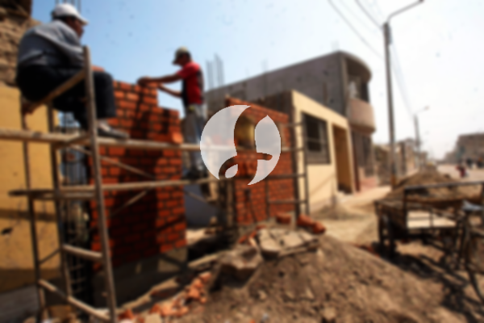

**Biaya Bangun Rumah Per Meter Di Pluit Jakarta** - Hai Mitra Sumber Material! Bagaimana kabar Anda semua? Kami dari Sumber Material hadir untuk memberikan solusi lengkap kebutuhan konstruksi Anda di Pluit Jakarta. Saat ini, layanan pembangunan rumah semakin banyak diminati seiring perkembangan zaman. Borongan pembangunan bangunan terus berkembang, termasuk layanan desain tempat tinggal. Ini membuat banyak orang lebih selektif dalam memilih jasa bangun rumah. Pertumbuhan populasi yang pesat secara otomatis meningkatkan kebutuhan akan hunian. Tak heran jika banyak pengembang properti berlomba-lomba membangun rumah, apartemen, atau perumahan dari berbagai kelas. Reputasi yang baik adalah kunci kepercayaan pembeli, sehingga jasa bangun rumah akan berupaya mempertahankan kualitas layanan yang telah diberikan. Dengan begitu, pekerjaan yang dipercayakan dapat diselesaikan dengan maksimal. Sebagai penyedia jasa borongan bangun rumah yang terpercaya, Kami menawarkan beragam layanan untuk membangun tempat tinggal impian Anda.



## Desain Rumah Impian dengan Layanan Arsitek Profesional di Pluit Jakarta

Sebagai penyedia jasa arsitek, Kami memberikan perhatian khusus pada desain rumah yang akan dibangun. Melalui desain yang matang, Kami berusaha menampilkan keindahan dan fungsionalitas rumah Anda. Beberapa faktor penting Kami perhatikan untuk menciptakan komposisi desain yang harmonis dan selaras. Seperti yang Anda ketahui, desain adalah elemen krusial dalam pembangunan rumah. Desain yang baik akan membuat rumah terlihat menarik dan berestetika. Anda tidak perlu khawatir, karena Kami akan menyesuaikan desain dengan anggaran yang Anda miliki. Dari desain tersebut, Anda dapat memperkirakan anggaran biaya yang dibutuhkan untuk mewujudkan rumah impian Anda. Selain itu, desain juga mempertimbangkan pemilihan material bangunan yang tepat. Proses ini memang membutuhkan keahlian khusus, itulah mengapa Anda perlu memilih jasa arsitek profesional. Dengan arsitek yang kompeten, Kami memahami keinginan Anda dan mewujudkannya menjadi kenyataan.

Harga jasa desain bangunan dari Kami bervariasi, tergantung pada luas bangunan dan kompleksitas desain yang diinginkan. Saat ini, harga jasa desain rumah minimalis satu lantai adalah Rp 54.000,- per meter persegi, sudah termasuk desain, RAB (Rencana Anggaran Biaya), dan dua kali revisi. Untuk bangunan dua lantai atau lebih, biayanya hanya dikalikan dua atau tiga, sesuai dengan jumlah lantai.

## Jasa Borong Renovasi Bangunan: Solusi Praktis di Pluit Jakarta

Setiap orang membutuhkan rumah sebagai tempat tinggal. Karena itu, banyak orang membutuhkan jasa bangun rumah yang menawarkan produk dan layanan terbaik. Di sinilah peran penting jasa bangun rumah dalam menangani tantangan pembangunan hunian. Dengan Kami, Anda akan mendapatkan layanan yang sesuai dengan harapan Anda. Memiliki rumah yang cantik adalah impian semua orang. Dengan menggunakan jasa borongan bangun rumah, Kami bantu mewujudkan mimpi tersebut. Anda tidak perlu repot mendesain rumah sendiri, karena Kami akan berusaha memahami keinginan Anda dan mewujudkannya dalam bentuk bangunan nyata. Kepuasan Anda adalah prioritas Kami, dan itu menjadi motivasi untuk terus berkarya lebih baik lagi. Dengan katalog proyek-proyek sebelumnya, Anda dapat melihat kualitas dan kemampuan Kami.

Untuk harga jasa borong bangun bangunan, Kami memiliki beberapa tingkatan harga, disesuaikan dengan material bangunan yang digunakan dan lokasi pembangunan. Dengan syarat lokasi tanah rata, stabil, dan tidak memerlukan pengurugan, harga per meter persegi dengan material dinding hebel adalah Rp 1.950.000,-, sementara dengan material bata merah adalah Rp 2.200.000,-. Harga tersebut mencakup pondasi batu kali, kolom dan tiang beton, lantai keramik standar, serta atap rangka baja ringan dengan genteng spandek. Untuk genteng dan keramik, Anda dapat menyesuaikan pilihan model dan kualitas sesuai budget.

## Jasa Perbaikan Rumah Profesional di Pluit Jakarta

Selain layanan arsitek dan pembangunan rumah baru, Kami juga menyediakan jasa renovasi rumah. Renovasi adalah cara efektif untuk mengubah tampilan rumah agar terlihat baru kembali. Dengan jasa renovasi rumah dari Kami, Anda tidak perlu khawatir lagi. Renovasi yang Kami lakukan dapat berupa perubahan model bangunan secara menyeluruh atau perbaikan bagian-bagian tertentu. Renovasi sering menjadi solusi bagi mereka yang ingin memperbarui tampilan rumah dengan biaya yang terjangkau. Namun, proses renovasi bisa rumit, itulah mengapa Anda membutuhkan jasa renovasi bangunan yang profesional. Kami siap membantu Anda merenovasi rumah menjadi lebih bagus dan indah dari sebelumnya, sesuai dengan impian Anda.

Harga borongan jasa renovasi rumah dari Kami bervariasi, tergantung pada kondisi kerusakan bangunan. Biaya disesuaikan dengan jenis kerusakan yang perlu diperbaiki. Untuk biaya jasa tukang harian, tarifnya adalah Rp 150.000,- per hari untuk tukang dan Rp 100.000,- per hari untuk kenek.

## Dukungan Tenaga Ahli: Tukang dan Arsitek Terbaik di Pluit Jakarta

Baik layanan arsitek, pembangunan rumah baru, maupun renovasi, semuanya memiliki peran penting. Didukung oleh arsitek profesional dan tenaga kerja yang handal, Kami akan membantu mewujudkan impian Anda. Membangun rumah idaman bersama Kami adalah investasi yang tepat, karena Kami menjamin kualitas dan pelayanan terbaik. Kepuasan pelanggan adalah motivasi utama Kami untuk terus berkembang dan memberikan karya yang lebih baik. Anda dapat melihat katalog proyek-proyek sebelumnya untuk membuktikan kualitas dan pengalaman Kami.

Rumah adalah kebutuhan pokok manusia, sama pentingnya dengan sandang dan pangan. Sebagai tempat berlindung dari cuaca ekstrem dan berbagai bahaya, rumah harus dibangun dengan baik dan aman. Hal ini menjadi peluang bagi penyedia jasa bangun rumah untuk menawarkan solusi terbaik. Sebagai penyedia jasa terpercaya, Kami berpartisipasi dalam perkembangan dunia arsitektur dengan menampilkan layanan Kami melalui berbagai media. Mulai dari media cetak hingga online, Kami hadir untuk memudahkan Anda dalam membangun rumah impian. Dengan menjaga kualitas dan pengalaman yang cukup lama, Kami semakin dipercaya oleh banyak orang.

Didukung oleh arsitek profesional dan tenaga kerja yang handal, Kami menjamin kualitas dan keandalan layanan Kami. Kami terus berinovasi dan memberikan karya-karya baru yang menarik. Banyak rumah dan bangunan yang telah Kami bangun dengan desain yang apik dan menarik. Dengan progres pengerjaan yang cepat, Anda akan segera merasakan kenyamanan di rumah impian Anda. Baik rumah skala kecil maupun besar, semua dapat Kami tangani dengan baik. Anda tidak perlu khawatir tentang desain, material, ukuran bangunan, maupun sumber daya manusia. Kami hadir untuk mendukung terwujudnya rumah impian Anda yang cantik dan nyaman. Disitulah peran penting dari jasa bangun rumah. Karena, Kami akan membuat suatu tata design, dan sekaligus pengawas pada pembangunan. Untuk informasi lebih lanjut dan pemesanan, silakan hubungi Kami melalui [hubungi Kami sekarang!](https://api.whatsapp.com/send?phone=6285776786091&text=*Halo%20sumbermaterial.com*%20%3A). Atau untuk melihat tabel harga yang lebih detail, kunjungi . Kami juga melayani [bangun rumah di Bidara Cina](/bangunan/biaya-bangun-rumah-per-meter-di-bidara-cina-jakarta/) dan [bangun rumah di Ancol](/bangunan/biaya-bangun-rumah-per-meter-di-ancol-jakarta/).
