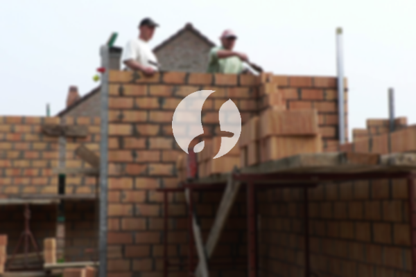

**Biaya Bangun Rumah Per Meter Di Pondok Bambu Jakarta** - Hai Mitra Sumber Material! Bagaimana kabar Anda? Kami dari Sumber Material hadir untuk membantu mewujudkan rumah impian Anda di Pondok Bambu Jakarta dan sekitarnya. Seiring perkembangan zaman, jasa membuat rumah kini semakin diminati. Layanan konstruksi benar-benar berkembang dan merambah ke layanan desain rumah. Ini menciptakan banyak orang lebih selektif dalam memilih jasa bangun rumah. Semakin banyak populasi, otomatis kebutuhan tempat tinggal juga meningkat. Oleh karena itu, para pelaku properti berlomba-lomba membangun rumah, apartemen, atau perumahan dari berbagai kelas. Dengan kepercayaan yang diberikan konsumen, layanan bangun rumah berkomitmen untuk mempertahankan trust tersebut dengan menyelesaikan pekerjaan yang diamanatkan. Dengan memberikan beberapa penawaran layanan dalam membangun rumah, Kami yakin dapat memberikan solusi terbaik untuk proyek Anda. Berikut adalah beberapa tipe layanan dari jasa bangun rumah yang bisa Anda pilih:



## Jasa Desain Gambar Arsitektur Di Pondok Bambu Jakarta

Sebagai penyedia jasa arsitek, Kami sangat memperhatikan desain sebuah rumah yang akan dibangun. Dengan desain yang matang, Kami berusaha menampilkan keindahan rumah tersebut. Untuk itu, Kami menggunakan beberapa faktor penting untuk menciptakan komposisi desain yang indah dan selaras. Desain tentu saja menjadi hal yang sangat penting untuk diperhatikan, karena desain yang baik akan membuat rumah tampak menarik. Anda tidak perlu khawatir, karena Kami dapat membuat desain yang sesuai dengan budget Anda. Dengan desain tersebut, Anda bisa memperkirakan budget biaya yang akan dikeluarkan untuk mewujudkan rumah impian Anda. Selain itu, desain juga harus mempertimbangkan material bangunan yang akan digunakan. Semua ini cukup kompleks, itulah mengapa Anda membutuhkan jasa arsitek yang profesional. Kami memahami keinginan Anda dan akan memberikan kepuasan maksimal pada setiap proyek di Pondok Bambu Jakarta.

Biaya jasa desain rumah Kami bervariasi tergantung pada luas rumah dan tingkat kesulitan desain yang diminta. Saat ini, Kami menetapkan harga per meter untuk jasa desain, termasuk perhitungan RAB dan 2 kali revisi. Untuk desain rumah minimalis satu lantai, biayanya adalah Rp54.000,- per meter. Sedangkan untuk rumah 2 lantai atau lebih, biayanya hanya dikali 2 atau 3 sesuai dengan jumlah lantai.

## Harga Jasa Borong Bangun Rumah Di Pondok Bambu Jakarta

Seperti yang kita ketahui, populasi bumi terus meningkat, sehingga kebutuhan akan tempat tinggal juga semakin besar. Banyaknya jasa bangun rumah yang hadir tentu menawarkan produk dan layanan terbaik bagi pelanggannya. Di sinilah peran utama dari layanan borong bangun rumah dalam menangani permasalahan pembangunan sebuah rumah. Dengan memilih Kami, Anda akan mendapatkan layanan bangun rumah yang sesuai dengan keinginan Anda. Memiliki rumah yang indah adalah impian semua orang. Dengan memanfaatkan layanan bangun rumah Kami, Anda akan dibantu mewujudkan impian tersebut. Dengan membangun rumah dengan Kami, Anda tidak perlu pusing mendesain sendiri. Kami senantiasa berusaha memahami harapan Anda dan mewujudkannya dalam bentuk bangunan impian Anda. Hal ini akan membuat Anda merasa puas dan semakin percaya pada layanan Kami di Pondok Bambu Jakarta.

Untuk jasa borong renovasi rumah, Kami memiliki beberapa tingkatan harga yang menyesuaikan dengan bahan bangunan yang digunakan dan lokasi pembangunan. Dengan syarat lokasi tanah dalam kondisi rata, stabil, dan tidak memerlukan pengurugan. Harga per meter dengan material dinding hebel adalah Rp1.950.000,-, sedangkan dengan material bata merah adalah Rp2.200.000,-. Harga tersebut sudah termasuk pondasi batu gunung, kolom dan tiang beton, lantai keramik standar, dan atap dengan rangka baja ringan plus genteng spandek. Untuk genteng dan keramik, Anda dapat memilih jenis, model, dan kualitas lain yang berbeda, dengan biaya yang menyesuaikan.

## Harga Layanan Renovasi Rumah Di Pondok Bambu Jakarta

Selain layanan arsitek dan bangun rumah, Kami juga menyediakan jasa renovasi bangunan. Borongan renovasi bangunan adalah cara yang efektif untuk mengubah tampilan rumah Anda menjadi lebih segar. Dengan adanya layanan renovasi rumah, Anda tidak perlu bingung menentukan cara renovasi. Kami melakukan renovasi dengan mengubah model bentuk rumah atau melakukan perubahan menyeluruh. Renovasi memang menjadi solusi untuk mempercantik rumah dengan anggaran yang terjangkau, namun terkadang sulit dilakukan sendiri. Namun, dengan adanya jasa renovasi rumah, semua itu dapat diatasi. Kami hadir sebagai layanan renovasi bangunan yang akan membantu Anda merenovasi bangunan agar lebih bagus dan menarik dari sebelumnya. Kami siap mewujudkan bangunan impian Anda di Pondok Bambu Jakarta.

Harga borongan renovasi rumah Kami bervariasi tergantung pada kondisi kerusakan bangunan. Jadi, biaya borongan renovasi bangunan disesuaikan dengan tipe kerusakan yang akan diperbaiki. Namun, untuk biaya jasa renovasi dengan tenaga tukang harian, harganya adalah Rp150.000,- per hari untuk tukang dan Rp100.000,- per hari untuk kenek.

## Disupport Tenaga Kerja Dan Arsitek Terbaik Di Pondok Bambu Jakarta

Baik layanan arsitek, bangun rumah, maupun renovasi bangunan, semuanya memiliki peran yang cukup penting. Dengan didukung oleh arsitek profesional dan tenaga kerja yang handal, Kami dapat membantu mewujudkan impian Anda. Dengan membangun rumah impian bersama Kami, Anda akan memiliki rumah yang menarik dan berkualitas. Anda tidak perlu khawatir, karena Kami memberikan pelayanan terbaik, menjaga mutu, dan memberikan kepuasan maksimal. Sebagai penyedia jasa bangun rumah, kepuasan pelanggan adalah motivasi Kami untuk terus berkarya dengan hasil yang lebih baik. Melalui katalog proyek Kami, Anda dapat melihat hasil karya desain dan konstruksi Kami, yang membuktikan bahwa Kami adalah pilihan terbaik dan terpercaya.

Perlu diingat, rumah adalah kebutuhan utama manusia setelah sandang dan pangan. Rumah adalah tempat berlindung dari cuaca ekstrem dan berbagai bahaya. Hal ini menjadi peluang bagi penyedia jasa bangun rumah untuk menawarkan jasanya. Kami sebagai penyedia jasa, khususnya dalam bidang bangun rumah, berpartisipasi dalam meramaikan dunia arsitektur yang terus berkembang dengan menawarkan jasa melalui berbagai media. Mulai dari media cetak hingga online, semua Kami gunakan untuk menawarkan layanan bangun rumah di Pondok Bambu Jakarta. Dengan menjaga mutu dan kualitas terbaik, Kami telah terbukti memiliki pengalaman yang cukup lama dalam dunia arsitektur. Inilah yang membuat Kami semakin dipercaya oleh banyak orang.

Didukung oleh arsitek profesional dan tenaga kerja yang handal, Kami mampu mewujudkan layanan bangun rumah yang semakin dikenal dan terpercaya. Hal ini terlihat dari perkembangan yang selalu Kami berikan. Kami terus berkarya menciptakan karya-karya baru yang lebih inovatif dan kreatif. Banyak bangunan yang dibangun dengan desain apik dan menarik menggunakan layanan Kami. Dengan cara pengerjaan yang cepat, Anda akan segera mendapatkan rumah impian Anda. Baik bangunan berskala kecil maupun besar, semua dapat Kami kendalikan. Jadi, Anda tidak perlu khawatir. Mulai dari desain rumah, material bangunan, ukuran rumah, hingga tenaga kerja, semua dapat Kami atasi. Sehingga, Kami dapat mendukung terwujudnya rumah yang cantik dan menarik. Di sinilah peran penting dari layanan bangun rumah Kami. Kami akan menciptakan tata desain sekaligus mengawasi seluruh proses pembangunan. [Hubungi Kami Sekarang](https://api.whatsapp.com/send?phone=6285776786091&text=*Halo%20sumbermaterial.com*%20%3A)
