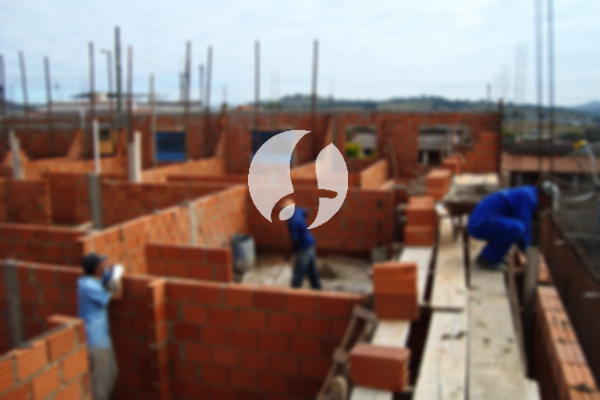

**Biaya Bangun Rumah Per Meter Di Pondok Petir Depok** - Hai Mitra Sumber Material! Bagaimana kabarnya? Seiring perubahan zaman, kebutuhan akan layanan konstruksi semakin meningkat. Banyak yang kini memilih jasa bangun rumah untuk mewujudkan impian memiliki hunian ideal. Peningkatan populasi juga mendorong permintaan akan rumah yang terus bertambah. Hal ini memicu persaingan positif di kalangan pelaku properti untuk menawarkan berbagai solusi pembangunan – mulai dari rumah minimalis hingga mewah. Kepercayaan pelanggan adalah segalanya, dan Kami sebagai penyedia jasa bangun rumah berkomitmen untuk menjaganya dengan memberikan hasil terbaik. Kami menawarkan beragam layanan yang bisa Anda pilih untuk membangun rumah impian Anda.



## Jasa Desain Gambar Arsitek Profesional Di Pondok Petir Depok

Sebagai penyedia jasa desain arsitek, Kami selalu mengutamakan estetika dan fungsi dalam setiap rancangan bangunan. Dengan desain yang tepat, rumah Anda tidak hanya indah secara visual, tetapi juga nyaman dan efisien. Kami menggunakan berbagai faktor penting untuk menciptakan komposisi desain yang harmonis dan sesuai dengan kebutuhan Anda. Desain adalah jantung dari sebuah proyek pembangunan, dan Kami memahami betul pentingnya aspek ini. Kami akan membantu Anda mewujudkan desain rumah yang sesuai dengan anggaran yang Anda miliki. Dengan desain yang jelas, Anda bisa memperkirakan biaya yang dibutuhkan untuk mewujudkan rumah impian Anda. Selain itu, Kami juga akan mempertimbangkan pemilihan material yang tepat untuk memastikan kualitas dan daya tahan bangunan. Anda tidak perlu khawatir, karena Kami akan memahami keinginan Anda dan menerjemahkannya ke dalam desain yang memuaskan.

Namun, harga jasa desain rumah Kami bervariasi tergantung pada luas bangunan dan kerumitan desain yang diinginkan. Saat ini, Kami menawarkan harga jasa desain rumah minimalis satu lantai mulai dari Rp 54.000,- per meter persegi, sudah termasuk desain, kalkulasi RAB (Rencana Anggaran Biaya), dan dua kali revisi. Untuk rumah dua lantai atau lebih, biayanya hanya dikalikan dua atau tiga sesuai dengan jumlah lantai.

## Jasa Borong Bangun Rumah Terpercaya Di Pondok Petir Depok

Seiring bertambahnya populasi, kebutuhan akan tempat tinggal semakin mendesak. Banyak orang yang mencari layanan borong bangun rumah untuk mendapatkan hunian yang nyaman dan berkualitas. Di sinilah peran utama Kami sebagai penyedia jasa bangunan untuk menangani permasalahan tersebut. Kami akan membantu Anda mewujudkan rumah impian Anda dengan layanan yang sesuai dengan kebutuhan Anda. Memiliki rumah yang indah adalah keinginan semua orang, dan Kami siap membantu Anda mewujudkannya. Dengan menggunakan jasa borong bangun rumah Kami, Anda tidak perlu repot mendesain rumah sendiri. Kami selalu berusaha memahami keinginan Anda dan mewujudkannya dalam bentuk bangunan yang nyata dan memuaskan. Kepuasan Anda adalah prioritas utama Kami, dan Kami akan terus berupaya untuk meningkatkan kualitas layanan Kami.

Untuk harga layanan borong bangun rumah Kami, Kami menawarkan beberapa tingkatan harga yang disesuaikan dengan material bangunan yang digunakan dan lokasi pembangunan. Dengan syarat lokasi tanah yang rata, stabil, dan tidak memerlukan pengurugan, harga per meter persegi dengan material dinding hebel adalah Rp 1.950.000,-, sedangkan dengan material bata merah adalah Rp 2.200.000,-. Harga tersebut sudah termasuk pondasi batu kali, kolom dan tiang beton, lantai keramik standar, serta atap dengan rangka baja ringan dan genteng spandek. Anda juga bisa memilih jenis genteng dan keramik lain sesuai dengan preferensi Anda, dengan penyesuaian biaya sesuai dengan kualitas dan model yang dipilih.

## Layanan Renovasi Rumah Berkualitas Di Pondok Petir Depok

Selain jasa arsitek dan bangun rumah, Kami juga menyediakan layanan renovasi rumah. Renovasi adalah solusi yang tepat untuk menyegarkan tampilan rumah Anda. Dengan adanya jasa renovasi bangunan, Anda tidak perlu khawatir tentang proses renovasi rumah Anda. Kami menawarkan renovasi yang bisa berupa perubahan bentuk model rumah, atau renovasi total. Renovasi memang bisa menjadi alternatif untuk memperbarui tampilan rumah tanpa harus mengeluarkan biaya yang besar. Namun, terkadang seseorang kesulitan melakukan renovasi sendiri karena anggaran terbatas. Dengan adanya jasa renovasi rumah dari Kami, semua masalah ini bisa diatasi. Kami siap membantu Anda merenovasi rumah Anda menjadi lebih segar dan menarik.

Untuk biaya borongan renovasi rumah Kami, harganya bervariasi tergantung pada kondisi kerusakan rumah Anda. Kami akan menyesuaikan biaya dengan jenis kerusakan yang akan diperbaiki. Namun, untuk biaya jasa renovasi dengan tenaga tukang harian, harganya adalah Rp 150.000,- per hari untuk tukang dan Rp 100.000,- per hari untuk kenek.

## Didukung Tenaga Kerja dan Arsitek Terbaik Di Pondok Petir Depok

Baik layanan arsitek, bangun rumah, maupun renovasi, semuanya memiliki peran penting dalam mewujudkan rumah impian Anda. Kami didukung oleh arsitek profesional dan tenaga kerja yang handal, sehingga Kami dapat membantu Anda mewujudkan impian tersebut. Dengan membangun rumah bersama Kami, Anda akan memiliki hunian yang menarik dan tentunya nyaman. Kami selalu memberikan pelayanan terbaik, menjaga kualitas dan ketepatan waktu untuk memberikan kepuasan kepada Anda. Kepuasan pelanggan adalah motivasi Kami untuk terus berkarya dan menghasilkan karya-karya yang lebih baik. Anda bisa melihat katalog proyek Kami untuk membuktikan kualitas pekerjaan Kami.

Perlu diketahui bahwa rumah adalah kebutuhan pokok manusia selain sandang dan pangan. Rumah memberikan perlindungan dari cuaca ekstrem dan berbagai bahaya. Hal ini menjadi kesempatan bagi Kami sebagai penyedia jasa bangunan untuk menawarkan layanan Kami. Sebagai penyedia jasa khusus dalam bidang bangunan, Kami berpartisipasi dalam memajukan dunia arsitektur dengan menampilkan layanan Kami melalui berbagai media, baik cetak maupun online. Ini membantu banyak orang yang ingin mewujudkan rumah impian mereka. Dengan mempertahankan kualitas terbaik, Kami telah memiliki pengalaman yang cukup lama dalam menggeluti dunia arsitektur. Inilah alasan mengapa banyak orang mempercayai Kami.

Didukung oleh arsitek profesional dan tenaga kerja yang handal, Kami semakin dikenal sebagai penyedia jasa bangunan yang terpercaya. Perkembangan yang berkelanjutan menunjukkan kemampuan Kami. Kami sering menghasilkan karya-karya baru yang inovatif dan kreatif. Banyak bangunan yang Kami bangun dengan desain yang apik dan menarik. Dengan proses pengerjaan yang efisien, Anda akan segera mendapatkan rumah impian Anda. Dimulai dari desain bangunan, pemilihan material, ukuran rumah, dan sumber daya manusia, semua bisa Kami atasi dengan baik. Hingga, Kami mendukung terwujudnya rumah yang cantik dan menarik. Disitulah peran penting Kami. Kami akan membuat tata desain dan sekaligus mengawasi proses pembangunan untuk memastikan kualitas dan kepuasan Anda. Jika Anda tinggal di sekitar Pondok Petir Depok, jangan ragu untuk menghubungi Kami. [Hubungi Kami Sekarang!](https://api.whatsapp.com/send?phone=6285776786091&text=*Halo%20sumbermaterial.com*%20%3A) Anda juga bisa melihat layanan [bangun rumah di Abadijaya](/bangunan/biaya-bangun-rumah-per-meter-di-abadijaya-depok/) untuk bangun rumah di Abadijaya atau [bangun rumah di Bedahan](/bangunan/biaya-bangun-rumah-per-meter-di-bedahan-depok/) untuk bangun rumah di Bedahan.
