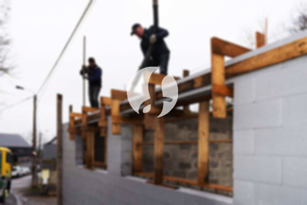

**Biaya Bangun Rumah Per Meter Di Pondok Pinang Jakarta** - Hai Mitra Sumber Material! Gimana kabarnya hari ini? Kami dari Sumber Material hadir untuk memberikan solusi lengkap kebutuhan konstruksi Anda di Pondok Pinang Jakarta. Seiring perkembangan zaman, jasa membuat tempat tinggal semakin diminati. Jasa membangun rumah kini berkembang pesat, menawarkan layanan desain hingga konstruksi. Artinya, banyak orang lebih selektif memilih layanan bangun rumah yang tepat. Peningkatan jumlah penduduk otomatis meningkatkan kebutuhan akan tempat tinggal. Tak heran, pengembang properti berlomba-lomba membangun rumah, apartemen, dan perumahan dengan berbagai pilihan. Dengan kepercayaan yang diberikan konsumen, jasa bangun rumah berkomitmen untuk memberikan layanan terbaik. Kami menjalankan pekerjaan sesuai amanah, menawarkan solusi konstruksi yang terpercaya. Berikut adalah beberapa layanan yang kami tawarkan untuk membangun rumah impian Anda:



## Harga Design Gambar Arsitek Di Pondok Pinang Jakarta

Sebagai penyedia jasa arsitek terpercaya di Pondok Pinang Jakarta, Kami memperhatikan betul desain suatu bangunan. Melalui desain yang cermat, Kami berupaya menampilkan keindahan rumah yang Anda impikan. Untuk itu, Kami mempertimbangkan beberapa faktor penting dalam menciptakan komposisi desain yang selaras dan menarik. Desain memang krusial—rumah dengan desain yang baik akan terlihat cantik dan nyaman. Anda tak perlu khawatir, karena Kami dapat membuat desain sesuai anggaran yang Anda miliki. Dari desain tersebut, Anda bisa memperkirakan biaya yang dibutuhkan untuk mewujudkan rumah impian Anda. Selain itu, desain yang Kami buat juga mempertimbangkan pemilihan bahan bangunan yang tepat. Semua proses ini cukup kompleks, itulah mengapa Anda membutuhkan jasa arsitek profesional. Kami memahami keinginan Anda dan mewujudkannya dalam desain yang memuaskan.

Harga jasa desain rumah Kami bervariasi, tergantung luas bangunan dan tingkat kerumitan desain. Saat ini, Kami menawarkan harga per meter. Untuk desain rumah minimalis satu lantai, harganya mulai dari Rp 54.000,- per meter persegi. Harga tersebut sudah termasuk desain, perhitungan RAB (Rencana Anggaran Biaya), dan dua kali revisi. Sedangkan untuk rumah dua lantai atau lebih, harganya bisa dikalikan dua atau tiga, sesuai jumlah lantai.

## Jasa Borong Bangun Rumah Di Pondok Pinang Jakarta

Kebutuhan akan tempat tinggal adalah kebutuhan dasar manusia. Semakin banyak orang, semakin banyak pula permintaan akan jasa bangun rumah. Kami hadir sebagai solusi bagi Anda yang ingin membangun rumah impian di Pondok Pinang Jakarta. Dengan banyaknya pilihan jasa bangun rumah, penting untuk menemukan penyedia yang sesuai harapan Anda. Memiliki rumah yang indah adalah impian semua orang. Dengan mempercayakan pembangunan rumah Anda kepada Kami, Anda bisa mewujudkan impian tersebut tanpa perlu repot. Kami akan membantu Anda mendesain rumah sesuai keinginan, sehingga Anda tidak perlu khawatir tentang proses desain. Kami selalu berusaha memahami kebutuhan Anda dan mewujudkannya dalam bentuk rumah impian. Kepuasan Anda adalah prioritas Kami, dan itu menjadi motivasi Kami untuk terus memberikan layanan terbaik.

Untuk layanan borong bangun rumah, Kami menawarkan beberapa tingkatan harga yang disesuaikan dengan bahan bangunan dan lokasi proyek di Pondok Pinang Jakarta. Dengan syarat lahan dalam kondisi rata, stabil, dan tidak memerlukan pengurugan. Harga per meter persegi dengan material dinding hebel adalah Rp 1.950.000,-, sedangkan dengan material bata merah adalah Rp 2.200.000,-. Harga tersebut sudah termasuk pondasi batu kali, kolom dan tiang beton, lantai keramik standar, dan atap dengan rangka baja ringan plus genteng spandek. Untuk jenis genteng dan keramik, Anda bisa memilih sesuai preferensi, model, kualitas, dan anggaran Anda.

## Harga Jasa Renovasi Rumah Di Pondok Pinang Jakarta

Selain layanan desain dan bangun rumah, Kami juga menyediakan jasa renovasi rumah di Pondok Pinang Jakarta. Renovasi adalah cara yang efektif untuk memperbarui tampilan rumah Anda. Dengan adanya jasa renovasi, Anda tidak perlu bingung menentukan langkah renovasi. Kami melakukan renovasi dengan cara mengubah bentuk model bangunan atau merenovasi secara menyeluruh. Renovasi menjadi pilihan bagi mereka yang ingin mempercantik rumah dengan anggaran terjangkau. Namun, renovasi terkadang bisa menjadi tantangan. Dengan adanya jasa renovasi rumah profesional, semua masalah tersebut dapat teratasi. Kami siap mengubah bangunan Anda menjadi lebih indah dan sesuai impian Anda.

Untuk harga borongan jasa renovasi, Kami memberikan harga yang berbeda-beda, tergantung pada kondisi kerusakan bangunan. Kami akan menyesuaikan biaya berdasarkan jenis kerusakan yang perlu diperbaiki. Namun, untuk harga jasa renovasi dengan tenaga tukang harian, tarifnya adalah Rp 150.000,- per hari untuk tukang dan Rp 100.000,- per hari untuk kenek.

## Disupport Tenaga Kerja Dan Arsitek Berpengalaman Di Pondok Pinang Jakarta

Baik jasa arsitek, jasa bangun rumah, maupun jasa renovasi, semuanya memiliki peran yang sangat penting dalam mewujudkan proyek konstruksi yang sukses. Dengan dukungan arsitek profesional dan tenaga kerja yang handal, Kami dapat membantu mewujudkan impian Anda. Membangun rumah impian bersama Kami akan memberikan Anda rumah yang menarik dan berkualitas. Anda tidak perlu khawatir, karena Kami memberikan pelayanan terbaik, menjaga mutu dan kualitas, serta mengutamakan kepuasan Anda. Sebagai jasa bangun rumah yang terpercaya, kepuasan pelanggan adalah motivasi Kami untuk terus berkarya dan memberikan hasil yang lebih baik. Melalui portofolio proyek Kami, Anda dapat melihat hasil karya desain dan konstruksi yang telah Kami kerjakan. Ini membuktikan bahwa Kami adalah pilihan terbaik dan terpercaya untuk proyek Anda.

Perlu diingat, rumah adalah kebutuhan penting bagi manusia, selain sandang dan pangan. Rumah menjadi tempat berlindung dari cuaca ekstrem dan berbagai bahaya. Hal ini menjadi peluang bagi penyedia jasa bangun rumah untuk menawarkan layanannya. Sebagai penyedia jasa di Pondok Pinang Jakarta, Kami berpartisipasi dalam mengembangkan dunia arsitektur dengan mempromosikan layanan Kami melalui berbagai media, baik cetak maupun online. Ini membantu orang-orang yang ingin membangun rumah menemukan solusi yang tepat. Dengan menjaga mutu dan kualitas terbaik, Kami telah terbukti memiliki pengalaman yang cukup lama dalam dunia arsitektur. Itulah mengapa Kami semakin dipercaya oleh banyak orang.

Didukung oleh arsitek profesional dan tenaga kerja yang handal, Kami semakin dikenal sebagai penyedia jasa bangun rumah yang kompeten. Hal ini terlihat dari perkembangan yang terus Kami berikan. Kami terus berkarya mewujudkan karya-karya baru yang inovatif dan kreatif. Banyak bangunan dengan desain apik dan menarik telah Kami bangun. Dengan proses pengerjaan yang efisien, Anda dapat segera memiliki rumah impian Anda. Kami mampu menangani bangunan dengan berbagai skala, baik kecil maupun besar. Jadi, Anda tidak perlu khawatir atau ragu. Kami dapat membantu Anda dalam segala aspek pembangunan, mulai dari desain, material, ukuran, hingga sumber daya manusia. Itulah peran penting Kami sebagai jasa bangun rumah. Kami membuat tata desain dan sekaligus mengawasi proses pembangunan. [Hubungi Kami Sekarang](https://api.whatsapp.com/send?phone=6285776786091&text=*Halo%20sumbermaterial.com*%20%3A) untuk konsultasi gratis!
