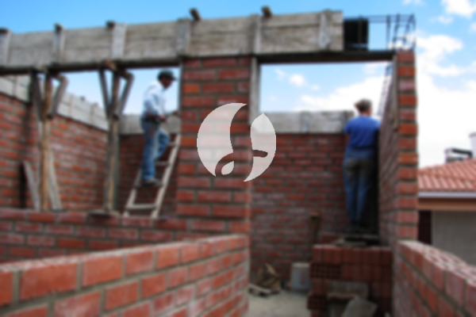

**Biaya Bangun Rumah Per Meter Di Pontang Serang** - Hai Mitra Sumber Material! Gimana kabarnya? Kami dari Sumber Material hadir sebagai solusi terpercaya untuk kebutuhan konstruksi Anda di Pontang Serang. Seiring dengan perkembangan zaman, jasa bangun rumah semakin diminati. Perkembangan ini juga memicu inovasi dalam layanan desain rumah, membuat banyak orang lebih selektif dalam memilih penyedia jasa. Pertumbuhan populasi juga berdampak langsung pada meningkatnya kebutuhan akan tempat tinggal – dari perumahan sederhana hingga apartemen mewah. Oleh karena itu, penyedia jasa bangun rumah terus berusaha membangun kepercayaan pelanggan dan memberikan layanan terbaik. Nah, sebagai penyedia jasa bangun rumah yang terpercaya, Kami menawarkan berbagai pilihan layanan untuk mendukung proyek Anda. Berikut beberapa tipe layanan yang bisa Anda pilih:



## Harga Desain Gambar Arsitek Di Pontang Serang

Sebagai penyedia jasa arsitek, Kami mengutamakan visualisasi desain rumah impian Anda. Kami berupaya menciptakan keindahan dan kenyamanan dalam setiap detail desain. Untuk mewujudkannya, Kami mempertimbangkan berbagai faktor penting agar komposisi desain tampak cantik dan harmonis. Desain yang baik adalah fondasi utama sebuah bangunan yang menarik. Anda tidak perlu khawatir, karena Kami akan menyesuaikan desain dengan anggaran yang Anda miliki. Dari desain yang dibuat, Anda dapat memperkirakan biaya yang dibutuhkan untuk mewujudkan hunian idaman Anda. Selain itu, desain juga perlu mempertimbangkan pemilihan material bangunan yang tepat. Semua aspek ini memang memerlukan keahlian khusus, itulah mengapa Anda sebaiknya memilih jasa arsitek profesional. Kami memahami keinginan Anda dan akan mewujudkannya menjadi kenyataan.

Harga jasa desain bangunan Kami bervariasi, tergantung pada luas rumah dan tingkat kesulitan desain yang diinginkan. Saat ini, Kami menawarkan harga per meter untuk jasa desain rumah. Harga jasa desain rumah minimalis satu lantai adalah Rp 54.000,- per meter, sudah termasuk desain, data RAB, dan 2 kali revisi. Untuk rumah dua lantai atau lebih, harga hanya dikalikan 2 atau 3 sesuai jumlah lantai.

## Layanan Borong Renovasi Tempat Tinggal Di Pontang Serang

Seperti yang kita ketahui, kebutuhan akan tempat tinggal adalah kebutuhan dasar manusia. Ketersediaan jasa bangun rumah yang melimpah mendorong mereka untuk menawarkan produk dan layanan terbaik kepada pelanggan. Di sinilah peran penting Kami sebagai jasa bangun rumah dalam menangani berbagai permasalahan konstruksi. Dengan mempercayakan proyek Anda kepada Kami, Anda akan mendapatkan layanan yang sesuai dengan kebutuhan Anda. Memiliki rumah yang indah adalah impian setiap orang. Dengan bantuan Kami, Anda tidak perlu repot mendesain rumah sendiri. Kami selalu berusaha memahami harapan Anda dan mewujudkannya dalam bentuk karya nyata, yaitu rumah impian Anda. Kepuasan Anda adalah prioritas Kami, dan itu menjadi motivasi Kami untuk terus memberikan yang terbaik.

Untuk ongkos borong renovasi tempat tinggal, Kami menawarkan beberapa pilihan harga yang disesuaikan dengan material bangunan yang digunakan dan lokasi proyek di Pontang Serang. Dengan asumsi lahan tanah dalam kondisi rata, stabil, dan tidak memerlukan pengurukan, maka harga per meter untuk material dinding hebel adalah Rp 1.950.000,-, sementara untuk material bata merah adalah Rp 2.200.000,-. Harga ini sudah termasuk pondasi batu gunung, kolom dan tiang beton, lantai keramik standar, serta atap dengan rangka baja ringan dan genteng spandek. Pilihan genteng dan keramik dapat disesuaikan dengan preferensi Anda – model, kualitas, dan harga dapat dibicarakan lebih lanjut.

## Harga Layanan Renovasi Tempat Tinggal Di Pontang Serang

Selain jasa arsitek dan borongan bangun rumah, Kami juga menyediakan jasa renovasi bangunan. Renovasi adalah cara yang efektif untuk menyegarkan tampilan rumah Anda. Dengan bantuan jasa renovasi bangunan, Anda tidak perlu khawatir tentang proses renovasi rumah Anda. Kami menawarkan teknik renovasi yang bervariasi, mulai dari perubahan tampilan bangunan hingga renovasi total. Renovasi memang menjadi pilihan yang menarik untuk mempercantik rumah Anda dengan biaya yang terjangkau. Namun, terkadang renovasi dapat terasa sulit dilakukan sendiri. Itulah mengapa Kami hadir sebagai solusi renovasi rumah yang memudahkan Anda. Kami siap membantu Anda mewujudkan rumah impian Anda dengan tampilan yang lebih baik dan menarik dari sebelumnya.

Biaya borongan renovasi rumah Kami bervariasi, tergantung pada kondisi kerusakan bangunan yang akan diperbaiki. Karena setiap rumah memiliki tingkat kerusakan yang berbeda, biaya borongan renovasi rumah akan disesuaikan dengan jenis kerusakan yang akan ditangani. Namun, untuk biaya jasa renovasi dengan tenaga tukang harian, harganya adalah Rp 150.000,- per hari untuk tukang dan Rp 100.000,- per hari untuk kenek.

## Disupport Tenaga Kerja Dan Arsitek Terbaik Di Pontang Serang

Baik layanan arsitek, borongan bangun rumah, maupun renovasi bangunan, semuanya memiliki peran penting dalam menciptakan hunian impian Anda. Dengan dukungan arsitek profesional dan tenaga kerja yang handal, Kami akan membantu Anda mewujudkan impian tersebut. Membangun rumah impian bersama Kami akan memberikan Anda rumah yang menarik dan nyaman. Anda tidak perlu khawatir, karena Kami berkomitmen untuk memberikan pelayanan terbaik, mempertahankan kualitas, dan memberikan kepuasan maksimal kepada Anda. Kepuasan Anda adalah penyemangat Kami untuk terus berkarya dan menghasilkan karya yang lebih baik lagi. Anda dapat melihat katalog proyek Kami untuk membuktikan kualitas dan kemampuan Kami.

Perlu diingat, rumah adalah kebutuhan utama manusia setelah sandang dan pangan. Rumah menjadi tempat berlindung dari cuaca ekstrem dan berbagai bahaya. Hal ini menjadi peluang bagi penyedia jasa bangun rumah untuk menawarkan jasanya. Sebagai penyedia jasa terpercaya, Kami berpartisipasi aktif dalam meramaikan dunia arsitektur yang terus berkembang dengan menawarkan layanan melalui berbagai media, baik cetak maupun online. Ini tentu memudahkan Anda dalam mewujudkan hunian impian Anda. Dengan memprioritaskan kualitas dan pengalaman, Kami telah terbukti memiliki rekam jejak yang baik dalam dunia arsitektur. Itulah mengapa semakin banyak orang mempercayakan proyek mereka kepada Kami.

Didukung oleh arsitek profesional dan tenaga kerja yang handal, Kami terus meningkatkan kualitas layanan Kami. Perkembangan yang kami berikan tercermin dalam karya-karya inovatif dan kreatif. Banyak rumah dan bangunan yang Kami bangun dengan desain yang apik dan menarik. Proses pengerjaan yang efisien memungkinkan Anda untuk segera menikmati rumah impian Anda. Baik itu rumah berskala kecil maupun besar, Kami mampu mengendalikan proyek dengan baik. Oleh karena itu, Anda tidak perlu khawatir atau ragu. Mulai dari desain bangunan, pemilihan material, menentukan ukuran bangunan, hingga manajemen sumber daya manusia, semuanya dapat Kami atasi. Sehingga, Kami dapat mendukung terwujudnya rumah yang cantik dan menarik. Disinilah peran penting Kami sebagai jasa bangun rumah. Kami akan menciptakan rancangan yang sesuai dengan keinginan Anda, sekaligus menjadi pengawas selama proses pembangunan. [Hubungi Kami](https://api.whatsapp.com/send?phone=6285776786091&text=*Halo%20sumbermaterial.com*%20%3A) sekarang juga untuk konsultasi gratis! Kami siap membantu Anda mewujudkan impian rumah Anda di Pontang Serang.
