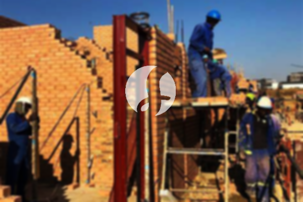

**Biaya Bangun Rumah Per Meter Di Pulo Gadung Jakarta** - Hai Mitra Sumber Material! Gimana kabarnya? Kami dari Sumber Material hadir untuk membantu Anda mewujudkan tempat tinggal impian di Pulo Gadung Jakarta. Seiring perkembangan zaman, kebutuhan akan layanan pembangunan rumah semakin meningkat. Pilihan jasa bangun rumah pun semakin beragam, memberikan kemudahan bagi Anda dalam mewujudkan rumah idaman. Dengan persaingan yang sehat, penyedia jasa konstruksi berlomba-lomba menawarkan layanan terbaik dan menjaga kepercayaan pelanggan. Kami sebagai borongan bangun rumah yang terpercaya akan memberikan penawaran yang sesuai dengan kebutuhan Anda. Ada beberapa layanan utama yang bisa Anda pilih untuk membangun rumah impian Anda di Pulo Gadung Jakarta:



## Jasa Desain Gambar Arsitek Profesional di Pulo Gadung Jakarta

Sebagai penyedia jasa arsitek, Kami akan memperhatikan desain bangunan secara detail. Desain yang baik akan memberikan keindahan dan kenyamanan pada rumah Anda. Kami akan menggabungkan berbagai faktor penting untuk menciptakan komposisi desain yang harmonis dan sesuai dengan harapan Anda. Desain adalah aspek krusial dalam pembangunan rumah, karena menentukan tampilan dan estetika bangunan. Dengan desain yang tepat, rumah Anda akan terlihat menarik dan berkarakter. Kami akan menciptakan desain yang selaras dengan anggaran yang Anda miliki. Dengan desain yang jelas, Anda dapat memperkirakan biaya yang dibutuhkan untuk mewujudkan rumah impian Anda. Selain itu, Kami juga mempertimbangkan material bangunan yang akan digunakan agar sesuai dengan desain dan anggaran Anda. Proses desain memang membutuhkan ketelitian dan keahlian khusus, sehingga Kami sarankan Anda memilih jasa arsitek profesional. Dengan memilih Kami, Anda akan mendapatkan desain yang sesuai dengan keinginan Anda dan kami akan mewujudkannya.

Biaya jasa desain rumah Kami bervariasi, tergantung pada luas rumah dan kerumitan desain yang Anda inginkan. Saat ini, Kami menawarkan harga jasa desain dengan sistem per meter persegi. Biaya jasa desain rumah minimalis satu lantai adalah Rp54.000,- per meter persegi, sudah termasuk desain, data RAB (Rencana Anggaran Biaya), dan 2 kali revisi. Untuk rumah dua lantai atau lebih, biayanya dapat dikalikan 2 atau 3 sesuai dengan jumlah lantai.

## Jasa Borong Bangun Rumah Terpercaya di Pulo Gadung Jakarta

Banyak orang yang mendambakan memiliki rumah sendiri sebagai tempat tinggal yang nyaman dan aman. Dengan banyaknya pilihan jasa bangun rumah yang tersedia, Anda dapat menemukan mitra yang tepat untuk mewujudkan impian tersebut. Kami hadir sebagai solusi untuk menangani permasalahan pembangunan rumah Anda. Dengan memilih Kami, Anda akan mendapatkan jasa bangun rumah yang sesuai dengan harapan Anda. Memiliki rumah yang cantik adalah impian setiap orang. Dengan menggunakan jasa borong bangun rumah, Kami akan membantu Anda mewujudkan impian tersebut. Kami akan mendengarkan keinginan Anda dan mewujudkannya dalam bentuk karya nyata berupa rumah impian Anda. Dengan begitu, Anda akan merasa puas dan yakin dengan kualitas layanan yang Kami berikan.

Untuk harga jasa borong pembangunan rumah, Kami menawarkan beberapa pilihan sesuai dengan material dan lokasi pembangunan. Dengan asumsi lokasi tanah dalam keadaan rata, stabil, dan tidak memerlukan pengurukan, harga per meter persegi menggunakan material dinding hebel adalah Rp1.950.000,-, sedangkan dengan material bata merah adalah Rp2.200.000,-. Harga tersebut sudah termasuk pondasi batu kali, kolom dan tiang beton, lantai keramik standar, serta atap dengan rangka baja ringan dan genteng spandek. Anda juga dapat menyesuaikan jenis genteng dan keramik sesuai dengan preferensi Anda, dengan penyesuaian harga yang berlaku.

## Jasa Renovasi Bangunan Profesional di Pulo Gadung Jakarta

Selain jasa arsitek dan jasa bangun rumah, Kami juga menyediakan layanan renovasi bangunan. Renovasi rumah adalah cara yang efektif untuk mengubah tampilan rumah Anda menjadi lebih segar dan modern. Dengan adanya jasa renovasi rumah, Anda tidak perlu khawatir tentang proses renovasi yang rumit. Kami menawarkan renovasi dengan berbagai teknik, mulai dari perubahan bentuk model bangunan hingga renovasi total. Renovasi dapat menjadi alternatif yang hemat biaya untuk memperbarui tampilan rumah Anda. Namun, seringkali seseorang kesulitan menjalankan renovasi rumah karena keterbatasan anggaran. Dengan adanya jasa renovasi rumah, Kami akan membantu Anda mengatasi masalah tersebut. Kami hadir sebagai solusi renovasi rumah yang akan membantu Anda menciptakan rumah yang lebih segar dan menarik dari sebelumnya, sesuai dengan impian Anda.

Harga borongan jasa renovasi rumah Kami bervariasi, tergantung pada kondisi kerusakan bangunan. Oleh karena itu, biaya borongan renovasi bangunan akan disesuaikan dengan tipe kerusakan yang akan diperbaiki. Untuk jasa renovasi dengan tenaga tukang harian, Kami memberikan harga Rp150.000,- per hari untuk tukang dan Rp100.000,- per hari untuk kenek.

## Dukungan Tenaga Kerja dan Arsitek Berpengalaman di Pulo Gadung Jakarta

Baik jasa arsitek, jasa bangun rumah, maupun layanan renovasi bangunan, semuanya memiliki peran penting dalam mewujudkan impian Anda. Dengan dukungan arsitek profesional dan tenaga kerja yang handal, Kami akan membantu Anda mewujudkan rumah impian Anda. Dengan membangun rumah bersama Kami, Anda akan memiliki tempat tinggal yang menarik dan berkualitas. Kami memberikan pelayanan terbaik, menjaga mutu dan kualitas pekerjaan, serta memberikan kepuasan kepada Anda. Sebagai jasa bangun rumah, kepuasan pelanggan adalah prioritas utama Kami, yang menjadi motivasi Kami untuk terus berkarya dan memberikan hasil yang lebih baik. Anda dapat melihat katalog proyek Kami untuk melihat hasil karya desain dan pembangunan rumah sebelumnya. Katalog tersebut dapat membuktikan bahwa Kami adalah pilihan terbaik dan terpercaya.

Perlu diingat bahwa rumah adalah kebutuhan primer manusia, selain sandang dan pangan. Rumah menjadi tempat berlindung dari cuaca dan bahaya. Hal ini menjadi peluang bagi penyedia jasa bangun rumah untuk menawarkan jasanya. Sebagai penyedia jasa, Kami berpartisipasi dalam meramaikan dunia arsitektur dengan menawarkan layanan melalui berbagai media, mulai dari media cetak hingga online. Hal ini membantu banyak orang mewujudkan rumah impian mereka. Dengan menjaga mutu dan kualitas terbaik, Kami telah memiliki pengalaman yang cukup lama dalam dunia arsitektur. Inilah yang membuat Kami semakin dipercaya oleh banyak orang.

Didukung oleh tenaga kerja yang handal dan arsitek profesional, Kami akan terus mengembangkan diri dan memberikan yang terbaik kepada Anda. Kami terus berkarya mewujudkan desain-desain baru yang inovatif dan kreatif. Banyak rumah dan bangunan telah Kami bangun dengan desain yang menarik dan apik. Dengan proses pengerjaan yang cepat, Anda akan segera mendapatkan rumah impian Anda. Baik rumah berskala kecil maupun besar, Kami mampu mengatasinya. Dengan layanan bangun rumah, Kami dapat membantu Anda dalam segala aspek pembangunan, mulai dari desain, material, ukuran, hingga tenaga kerja. Sehingga, Kami dapat mendukung terwujudnya bangunan yang cantik dan menarik. Disitulah peran penting dari Kami sebagai penyedia jasa bangun rumah. [Hubungi Kami Sekarang](https://api.whatsapp.com/send?phone=6285776786091&text=*Halo%20sumbermaterial.com*%20%3A)
