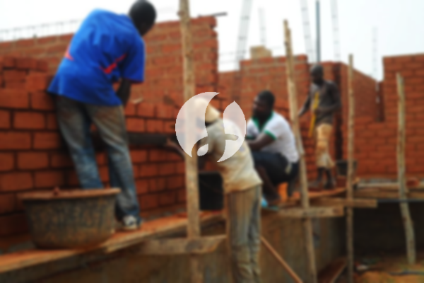

**Biaya Bangun Rumah Per Meter Di Pulo Gebang Jakarta** - Hai Mitra Sumber Material! Bagaimana kabarnya? Kami dari Sumber Material hadir sebagai mitra terpercaya Anda dalam mewujudkan impian hunian di Pulo Gebang Jakarta. Seiring dengan perkembangan zaman, layanan bangun rumah semakin diminati. Jasa bangun rumah kini berkembang pesat, bahkan merambah ke layanan desain interior. Semakin banyak orang yang memilih solusi ini karena kemudahan dan efisiensi yang ditawarkan. Kebutuhan akan tempat tinggal terus meningkat, mendorong para pelaku properti untuk berlomba-lomba menghadirkan solusi terbaik, mulai dari rumah sederhana hingga mewah. Kami, sebagai penyedia jasa bangun rumah yang terpercaya di Pulo Gebang Jakarta, berkomitmen untuk menjaga kepercayaan pelanggan dengan memberikan hasil terbaik. Layanan kami menawarkan berbagai pilihan untuk membangun rumah impian Anda.



## Jasa Desain Gambar Arsitektur Profesional di Pulo Gebang Jakarta

Sebagai bagian dari layanan kami, Sumber Material menyediakan jasa desain gambar arsitektur yang akan mewujudkan visi rumah impian Anda. Kami memahami bahwa desain adalah fondasi utama dari sebuah bangunan yang indah dan fungsional. Tim arsitek profesional kami akan bekerja keras menciptakan komposisi desain yang selaras dengan keinginan dan kebutuhan Anda. Kualitas desain sangat penting karena akan menentukan tampilan akhir rumah Anda. Kami menawarkan solusi desain yang sesuai dengan anggaran Anda, sehingga Anda dapat mengetahui perkiraan biaya yang dibutuhkan untuk mewujudkan rumah impian Anda. Selain estetika, kami juga memperhatikan pemilihan material bangunan yang tepat. Kami memahami kompleksitas proses ini, dan itulah mengapa kami hadir untuk membantu Anda. Bersama Sumber Material, Anda akan mendapatkan desain yang sesuai dengan harapan Anda di Pulo Gebang Jakarta.

Biaya jasa desain bangunan dari kami bervariasi tergantung luas bangunan dan kompleksitas desain. Saat ini, kami menawarkan harga per meter untuk layanan desain, termasuk gambar, RAB (Rencana Anggaran Biaya), dan 2 kali revisi. Untuk desain rumah minimalis satu lantai, biaya jasa kami adalah Rp 54.000,- per meter persegi. Sedangkan untuk bangunan dua lantai atau lebih, biayanya cukup dikalikan 2 atau 3 sesuai jumlah lantai.

## Harga Jasa Borong Bangun Rumah di Pulo Gebang Jakarta

Mewujudkan sebuah rumah adalah kebutuhan mendasar setiap manusia. Banyaknya penyedia jasa bangun rumah di pasaran menawarkan berbagai keunggulan untuk menarik pelanggan. Di sinilah peran penting jasa borong bangun rumah di Sumber Material hadir untuk memberikan solusi yang tepat. Dengan memilih layanan borong bangun rumah dari Kami, Anda akan mendapatkan hasil yang sesuai dengan harapan Anda. Memiliki rumah yang bagus adalah impian semua orang. Dengan menggunakan layanan bangun rumah, Kami akan membantu mewujudkan impian tersebut. Anda tidak perlu repot mendesain rumah sendiri, karena tim Kami akan memahami keinginan Anda dan menerjemahkannya menjadi karya nyata. Kepuasan pelanggan adalah prioritas utama Kami, sehingga Kami terus berusaha memberikan pelayanan terbaik.

Untuk harga borong bangun rumah, Kami menawarkan beberapa tingkatan harga yang disesuaikan dengan material bangunan dan lokasi di Pulo Gebang Jakarta. Dengan syarat lokasi tanah yang rata, stabil, dan tidak memerlukan pengurugan. Harga per meter persegi dengan material dinding hebel adalah Rp 1.950.000,-, sedangkan dengan material bata merah adalah Rp 2.200.000,-. Harga tersebut sudah termasuk pondasi batu gunung, kolom dan tiang beton, lantai keramik standar, serta atap dengan rangka baja ringan plus genteng spandek. Anda dapat memilih variasi genteng dan keramik sesuai preferensi Anda, dengan penyesuaian model, kualitas, dan harga.

## Biaya Renovasi Bangunan di Pulo Gebang Jakarta

Selain layanan arsitek dan bangun rumah, Sumber Material juga menyediakan jasa renovasi bangunan. Borongan renovasi rumah adalah solusi tepat untuk memberikan tampilan baru pada hunian Anda. Dengan hadirnya jasa renovasi rumah, Anda tidak perlu lagi khawatir mencari tukang dan material yang tepat. Renovasi yang Kami lakukan bisa berupa perubahan tampilan bangunan secara menyeluruh atau perbaikan kerusakan tertentu. Renovasi memang merupakan alternatif yang efektif untuk meningkatkan tampilan rumah Anda dengan anggaran yang terjangkau. Namun, seringkali pemilik rumah kesulitan menjalankan renovasi karena kendala anggaran atau ketidakpastian biaya. Dengan adanya jasa renovasi rumah dari Sumber Material, semua masalah tersebut dapat diatasi. Kami akan memberikan layanan renovasi bangunan yang terpercaya dan sesuai dengan impian Anda.

Harga borongan jasa renovasi bangunan dari Kami bervariasi tergantung pada kondisi kerusakan bangunan di Pulo Gebang Jakarta. Setiap rumah memiliki tingkat kerusakan yang berbeda-beda, sehingga harga disesuaikan dengan jenis kerusakan yang perlu diperbaiki. Untuk tenaga tukang harian, harga per hari adalah Rp 150.000,- untuk tukang dan Rp 100.000,- untuk kenek.

## Dukungan Tukang dan Arsitek Terbaik di Pulo Gebang Jakarta

Baik layanan arsitek, bangun rumah, maupun renovasi, semuanya memiliki peran penting dalam mewujudkan hunian impian Anda. Dengan dukungan arsitek profesional dan tenaga kerja yang handal, Kami akan membantu mewujudkan impian Anda. Membangun rumah idaman bersama Sumber Material akan memberikan Anda rumah yang menarik dan berkualitas. Kami tidak perlu diragukan lagi dalam memberikan pelayanan terbaik, menjaga kualitas, dan memberikan kepuasan kepada Anda. Kepuasan pelanggan adalah motivasi utama Kami untuk terus berkarya dan memberikan hasil yang lebih baik. Kami memiliki katalog proyek yang bisa Anda lihat untuk membuktikan kualitas kerja Kami.

Perlu diingat bahwa rumah merupakan kebutuhan pokok manusia, selain sandang dan pangan. Rumah menjadi tempat berlindung dari cuaca panas dan dingin, serta melindungi kita dari berbagai bahaya. Hal ini menjadi celah bagi penyedia jasa bangun rumah untuk menawarkan layanan terbaik mereka. Sebagai penyedia jasa, khususnya jasa bangun rumah, Kami akan berkontribusi untuk memajukan dunia arsitektur dengan menawarkan layanan melalui berbagai media, baik cetak maupun online. Hal ini tentu akan membantu banyak orang yang ingin membangun rumah impian mereka. Dengan mempertahankan kualitas dan mutu terbaik, Kami telah terbukti memiliki pengalaman yang cukup lama dalam dunia arsitektur. Itulah sebabnya, Kami semakin dipercaya oleh banyak orang di Pulo Gebang Jakarta.

Didukung oleh arsitek yang kompeten dan tenaga kerja yang terampil, Kami berkomitmen untuk memberikan yang terbaik. Anda bisa melihat perkembangan dan inovasi yang selalu Kami berikan dalam setiap proyek. Banyak rumah dan bangunan indah dibangun dengan desain yang apik dan menarik berkat Kami. Dengan proses pengerjaan yang efisien, Kami akan membantu Anda mendapatkan rumah impian dengan cepat. Baik rumah berskala kecil maupun besar, semuanya dapat Kami kendalikan. Anda tidak perlu khawatir atau cemas, karena Kami akan menangani semua aspek pembangunan, mulai dari desain, material, ukuran, hingga sumber daya manusia. Kami adalah solusi lengkap untuk membangun rumah impian Anda. [Hubungi Kami Sekarang!](https://api.whatsapp.com/send?phone=6285776786091&text=*Halo%20sumbermaterial.com*%20%3A) Untuk wilayah lain, Kami juga melayani [bangun rumah di Cakung Timur](/bangunan/biaya-bangun-rumah-per-meter-di-cakung-timur-jakarta/).
