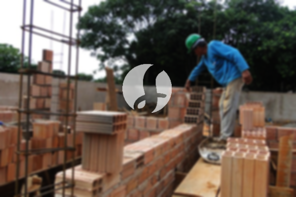

**Biaya Bangun Rumah Per Meter Di Purwasari Karawang** - Hai Mitra Sumber Material! Bagaimana kabarnya? Kami dari Sumber Material, penyedia layanan konstruksi terpercaya di Purwasari Karawang, siap membantu mewujudkan rumah impian Anda. Perkembangan zaman semakin mendorong minat masyarakat terhadap layanan bangun rumah, desain rumah, hingga renovasi. Banyak orang kini memilih jasa bangun rumah karena kemudahan dan kepastian yang ditawarkan. Meningkatnya kebutuhan akan tempat tinggal mendorong kontraktor properti untuk berlomba-lomba menawarkan layanan terbaik, mulai dari standar hingga mewah. Kami memahami betul pentingnya kepercayaan dalam setiap proyek, dan berkomitmen untuk memberikan layanan yang memuaskan. Nah, dengan memilih Kami, Mitra Sumber Material, Anda akan mendapatkan berbagai opsi layanan yang bisa disesuaikan dengan kebutuhan dan budget Anda. Berikut beberapa jenis layanan yang kami tawarkan:



## Jasa Desain Gambar Arsitek Profesional di Purwasari Karawang

Sebagai bagian dari layanan Kami, desain arsitektur memegang peranan penting dalam mewujudkan rumah impian Anda. Kami, di Sumber Material Purwasari Karawang, akan membantu Anda menciptakan desain yang indah dan fungsional. Kami percaya bahwa desain yang baik adalah fondasi dari bangunan yang berkualitas. Proses desain yang kami lakukan mempertimbangkan berbagai faktor penting agar menghasilkan komposisi yang selaras dan estetis.  Kami memahami bahwa desain yang menarik sangatlah penting. Dengan desain yang tepat, rumah Anda akan terlihat lebih cantik dan nyaman. Anda tidak perlu khawatir, karena Kami akan menciptakan desain sesuai dengan anggaran yang Anda miliki. Melalui desain yang matang, Anda dapat memperkirakan biaya yang dibutuhkan untuk mewujudkan rumah impian Anda.  Selain itu, Kami juga mempertimbangkan pemilihan bahan material yang tepat untuk memastikan kualitas dan efisiensi biaya. Semua hal ini tentu membutuhkan keahlian khusus, dan itulah mengapa Kami menawarkan jasa arsitek profesional. Kami akan memahami keinginan Anda dan mewujudkannya ke dalam desain yang sempurna, sehingga Anda merasa puas dengan hasilnya.

Biaya jasa desain bangunan Kami bervariasi, tergantung pada luas bangunan dan kompleksitas desain yang diinginkan. Saat ini, Kami menawarkan harga jasa desain rumah minimalis satu lantai mulai dari Rp 54.000 per meter persegi, sudah termasuk desain, RAB (Rencana Anggaran Biaya), dan 2 kali revisi. Untuk rumah dua lantai atau lebih, biayanya hanya dikalikan 2 atau 3 sesuai dengan jumlah lantai.

## Estimasi Biaya Borong Bangun Rumah di Purwasari Karawang

Memiliki rumah yang nyaman dan berkualitas adalah impian setiap orang. Sumber Material Purwasari Karawang hadir sebagai solusi untuk mewujudkan impian tersebut. Banyaknya penyedia jasa bangun rumah di pasaran memungkinkan Anda untuk memilih layanan yang paling sesuai dengan kebutuhan Anda. Kami memahami betul pentingnya peran jasa bangun rumah dalam menangani proyek pembangunan Anda, dan Kami berkomitmen untuk memberikan layanan terbaik. Dengan menggunakan jasa Kami, Anda tidak perlu repot memikirkan desain rumah sendiri. Kami akan membantu Anda mewujudkan keinginan Anda menjadi karya nyata, yaitu rumah impian Anda. Kepuasan Anda adalah prioritas Kami, dan Kami akan terus berusaha untuk memberikan pelayanan terbaik.

Untuk layanan borong pembangunan rumah, Kami memiliki beberapa pilihan harga yang dapat disesuaikan dengan kebutuhan Anda. Harga disesuaikan dengan kualitas bahan bangunan dan lokasi pembangunan. Dengan asumsi lokasi tanah yang rata, stabil, dan tidak memerlukan pengurugan, harga per meter persegi dengan material dinding hebel adalah Rp 1.950.000,-, sementara dengan material bata merah adalah Rp 2.200.000,-. Harga tersebut sudah termasuk pondasi batu sungai, kolom dan tiang beton, lantai keramik standar, serta rangka baja ringan dan genteng spandek untuk atap. Untuk pilihan genteng dan keramik lainnya, Anda dapat menyesuaikan model, kualitas, dan harga sesuai keinginan Anda.

## Jasa Renovasi Rumah Terpercaya di Purwasari Karawang

Selain layanan arsitek dan bangun rumah, Kami juga menyediakan jasa renovasi rumah di Purwasari Karawang. Renovasi rumah adalah cara yang efektif untuk memberikan tampilan baru pada hunian Anda. Dengan kehadiran Kami, Anda tidak perlu khawatir tentang proses renovasi rumah Anda. Kami menawarkan jasa renovasi rumah dengan teknik mengubah bentuk model rumah atau melakukan renovasi menyeluruh. Renovasi bisa menjadi solusi yang tepat untuk memperbarui tampilan rumah Anda dengan anggaran yang terjangkau. Namun, seringkali seseorang merasa kesulitan untuk menjalankan renovasi rumah karena berbagai kendala. Dengan adanya jasa renovasi bangunan, semua kendala tersebut dapat diatasi. Kami hadir sebagai solusi renovasi yang akan memudahkan Anda untuk mengubah rumah Anda menjadi lebih segar dan indah dari sebelumnya. Kami siap mewujudkan impian Anda untuk memiliki rumah yang cantik dan sesuai dengan keinginan Anda.

Harga borongan jasa renovasi rumah Kami bervariasi, tergantung pada kondisi kerusakan yang perlu diperbaiki. Setiap rumah memiliki kondisi kerusakan yang berbeda-beda, sehingga harga disesuaikan dengan jenis kerusakan yang akan diperbaiki. Untuk jasa renovasi dengan tenaga tukang harian, Kami menawarkan harga Rp 150.000,- per hari untuk tukang dan Rp 100.000,- per hari untuk kenek.

## Dukungan Tenaga Kerja dan Arsitek Terbaik di Purwasari Karawang

Baik layanan arsitek, bangun rumah, maupun renovasi, semuanya memiliki peran yang sangat penting. Dengan dukungan arsitek profesional dan tenaga kerja yang handal, Kami akan membantu mewujudkan impian Anda. Dengan membangun rumah idaman bersama Sumber Material, Anda akan memiliki rumah yang menarik dan cantik. Anda tidak perlu khawatir, karena Kami akan memberikan pelayanan terbaik, menjaga kualitas, dan memberikan kepuasan yang maksimal. Sebagai penyedia layanan bangun rumah, kepuasan pelanggan adalah penyemangat Kami untuk terus berkarya dan menghasilkan karya-karya yang lebih baik. Anda dapat melihat katalog proyek-proyek yang telah Kami selesaikan untuk membuktikan kualitas dan keandalan Kami.

Wajib diketahui, rumah adalah kebutuhan utama manusia selain sandang dan pangan. Rumah menjadi tempat berlindung dari cuaca ekstrem dan berbagai bahaya. Hal ini menjadi peluang bagi penyedia jasa bangun rumah untuk menawarkan jasanya. Sebagai penyedia layanan, Kami berpartisipasi dalam meramaikan dunia arsitektur yang terus berkembang dengan menawarkan layanan melalui berbagai media, baik cetak maupun online. Hal ini tentu mempermudah masyarakat yang berencana membangun rumah. Dengan menjaga kualitas dan memberikan layanan terbaik, Kami telah terbukti memiliki pengalaman yang cukup lama dalam dunia arsitektur. Itulah sebabnya, semakin banyak orang mempercayai Kami.

Kami didukung oleh arsitek profesional dan tenaga kerja yang handal, yang tentunya dapat menjamin kualitas dan kecepatan pekerjaan. Kami selalu berusaha untuk berinovasi dan berkreasi dalam setiap proyek yang Kami tangani. Banyak bangunan-bangunan indah dan menarik yang telah Kami bangun. Dengan proses pengerjaan yang efisien, Kami dapat menyelesaikan pekerjaan dengan cepat tanpa mengorbankan kualitas. Baik proyek kecil maupun besar, Kami siap menghadapinya. Kami akan membantu Anda dalam perencanaan, pengawasan, dan pelaksanaan pembangunan hingga rumah impian Anda terwujud. [Hubungi Kami Sekarang!](https://api.whatsapp.com/send?phone=6285776786091&text=*Halo%20sumbermaterial.com*%20%3A)
