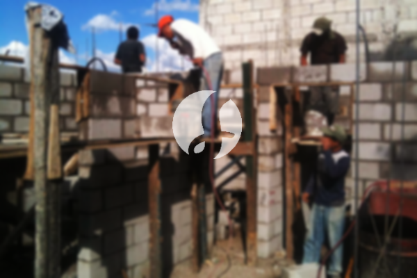

**Biaya Bangun Rumah Per Meter Di Ragunan Jakarta** - Hai Mitra Sumber Material! Bagaimana kabarnya? Kami dari Sumber Material hadir untuk memberikan solusi kebutuhan konstruksi Anda di Ragunan Jakarta. Seiring perkembangan zaman, layanan pembangunan tempat tinggal kini semakin diminati. Banyak orang beralih ke jasa bangun rumah karena kemudahan dan efisiensinya. Semakin padatnya penduduk, kebutuhan akan tempat tinggal yang nyaman dan berkualitas juga meningkat. Para kontraktor properti berlomba-lomba menawarkan berbagai pilihan, mulai dari rumah sederhana hingga mewah, berusaha membangun kepercayaan konsumen melalui pelayanan terbaik. Jasa bangun rumah yang terpercaya akan berjuang keras menjaga reputasi dan menjalankan amanah yang diberikan. Dengan layanan beragam, Anda dapat memilih solusi yang paling sesuai dengan kebutuhan dan anggaran Anda. Mari kita simak beberapa jenis layanan yang kami tawarkan:



## Jasa Desain Gambar Arsitektur Di Ragunan Jakarta

Sebagai penyedia layanan arsitektur, kami akan memperhatikan desain bangunan yang akan Anda wujudkan. Melalui desain yang baik, kami berupaya menciptakan keindahan dan fungsionalitas pada rumah Anda. Beberapa faktor penting kami perhatikan untuk mewujudkan komposisi desain yang selaras dan menarik, karena desain yang tepat adalah kunci tampilan rumah yang menawan. Dengan desain yang jelas, Anda dapat memperkirakan biaya yang dibutuhkan untuk mewujudkan impian Anda. Selain itu, desain juga mempertimbangkan material bangunan yang akan digunakan. Proses ini memang cukup kompleks, jadi memilih jasa arsitek yang profesional adalah langkah yang tepat. Kami akan memahami keinginan Anda dan mewujudkannya melalui desain yang memuaskan.

Harga jasa desain bangunan kami bervariasi, tergantung pada luas bangunan dan tingkat kesulitan desain. Saat ini, kami menawarkan harga per meter persegi. Untuk desain rumah minimalis satu lantai, tarifnya mulai dari Rp 54.000,- per meter persegi, sudah termasuk desain, Rencana Anggaran Biaya (RAB), dan dua kali revisi. Untuk bangunan dua lantai atau lebih, biayanya dapat dikalikan dua atau tiga sesuai jumlah lantai.

## Harga Jasa Borong Bangun Rumah Di Ragunan Jakarta

Dengan bertambahnya jumlah penduduk bumi, kebutuhan akan tempat tinggal pun semakin meningkat. Banyak jasa bangun rumah hadir menawarkan produk dan layanan terbaik untuk konsumen. Di sinilah peran penting jasa bangun rumah dalam mewujudkan impian memiliki rumah yang nyaman dan berkualitas. Dengan menggunakan jasa kami, Anda akan mendapatkan solusi bangunan yang sesuai dengan keinginan Anda. Memiliki rumah yang cantik adalah impian semua orang. Kami akan membantu mewujudkan impian itu dengan layanan desain dan pembangunan yang terpercaya. Dengan mempercayakan pembangunan rumah Anda kepada kami, Anda tidak perlu khawatir tentang proses desain. Kami akan memahami harapan Anda dan mewujudkannya dalam bentuk rumah impian yang sesungguhnya. Percayakan pada keahlian kami untuk memberikan hasil yang memuaskan.

Untuk biaya borong pembangunan, kami menawarkan beberapa tingkatan harga, disesuaikan dengan material bangunan yang digunakan dan lokasi pembangunan. Dengan catatan area tanah dalam keadaan rata, stabil, dan tidak memerlukan pengurugan. Harga per meter persegi dengan material dinding hebel adalah Rp 1.950.000,-, sedangkan dengan material bata merah adalah Rp 2.200.000,-. Harga tersebut sudah termasuk pondasi batu gunung, kolom dan tiang beton, lantai keramik standar, serta atap rangka baja ringan plus genteng spandek. Anda dapat memilih variasi genteng dan keramik sesuai preferensi, model, kualitas, dan anggaran Anda.

## Harga Renovasi Rumah Di Ragunan Jakarta

Selain jasa arsitek dan borong bangun rumah, kami juga menyediakan jasa renovasi rumah di Ragunan Jakarta. Renovasi adalah cara efektif untuk memberikan tampilan baru pada rumah Anda. Dengan layanan renovasi kami, Anda tidak perlu repot memikirkan proses renovasi. Kami menawarkan renovasi dengan berbagai pilihan, mulai dari perubahan tampilan hingga renovasi total. Renovasi bisa menjadi solusi ideal untuk meningkatkan nilai estetika rumah Anda tanpa harus mengeluarkan biaya yang besar. Namun, seringkali anggaran menjadi kendala utama. Jangan khawatir, kami hadir dengan solusi renovasi yang terjangkau. Kami adalah penyedia jasa renovasi bangunan yang siap membantu Anda merombak rumah Anda menjadi lebih segar dan menarik. Kami siap mewujudkan impian Anda untuk memiliki rumah yang lebih indah.

Harga borongan renovasi rumah kami bervariasi, tergantung pada kondisi kerusakan bangunan dan jenis pekerjaan yang dilakukan. Untuk jasa tenaga tukang harian, tarifnya adalah Rp 150.000,- per hari untuk tukang dan Rp 100.000,- per hari untuk kenek.

## Didukung Tenaga Kerja Dan Arsitek Terbaik Di Ragunan Jakarta

Baik jasa arsitek, borong bangun rumah, maupun renovasi, semuanya memiliki peran penting dalam mewujudkan impian Anda. Didukung oleh arsitek profesional dan tenaga kerja yang handal, kami akan membantu Anda menciptakan rumah impian yang sesuai dengan keinginan Anda. Dengan membangun rumah bersama kami, Anda akan mendapatkan rumah yang menarik dan indah. Kami akan memberikan pelayanan terbaik, menjaga kualitas, dan memberikan kepuasan maksimal. Kepuasan pelanggan adalah motivasi utama kami untuk terus berkarya dan menghasilkan karya yang lebih baik. Anda dapat melihat portofolio proyek-proyek kami untuk membuktikan kualitas dan keunggulan layanan kami.

Perlu diingat, rumah adalah kebutuhan pokok manusia, selain sandang dan pangan. Rumah memberikan perlindungan dari cuaca ekstrem dan berbagai bahaya. Hal ini menjadi peluang bagi penyedia jasa bangun rumah untuk menawarkan layanan mereka. Sebagai penyedia jasa, kami berpartisipasi aktif dalam meramaikan dunia arsitektur dengan menampilkan layanan kami melalui berbagai media, baik cetak maupun online. Ini membantu orang-orang yang ingin membangun rumah menemukan solusi yang tepat. Dengan menjaga kualitas dan mutu terbaik, kami telah memiliki pengalaman yang cukup lama dalam dunia arsitektur. Itulah mengapa kami semakin dipercaya oleh banyak orang.

Didukung oleh arsitek profesional dan tenaga kerja yang handal, kami akan terus memberikan yang terbaik. Kami selalu berinovasi dan menciptakan karya-karya baru yang kreatif dan menarik. Banyak rumah dan bangunan yang telah kami bangun dengan desain yang apik dan menarik. Dengan proses pengerjaan yang efisien, Anda akan segera mendapatkan rumah impian Anda. Baik rumah skala kecil maupun besar, kami siap menangani semua jenis proyek. Maka dari itu, Anda tidak perlu khawatir atau ragu. Mulai dari desain rumah, pemilihan material, ukuran bangunan, hingga sumber daya manusia, semuanya dapat kami atasi. Dengan demikian, kami dapat mendukung terwujudnya rumah yang cantik dan menarik. Di sinilah peran penting jasa bangun rumah ditunjukkan, karena kami akan membantu Anda dalam perencanaan dan pengawasan pembangunan. Untuk informasi lebih lanjut dan konsultasi, [hubungi Kami sekarang juga](https://api.whatsapp.com/send?phone=6285776786091&text=*Halo%20sumbermaterial.com*%20%3A)! Atau, kunjungi Kami di Ragunan Jakarta untuk diskusi yang lebih mendalam. Jangan ragu untuk bertanya, Kami siap membantu Anda mewujudkan rumah impian Anda di Ragunan Jakarta. [bangun rumah di Bali Mester](/bangunan/biaya-bangun-rumah-per-meter-di-bali-mester-jakarta/) Anda juga bisa melihat contoh bangun rumah di Bali Mester.
