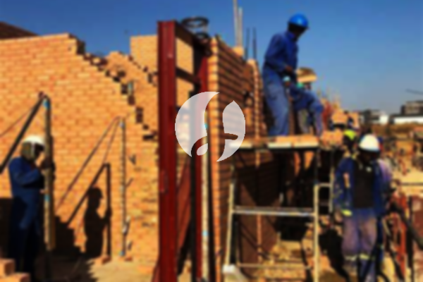

**Biaya Bangun Rumah Per Meter Di Rawa Bunga Jakarta** - Hai Mitra Sumber Material! Gimana kabarnya? Kami dari Sumber Material hadir untuk membantu mewujudkan rumah impian Anda di Rawa Bunga Jakarta dan sekitarnya. Seiring dengan perkembangan zaman, jasa pembangunan rumah semakin diminati. Borongan membuat bangunan memang terus berkembang, termasuk layanan desain rumah. Peningkatan minat ini seiring dengan peningkatan populasi yang kemudian memicu permintaan akan tempat tinggal yang layak. Para kontraktor properti berlomba-lomba menawarkan solusi, mulai dari hunian standar hingga mewah. Kepercayaan pelanggan adalah kunci, dan layanan bangun rumah berkualitas akan selalu berusaha menjaganya. Kami, sebagai penyedia jasa konstruksi yang terpercaya di Rawa Bunga Jakarta, menawarkan beragam layanan untuk membangun rumah impian Anda. Berikut beberapa pilihan layanan yang bisa Anda pertimbangkan:



## Layanan Desain Gambar Arsitek Di Rawa Bunga Jakarta

Sebagai penyedia jasa arsitek, layanan kami dimulai dengan observasi mendalam terhadap desain bangunan yang Anda inginkan. Kami berupaya keras untuk menghadirkan keindahan dalam setiap detail, menggunakan berbagai faktor penting untuk menciptakan komposisi desain yang cantik dan harmonis. Desain adalah aspek krusial yang seringkali menjadi daya tarik utama sebuah rumah. Dengan desain yang tepat, rumah Anda akan terlihat menarik dan sesuai dengan kepribadian Anda. Anda tidak perlu khawatir tentang anggaran, karena Kami akan mewujudkan desain yang sesuai dengan *budget* yang Anda miliki. Dari desain inilah, Anda dapat memperkirakan biaya yang akan dikeluarkan untuk mewujudkan hunian impian Anda. Selain itu, desain juga mempertimbangkan pemilihan bahan bangunan yang tepat. Semua aspek ini memerlukan keahlian dan pengalaman, itulah mengapa memilih jasa arsitek profesional adalah langkah yang bijak. Kami memahami harapan Anda dan akan menerjemahkannya menjadi desain yang memuaskan.

Biaya jasa desain bangunan Kami bervariasi tergantung pada luas bangunan dan kompleksitas desain yang Anda minta. Saat ini, Kami menawarkan harga per meter untuk layanan desain, perhitungan RAB, dan revisi hingga dua kali. Harga jasa desain rumah minimalis satu lantai adalah Rp 54.000,- per meter. Untuk bangunan dua lantai atau lebih, harganya akan disesuaikan, biasanya dikalikan dua atau tiga sesuai dengan jumlah lantai.

## Harga Borong Renovasi Rumah Di Rawa Bunga Jakarta

Memiliki rumah adalah kebutuhan dasar setiap orang. Meningkatnya permintaan akan hunian mendorong Kami untuk menawarkan layanan terbaik kepada konsumen Kami di Rawa Bunga Jakarta. Kami hadir untuk membantu Anda mengatasi permasalahan dalam pembangunan rumah, sehingga Anda dapat memperoleh jasa bangun rumah yang sesuai dengan harapan Anda. Memiliki rumah yang indah adalah impian setiap orang. Dengan menggunakan jasa bangun rumah, Anda akan terbantu mewujudkan impian tersebut. Anda tidak perlu repot mendesain rumah sendiri, karena Kami akan berusaha memahami kemauan Anda dan mewujudkannya dalam bentuk karya nyata. Kepuasan Anda adalah prioritas Kami dan menjadi motivasi untuk terus berkarya lebih baik lagi. Katalog proyek yang telah Kami selesaikan dapat menjadi bukti bahwa Kami adalah pilihan terbaik dan terpercaya.

Untuk harga layanan borong pembangunan, Kami menawarkan beberapa tingkatan harga yang disesuaikan dengan material bangunan yang digunakan dan lokasi pembangunan. Dengan asumsi area tanah dalam kondisi rata, stabil, dan tidak memerlukan pengurukan, harga per meter untuk material dinding hebel adalah Rp 1.950.000,-, sedangkan untuk bata merah adalah Rp 2.200.000,-. Harga ini mencakup pondasi batu sungai, kolom dan tiang beton, lantai keramik standar, serta atap dengan rangka baja ringan dan genteng spandek. Anda dapat melakukan *request* untuk jenis genteng dan keramik lain sesuai dengan preferensi dan anggaran Anda.

## Harga Layanan Perbaikan Rumah Di Rawa Bunga Jakarta

Selain layanan arsitek dan pembangunan rumah baru, Kami juga menyediakan jasa renovasi rumah. Renovasi adalah cara yang efektif untuk mengubah tampilan rumah agar terlihat baru kembali. Dengan hadirnya jasa renovasi bangunan, Anda tidak perlu lagi bingung mencari solusi untuk merenovasi rumah Anda. Kami menawarkan renovasi yang dapat mengubah tampilan rumah secara keseluruhan atau hanya sebagian. Renovasi sering menjadi pilihan karena biaya yang lebih terjangkau dibandingkan membangun rumah baru. Namun, menemukan kontraktor yang tepat adalah kunci keberhasilan renovasi. Kami hadir sebagai solusi borongan renovasi rumah yang akan membantu Anda merenovasi rumah Anda agar lebih segar dan menarik. Kami siap mewujudkan bangunan impian Anda sesuai dengan harapan Anda.

Harga borongan jasa renovasi Kami bervariasi tergantung pada kondisi kerusakan bangunan. Karena setiap rumah memiliki tingkat kerusakan yang berbeda, Kami akan melakukan survei terlebih dahulu untuk memberikan penawaran harga yang akurat. Untuk biaya tenaga tukang harian, tarifnya adalah Rp 150.000,- per hari untuk tukang dan Rp 100.000,- per hari untuk kenek.

## Didukung Tenaga Kerja Dan Arsitek Berpengalaman Di Rawa Bunga Jakarta

Baik layanan arsitek, pembangunan rumah baru, maupun renovasi, semuanya memiliki peran penting dalam mewujudkan hunian impian Anda. Didukung oleh arsitek profesional dan tenaga kerja yang handal, Kami akan membantu Anda mewujudkan impian tersebut. Membangun rumah dengan layanan Kami akan memberikan Anda rumah yang menarik dan berkualitas. Kami menjamin pelayanan terbaik, menjaga mutu dan kualitas, serta memberikan kepuasan kepada Anda. Kepuasan pelanggan adalah penyemangat Kami untuk terus berkarya dan menghasilkan karya yang lebih baik lagi. Hasil karya desain dan proyek pembangunan Kami dapat dilihat pada katalog Kami, yang membuktikan bahwa Kami adalah pilihan terbaik dan terpercaya di Rawa Bunga Jakarta.

Perlu diketahui bahwa rumah adalah kebutuhan utama manusia selain sandang dan pangan. Rumah menjadi tempat berlindung dari cuaca ekstrem dan berbagai bahaya. Hal ini menjadi peluang bagi penyedia jasa bangun rumah untuk menawarkan jasanya. Sebagai penyedia jasa khususnya dalam pembangunan rumah, Kami turut berkontribusi dalam perkembangan dunia arsitektur dengan menawarkan layanan Kami melalui berbagai media, baik cetak maupun *online*. Hal ini tentu memudahkan Anda yang ingin membangun rumah. Dengan menjaga mutu dan kualitas terbaik, Kami telah terbukti memiliki pengalaman yang cukup lama dalam menggeluti dunia arsitektur. Inilah sebabnya, layanan bangun rumah Kami semakin dipercaya oleh banyak orang. [bangun rumah di Bintaro](/bangunan/biaya-bangun-rumah-per-meter-di-bintaro-jakarta/)

Didukung oleh arsitek profesional dan tenaga kerja yang handal, tentu akan menjadikan jasa bangun rumah Kami semakin dikenal dan terpercaya. Hal ini terlihat dari perkembangan yang terus Kami berikan. Banyak rumah-bangunan yang dibangun dengan desain yang apik dan menarik oleh tim Kami. Dengan cara pengerjaan yang efisien, Anda akan cepat mendapatkan rumah impian Anda. Baik bangunan berskala kecil maupun besar, semuanya dapat Kami tangani dengan baik. Anda tidak perlu khawatir tentang hal tersebut. Mulai dari desain rumah, material bahan, ukuran bangunan, dan SDM, semuanya dapat Kami atasi dengan adanya layanan bangun rumah. Hal ini akan mendukung terwujudnya rumah yang cantik dan menarik. Disitulah peran penting dari jasa bangun rumah. Karena, Kami akan membuat sebuah rancangan, dan sekaligus mengawasi seluruh proses pembangunan. Jangan ragu untuk menghubungi Kami untuk informasi lebih lanjut atau konsultasi gratis! [Hubungi Kami Sekarang!](https://api.whatsapp.com/send?phone=6285776786091&text=*Halo%20sumbermaterial.com*%20%3A) Kami siap membantu Anda membangun rumah impian di Rawa Bunga Jakarta.
