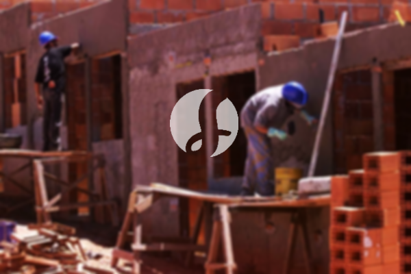

**Biaya Bangun Rumah Per Meter Di Rawasari Jakarta** - Hai Mitra Sumber Material! Gimana kabarnya? Kami dari Sumber Material ingin berbagi informasi penting bagi Anda yang berencana membangun rumah di Rawasari Jakarta. Seiring dengan perkembangan zaman, jasa bangun rumah semakin diminati. Layanan pembangunan tempat tinggal kini semakin berkembang, termasuk jasa desain rumah. Hal ini membuat banyak orang lebih memilih mengandalkan jasa profesional untuk mewujudkan rumah impian mereka. Pertumbuhan populasi yang pesat juga meningkatkan kebutuhan akan tempat tinggal, memicu persaingan di antara pelaku properti untuk menawarkan solusi perumahan dari berbagai kelas. Dengan kepercayaan yang diberikan pembeli, jasa bangun rumah berkomitmen untuk menghadirkan layanan terbaik dan memenuhi harapan Anda. Nah, mari kita bahas lebih lanjut mengenai opsi layanan yang tersedia untuk membangun rumah idaman Anda di Rawasari Jakarta.



## Jasa Desain Gambar Arsitek Di Rawasari Jakarta

Sebagai penyedia jasa arsitek, Kami tentu sangat memperhatikan desain rumah yang akan dibangun. Desain yang baik akan mewujudkan keindahan dan kenyamanan hunian Anda. Kami akan mempertimbangkan berbagai faktor penting untuk menciptakan komposisi desain yang selaras dan menarik. Desain rumah adalah elemen krusial yang perlu diperhatikan karena secara visual akan menentukan tampilan keseluruhan rumah Anda. Mitra Sumber Material akan mewujudkan desain yang sesuai dengan budget yang Anda miliki. Dengan desain yang jelas, Anda dapat memperkirakan biaya yang dibutuhkan untuk mewujudkan rumah impian Anda. Selain itu, desain juga akan mempertimbangkan jenis bahan bangunan yang akan digunakan. Semua aspek ini memerlukan pertimbangan matang, itulah mengapa memilih jasa arsitek yang tepat sangat penting. Karena, jasa arsitek profesional akan memahami keinginan Anda dan menerjemahkannya ke dalam rancangan yang memuaskan.

Namun, biaya jasa desain rumah Kami bervariasi tergantung pada luas rumah dan kerumitan desain yang diinginkan. Saat ini Kami menawarkan harga jasa desain bangunan dan lainnya berdasarkan meter persegi. Untuk desain rumah minimalis satu lantai, biayanya adalah Rp54.000,- per meter, sudah termasuk desain, perhitungan RAB, dan dua kali revisi. Sedangkan untuk bangunan dua lantai atau lebih, harganya hanya dikalikan dua atau tiga sesuai jumlah lantai.

## Jasa Borong Renovasi Rumah Di Rawasari Jakarta

Seiring dengan pertumbuhan populasi, kebutuhan akan tempat tinggal pun semakin meningkat. Ini membuka peluang bagi banyak penyedia jasa bangun rumah untuk menawarkan layanan mereka. Disinilah peran penting Kami dalam menangani permasalahan pembangunan rumah. Kami akan membantu Anda mewujudkan rumah impian sesuai dengan keinginan Anda. Memiliki rumah yang bagus adalah impian semua orang. Dengan menggunakan jasa Kami, Anda tidak perlu khawatir mendesain rumah sendiri karena Kami akan berusaha memahami dan mewujudkan impian Anda menjadi karya nyata. Hal ini akan memberikan kepuasan dan meningkatkan kepercayaan Anda terhadap layanan Kami.

Untuk harga borong renovasi bangunan, Kami memiliki beberapa tingkatan harga yang disesuaikan dengan bahan bangunan yang digunakan dan lokasi pembangunan. Dengan asumsi kondisi tanah rata, stabil, dan tidak memerlukan pengurugan. Harga per meter dengan material dinding hebel mulai dari Rp1.950.000,-, sedangkan dengan material bata merah mulai dari Rp2.200.000,-. Harga tersebut sudah termasuk pondasi batu kali, kolom dan tiang beton, lantai keramik standar, serta atap dengan rangka baja ringan dan genteng spandek. Untuk jenis genteng dan keramik lain, Anda dapat menyesuaikan pilihan sesuai dengan model, kualitas, dan anggaran Anda.

## Layanan Renovasi Rumah Di Rawasari Jakarta

Selain jasa arsitek dan bangun rumah, Kami juga menyediakan layanan renovasi rumah. Jasa renovasi rumah merupakan solusi tepat untuk menyegarkan tampilan rumah Anda. Dengan adanya jasa renovasi rumah, Anda tidak perlu bingung menentukan langkah renovasi yang tepat karena Kami akan melakukan perubahan pada tampilan rumah, baik secara sebagian maupun keseluruhan total. Renovasi adalah cara efektif untuk memperbarui tampilan rumah agar terlihat lebih indah. Namun, biaya renovasi seringkali menjadi kendala bagi banyak orang. Di sinilah Kami hadir sebagai solusi. Kami menawarkan layanan renovasi rumah yang terjangkau dan berkualitas. Dengan menggunakan jasa Kami, Anda akan mendapatkan bantuan untuk merenovasi rumah Anda menjadi lebih segar dan menarik. Kami siap mewujudkan perubahan yang sesuai dengan impian Anda.

Untuk harga borongan jasa renovasi rumah, Kami memberikan harga yang berbeda-beda tergantung pada kondisi kerusakan rumah. Setiap rumah memiliki tingkat kerusakan yang berbeda, sehingga Kami menyesuaikan harga dengan variasi kerusakan yang akan diperbaiki. Namun, untuk biaya jasa renovasi dengan tenaga tukang harian, harganya adalah Rp150.000,- per hari untuk tukang dan Rp100.000,- per hari untuk kenek.

## Disupport Tenaga Kerja Dan Arsitek Terbaik Di Rawasari Jakarta

Baik jasa arsitek, bangun rumah, maupun renovasi rumah, semuanya memiliki peran penting dalam mewujudkan hunian impian Anda. Dengan dukungan arsitek profesional dan tenaga kerja yang handal, Kami akan membantu mewujudkan impian Anda. Dengan membangun rumah bersama Kami, Anda akan memiliki hunian yang menarik dan berkualitas. Anda tidak perlu khawatir, karena Kami selalu mengutamakan kualitas, ketepatan waktu, dan kepuasan Anda. Sebagai penyedia jasa, kepuasan Anda adalah motivasi utama Kami untuk terus berkarya dan menghasilkan karya yang lebih baik. Kami memiliki katalog proyek yang dapat Anda lihat untuk membuktikan kualitas layanan Kami.

Perlu diingat, rumah adalah kebutuhan dasar manusia yang sangat penting selain sandang dan pangan. Rumah menjadi tempat berlindung dari cuaca ekstrem dan berbagai bahaya. Hal ini menjadi peluang bagi penyedia jasa bangun rumah untuk menawarkan solusi perumahan. Sebagai penyedia jasa, Kami berpartisipasi aktif dalam memajukan dunia arsitektur dengan mempromosikan layanan Kami melalui berbagai media, mulai dari media cetak hingga online. Hal ini membantu banyak orang mewujudkan rumah impian mereka. Dengan menjaga kualitas dan layanan terbaik, Kami telah terbukti memiliki pengalaman yang cukup lama di bidang arsitektur. Inilah alasan mengapa Kami semakin dipercaya oleh banyak orang.

Didukung oleh arsitek profesional dan tenaga kerja yang handal, Kami yakin dapat memberikan layanan yang terbaik. Kami terus berinovasi dan menciptakan karya-karya baru yang menarik dan kreatif. Banyak rumah dan bangunan telah Kami bangun dengan desain yang apik. Proses pengerjaan yang efisien memungkinkan Anda untuk segera menikmati rumah impian Anda. Baik rumah berskala kecil maupun besar, Kami dapat mengatasinya dengan baik. Anda tidak perlu khawatir atau cemas, karena Kami akan menangani seluruh proses pembangunan, mulai dari desain, material, ukuran, hingga tenaga kerja. Kami adalah solusi lengkap untuk membangun rumah impian Anda. Jangan sungkan untuk menghubungi Kami, Kami siap membantu Anda mewujudkan hunian impian di Rawasari Jakarta! [Hubungi Kami Sekarang](https://api.whatsapp.com/send?phone=6285776786091&text=*Halo%20sumbermaterial.com*%20%3A)

Untuk informasi lebih lanjut, silakan lihat  terkait layanan Kami. Anda juga bisa mengeksplorasi pilihan lainnya untuk [bangun rumah di Bidara Cina](/bangunan/biaya-bangun-rumah-per-meter-di-bidara-cina-jakarta/) atau jika Anda mencari layanan serupa di kawasan sekitarnya, pertimbangkan untuk [bangun rumah di Angke](/bangunan/biaya-bangun-rumah-per-meter-di-angke-jakarta/).
