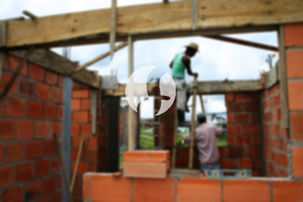

**Biaya Bangun Rumah Per Meter Di Roa Malaka Jakarta** - Hai Mitra Sumber Material! Bagaimana kabarnya hari ini? Kami dari Sumber Material hadir untuk membantu Anda mewujudkan rumah impian di Roa Malaka Jakarta. Seiring dengan perkembangan zaman, jasa membangun rumah semakin diminati. Munculnya banyak penyedia jasa membuat Anda memiliki lebih banyak pilihan, dan penting untuk memilih yang paling sesuai dengan kebutuhan Anda. Tingginya pertumbuhan populasi juga mendorong kebutuhan akan tempat tinggal yang memadai. Para kontraktor properti berlomba-lomba menawarkan berbagai pilihan, mulai dari rumah sederhana hingga mewah. Kepercayaan pembeli menjadi kunci utama, sehingga jasa bangun rumah selalu berupaya memberikan pelayanan terbaik dan menjaga reputasi mereka. Dengan demikian, penyedia jasa bangun rumah akan menawarkan berbagai layanan untuk memenuhi kebutuhan Anda. Berikut adalah beberapa tipe layanan dari jasa bangun rumah yang dapat Anda pilih:



## Biaya Jasa Desain Gambar Arsitek Di Roa Malaka Jakarta

Sebagai penyedia jasa arsitek, kami akan mengamati dan mewujudkan desain rumah yang Anda impikan. Dengan desain yang baik, rumah Anda akan terlihat indah dan nyaman. Kami memahami bahwa desain adalah faktor penting yang perlu diperhatikan. Karena, desain yang tepat akan membuat rumah Anda tampak menarik dan fungsional. Anda tidak perlu khawatir, karena Kami akan membuat desain yang sesuai dengan anggaran yang Anda miliki. Dengan desain yang jelas, Anda dapat memperkirakan biaya yang dibutuhkan untuk mewujudkan rumah impian Anda. Selain itu, Kami juga mempertimbangkan material bangunan yang akan digunakan. Proses ini memang kompleks, itulah mengapa memilih jasa arsitek yang tepat sangatlah penting. Kami akan memahami keinginan Anda dan mewujudkannya ke dalam desain yang memuaskan.

Biaya jasa desain rumah Kami bervariasi tergantung pada luas bangunan dan tingkat kesulitan desain. Saat ini, Kami menawarkan harga per meter untuk jasa desain rumah minimalis satu lantai, mulai dari Rp 54.000,-. Harga tersebut sudah termasuk desain, perhitungan RAB, dan dua kali revisi. Untuk rumah dua lantai atau lebih, biayanya dikalikan 2 atau 3 sesuai dengan jumlah lantai.

## Estimasi Biaya Borong Renovasi Tempat Tinggal Di Roa Malaka Jakarta

Kita semua tahu bahwa memiliki rumah adalah kebutuhan dasar manusia. Seiring dengan bertambahnya jumlah penduduk, permintaan akan rumah juga meningkat. Banyak penyedia jasa bangun rumah yang menawarkan produk dan layanan terbaik untuk memenuhi kebutuhan ini. Di sinilah peran penting dari jasa bangun rumah dalam menangani proses pembangunan rumah Anda. Dengan memilih jasa bangun rumah yang tepat, Anda akan mendapatkan layanan yang sesuai dengan harapan Anda. Memiliki rumah yang bagus adalah impian setiap orang. Dengan mempercayakan pembangunan rumah Anda kepada Kami, Anda tidak perlu khawatir untuk mendesain rumah sendiri. Kami akan selalu berusaha memahami keinginan Anda dan mewujudkannya menjadi kenyataan, sehingga Anda akan merasa puas dengan hasilnya.

Untuk harga layanan borong renovasi rumah, Kami menawarkan beberapa pilihan harga. Harga tersebut disesuaikan dengan material bangunan yang digunakan dan lokasi bangunan. Dengan asumsi lokasi tanah dalam kondisi rata, stabil, dan tidak memerlukan pengurugan. Harga per meter dengan material dinding hebel adalah Rp 1.950.000,-, sedangkan dengan material bata merah adalah Rp 2.200.000,-. Harga tersebut termasuk pondasi batu gunung, kolom dan tiang beton, lantai keramik standar, dan atap dengan rangka baja ringan plus genteng spandek. Untuk pilihan genteng dan keramik lainnya, Anda dapat menyesuaikan dengan preferensi Anda, dan harga akan disesuaikan.

## Kisaran Biaya Rombak Rumah Di Roa Malaka Jakarta

Selain jasa arsitek dan borongan bangun rumah, Kami juga menyediakan jasa renovasi bangunan. Jasa renovasi rumah adalah solusi untuk mengubah tampilan rumah Anda agar terlihat baru kembali. Dengan bantuan jasa renovasi rumah, Anda tidak perlu bingung dalam menentukan cara merenovasi bangunan Anda. Renovasi yang Kami lakukan dapat berupa perubahan bentuk model rumah atau perubahan menyeluruh. Renovasi memang menjadi alternatif untuk meningkatkan tampilan rumah Anda, tetapi seringkali terhambat karena anggaran terbatas. Namun, dengan adanya jasa renovasi rumah, masalah ini dapat diatasi. Kami hadir sebagai penyedia jasa renovasi yang akan memudahkan Anda dalam merenovasi rumah Anda menjadi lebih segar dan menarik. Kami siap mewujudkan impian Anda untuk memiliki rumah yang indah.

Harga borongan jasa renovasi rumah Kami bervariasi tergantung pada kondisi kerusakan bangunan. Setiap bangunan memiliki tingkat kerusakan yang berbeda-beda, sehingga Kami akan menyesuaikan harga sesuai dengan jenis kerusakan yang akan diperbaiki. Untuk tenaga tukang harian, harga yang Kami tawarkan adalah Rp 150.000,- per hari untuk tukang dan Rp 100.000,- per hari untuk kenek.

## Dukungan Tukang dan Arsitek Terbaik Di Roa Malaka Jakarta

Baik jasa arsitek, jasa bangun rumah, maupun borongan renovasi rumah, semuanya memiliki peran yang sangat penting. Dengan dukungan arsitek profesional dan tenaga kerja yang handal, Kami akan membantu mewujudkan impian Anda. Dengan membangun rumah idaman bersama Kami, Anda akan memiliki rumah yang menarik dan indah. Anda tidak perlu khawatir, karena Kami akan memberikan pelayanan terbaik, menjaga mutu dan kualitas, serta memberikan kepuasan kepada Anda. Sebagai penyedia jasa, kepuasan pelanggan adalah motivasi Kami untuk terus berkarya dan menghasilkan karya yang lebih baik. Anda dapat melihat katalog proyek Kami untuk melihat hasil karya Kami sebelumnya. Katalog tersebut akan membuktikan bahwa Kami adalah pilihan terbaik dan terpercaya.

Perlu diingat, bahwa rumah adalah kebutuhan primer manusia selain sandang dan pangan. Rumah menjadi tempat berlindung dari cuaca panas dan dingin, serta melindungi dari berbagai bahaya. Hal ini menjadi peluang bagi penyedia jasa bangun rumah untuk mempresentasikan jasanya. Sebagai penyedia jasa terkhusus dalam pembangunan rumah di Roa Malaka Jakarta, Kami berpartisipasi meramaikan dunia arsitektur yang terus berkembang dengan menawarkan jasa melalui berbagai media. Mulai dari media cetak hingga media online, Kami manfaatkan untuk menjangkau lebih banyak calon pelanggan. Hal ini tentu membantu banyak orang yang ingin membangun rumah. Dengan menjaga mutu dan kualitas terbaik, Kami telah memiliki pengalaman yang cukup lama dalam dunia arsitektur. Inilah sebabnya, Kami semakin dipercaya oleh banyak orang.

Dengan dukungan arsitek profesional dan tenaga kerja yang handal, Kami akan mewujudkan jasa bangun rumah yang semakin dikenal dan terpercaya. Hal ini terlihat dari perkembangan yang selalu Kami berikan. Kami terus berkarya menciptakan karya-karya baru yang inovatif dan kreatif. Banyak bangunan-bangunan yang dibangun dengan desain apik dan menarik oleh Kami. Dengan proses pengerjaan yang efisien, Anda akan segera memiliki rumah impian Anda. Baik rumah berskala kecil maupun besar, semuanya dapat Kami tangani dengan baik. [bangun rumah di Cawang](/bangunan/biaya-bangun-rumah-per-meter-di-cawang-jakarta/) Sehingga, Anda tidak perlu khawatir atau bingung. Mulai dari desain rumah, material bangunan, ukuran bangunan, dan sumber daya manusia, semuanya dapat Kami atasi. Kami akan menciptakan tata desain yang baik dan juga bertindak sebagai pengawas selama pembangunan. [Hubungi Kami Sekarang](https://api.whatsapp.com/send?phone=6285776786091&text=*Halo%20sumbermaterial.com*%20%3A) untuk informasi lebih lanjut!
