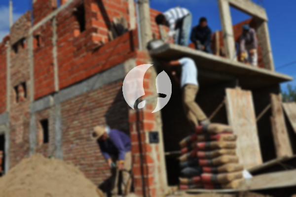

**Biaya Bangun Rumah Per Meter Di Sajira Rangkasbitung** - Hai Mitra Sumber Material! Gimana kabarnya? Kami dari Sumber Material ingin berbagi informasi penting bagi Anda yang berencana membangun rumah di Sajira Rangkasbitung. Permintaan jasa pembangunan rumah kian meningkat seiring perkembangan zaman, dengan layanan desain bangunan yang semakin populer. Banyak orang kini memilih jasa bangun rumah untuk memastikan kualitas dan estetika hunian impian mereka. Pertumbuhan populasi juga memicu kebutuhan akan tempat tinggal, mendorong para pengembang untuk membangun berbagai jenis properti. Kepercayaan konsumen menjadi kunci utama bagi layanan bangun rumah dalam melaksanakan pekerjaan sesuai harapan. Kami sebagai penyedia jasa yang terpercaya berkomitmen memberikan penawaran layanan terbaik untuk membangun rumah Anda. Berikut adalah beberapa tipe layanan yang dapat Anda pilih:



## Estimasi Biaya Desain Gambar Arsitek Di Sajira Rangkasbitung

Sebagai penyedia jasa arsitek, Kami akan mengamati dan merancang desain rumah yang sesuai dengan kebutuhan Anda di Sajira Rangkasbitung. Desain yang baik akan menciptakan keindahan dan kenyamanan rumah impian Anda. Kami menggunakan beberapa faktor penting untuk mewujudkan komposisi desain yang cantik dan selaras. Desain yang menarik adalah hal krusial karena dapat meningkatkan nilai estetika rumah Anda. Anda tidak perlu khawatir, karena Kami akan menciptakan desain yang sesuai dengan anggaran yang Anda miliki. Dari desain tersebut, Anda dapat memperkirakan biaya yang akan dikeluarkan untuk mewujudkan rumah impian Anda. Selain itu, desain juga mempertimbangkan pemilihan bahan bangunan yang tepat. Semua ini membutuhkan perencanaan yang matang, itulah mengapa Anda membutuhkan jasa arsitek profesional. Jasa arsitek Kami akan memahami keinginan Anda dan memberikan solusi terbaik.

Biaya jasa desain bangunan Kami bervariasi, tergantung pada luas bangunan dan tingkat kesulitan desain yang Anda inginkan. Saat ini, Kami menawarkan harga per meter untuk jasa desain, kalkulasi RAB, dan dua kali revisi. Untuk rumah minimalis satu lantai, biaya jasa desain adalah Rp 54.000,- per meter. Sedangkan untuk bangunan dua lantai atau lebih, harganya hanya dikali dua atau dikali tiga, sesuai dengan jumlah lantai.

## Harga Jasa Borong Renovasi Rumah Di Sajira Rangkasbitung

Setiap orang membutuhkan tempat tinggal yang nyaman dan aman. Hal ini menciptakan permintaan yang tinggi untuk layanan bangun rumah. Kami hadir sebagai solusi untuk membangun rumah impian Anda di Sajira Rangkasbitung. Dengan menggunakan jasa bangun rumah, Anda akan mendapatkan layanan yang sesuai dengan keinginan Anda. Memiliki rumah yang indah adalah impian semua orang, dan Kami siap membantu Anda mewujudkannya. Anda tidak perlu repot mendesain rumah sendiri, karena Kami akan berusaha memahami kemauan Anda dan menerjemahkannya ke dalam sebuah karya nyata. Hal ini akan membuat Anda merasa puas dan semakin percaya pada layanan Kami.

Untuk harga borong renovasi rumah, Kami menawarkan beberapa pilihan harga. Harga tersebut disesuaikan dengan bahan bangunan yang digunakan dan lokasi pembangunan di Sajira Rangkasbitung. Dengan asumsi tanah dalam kondisi rata dan stabil, tanpa perlu pengurugan. Harga per meter untuk material dinding hebel adalah Rp 1.950.000,-, sedangkan untuk material bata merah adalah Rp 2.200.000,-. Harga tersebut sudah termasuk pondasi batu sungai, kolom dan tiang beton, lantai keramik standar, serta atap rangka baja ringan dengan genteng spandek. Anda juga dapat memilih variasi genteng dan keramik lainnya sesuai dengan model, kualitas, dan anggaran Anda.

## Jasa Renovasi Tempat Tinggal Di Sajira Rangkasbitung

Selain layanan arsitek dan bangun rumah, Kami juga menyediakan jasa renovasi tempat tinggal. Renovasi bangunan adalah cara yang efektif untuk memberikan tampilan baru pada rumah Anda. Dengan bantuan jasa renovasi rumah Kami, Anda tidak perlu khawatir dalam memastikan renovasi rumah berjalan lancar. Kami menawarkan renovasi yang dapat mengubah bentuk model rumah Anda secara menyeluruh atau sebagian. Renovasi memang menjadi pilihan untuk meningkatkan keindahan rumah, namun biaya yang terjangkau seringkali menjadi kendala. Namun, dengan adanya jasa renovasi rumah Kami, semua itu bisa diatasi. Kami hadir sebagai solusi renovasi bangunan yang akan membantu Anda menciptakan rumah yang lebih segar dan indah.

Biaya borong jasa renovasi rumah Kami bervariasi, tergantung pada situasi kerusakan bangunan. Setiap bangunan memiliki tingkat kerusakan yang berbeda-beda, sehingga harga disesuaikan dengan jenis kerusakan yang akan diperbaiki. Namun, untuk biaya tenaga tukang harian, harganya adalah Rp 150.000,- per hari untuk tukang dan Rp 100.000,- per hari untuk kenek.

## Didukung Tukang Dan Arsitek Berpengalaman Di Sajira Rangkasbitung

Layanan arsitek, bangun rumah, atau renovasi sama-sama memiliki peran penting dalam mewujudkan hunian impian Anda di Sajira Rangkasbitung. Dengan dukungan arsitek profesional dan tenaga kerja yang handal, Kami akan membantu mewujudkan impian Anda. Membangun rumah idaman bersama Kami akan memberikan Anda rumah yang menarik dan indah. Anda tidak perlu khawatir, karena Kami selalu mengutamakan kualitas dan memberikan pelayanan terbaik untuk mencapai kepuasan Anda. Sebagai penyedia jasa, kepuasan pelanggan adalah penyemangat Kami untuk terus berkarya dan menghasilkan karya yang lebih baik. Anda dapat melihat katalog proyek Kami untuk membuktikan bahwa Kami adalah pilihan terbaik dan terpercaya.

Perlu diketahui, rumah adalah kebutuhan utama manusia selain sandang dan pangan. Rumah menjadi tempat berlindung dari cuaca ekstrem dan berbagai bahaya. Hal ini menciptakan peluang bagi penyedia jasa bangun rumah untuk menampilkan jasanya. Sebagai penyedia jasa terutama dalam layanan bangun rumah, Kami berpartisipasi dalam meramaikan dunia arsitektur dengan menawarkan layanan melalui berbagai media. Dari media cetak hingga media online dimanfaatkan untuk mempromosikan layanan Kami. Hal ini tentu membantu orang-orang yang berencana membangun rumah. Dengan menjaga kualitas terbaik, Kami telah memiliki pengalaman yang cukup lama dalam dunia arsitektur. Inilah yang membuat Kami semakin dipercaya oleh banyak orang.

Didukung oleh arsitek profesional dan tenaga kerja yang handal, Kami terus mengembangkan layanan Kami dan meningkatkan kemampuan Kami. Kami selalu berkarya dengan menciptakan desain yang inovatif dan kreatif. Banyak rumah dan bangunan yang dibangun dengan desain apik dan menarik dari jasa bangun rumah Kami. Dengan proses pengerjaan yang efisien, Anda akan segera mendapatkan rumah impian Anda. Baik rumah yang berskala kecil maupun besar, Kami mampu mengatasinya. Jadi, Anda tidak perlu cemas atau khawatir. Mulai dari desain bangunan, material bahan, ukuran bangunan, dan sumber daya manusia, semuanya dapat Kami atasi. Itulah peran penting dari jasa bangun rumah Kami. Karena, Kami akan menciptakan perencanaan yang matang dan melakukan pengawasan selama pembangunan. [Hubungi Kami Sekarang](https://api.whatsapp.com/send?phone=6285776786091&text=*Halo%20sumbermaterial.com*%20%3A) untuk konsultasi gratis! Anda juga dapat menelusuri lebih lanjut jasa membangun rumah di Banjarsari Rangkasbitung [bangun rumah di Banjarsari](/bangunan/biaya-bangun-rumah-per-meter-di-banjarsari-rangkasbitung/) atau di Bojongmanik Rangkasbitung [bangun rumah di Bojongmanik](/bangunan/biaya-bangun-rumah-per-meter-di-bojongmanik-rangkasbitung/). Kami siap membantu mewujudkan rumah impian Anda di Sajira Rangkasbitung!
