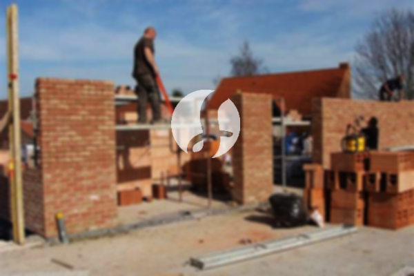

**Biaya Bangun Rumah Per Meter Di Selong Jakarta** - Hai Mitra Sumber Material! Gimana kabarnya hari ini? Kami dari Sumber Material hadir untuk memberikan solusi lengkap kebutuhan konstruksi Anda di Selong Jakarta. Seiring dengan perkembangan zaman, jasa bangun rumah semakin banyak dicari. Layanan ini terus berkembang, bahkan merambah ke desain rumah yang menarik dan fungsional. Hal ini memicu persaingan positif antar penyedia jasa, dan yang terpenting, memberikan lebih banyak pilihan kepada Anda, para pemilik proyek. Semakin padatnya populasi, kebutuhan akan hunian yang nyaman dan berkualitas juga ikut meningkat. Para pengembang properti berlomba-lomba menghadirkan beragam pilihan, dari perumahan sederhana hingga apartemen mewah. Kepercayaan pelanggan adalah kunci utama, dan kami berkomitmen untuk menjaga kepercayaan tersebut dengan memberikan layanan terbaik. Nah, bagi Anda yang sedang merencanakan pembangunan rumah di Selong Jakarta, artikel ini akan membahas secara detail biaya yang mungkin Anda keluarkan per meter persegi.



## Kisaran Biaya Desain Gambar Arsitek Di Selong Jakarta

Sebagai penyedia jasa desain, kami akan memastikan gambar hunian Anda tidak hanya indah secara visual, tetapi juga fungsional dan sesuai dengan kebutuhan Anda. Desain yang baik adalah fondasi dari bangunan yang berkualitas. Kami memperhatikan berbagai faktor penting untuk menciptakan komposisi desain yang harmonis. Seperti yang kita tahu, desain merupakan aspek krusial dalam pembangunan rumah. Desain yang menarik akan membuat rumah Anda terlihat cantik dan berkarakter. Anda tidak perlu khawatir, karena kami dapat menyesuaikan desain dengan anggaran yang Anda miliki. Dari desain inilah, Anda dapat memperkirakan biaya yang dibutuhkan untuk mewujudkan rumah impian Anda. Selain itu, kami juga mempertimbangkan material bangunan yang akan digunakan dalam proses desain. Semua aspek ini membutuhkan keahlian seorang arsitek profesional. Dengan begitu, Anda akan mendapatkan desain yang sesuai dengan ekspektasi Anda.

Biaya jasa desain bangunan dari Kami bervariasi, tergantung pada luas bangunan dan tingkat kerumitan desain yang diinginkan. Saat ini, kami menawarkan harga jasa desain rumah dengan harga per meter persegi. Harga jasa desain bangunan minimalis satu lantai adalah Rp 54.000,- per meter persegi, sudah termasuk desain, perhitungan RAB (Rencana Anggaran Biaya), dan 2 kali revisi. Untuk bangunan 2 lantai atau lebih, biayanya bisa dikalikan 2 atau 3 sesuai jumlah lantai.

## Estimasi Biaya Borong Bangun Bangunan Di Selong Jakarta

Membangun rumah adalah impian setiap orang. Dengan banyaknya layanan bangun rumah yang tersedia, Anda dapat memilih yang paling sesuai dengan kebutuhan dan anggaran Anda. Kami hadir sebagai solusi untuk mewujudkan impian Anda memiliki rumah yang nyaman dan berkualitas di Selong Jakarta. Memiliki rumah yang indah dan fungsional tentu menjadi harapan semua orang. Dengan memanfaatkan jasa bangun rumah, Anda akan terbantu dalam mewujudkan impian tersebut. Anda tidak perlu repot memikirkan desain, pemilihan material, atau proses pembangunan. Kami akan mengurus semuanya untuk Anda. Mitra Sumber Material akan berusaha memahami keinginan Anda dan mewujudkannya menjadi sebuah karya nyata.

Untuk harga borong bangun bangunan, Kami menawarkan beberapa tingkatan harga yang disesuaikan dengan kualitas material dan lokasi pembangunan. Dengan asumsi kondisi tanah yang rata, stabil, dan tidak memerlukan pengurukan, perkiraan harganya sebagai berikut: Harga per meter persegi dengan material dinding hebel adalah Rp 1.950.000,-, sedangkan dengan material bata merah adalah Rp 2.200.000,-. Harga tersebut sudah termasuk pondasi batu kali, kolom dan tiang beton, lantai keramik standar, serta atap rangka baja ringan dengan genteng spandek. Untuk jenis genteng dan keramik, Anda dapat memilih sesuai preferensi, dengan penyesuaian harga dan kualitas.

## Harga Jasa Renovasi Rumah Di Selong Jakarta

Selain jasa desain dan bangun rumah, Kami juga menyediakan layanan renovasi bangunan di Selong Jakarta. Renovasi rumah adalah cara yang efektif untuk memberikan tampilan baru pada hunian Anda. Kami memahami bahwa setiap bangunan memiliki kondisi yang berbeda-beda. Oleh karena itu, Kami menawarkan solusi renovasi yang disesuaikan dengan kebutuhan Anda. Jasa renovasi Kami meliputi perubahan tampilan bangunan, perbaikan kerusakan, atau renovasi total. Renovasi dapat menjadi pilihan yang tepat jika Anda ingin memperbarui rumah Anda tanpa mengeluarkan biaya yang terlalu besar. Namun, renovasi juga dapat menjadi tantangan, terutama jika Anda tidak memiliki pengalaman dan keahlian yang cukup. Dengan mempercayakan renovasi kepada Kami, Anda dapat memastikan bahwa prosesnya berjalan lancar dan hasilnya sesuai dengan harapan Anda. Kami siap membantu Anda mewujudkan rumah impian yang lebih modern dan nyaman.

Untuk harga borongan renovasi bangunan, Kami tidak menetapkan harga yang sama untuk setiap proyek. Hal ini disebabkan karena kondisi kerusakan bangunan bervariasi. Kami akan melakukan survei terlebih dahulu untuk menilai kerusakan dan memberikan penawaran harga yang sesuai. Namun, jika Anda lebih memilih menggunakan jasa tenaga tukang harian, harganya adalah Rp 150.000,- per hari untuk tukang dan Rp 100.000,- per hari untuk kenek.

## Dukungan Tenaga Kerja dan Arsitek Berpengalaman Di Selong Jakarta

Baik jasa desain, bangun rumah, maupun renovasi, semuanya memerlukan peran penting dari tenaga kerja dan arsitek yang profesional. Kami memiliki tim yang solid dan berpengalaman di bidangnya. Dengan dukungan arsitek yang kompeten dan tenaga kerja yang terampil, Kami dapat membantu mewujudkan impian Anda memiliki rumah yang berkualitas. Membangun rumah bersama Kami berarti Anda mendapatkan pelayanan terbaik, mutu terjamin, dan kepuasan yang maksimal. Kepuasan pelanggan adalah prioritas utama Kami, dan menjadi motivasi Kami untuk terus berkarya dan memberikan yang terbaik. Anda dapat melihat contoh proyek yang telah Kami kerjakan melalui katalog proyek Kami. Katalog tersebut dapat menjadi bukti bahwa Kami adalah pilihan yang tepat dan terpercaya.

Perlu Kami ingatkan, rumah adalah kebutuhan pokok manusia, sama pentingnya dengan sandang dan pangan. Rumah menjadi tempat berlindung dari panas dan dingin, serta melindungi Anda dari berbagai bahaya. Hal ini menjadi peluang bagi penyedia jasa bangun rumah untuk menawarkan solusi bagi Anda yang ingin membangun hunian impian. Sebagai penyedia jasa terpercaya di Selong Jakarta, Kami aktif berpartisipasi dalam perkembangan dunia arsitektur modern. Kami memanfaatkan berbagai media, baik cetak maupun online, untuk memperkenalkan layanan Kami kepada masyarakat luas. Hal ini bertujuan untuk memudahkan Anda dalam mencari informasi dan memilih penyedia jasa yang tepat. Dengan mempertahankan kualitas dan standar terbaik, Kami telah membuktikan diri sebagai penyedia jasa yang berpengalaman dan terpercaya.

Dengan dukungan tim arsitek profesional dan tenaga kerja yang handal, Kami yakin dapat memberikan pelayanan yang terbaik bagi Anda. Kami terus berinovasi dan mengembangkan diri untuk memenuhi kebutuhan pasar yang semakin dinamis. Proses pengerjaan yang cepat dan efisien, memungkinkan Anda untuk segera menempati rumah impian Anda. Kami dapat menangani proyek skala kecil maupun besar dengan baik. Mulai dari desain, pemilihan material, hingga pelaksanaan pembangunan, semuanya dapat Kami atasi. Dengan begitu, Anda dapat fokus pada hal-hal lain yang penting dalam hidup Anda. Karena, hanya Kami yang akan menciptakan rancangan yang sempurna dan mengawasi seluruh proses pembangunan dengan cermat. Untuk informasi lebih lanjut, Anda dapat [hubungi Kami sekarang!](https://api.whatsapp.com/send?phone=6285776786091&text=*Halo%20sumbermaterial.com*%20%3A).
