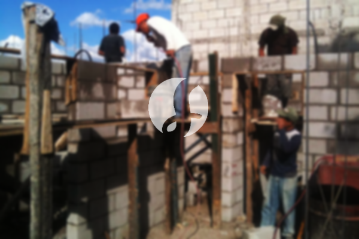

**Biaya Bangun Rumah Per Meter Di Sempur Bogor** - Hai Mitra Sumber Material! Gimana kabarnya? Kami dari Sumber Material hadir untuk membantu mewujudkan impian memiliki rumah impian Anda di Sempur Bogor. Seiring dengan perkembangan zaman, layanan bangun bangunan kini semakin diminati. Jasa pembangunan rumah memang mulai bertumbuh dan merambah ke jasa desain bangunan. Hal ini membuat banyak orang lebih selektif memilih jasa bangun rumah. Semakin meningkatnya jumlah penduduk, otomatis kebutuhan tempat tinggal pun ikut bertambah. Karena itulah, para pengembang properti berlomba-lomba membangun rumah atau perumahan, apartemen, tempat tinggal susun, mulai dari kelas ekonomis hingga mewah. Dengan kepercayaan yang diberikan pembeli, jasa bangun rumah akan berjuang dan menjaga kepercayaan tersebut dengan menjalankan pekerjaan sesuai amanah. Dengan begitu, sebagai penyedia jasa bangun rumah yang terpercaya, kami menawarkan berbagai layanan dalam membangun rumah. Berikut beberapa tipe layanan dari jasa bangun rumah yang dapat Anda pilih:



## Harga Layanan Desain Gambar Arsitek Di Sempur Bogor

Sebagai penyedia jasa arsitek, kami akan mengamati desain suatu bangunan yang akan dibuat. Dengan desain yang dihasilkan, kami berupaya memunculkan keindahan rumah tersebut. Untuk itu, kami memanfaatkan beberapa faktor penting untuk mewujudkan komposisi desain yang bagus dan selaras. Seperti yang kita tahu, desain terkadang menjadi hal yang amat penting untuk diperhatikan. Karena, dengan desain yang baik, rumah akan terlihat cantik. Anda tak perlu khawatir, karena kami akan membuat desain yang sesuai dengan anggaran yang Anda miliki. Dari desain itulah, Anda dapat memperkirakan biaya yang akan dikeluarkan untuk mewujudkan desain rumah yang Anda inginkan. Selain itu, desain yang dibuat juga harus mempertimbangkan bahan bangunan yang akan digunakan. Semua hal ini cukup rumit, itulah mengapa Anda perlu memilih jasa arsitek profesional. Jasa arsitek akan memahami keinginan Anda, sehingga Anda akan merasa puas dengan hasilnya.

Biaya jasa desain bangunan dari kami bervariasi. Sangat bergantung pada luas rumah dan kerumitan desain yang diminta. Saat ini, kami memasang harga jasa desain bangunan minimalis satu lantai sebesar Rp 54.000,- per meter. Harga tersebut sudah termasuk desain, perhitungan RAB dan 2 kali revisi. Namun untuk rumah 2 lantai atau lebih, harganya tinggal dikalikan 2 atau dikalikan 3 saja sesuai dengan jumlah lantai.

## Ongkos Borong Bangun Rumah Di Sempur Bogor

Seiring dengan bertambahnya populasi bumi, kebutuhan akan tempat tinggal juga semakin meningkat. Banyak jasa bangun rumah yang hadir menawarkan produk dan layanan terbaiknya kepada calon pembeli. Disinilah peran utama jasa bangun rumah dalam menangani permasalahan pembangunan sebuah rumah. Dengan memilih jasa bangun rumah yang tepat, Anda akan memperoleh layanan yang sesuai harapan Anda. Memiliki rumah yang cantik adalah impian semua orang. Dengan menggunakan jasa bangun rumah, Anda akan dibantu mewujudkan impian tersebut. Dengan membangun rumah dengan sistem borongan, Anda tidak perlu repot mendesain rumah sendiri. Karena, jasa bangun rumah akan berusaha memahami keinginan Anda, yaitu dengan mewujudkan impian Anda ke dalam karya nyata berupa bangunan impian. Hal ini akan membuat Anda merasa puas dan menjadikannya jasa bangun rumah yang semakin terpercaya.

Untuk ongkos borong bangun rumah, kami menawarkan beberapa tingkatan harga. Harga disesuaikan dengan material bangunan yang digunakan dan lokasi pembangunan. Dengan asumsi area tanah yang akan dibangun dalam kondisi rata, stabil, dan tidak memerlukan pengurukan, harga per meter dengan material dinding hebel adalah Rp 1.950.000,-, dan dengan material bata merah adalah Rp 2.200.000,-. Harga tersebut sudah termasuk pondasi batu sungai, kolom dan tiang beton, lantai keramik standar, serta atap dengan rangka baja ringan dan genteng spandek. Pilihan genteng dan keramik lain tersedia, dengan model, mutu, dan harga yang menyesuaikan.

## Ongkos Rombak Rumah Di Sempur Bogor

Selain layanan arsitek dan borongan bangun rumah, kami juga menyediakan jasa renovasi rumah. Jasa renovasi rumah adalah cara yang tepat untuk memberikan tampilan baru pada rumah Anda. Dengan bantuan jasa renovasi bangunan, Anda tidak perlu khawatir memastikan renovasi bangunan Anda. Kami menyediakan jasa renovasi yang meliputi perubahan tampilan rumah, atau bahkan perubahan menyeluruh. Renovasi memang menjadi solusi untuk mengubah rumah agar terlihat lebih bagus. Namun, dengan biaya yang terjangkau, seseorang mungkin akan kesulitan melakukannya. Namun, dengan adanya jasa renovasi rumah, semua itu bisa diatasi. Karena, jasa renovasi rumah hadir sebagai layanan yang akan memudahkan Anda merenovasi rumah menjadi lebih indah dan menarik. Kami siap mewujudkan rumah impian Anda.

Harga borongan jasa renovasi bangunan kami bervariasi. Kondisi kerusakan rumah yang akan direnovasi sangat mempengaruhi harga. Untuk biaya jasa renovasi dengan tenaga tukang harian, harganya adalah Rp 150.000,- per hari untuk tukang dan Rp 100.000,- per hari untuk kenek.

## Disupport Tenaga Kerja Dan Arsitek Berpengalaman Di Sempur Bogor

Baik layanan arsitek, borongan bangun rumah, maupun jasa renovasi bangunan, semuanya memiliki peran penting. Dengan dukungan arsitek profesional dan tenaga kerja yang handal, kami akan membantu mewujudkan impian Anda. Dengan membangun rumah idaman bersama kami, Anda akan memiliki rumah yang menarik dan indah. Anda tidak perlu cemas, karena kami akan memberikan pelayanan terbaik, mempertahankan mutu dan kualitas untuk memberikan kepuasan kepada Anda. Sebagai jasa bangun rumah, kepuasan pelanggan menjadi penyemangat kami untuk terus berkarya melalui karya-karya yang lebih baik. Melalui katalog hasil proyek jasa bangun rumah, Anda dapat melihat contoh karya kami. Ini membuktikan bahwa kami adalah pilihan terbaik dan terpercaya untuk pembangunan rumah di Sempur Bogor.

Perlu diketahui bahwa rumah merupakan kebutuhan dasar manusia, sama pentingnya dengan sandang dan pangan. Rumah menjadi tempat berteduh dari cuaca panas dan dingin, serta melindungi dari berbagai bahaya. Hal ini menjadi peluang bagi penyedia jasa bangun rumah untuk menawarkan jasanya. Sebagai penyedia jasa, khususnya jasa bangun rumah, kami berpartisipasi meramaikan dunia arsitektur yang terus berkembang dengan mempromosikan layanan kami melalui berbagai media. Mulai dari media cetak hingga media online, kami gunakan untuk menjangkau calon pelanggan yang ingin membangun rumah. Dengan menjaga mutu dan kualitas terbaik, kami telah memiliki pengalaman yang cukup lama dalam menggeluti dunia arsitektur. Inilah alasan mengapa kami semakin banyak dipercaya oleh banyak orang.

Didukung oleh arsitek profesional dan tenaga kerja yang handal, tentu akan membuat jasa bangun rumah semakin dikenal dan dipercaya kemampuannya. Hal ini terlihat dari perkembangan yang kami berikan. Kami selalu berkarya menciptakan karya-karya baru yang inovatif dan kreatif. Banyak bangunan yang dibangun dengan desain apik dan menarik berkat jasa bangun rumah. Dengan proses pengerjaan yang efisien, Anda akan segera mendapatkan rumah impian. Baik bangunan berskala kecil maupun besar, kami dapat mengatasinya. Jadi, Anda tidak perlu cemas atau khawatir. Mulai dari desain rumah, material bahan, ukuran rumah, dan sumber daya manusia, semuanya dapat kami atasi. Dengan begitu, kami dapat mendukung terwujudnya rumah yang cantik dan menarik. Disitulah peran penting jasa bangun rumah. Karena, kami akan menciptakan rancangan dan juga bertindak sebagai pengawas pembangunan. [Hubungi Kami Sekarang](https://api.whatsapp.com/send?phone=6285776786091&text=*Halo%20sumbermaterial.com*%20%3A) untuk konsultasi gratis! Anda juga bisa melihat layanan bangun rumah di [bangun rumah di Bondongan](/bangunan/biaya-bangun-rumah-per-meter-di-bondongan-bogor/) atau [bangun rumah di Babakan Pasar](/bangunan/biaya-bangun-rumah-per-meter-di-babakan-pasar-bogor/).
