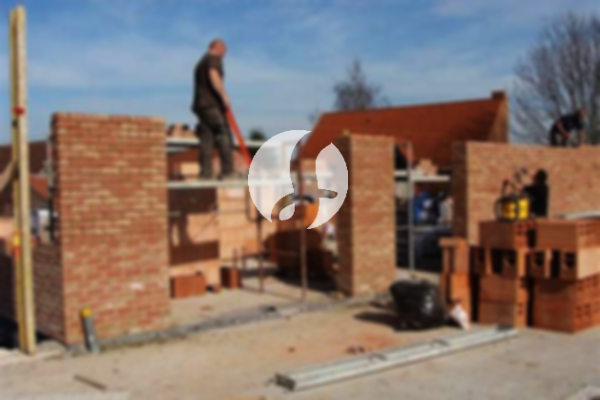

**Biaya Bangun Rumah Per Meter Di Serpong Tangerang** - Hai Mitra Sumber Material! Gimana kabarnya hari ini? Kami dari penyedia jasa konstruksi di Serpong Tangerang ingin berbagi informasi penting seputar biaya membangun rumah per meter. Seiring perkembangan zaman, kebutuhan akan layanan pembangunan semakin meningkat, bahkan berkembang pesat menjadi jasa desain rumah yang komprehensif. Hal ini memicu persaingan sehat antar penyedia jasa, di mana kualitas dan kepercayaan menjadi kunci utama. Dengan pertumbuhan populasi yang pesat, kebutuhan akan tempat tinggal pun melonjak. Para pengembang properti berlomba-lomba menghadirkan berbagai pilihan hunian, mulai dari standar hingga mewah. Sebagai penyedia jasa bangun rumah terpercaya, Kami berkomitmen untuk memberikan layanan terbaik dan mempertahankan kepercayaan yang telah diberikan oleh pelanggan setia Kami di Serpong Tangerang. Kami menawarkan beberapa jenis layanan yang dapat Anda pilih sesuai kebutuhan:



## Jasa Desain Gambar Arsitektur Di Serpong Tangerang

Sebagai mitra terpercaya dalam mewujudkan rumah impian Anda, Kami sangat memperhatikan desain bangunan. Desain yang baik akan menciptakan keindahan dan kenyamanan hunian Anda. Kami akan menciptakan komposisi desain yang selaras dan menarik dengan memperhatikan berbagai faktor penting. Kami memahami bahwa desain memegang peran krusial dalam estetika rumah Anda. Oleh karena itu, Kami akan menyesuaikan desain dengan budget yang Anda miliki. Dengan desain yang jelas, Anda dapat memahami perkiraan biaya yang dibutuhkan untuk mewujudkan rumah impian Anda. Selain itu, Kami juga mempertimbangkan pemilihan material bangunan yang sesuai dengan desain dan budget Anda. Proses ini memang cukup kompleks, itulah mengapa Kami menyarankan Anda untuk menggunakan jasa arsitek profesional. Seorang arsitek akan memahami keinginan Anda dan menerjemahkannya menjadi desain yang memuaskan.

Harga jasa desain bangunan Kami bervariasi tergantung pada luas bangunan dan kompleksitas desain yang Anda inginkan. Saat ini, Kami menetapkan harga per meter untuk desain rumah minimalis satu lantai sebesar Rp 54.000,-. Harga tersebut sudah termasuk desain, perhitungan RAB (Rencana Anggaran Biaya), dan dua kali revisi. Untuk bangunan dua lantai atau lebih, harga akan disesuaikan, biasanya dikalikan 2 atau 3 sesuai jumlah lantai.

## Harga Layanan Borong Bangun Rumah Di Serpong Tangerang

Seiring dengan pertambahan jumlah penduduk, kebutuhan akan tempat tinggal semakin meningkat. Banyak penyedia jasa bangun rumah menawarkan layanan terbaik mereka untuk menarik pelanggan. Disinilah peran penting Kami dalam menangani permasalahan pembangunan rumah Anda. Dengan memilih Kami, Anda akan mendapatkan solusi yang sesuai dengan kebutuhan dan keinginan Anda. Memiliki rumah yang indah adalah impian setiap orang. Dengan mempercayakan pembangunan rumah Anda kepada Kami, Anda akan Kami bantu mewujudkan impian tersebut. Kami akan memahami keinginan Anda dan menerjemahkannya menjadi karya nyata yang memuaskan. Kepuasan Anda adalah prioritas Kami, dan hal ini menjadi motivasi Kami untuk terus memberikan yang terbaik.

Untuk biaya borong bangun rumah, Kami menawarkan beberapa tingkatan harga yang disesuaikan dengan material bangunan dan lokasi pembangunan di Serpong Tangerang. Dengan asumsi kondisi tanah rata, stabil, dan tidak memerlukan pengurukan, harga per meter untuk material dinding hebel adalah Rp 1.950.000,-, sedangkan untuk material bata merah adalah Rp 2.200.000,-. Harga tersebut sudah termasuk pondasi batu kali, kolom dan tiang beton, lantai keramik standar, serta atap dengan rangka baja ringan dan genteng spandek. Untuk jenis genteng dan keramik, Anda dapat memilih sesuai preferensi dan anggaran Anda.

## Jasa Perbaikan Rumah Di Serpong Tangerang

Selain layanan desain dan pembangunan, Kami juga menyediakan jasa renovasi rumah. Renovasi adalah cara efektif untuk memberikan tampilan baru pada rumah Anda. Dengan layanan renovasi Kami, Anda tidak perlu khawatir tentang prosesnya. Renovasi yang Kami lakukan dapat berupa perubahan bentuk model rumah atau perubahan menyeluruh. Renovasi menjadi solusi alternatif untuk mempercantik rumah tanpa harus mengeluarkan biaya yang besar. Namun, seringkali renovasi menjadi sulit dilakukan karena anggaran terbatas. Itulah mengapa Kami hadir sebagai solusi renovasi bangunan yang memudahkan Anda. Kami siap membantu Anda merenovasi bangunan Anda agar terlihat lebih segar dan indah dari sebelumnya.

Biaya borongan jasa renovasi Kami bervariasi tergantung pada kondisi kerusakan bangunan. Kami akan melakukan survei terlebih dahulu untuk menentukan perkiraan biaya yang sesuai. Untuk jasa renovasi dengan tenaga tukang harian, Kami mengenakan biaya Rp 150.000,- per hari untuk tukang dan Rp 100.000,- per hari untuk kenek.

## Didukung Tukang Dan Arsitek Terbaik Di Serpong Tangerang

Baik jasa desain, pembangunan, maupun renovasi, semuanya memiliki peran penting dalam mewujudkan hunian impian Anda. Dengan dukungan arsitek profesional dan tenaga kerja terhandal, Kami akan membantu mewujudkan impian Anda. Membangun rumah impian bersama Kami akan memberikan Anda hunian yang menarik dan berkualitas. Kami menjamin kualitas dan mutu pekerjaan Kami untuk memberikan kepuasan maksimal kepada Anda. Sebagai penyedia jasa bangun rumah, kepuasan pelanggan adalah prioritas utama Kami. Kami selalu berusaha memberikan yang terbaik melalui karya-karya yang lebih baik lagi. Anda dapat melihat katalog proyek-proyek yang telah Kami kerjakan untuk membuktikan kualitas Kami.

Perlu diingat bahwa rumah adalah kebutuhan pokok manusia yang sangat penting. Rumah melindungi kita dari cuaca ekstrem dan berbagai bahaya. Hal ini menjadi peluang bagi Kami sebagai penyedia jasa bangun rumah untuk menawarkan layanan terbaik Kami. Sebagai penyedia jasa, Kami berpartisipasi aktif dalam meramaikan dunia arsitektur dengan mempresentasikan layanan Kami melalui berbagai media, baik cetak maupun online. Hal ini memudahkan banyak orang untuk mewujudkan rumah impian mereka. Kami selalu menjaga mutu dan kualitas terbaik dalam setiap pekerjaan Kami, sehingga Kami telah memiliki pengalaman yang cukup lama dalam menggeluti dunia arsitektur. Itulah mengapa Kami semakin dipercaya oleh banyak orang.

Dengan dukungan arsitek profesional dan tenaga kerja yang handal, Kami semakin dikenal dan dipercaya kemampuannya. Hal ini terlihat dari perkembangan yang terus Kami lakukan untuk menciptakan karya-karya yang inovatif dan kreatif. Banyak bangunan indah dengan desain apik telah Kami bangun. Kami juga menawarkan proses pengerjaan yang cepat dan efisien, sehingga Anda dapat segera menikmati rumah impian Anda. Baik rumah berskala kecil maupun besar, Kami mampu mengatasinya dengan baik. Anda tidak perlu ragu atau khawatir karena Kami akan membantu Anda dalam segala aspek pembangunan. Mulai dari desain rumah, pemilihan material, ukuran bangunan, hingga tenaga kerja, semuanya akan Kami tangani dengan profesional. Kami akan menciptakan perencanaan yang matang dan melakukan pengawasan ketat selama proses pembangunan. [Hubungi Kami Sekarang!](https://api.whatsapp.com/send?phone=6285776786091&text=*Halo%20sumbermaterial.com*%20%3A) Yuk, wujudkan rumah impian Anda bersama Kami di Serpong Tangerang! [bangun rumah di Batuceper](/bangunan/biaya-bangun-rumah-per-meter-di-batuceper-tangerang/) Untuk layanan di Batuceper, Kami juga siap membantu! [bangun rumah di Balaraja](/bangunan/biaya-bangun-rumah-per-meter-di-balaraja-tangerang/) Kami juga melayani proyek bangun rumah di Balaraja.
