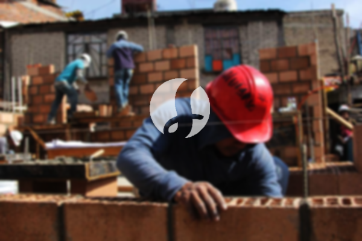

**Biaya Bangun Rumah Per Meter Di Serua Depok** - Hai Mitra Sumber Material! Bagaimana kabar Anda? Seiring dengan perkembangan zaman, layanan pembangunan rumah semakin diminati di Serua Depok. Jasa konstruksi kini tak hanya menawarkan pembangunan, tetapi juga desain rumah yang menarik. Ini membuat masyarakat lebih selektif dalam memilih penyedia jasa yang tepat untuk mewujudkan rumah impian mereka. Kebutuhan akan tempat tinggal terus meningkat seiring pertumbuhan penduduk, dan hal ini memicu persaingan sehat antar kontraktor properti untuk menawarkan layanan terbaik, mulai dari rumah sederhana hingga mewah. Kepercayaan pelanggan adalah kunci utama, dan penyedia jasa konstruksi akan berupaya keras menjaganya dengan memberikan hasil yang sesuai harapan. Kami, sebagai penyedia layanan bangun rumah terpercaya di Serua Depok, hadir dengan berbagai penawaran yang bisa Anda pilih:



## Desain Gambar Arsitek Profesional Di Serua Depok

Sebagai mitra terpercaya Anda dalam membangun rumah impian, Kami sangat memperhatikan aspek desain arsitektur. Desain yang baik akan menciptakan rumah yang indah, nyaman, dan fungsional. Kami memanfaatkan berbagai faktor penting untuk menghasilkan komposisi desain yang harmonis dan sesuai dengan keinginan Anda. Kami memahami bahwa desain merupakan elemen krusial dalam sebuah bangunan, karena akan menentukan tampilan visual rumah secara keseluruhan. Dengan desain yang tepat, rumah Anda akan terlihat menarik dan berkarakter.

Kami berkomitmen untuk membuat desain yang sesuai dengan anggaran yang Anda miliki. Melalui desain tersebut, Anda dapat memperkirakan biaya yang dibutuhkan untuk mewujudkan rumah impian Anda. Selain itu, Kami juga mempertimbangkan pemilihan material bangunan yang tepat agar sesuai dengan desain dan anggaran. Proses ini memang cukup kompleks, itulah mengapa Kami merekomendasikan untuk menggunakan jasa arsitek profesional. Dengan bantuan arsitek, Anda dapat mewujudkan desain yang sesuai dengan kebutuhan dan selera Anda.

Biaya jasa desain dari Kami bervariasi, tergantung pada luas bangunan dan tingkat kerumitan desain yang diminta. Saat ini, Kami menawarkan harga jasa desain rumah minimalis satu lantai mulai dari Rp54.000,- per meter persegi, sudah termasuk desain, perhitungan RAB, dan dua kali revisi. Untuk bangunan dua lantai atau lebih, biayanya hanya dikalikan dua atau tiga tergantung jumlah lantainya.

## Harga Borong Bangun Rumah Di Serua Depok

Memiliki rumah sendiri adalah impian setiap orang. Seiring dengan pertumbuhan populasi, kebutuhan akan jasa bangun rumah semakin meningkat. Banyak penyedia jasa konstruksi yang menawarkan berbagai produk dan layanan terbaik untuk memenuhi kebutuhan pasar. Inilah saatnya Anda memilih mitra yang tepat untuk membangun rumah impian Anda.

Sebagai penyedia jasa bangun rumah yang terpercaya, Kami akan membantu Anda mewujudkan impian tersebut. Dengan mempercayakan pembangunan rumah Anda kepada Kami, Anda tidak perlu khawatir tentang desain, material, atau proses konstruksi. Kami akan berusaha memahami harapan dan kebutuhan Anda, dan mewujudkannya dalam bentuk bangunan yang nyata dan sesuai dengan impian Anda. Kepuasan Anda adalah prioritas utama Kami.

Untuk jasa borong bangun rumah, Kami menawarkan beberapa tingkatan harga yang disesuaikan dengan material bangunan dan lokasi pembangunan. Dengan asumsi lahan dalam kondisi rata, stabil, dan tidak memerlukan pengurukan, harga per meter persegi dengan material dinding hebel adalah Rp1.950.000,-, dan Rp2.200.000,- untuk material bata merah. Harga tersebut sudah termasuk pondasi batu gunung, kolom dan tiang beton, lantai keramik standar, serta atap dengan rangka baja ringan plus genteng spandek. Untuk jenis genteng dan keramik, Anda dapat memilih sendiri sesuai dengan preferensi, model, dan kualitas yang diinginkan, dengan penyesuaian harga yang sesuai.

## Jasa Renovasi Rumah Terpercaya Di Serua Depok

Selain jasa arsitek dan borong bangun rumah, Kami juga menyediakan jasa renovasi rumah. Renovasi adalah solusi yang tepat untuk mengubah tampilan rumah Anda menjadi lebih segar dan modern. Dengan bantuan jasa renovasi bangunan, Anda tidak perlu repot mencari tukang atau mengurus proses renovasi sendiri. Kami menawarkan layanan renovasi yang komprehensif, mulai dari perubahan tampilan bangunan secara parsial hingga renovasi total.

Renovasi merupakan alternatif yang efektif untuk mempercantik rumah Anda dengan biaya yang lebih terjangkau. Namun, renovasi seringkali menjadi tantangan bagi mereka yang tidak memiliki pengalaman atau keahlian di bidang konstruksi. Dengan adanya jasa renovasi rumah, Anda dapat mengatasi masalah tersebut dengan mudah dan nyaman. Kami siap membantu Anda merenovasi rumah Anda menjadi lebih indah dan sesuai dengan keinginan Anda.

Untuk biaya borongan jasa renovasi rumah, Kami memberikan harga yang bervariasi tergantung pada kondisi kerusakan bangunan. Biaya akan disesuaikan dengan tingkat kerusakan yang perlu diperbaiki. Selain itu, Kami juga menawarkan layanan tukang harian dengan harga Rp150.000,- per hari untuk tukang dan Rp100.000,- per hari untuk kenek.

## Dukungan Tim Terbaik: Arsitek dan Tukang Berpengalaman Di Serua Depok

Baik jasa arsitek, borong bangun rumah, maupun jasa renovasi, semuanya memiliki peran penting dalam mewujudkan rumah impian Anda. Dengan dukungan tim arsitek profesional dan tenaga kerja yang handal, Kami akan membantu Anda mewujudkan impian tersebut. Kami berkomitmen untuk memberikan pelayanan terbaik, menjaga kualitas, dan memberikan kepuasan maksimal kepada Anda. Kepuasan pelanggan adalah motivasi utama Kami untuk terus berkarya dan menghasilkan karya-karya yang lebih baik. Anda dapat melihat katalog proyek-proyek sebelumnya untuk melihat kualitas hasil kerja Kami. Kami yakin dapat menjadi mitra terpercaya dalam membangun rumah impian Anda.

Rumah adalah kebutuhan pokok manusia yang sangat penting. Selain sebagai tempat tinggal, rumah juga menjadi tempat berlindung dari cuaca ekstrem dan berbagai bahaya. Hal ini menjadi peluang bagi penyedia jasa bangun rumah untuk menawarkan layanan mereka. Sebagai penyedia jasa khususnya di Serua Depok, Kami berpartisipasi aktif dalam memajukan dunia arsitektur dengan mempresentasikan layanan Kami melalui berbagai media, baik cetak maupun online. Hal ini tentu memudahkan masyarakat yang berencana membangun rumah. Dengan mengutamakan kualitas dan mutu terbaik, Kami telah memiliki pengalaman yang cukup lama di bidang arsitektur, yang menjadi alasan mengapa Kami semakin dipercaya oleh banyak orang.

Didukung oleh arsitek profesional dan tenaga kerja yang handal, Kami terus mengembangkan diri dan menghasilkan karya-karya inovatif dan kreatif. Banyak rumah dan bangunan yang Kami bangun dengan desain yang apik dan menarik. Proses pengerjaan yang efisien memungkinkan Anda untuk segera menempati rumah impian Anda. Apakah itu rumah berskala kecil maupun besar, Kami mampu mengatasinya dengan baik. Dengan demikian, Anda tidak perlu ragu atau khawatir. Kami siap membantu Anda dalam perencanaan, material, ukuran bangunan, dan sumber daya manusia. Percayakan pembangunan rumah Anda kepada Kami, dan Kami akan mewujudkan rumah impian Anda. [Hubungi Kami Sekarang](https://api.whatsapp.com/send?phone=6285776786091&text=*Halo%20sumbermaterial.com*%20%3A)
