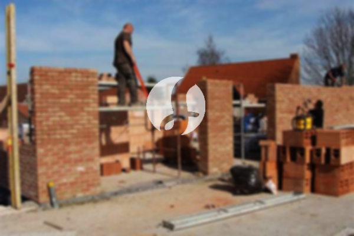

**Biaya Bangun Rumah Per Meter Di Setu Bekasi** - Hai Mitra Sumber Material! Gimana kabarnya? Kami dari penyedia jasa konstruksi di Setu Bekasi ingin berbagi informasi penting untuk Anda yang berencana membangun rumah impian. Sejalan dengan perkembangan zaman, borongan membuat rumah semakin diminati. Layanan pembangunan tempat tinggal benar-benar berkembang dan merambah ke layanan desain rumah. Hal ini makin membuat banyak orang lebih memilih jasa bangun rumah. Peningkatan jumlah penduduk tentu meningkatkan kebutuhan akan tempat tinggal. Karenanya, tidak heran jika para kontraktor properti berlomba-lomba mewujudkan proyek pembangunan yang beragam, mulai dari hunian ekonomis hingga mewah. Dengan kepercayaan yang diberikan pembeli, layanan bangun rumah berkomitmen memberikan hasil terbaik. Oleh karena itu, kami hadir sebagai solusi terpercaya dengan berbagai penawaran layanan untuk membangun rumah impian Anda. Berikut beberapa layanan yang dapat Anda pilih:



## Harga Layanan Desain Gambar Arsitektur Di Setu Bekasi

Sebagai penyedia jasa arsitek, kami akan mengamati desain rumah yang Anda inginkan. Melalui desain yang disepakati, kami berusaha menghadirkan keindahan pada hunian Anda. Kami mempertimbangkan berbagai faktor penting untuk menciptakan komposisi desain yang indah dan harmonis. Desain adalah elemen krusial dalam membangun rumah impian. Dengan desain yang tepat, rumah Anda akan terlihat menarik dan berkarakter. Anda tidak perlu khawatir, karena kami menawarkan layanan desain yang sesuai dengan anggaran yang Anda miliki. Dari desain tersebut, Anda dapat memperkirakan biaya yang dibutuhkan untuk mewujudkannya. Selain itu, desain juga akan mempertimbangkan material bangunan yang akan digunakan. Semua ini membutuhkan pertimbangan matang, itulah mengapa Anda memerlukan jasa arsitek profesional. Kami memahami keinginan Anda dan berupaya mewujudkannya.

Biaya jasa desain rumah kami bervariasi, tergantung pada luas bangunan dan kompleksitas desain yang diinginkan. Saat ini, kami menetapkan harga jasa desain rumah minimalis satu lantai sebesar Rp 54.000,- per meter persegi, sudah termasuk desain, perhitungan RAB, dan dua kali revisi. Untuk rumah dua lantai atau lebih, biayanya dapat dikalikan dua atau tiga sesuai dengan jumlah lantai.

## Ongkos Borong Bangun Rumah Di Setu Bekasi

Mengingat pertumbuhan populasi yang pesat, memiliki tempat tinggal menjadi kebutuhan mendasar. Banyak penyedia jasa bangun rumah hadir menawarkan produk dan layanan terbaik mereka. Di sinilah peran utama jasa bangun rumah dalam menangani tantangan pembangunan sebuah rumah. Dengan memilih jasa bangun rumah yang tepat, Anda akan mendapatkan layanan yang sesuai dengan harapan Anda. Memiliki rumah yang indah adalah impian setiap orang. Dengan memanfaatkan layanan bangun rumah, kami akan membantu Anda mewujudkan impian tersebut. Dengan mempercayakan pembangunan rumah pada kami, Anda tidak perlu repot mendesain rumah sendiri. Kami akan berusaha memahami keinginan Anda dan mewujudkannya dalam bentuk bangunan impian. Kepuasan Anda adalah prioritas kami dan menjadi motivasi bagi kami untuk terus memberikan karya yang lebih baik.

Untuk harga jasa borong bangun rumah, kami menawarkan beberapa tingkatan harga yang disesuaikan dengan material bangunan dan lokasi pembangunan. Dengan asumsi area tanah dalam kondisi rata, stabil, dan tidak memerlukan pengurukan, harga per meter persegi dengan material dinding hebel adalah Rp 1.950.000,-, sementara dengan material bata merah adalah Rp 2.200.000,-. Harga ini mencakup pondasi batu sungai, kolom dan tiang beton, lantai keramik standar, serta atap dengan rangka baja ringan dan genteng spandek. Pilihan genteng dan keramik dapat disesuaikan dengan preferensi Anda, dengan penyesuaian biaya sesuai model dan kualitas yang dipilih.

## Harga Layanan Renovasi Tempat Tinggal Di Setu Bekasi

Selain layanan arsitek dan bangun rumah, kami juga menyediakan jasa renovasi bangunan. Renovasi adalah cara yang efektif untuk memberikan tampilan baru pada rumah Anda. Dengan jasa renovasi bangunan profesional, Anda tidak perlu khawatir tentang proses renovasi yang rumit. Kami melakukan renovasi dengan mengubah tampilan bangunan atau melakukan perubahan menyeluruh. Renovasi menjadi solusi bagi mereka yang ingin memperbaiki bangunan tanpa membangun dari awal. Namun, anggaran yang terbatas seringkali menjadi kendala. Dengan adanya jasa renovasi rumah, semua kendala tersebut dapat diatasi. Kami hadir sebagai solusi yang akan membantu Anda merenovasi bangunan menjadi lebih baik dan menarik. Kami siap mewujudkan impian Anda untuk memiliki rumah yang lebih indah dan nyaman.

Harga borongan jasa renovasi rumah kami berbeda-beda, tergantung pada kondisi kerusakan bangunan yang akan diperbaiki. Untuk biaya jasa renovasi dengan tenaga tukang harian, harganya adalah Rp 150.000,- per hari untuk tukang dan Rp 100.000,- per hari untuk kenek.

## Didukung Tenaga Kerja Dan Arsitek Terbaik Di Setu Bekasi

Layanan arsitek, bangun rumah, dan renovasi semuanya berperan penting dalam mewujudkan impian Anda. Dengan dukungan arsitek profesional dan tenaga kerja yang handal, kami akan membantu Anda menciptakan rumah impian. Dengan membangun rumah bersama kami, Anda akan memiliki hunian yang menarik dan berkualitas. Anda tidak perlu khawatir karena kami menawarkan pelayanan terbaik, menjaga mutu dan kualitas untuk memberikan kepuasan maksimal. Sebagai penyedia jasa bangun rumah, kepuasan pelanggan adalah motivasi utama kami untuk terus berkarya dan menghasilkan karya yang lebih baik. Anda dapat melihat katalog proyek yang telah kami selesaikan untuk melihat kualitas pekerjaan kami. Ini dapat membuktikan bahwa kami adalah pilihan yang terbaik dan terpercaya.

Perlu diingat, rumah adalah kebutuhan pokok manusia, sama pentingnya dengan sandang dan pangan. Rumah memberikan perlindungan dari cuaca ekstrem dan bahaya lainnya. Hal ini menjadi peluang bagi penyedia jasa bangun rumah untuk menawarkan jasanya. Sebagai penyedia jasa, kami berpartisipasi dalam memajukan dunia arsitektur dengan menawarkan layanan melalui berbagai media, mulai dari media cetak hingga online. Ini memudahkan Anda untuk menemukan jasa bangun rumah yang tepat. Dengan menjaga kualitas dan memberikan layanan terbaik, kami telah terbukti memiliki pengalaman yang mumpuni dalam dunia arsitektur. Itulah sebabnya, semakin banyak orang mempercayakan pembangunan rumah mereka kepada kami.

Didukung oleh arsitek profesional dan tenaga kerja yang handal, menjadikan jasa bangun rumah kami semakin dikenal dan terpercaya. Perkembangan yang kami berikan terlihat dari karya-karya inovatif dan kreatif yang kami hasilkan. Banyak rumah dan bangunan yang kami bangun dengan desain yang apik dan menarik. Dengan proses pengerjaan yang efisien, Anda akan segera memiliki rumah impian Anda. Baik rumah skala kecil maupun besar, kami dapat mengatasinya dengan baik. Anda tidak perlu khawatir atau bimbang. Kami dapat membantu Anda dalam hal desain, material, ukuran bangunan, dan sumber daya manusia. Kami siap mendukung terwujudnya rumah yang cantik dan menarik. Karena, kami menciptakan rancangan, sekaligus mengawasi seluruh proses pembangunan. Untuk informasi lebih lanjut, Anda bisa menghubungi Kami melalui [hubungi Kami sekarang](https://api.whatsapp.com/send?phone=6285776786091&text=*Halo%20sumbermaterial.com*%20%3A). Kami juga melayani [bangun rumah di Bekasi Selatan](/bangunan/biaya-bangun-rumah-per-meter-di-bekasi-selatan/) dan [bangun rumah di Bantar Gebang](/bangunan/biaya-bangun-rumah-per-meter-di-bantar-gebang-bekasi/).
