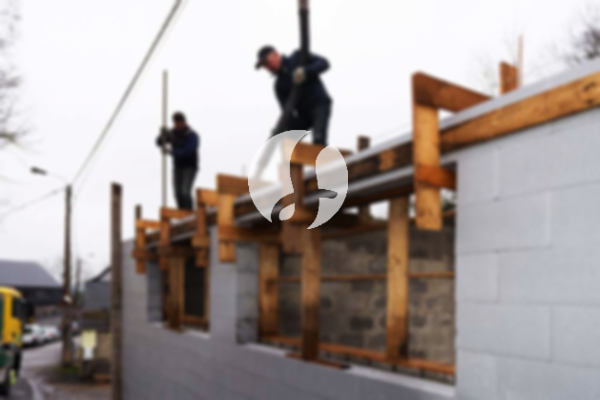

**Biaya Bangun Rumah Per Meter Di Setu Jakarta** - Hai Mitra Sumber Material! Gimana kabarnya hari ini? Kami dari Sumber Material hadir untuk memberikan solusi lengkap kebutuhan konstruksi Anda di Setu Jakarta. Seiring dengan perkembangan zaman, jasa bangun rumah semakin diminati. Borongan membuat rumah kini berkembang pesat, bahkan merambah ke layanan desain rumah. Ini memberikan lebih banyak pilihan bagi Anda yang ingin membangun hunian impian. Semakin banyak orang yang membutuhkan tempat tinggal, kebutuhan akan layanan konstruksi berkualitas pun semakin meningkat. Para pengembang properti berlomba-lomba membangun rumah dan perumahan, dari yang ekonomis hingga mewah. Dengan kepercayaan yang diberikan konsumen, jasa bangun rumah berkomitmen untuk memberikan hasil terbaik dan mempertahankan kepuasan pelanggan. Nah, sebagai penyedia jasa bangun rumah terpercaya, Kami menawarkan berbagai layanan yang bisa Anda pilih:



## Harga Jasa Desain Gambar Arsitek Di Setu Jakarta

Sebagai penyedia jasa desain, Kami akan cermat mempelajari desain rumah yang Anda inginkan. Dengan desain yang tepat, Kami akan berupaya menghadirkan keindahan pada hunian Anda. Untuk itu, Kami mempertimbangkan berbagai faktor penting agar komposisi desain terlihat cantik dan harmonis. Penting untuk diingat bahwa desain merupakan elemen krusial dalam pembangunan rumah. Desain yang baik akan menghasilkan rumah yang menarik secara visual. Anda tidak perlu khawatir, karena Kami akan menciptakan desain yang sesuai dengan budget Anda. Dengan desain tersebut, Anda dapat memperkirakan biaya yang dibutuhkan untuk mewujudkan rumah impian Anda. Selain itu, desain juga harus mempertimbangkan material bangunan yang akan digunakan. Semua aspek ini memerlukan keahlian khusus. Oleh karena itu, memilih jasa arsitek yang tepat adalah kunci untuk mendapatkan hasil yang memuaskan.

Biaya jasa desain rumah Kami bervariasi, tergantung pada luas rumah dan kompleksitas desain yang diminta. Saat ini, Kami menetapkan harga per meter persegi. Biaya jasa desain rumah minimalis satu lantai adalah Rp 54.000,-, sudah termasuk desain, RAB (Rencana Anggaran Biaya), dan dua kali revisi. Untuk rumah dua lantai atau lebih, biayanya bisa dikalikan dua atau tiga, sesuai dengan jumlah lantai.

## Jasa Borong Renovasi Bangunan Di Setu Jakarta

Seperti yang kita ketahui, kebutuhan akan tempat tinggal terus meningkat seiring dengan bertambahnya populasi. Hal ini mendorong banyak penyedia jasa bangun rumah untuk menawarkan produk dan layanan terbaik kepada konsumen. Di sinilah peran penting jasa bangun rumah dalam mengatasi berbagai masalah konstruksi. Dengan memilih jasa bangun rumah yang tepat, Anda akan mendapatkan solusi yang sesuai dengan keinginan Anda. Memiliki rumah yang cantik adalah impian setiap orang. Dengan menggunakan jasa bangun rumah, Kami akan membantu mewujudkan impian Anda. Anda tidak perlu repot mendesain rumah sendiri karena Kami selalu berusaha memahami kebutuhan Anda dan menerjemahkannya ke dalam karya nyata. Kepuasan Anda adalah prioritas Kami, sehingga Kami akan terus berusaha memberikan pelayanan terbaik dan mempertahankan kepercayaan yang telah diberikan.

Untuk harga borong renovasi rumah, Kami menawarkan beberapa tingkatan harga. Harga ini disesuaikan dengan material bangunan yang digunakan dan lokasi pembangunan di Setu Jakarta. Dengan asumsi lahan dalam kondisi rata, stabil, dan tidak memerlukan pengurugan, harga per meter persegi dengan material dinding hebel adalah Rp 1.950.000,-, sedangkan dengan material bata merah adalah Rp 2.200.000,-. Harga tersebut sudah termasuk pondasi batu kali, kolom dan tiang beton, lantai keramik standar, dan atap rangka baja ringan dengan genteng spandek. Untuk jenis genteng dan keramik, Anda dapat menyesuaikannya dengan preferensi Anda, serta menyesuaikan harga dan kualitasnya.

## Harga Rombak Tempat Tinggal Di Setu Jakarta

Selain layanan desain dan pembangunan rumah baru, Kami juga menyediakan jasa renovasi bangunan. Renovasi adalah cara yang efektif untuk memberikan tampilan baru pada rumah Anda. Dengan adanya jasa renovasi rumah, Anda tidak perlu khawatir tentang proses renovasi yang rumit. Kami menawarkan renovasi yang dapat berupa perubahan bentuk model rumah, atau renovasi total. Renovasi dapat menjadi solusi yang lebih terjangkau untuk mengubah tampilan rumah Anda. Namun, seringkali orang kesulitan untuk melakukan renovasi sendiri karena keterbatasan biaya. Dengan Kami, semua itu dapat diatasi. Kami hadir sebagai penyedia jasa renovasi rumah yang siap membantu Anda mempercantik tampilan rumah Anda.

Biaya borongan renovasi rumah Kami bervariasi, tergantung pada kondisi kerusakan bangunan. Setiap bangunan memiliki tingkat kerusakan yang berbeda-beda, sehingga harga disesuaikan dengan jenis kerusakan yang perlu diperbaiki. Namun, untuk jasa renovasi dengan tenaga tukang harian, tarifnya adalah Rp 150.000,- per hari untuk tukang dan Rp 100.000,- per hari untuk kenek.

## Didukung Tenaga Kerja Dan Arsitek Terbaik Di Setu Jakarta

Baik jasa arsitek, pembangunan rumah baru, maupun renovasi, semuanya memiliki peran penting. Dengan dukungan arsitek profesional dan tenaga kerja yang handal, Kami akan membantu mewujudkan impian Anda. Dengan membangun rumah bersama Kami, Anda akan memiliki hunian yang menarik dan indah. Anda tidak perlu khawatir, karena Kami selalu mengutamakan kualitas dan mutu untuk memberikan kepuasan maksimal. Kepuasan pelanggan adalah penyemangat Kami untuk terus berkarya dan menghasilkan karya yang lebih baik. Anda dapat melihat katalog proyek Kami yang telah selesai untuk melihat kualitas pekerjaan Kami. Katalog tersebut akan membuktikan bahwa Kami adalah pilihan terbaik dan terpercaya.

Penting untuk diingat bahwa rumah adalah kebutuhan primer manusia yang sangat penting, selain sandang dan pangan. Rumah adalah tempat berlindung dari cuaca dan bahaya. Oleh karena itu, banyak penyedia jasa bangun rumah yang berpartisipasi dalam memajukan dunia arsitektur dengan menawarkan jasanya melalui berbagai media, baik cetak maupun online. Ini tentu membantu banyak orang yang ingin membangun rumah impian mereka. Dengan menjaga kualitas dan mutu terbaik, Kami telah memiliki pengalaman yang cukup lama dalam menggeluti dunia arsitektur. Inilah alasan mengapa Kami semakin dipercaya oleh banyak orang.

Didukung oleh arsitek profesional dan tenaga kerja yang handal, Kami yakin dapat memberikan layanan terbaik bagi Anda. Dengan pengalaman dan dedikasi Kami, Kami selalu berusaha menciptakan karya-karya inovatif dan kreatif. Banyak bangunan indah yang telah Kami bangun dengan desain yang menarik. Proses pengerjaan yang efisien memungkinkan Anda untuk segera menikmati rumah impian Anda. Apakah rumah skala kecil atau besar, Kami mampu mengatasinya. Kami dapat membantu Anda dalam perencanaan, material bangunan, ukuran rumah, dan sumber daya manusia. Disitulah peran penting dari Kami. Karena, Kami akan menciptakan suatu perencanaan, dan sekaligus pengawas pada pembangunan. [Hubungi Kami Sekarang](https://api.whatsapp.com/send?phone=6285776786091&text=*Halo%20sumbermaterial.com*%20%3A) untuk konsultasi gratis! Apakah Anda juga ingin tahu informasi seputar [bangun rumah di Cawang](/bangunan/biaya-bangun-rumah-per-meter-di-cawang-jakarta/) atau bahkan [bangun rumah di Batu Ampar](/bangunan/biaya-bangun-rumah-per-meter-di-batu-ampar-jakarta/)?
