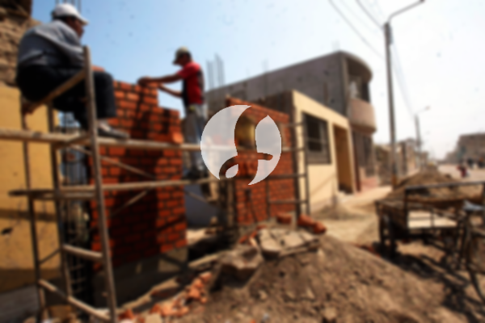

**Biaya Bangun Rumah Per Meter Di Slipi Jakarta** - Hai Mitra Sumber Material! Gimana kabarnya? Kami dari Sumber Material hadir untuk membantu mewujudkan rumah impian Anda di Slipi Jakarta dan sekitarnya. Seiring dengan perkembangan zaman, layanan pembangunan tempat tinggal semakin diminati. Bukan hanya itu, layanan ini juga berkembang pesat ke arah desain interior dan eksterior yang lebih personal. Ini membuat banyak orang lebih selektif dalam memilih jasa bangun rumah. Pertumbuhan populasi yang pesat secara otomatis meningkatkan kebutuhan akan tempat tinggal, dan para kontraktor properti berlomba-lomba menawarkan solusi terbaik – mulai dari rumah sederhana hingga mewah. Kepercayaan konsumen adalah kunci, dan layanan bangun rumah yang terpercaya akan selalu berusaha mempertahankan reputasi mereka dengan memberikan hasil terbaik. Berikut adalah beberapa tipe layanan yang bisa Anda pilih dari jasa bangun rumah:



## Estimasi Biaya Desain Gambar Arsitek Di Slipi Jakarta

Sebagai penyedia jasa desain, tentu saja kami akan mengamati dan merancang desain rumah yang Anda inginkan. Dengan desain yang baik, rumah Anda akan terlihat lebih indah dan menarik. Kami akan berusaha menciptakan komposisi desain yang selaras dan indah dengan mempertimbangkan beberapa faktor penting. Anda tahu sendiri, desain adalah elemen paling krusial dalam pembangunan rumah. Karena dengan desain yang tepat, rumah akan terlihat cantik dan sesuai dengan harapan Anda. Yang terpenting, kami akan menyesuaikan desain dengan anggaran yang Anda miliki. Dari desain yang kami buat, Anda bisa memperkirakan biaya yang akan dikeluarkan untuk mewujudkan rumah impian Anda. Selain itu, desain juga harus mempertimbangkan pemilihan bahan bangunan yang tepat. Semua ini memang membutuhkan perencanaan yang matang. Itulah mengapa memilih jasa arsitek profesional sangat penting, karena mereka memahami keinginan Anda dan menerjemahkannya menjadi rancangan yang memuaskan.

Harga jasa desain rumah dari kami bervariatif, tergantung pada luas rumah dan kompleksitas desain yang Anda minta. Saat ini, kami menetapkan harga per meter untuk desain bangunan dan layanan terkait. Biaya jasa desain rumah minimalis satu lantai per meternya adalah Rp 54.000,-. Harga tersebut sudah termasuk desain, perhitungan RAB (Rencana Anggaran Biaya), dan dua kali revisi. Untuk bangunan dua lantai atau lebih, biayanya hanya dikalikan 2 atau 3 sesuai dengan jumlah lantai.

## Jasa Borong Bangun Rumah Di Slipi Jakarta

Kebutuhan akan tempat tinggal adalah kebutuhan dasar manusia. Hal ini memicu banyaknya layanan bangun rumah yang menawarkan produk dan layanan terbaik mereka kepada calon pembeli. Disinilah peran utama jasa bangun rumah dalam mengatasi permasalahan pembangunan sebuah rumah. Dengan memilih jasa yang tepat, Anda akan mendapatkan layanan yang sesuai dengan harapan Anda. Memiliki rumah yang cantik adalah impian setiap orang. Dengan menggunakan jasa bangun rumah, Kami akan membantu Anda mewujudkan impian tersebut. Dengan mempercayakan pembangunan rumah pada Kami, Anda tidak perlu khawatir tentang desain atau perencanaan. Kami selalu berusaha memahami harapan Anda dan mewujudkannya menjadi sebuah karya nyata berupa bangunan impian Anda. Puasnya Anda adalah prioritas Kami, dan hal itu memotivasi Kami untuk terus memberikan yang terbaik. Katalog proyek-proyek yang telah Kami selesaikan dapat menjadi bukti kualitas dan kepercayaan Kami.

Untuk ongkos borong pembangunan rumah, Kami menawarkan beberapa tingkatan harga. Harga tersebut disesuaikan dengan bahan bangunan yang digunakan dan lokasi pembangunan. Dengan asumsi tanah dalam kondisi rata, stabil, dan tidak memerlukan pengurugan, harga per meter untuk material dinding hebel adalah Rp 1.950.000,-, sedangkan untuk material bata merah adalah Rp 2.200.000,-. Harga tersebut sudah termasuk pondasi batu gunung, kolom dan tiang beton, lantai keramik standar, serta atap rangka baja ringan dengan genteng spandek. Pilihan genteng dan keramik dapat disesuaikan dengan preferensi Anda, dengan menyesuaikan model, kualitas, dan harga.

## Layanan Renovasi Bangunan Di Slipi Jakarta

Selain layanan desain dan pembangunan rumah baru, Kami juga menyediakan jasa renovasi bangunan. Renovasi rumah adalah solusi tepat untuk mengubah tampilan rumah Anda menjadi lebih segar dan modern. Dengan hadirnya jasa renovasi rumah, Anda tidak perlu khawatir dengan proses renovasi yang rumit. Karena, renovasi yang Kami lakukan bisa berupa perubahan bentuk model bangunan secara keseluruhan atau sebagian. Renovasi memang menjadi alternatif untuk mempercantik rumah dengan anggaran yang lebih terjangkau. Namun, seringkali orang kesulitan mengatur anggaran dan proses renovasi sendiri. Nah, dengan adanya jasa renovasi rumah, semua masalah itu bisa diatasi. Kami siap membantu Anda merenovasi rumah Anda menjadi lebih segar dan indah dari sebelumnya.

Biaya borongan dari jasa renovasi rumah Kami bervariasi, tergantung pada kondisi kerusakan rumah Anda. Karena setiap rumah memiliki tingkat kerusakan yang berbeda-beda, biaya renovasi juga akan disesuaikan dengan jenis kerusakan yang akan diperbaiki. Namun, untuk biaya jasa renovasi dengan tenaga tukang harian, harganya adalah Rp 150.000,- per hari untuk tukang dan Rp 100.000,- per hari untuk kenek.

## Dukungan Tim Profesional: Arsitek dan Tukang Berpengalaman Di Slipi Jakarta

Baik layanan desain, pembangunan rumah baru, maupun renovasi, semuanya membutuhkan peran yang penting. Didukung oleh arsitek profesional dan tenaga kerja yang handal, Kami akan membantu mewujudkan impian Anda. Dengan membangun rumah impian bersama Kami, Anda akan memiliki tempat tinggal yang menarik dan indah. Kami tidak perlu khawatir, karena Kami akan memberikan pelayanan terbaik, menjaga mutu dan kualitas untuk memberikan kepuasan Anda. Memuaskan klien adalah prioritas Kami, dan hal itu menjadi motivasi Kami untuk terus berkarya melalui karya-karya yang lebih baik. Anda dapat melihat katalog hasil proyek-proyek Kami untuk membuktikan bahwa Kami adalah pilihan yang tepat dan terpercaya.

Perlu diingat, rumah adalah kebutuhan utama manusia, selain sandang dan pangan. Rumah melindungi kita dari cuaca ekstrem dan berbagai bahaya. Hal ini menjadikan penyedia jasa bangun rumah berperan penting dalam memajukan dunia arsitektur dengan menawarkan jasanya melalui berbagai media, mulai dari media cetak hingga online. Ini tentu mempermudah orang-orang yang ingin membangun rumah. Dengan mempertahankan mutu dan kualitas terbaik, Kami telah memiliki pengalaman yang cukup lama dalam menggeluti dunia arsitektur. Itulah mengapa jasa bangun rumah semakin banyak dipercaya oleh masyarakat. [bangun rumah di Bali Mester](/bangunan/biaya-bangun-rumah-per-meter-di-bali-mester-jakarta/)

Didukung oleh arsitek profesional dan tenaga kerja yang handal, tentu akan membuat layanan Kami semakin dikenal dan dipercaya. Hal ini terlihat dari perkembangan yang terus Kami berikan. Dengan terus berkarya menciptakan karya-karya baru yang inovatif dan kreatif, Kami telah berhasil membangun banyak rumah dengan desain yang apik dan menarik. Dengan progres pengerjaan yang cepat dan efisien, Anda akan segera mendapatkan rumah impian Anda. Baik rumah berskala kecil maupun besar, semuanya dapat Kami tangani dengan baik. Anda tidak perlu ragu atau khawatir. Mulai dari desain rumah, material bahan, ukuran bangunan, hingga sumber daya manusia (SDM), semuanya dapat Kami atasi dengan mudah. Itulah peran penting dari jasa bangun rumah. Karena, Kami akan mewujudkan tata desain yang Anda inginkan, dan sekaligus mengawasi proses pembangunan. [Hubungi Kami Sekarang!](https://api.whatsapp.com/send?phone=6285776786091&text=*Halo%20sumbermaterial.com*%20%3A)
