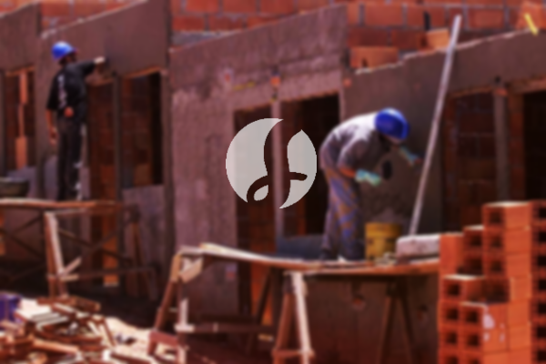

**Biaya Bangun Rumah Per Meter Di Solear Tangerang** - Hai Mitra Sumber Material! Bagaimana kabar Anda? Kami dari penyedia jasa konstruksi di Solear Tangerang ingin berbagi informasi penting seputar biaya bangun rumah per meter persegi. Seiring dengan pesatnya pembangunan, kebutuhan akan layanan bangun bangunan semakin meningkat. Banyak orang kini lebih memilih jasa bangun rumah karena kemudahan dan kepraktisannya. Pertumbuhan populasi juga mendorong permintaan akan tempat tinggal, mulai dari rumah sederhana hingga mewah. Kami, sebagai penyedia layanan yang terpercaya, berkomitmen untuk mewujudkan impian Anda memiliki rumah berkualitas.



## Estimasi Biaya Desain Gambar Arsitek Di Solear Tangerang

Sebagai mitra Anda dalam mewujudkan rumah impian, Kami sangat memperhatikan desain sebagai fondasi utama. Desain yang baik akan menghasilkan rumah yang indah, fungsional, dan sesuai dengan kebutuhan Anda. Kami akan menciptakan komposisi desain yang selaras dengan mempertimbangkan berbagai faktor penting. Kami memahami betul bahwa desain adalah aspek krusial dalam membangun rumah yang menarik. Dengan desain yang tepat, rumah Anda akan terlihat estetis dan nyaman dihuni. Anda tidak perlu khawatir, karena Kami akan mewujudkan desain yang serasi dengan anggaran yang Anda miliki. Dari desain tersebut, Anda dapat memperkirakan biaya yang dibutuhkan untuk membangun rumah idaman Anda. Selain itu, desain juga akan mempertimbangkan pemilihan material bangunan yang tepat. Semua proses ini memang membutuhkan perencanaan matang, itulah mengapa Anda membutuhkan jasa arsitek profesional. Kami akan memahami keinginan Anda dan menerjemahkannya menjadi desain yang memuaskan.

Namun, harga jasa desain rumah Kami bervariasi, tergantung pada luas rumah dan tingkat kesulitan desainnya. Saat ini, Kami menetapkan harga jasa desain rumah minimalis satu lantai sebesar Rp 54.000,- per meter persegi. Harga tersebut sudah termasuk desain, data RAB (Rencana Anggaran Biaya), dan dua kali revisi. Untuk rumah dua lantai atau lebih, biayanya hanya dikali dua atau dikali tiga sesuai dengan jumlah lantainya.

## Estimasi Biaya Borong Renovasi Bangunan Di Solear Tangerang

Seperti yang Anda ketahui, kebutuhan akan tempat tinggal terus meningkat seiring dengan bertambahnya jumlah penduduk. Hal ini menciptakan peluang bagi penyedia jasa bangun rumah untuk menawarkan layanan terbaik kepada calon pembeli. Kami hadir sebagai solusi untuk permasalahan pembangunan rumah Anda. Dengan memanfaatkan jasa bangun rumah, Anda akan mendapatkan layanan yang sesuai dengan kebutuhan dan keinginan Anda. Memiliki rumah yang cantik tentu menjadi impian setiap orang. Dengan dukungan dari penyedia jasa bangun rumah, Anda akan terbantu mewujudkan impian tersebut. Anda tidak perlu repot mendesain rumah sendiri karena Kami selalu berusaha memahami keinginan Anda dan mewujudkannya dalam bentuk nyata. Kepuasan Anda adalah prioritas Kami, yang mendorong Kami untuk terus memberikan layanan terbaik dan meningkatkan kualitas pekerjaan.

Untuk harga jasa borong renovasi, Kami menawarkan beberapa pilihan sesuai dengan bahan bangunan yang digunakan dan lokasi proyek di Solear Tangerang. Dengan persyaratan area tanah yang rata, stabil, dan tidak memerlukan pengurukan, harga per meternya dengan material dinding hebel adalah Rp 1.950.000,-, dan dengan material bata merah per meternya Rp 2.200.000,-. Harga tersebut sudah termasuk pondasi batu kali, kolom dan tiang beton, lantai keramik standar, dan atap dengan rangka baja ringan plus genteng spandek. Untuk genteng dan keramik, Anda dapat memilih variasi lain sesuai dengan model, kualitas, dan anggaran yang Anda miliki.

## Estimasi Biaya Rombak Tempat Tinggal Di Solear Tangerang

Selain jasa arsitek dan bangun rumah, Kami juga menyediakan jasa renovasi rumah di Solear Tangerang. Renovasi rumah merupakan cara efektif untuk memberikan tampilan baru pada hunian Anda. Dengan kehadiran jasa renovasi rumah, Anda tidak perlu khawatir dalam menentukan langkah-langkah renovasi. Kami akan melakukan renovasi dengan mengubah bentuk model bangunan secara menyeluruh atau total. Renovasi memang menjadi alternatif yang menarik untuk memperbaiki tampilan bangunan agar lebih cantik dan modern. Namun, dengan anggaran yang terbatas, seseorang mungkin kesulitan melakukan renovasi. Kami hadir untuk mengatasi masalah tersebut sebagai penyedia jasa renovasi rumah yang akan memudahkan Anda merenovasi bangunan Anda menjadi lebih bagus dan menarik dari sebelumnya. Kami siap mewujudkan bangunan impian Anda sesuai dengan keinginan dan kebutuhan Anda.

Sedangkan untuk biaya borongan jasa renovasi rumah Kami, harganya bervariasi tergantung pada kondisi kerusakan bangunan yang akan diperbaiki. Untuk biaya jasa renovasi dengan tenaga tukang harian, harganya adalah Rp 150.000,- per hari untuk tukang dan Rp 100.000,- per hari untuk kenek.

## Dukungan Tukang Dan Arsitek Terbaik Di Solear Tangerang

Baik jasa desain arsitek, bangun rumah, maupun renovasi, semuanya memiliki peran yang sangat penting. Dengan dukungan dari arsitek profesional dan tenaga kerja yang handal, Kami akan membantu mewujudkan impian Anda. Membangun rumah idaman bersama Kami akan menghasilkan rumah yang menarik dan berkualitas. Anda tidak perlu khawatir karena Kami akan memberikan pelayanan terbaik, menjaga mutu dan kualitas, serta memberikan kepuasan maksimal. Sebagai penyedia jasa bangun rumah, kepuasan Anda adalah penyemangat Kami untuk terus berkarya dan menciptakan karya-karya yang lebih baik lagi. Anda dapat melihat katalog hasil proyek Kami untuk membuktikan bahwa Kami adalah pilihan terbaik dan terpercaya. [bangun rumah di Benda](/bangunan/biaya-bangun-rumah-per-meter-di-benda-tangerang/)

Perlu diingat, rumah adalah kebutuhan primer manusia yang sangat penting, selain sandang dan pangan. Rumah menjadi tempat berlindung dari cuaca panas dan dingin serta sebagai penjaga dari berbagai bahaya. Hal ini menjadi peluang bagi penyedia jasa bangun rumah untuk menawarkan jasanya. Sebagai penyedia jasa terkhusus pada jasa bangun rumah, Kami akan berpartisipasi untuk mengembangkan dunia arsitektur dengan menawarkan layanan melalui berbagai media. Mulai dari media cetak hingga media online, Kami gunakan untuk menampilkan jasa bangun rumah Kami. Hal ini tentu membantu banyak orang yang ingin mewujudkan rumah impian mereka. Dengan menjaga mutu dan kualitas terbaik, Kami telah terbukti memiliki pengalaman yang cukup lama dalam menggeluti dunia arsitektur. Itulah sebabnya, Kami semakin dipercaya oleh banyak orang.

Didukung oleh arsitek profesional dan tenaga kerja yang handal, tentu akan membuat jasa bangun rumah Kami semakin dikenal dan diakui kemampuannya. Hal ini terlihat dari perkembangan yang terus Kami berikan. Kami selalu berkarya mewujudkan karya-karya baru yang lebih inovatif dan kreatif. Banyak rumah dan bangunan yang Kami bangun dengan desain yang apik dan menarik. Dengan proses pengerjaan yang efisien, Anda akan segera memiliki rumah impian Anda. Baik bangunan berskala kecil maupun besar, semuanya dapat Kami tangani dengan baik. Anda tidak perlu khawatir atau cemas karena Kami akan membantu Anda dalam segala hal, mulai dari desain bangunan, pemilihan material, ukuran rumah, hingga sumber daya manusia. Hingga, mampu mendukung terwujudnya rumah yang cantik dan menarik. Disitulah peran penting dari jasa bangun rumah. Karena, Kami akan membuat perencanaan yang matang dan sekaligus melakukan pengawasan selama proses pembangunan. [Hubungi Kami Sekarang](https://api.whatsapp.com/send?phone=6285776786091&text=*Halo%20sumbermaterial.com*%20%3A)
