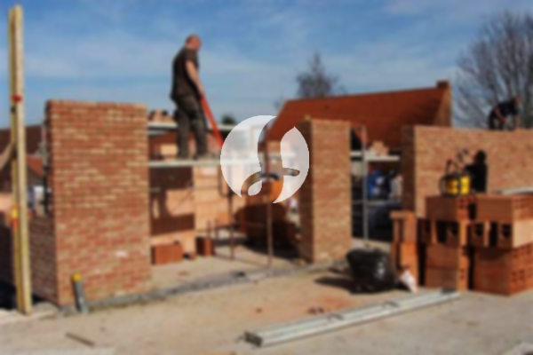

**Biaya Bangun Rumah Per Meter Di Sukabumi Sukabumi** - Hai Mitra Sumber Material! Gimana kabarnya? Kami dari Sumber Material hadir sebagai mitra terpercaya Anda dalam mewujudkan hunian impian. Seiring dengan perkembangan zaman, layanan pembuatan rumah semakin diminati. Banyak yang memilih jasa bangun rumah demi kemudahan dan hasil optimal. Semakin banyak orang yang mencari tempat tinggal, kebutuhan akan kontraktor properti berkualitas pun semakin tinggi. Kami berkomitmen untuk menjaga kepercayaan pelanggan dan menjalankan setiap proyek dengan penuh tanggung jawab. Sebagai penyedia jasa bangun rumah yang terpercaya, Kami menawarkan beragam pilihan layanan untuk memenuhi kebutuhan Anda. Berikut adalah beberapa tipe layanan dari Kami yang bisa Anda pertimbangkan:



## Estimasi Biaya Desain Gambar Arsitek Di Sukabumi Sukabumi

Sebagai penyedia jasa arsitek, Kami sangat memperhatikan desain sebuah hunian yang akan dibangun. Melalui desain yang cermat, Kami berupaya menciptakan keindahan dan fungsionalitas yang optimal. Beberapa faktor penting Kami pertimbangkan untuk mewujudkan komposisi desain yang baik dan selaras. Desain merupakan aspek krusial dalam pembangunan, karena menentukan tampilan visual rumah Anda. Anda tidak perlu khawatir, karena Kami akan menciptakan desain yang sesuai dengan anggaran yang Anda miliki. Dari desain tersebut, Anda dapat memperkirakan biaya yang akan dikeluarkan untuk mewujudkan rumah impian Anda. Selain itu, desain juga mempertimbangkan pemilihan material bangunan yang tepat. Semua hal ini memang memerlukan keahlian khusus. Itulah mengapa, Anda membutuhkan jasa arsitek profesional. Kami akan memahami keinginan Anda dan mewujudkannya dalam desain yang memuaskan.

Harga jasa desain bangunan dari Kami bervariasi, tergantung pada luas rumah dan tingkat kesulitan desain yang diminta. Saat ini, Kami menawarkan harga jasa desain bangunan minimalis satu lantai sebesar Rp 54.000,- per meter. Harga ini sudah termasuk desain, perhitungan RAB (Rencana Anggaran Biaya), dan 2 kali revisi. Untuk rumah 2 lantai atau lebih, biayanya hanya dikali 2 atau dikali 3 sesuai jumlah lantai.

## Harga Borong Renovasi Bangunan Di Sukabumi Sukabumi

Seiring dengan pertumbuhan populasi, kebutuhan akan tempat tinggal semakin meningkat. Oleh karena itu, banyak orang yang memerlukan layanan bangun rumah untuk mewujudkan kepemilikan properti. Kami hadir sebagai solusi terpercaya dalam menangani berbagai permasalahan pembangunan rumah Anda. Dengan memanfaatkan layanan bangun rumah, Anda akan mendapatkan hunian yang sesuai dengan keinginan Anda. Memiliki rumah yang cantik adalah impian setiap orang. Dengan bantuan jasa bangun rumah, Anda dapat mewujudkan impian tersebut tanpa harus khawatir dengan proses desain dan pembangunan. Kami akan memahami kebutuhan dan preferensi Anda, serta menerjemahkannya menjadi karya nyata berupa rumah impian Anda. Kepuasan Anda adalah prioritas Kami.

Untuk biaya borong bangun rumah, Kami memiliki beberapa tingkatan harga yang disesuaikan dengan material bangunan yang digunakan dan lokasi pembangunan. Dengan asumsi kondisi tanah rata, stabil, dan tidak memerlukan pengurukan, harga per meter dengan material dinding hebel adalah Rp 1.950.000,-, sedangkan dengan material bata merah adalah Rp 2.200.000,-. Harga tersebut sudah termasuk pondasi batu kali, kolom dan tiang beton, lantai keramik standar, serta atap dengan rangka baja ringan dan genteng spandek. Untuk jenis genteng dan keramik, Anda dapat memilih sesuai preferensi, model, kualitas, dan anggaran yang tersedia.

## Harga Jasa Perbaikan Rumah Di Sukabumi Sukabumi

Selain jasa arsitek dan bangun rumah, Kami juga menyediakan jasa renovasi bangunan. Renovasi rumah adalah cara yang efektif untuk memberikan tampilan baru pada hunian Anda. Dengan hadirnya jasa renovasi bangunan, Anda tidak perlu lagi bingung menentukan langkah renovasi yang tepat. Kami menawarkan teknik renovasi yang bervariasi, mulai dari perubahan model bangunan hingga renovasi total. Renovasi memang menjadi pilihan menarik untuk mempercantik rumah dengan biaya yang terjangkau. Namun, seringkali proses renovasi terasa rumit dan memakan waktu. Dengan menggunakan jasa renovasi bangunan, semua kesulitan tersebut dapat Kami atasi. Kami siap membantu Anda merenovasi rumah menjadi lebih bagus dan menawan dari sebelumnya, sesuai dengan impian Anda.

Untuk harga borongan jasa renovasi bangunan, Kami memberikan harga yang bervariasi tergantung pada kondisi kerusakan bangunan. Oleh karena itu, harga disesuaikan dengan jenis kerusakan yang akan diperbaiki. Namun, untuk harga jasa renovasi dengan tenaga tukang harian, tarifnya adalah Rp 150.000,- per hari untuk tukang dan Rp 100.000,- per hari untuk kenek.

## Didukung Tukang Dan Arsitek Terbaik Di Sukabumi Sukabumi

Baik layanan arsitek, jasa bangun rumah, maupun borongan renovasi bangunan, semuanya memainkan peran penting dalam mewujudkan hunian impian Anda. Dengan dukungan arsitek profesional dan tenaga kerja yang handal, Kami akan membantu mewujudkan impian Anda. Dengan membangun rumah idaman bersama Kami, Anda akan memiliki rumah yang menarik dan tentunya cantik. Anda tidak perlu khawatir, karena Kami akan memberikan pelayanan terbaik, menjaga mutu dan kualitas, serta mengutamakan kepuasan Anda. Sebagai penyedia jasa bangun rumah, kepuasan pelanggan adalah motivasi Kami untuk terus berkarya dan menghasilkan karya yang lebih baik. Anda dapat melihat katalog hasil proyek-proyek Kami untuk melihat kualitas pekerjaan Kami. Katalog tersebut akan membuktikan bahwa Kami adalah pilihan terbaik dan terpercaya.

Perlu diingat, rumah adalah kebutuhan primer manusia setelah sandang dan pangan. Rumah melindungi kita dari cuaca ekstrem dan berbagai bahaya. Hal ini menjadi peluang bagi penyedia jasa bangun rumah untuk menawarkan jasanya. Sebagai penyedia jasa, Kami berpartisipasi dalam memajukan dunia arsitektur dengan menawarkan layanan melalui berbagai media, mulai dari media cetak hingga online. Hal ini tentu akan membantu Anda yang ingin mewujudkan rumah impian. Dengan mempertahankan mutu dan kualitas terbaik, Kami telah memiliki pengalaman yang cukup lama dalam menggeluti dunia arsitektur. Itulah mengapa, Kami semakin dipercaya oleh banyak orang.

Didukung oleh arsitek profesional dan tenaga kerja yang handal, tentu akan menjadikan Kami semakin dikenal dan terpercaya. Kami terus berinovasi dan menciptakan karya-karya baru yang lebih kreatif. Banyak rumah dan bangunan yang Kami bangun dengan desain yang apik dan menarik. Dengan proses pengerjaan yang efisien, Anda akan segera mendapatkan rumah impian Anda. Baik rumah berskala kecil maupun besar, Kami dapat mengatasinya dengan baik. Anda tidak perlu khawatir dengan hal tersebut. Mulai dari desain bangunan, material bahan, ukuran rumah, dan sumber daya manusia, semuanya dapat Kami atasi dengan baik. Dengan demikian, Kami dapat mendukung terwujudnya bangunan yang cantik dan menawan. Di sinilah peran penting Kami sebagai penyedia jasa bangun rumah. Kami akan menciptakan tata desain yang harmonis dan sekaligus mengawasi proses pembangunan. Anda juga bisa melihat opsi [bangun rumah di Caringin](/bangunan/biaya-bangun-rumah-per-meter-di-caringin-sukabumi/) untuk bangun rumah di Caringin, Sukabumi. Jangan ragu untuk menghubungi Kami jika Anda berada di area [bangun rumah di Banjarsari](/bangunan/biaya-bangun-rumah-per-meter-di-banjarsari-rangkasbitung/) atau membutuhkan layanan di Banjarsari Rangkasbitung. [Hubungi Kami Sekarang!](https://api.whatsapp.com/send?phone=6285776786091&text=*Halo%20sumbermaterial.com*%20%3A)
