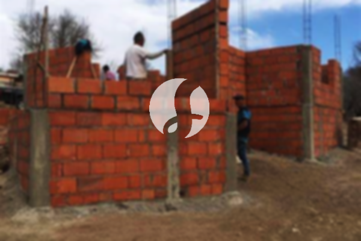

**Biaya Bangun Rumah Per Meter Di Sukadamai Bogor** - Hai Mitra Sumber Material! Gimana kabarnya? Kami dari Sumber Material hadir untuk membantu mewujudkan impian memiliki rumah impian Anda di Sukadamai Bogor. Seiring perkembangan zaman, jasa membuat rumah semakin banyak diminati. Layanan konstruksi ini terus berkembang, termasuk layanan desain interior dan eksterior. Semakin banyak orang yang memilih jasa bangun rumah karena kepraktisan dan efisiensinya. Pertumbuhan populasi otomatis meningkatkan kebutuhan akan tempat tinggal. Tidak heran jika pengembang properti berlomba-lomba menawarkan berbagai opsi, dari rumah sederhana hingga mewah. Kepercayaan konsumen adalah segalanya, dan Kami sebagai penyedia jasa bangun rumah berupaya keras menjaganya. Kami berkomitmen untuk menjalankan setiap proyek dengan tanggung jawab penuh. Sebagai penyedia jasa yang terpercaya, Kami menawarkan berbagai layanan konstruksi untuk memenuhi kebutuhan Anda. Yuk, kita bahas lebih lanjut!



## Jasa Desain Gambar Arsitektur Di Sukadamai Bogor

Sebagai penyedia jasa arsitektur, Kami akan mengamati detail desain rumah yang Anda inginkan. Melalui desain yang matang, Kami berusaha menciptakan estetika yang harmonis dan sesuai dengan selera Anda. Kami mempertimbangkan berbagai faktor penting untuk mewujudkan komposisi desain yang indah dan fungsional. Seperti yang Anda ketahui, desain adalah elemen krusial dalam pembangunan rumah. Desain yang baik akan membuat rumah terlihat menarik dan nyaman. Anda tidak perlu khawatir, karena Kami akan membuat desain yang sesuai dengan anggaran Anda. Dengan desain yang jelas, Anda dapat memperkirakan biaya yang dibutuhkan untuk mewujudkan rumah impian Anda. Selain itu, Kami juga mempertimbangkan material bangunan yang akan digunakan. Semua aspek ini memang membutuhkan perencanaan yang cermat. Itulah mengapa, Kami sangat merekomendasikan penggunaan jasa arsitek profesional. Jasa arsitek akan memahami keinginan Anda dan menerjemahkannya ke dalam desain yang memuaskan.

Harga jasa desain bangunan Kami bervariasi, tergantung pada luas bangunan dan tingkat kesulitan desain. Saat ini, Kami menawarkan harga per meter persegi. Biaya jasa desain rumah minimalis satu lantai adalah Rp 54.000,- per meter persegi, sudah termasuk desain, kalkulasi RAB (Rencana Anggaran Biaya), dan 2 kali revisi desain. Untuk rumah dua lantai atau lebih, harga desain hanya dikalikan 2 atau 3 sesuai jumlah lantai.

## Jasa Borong Bangun Rumah Di Sukadamai Bogor

Seiring bertambahnya populasi, kebutuhan akan tempat tinggal juga terus meningkat. Banyak penyedia jasa bangun rumah menawarkan berbagai produk dan layanan terbaik untuk konsumen. Disinilah peran penting jasa bangun rumah dalam menangani tantangan pembangunan. Dengan memilih Kami, Anda akan mendapatkan layanan yang sesuai dengan kebutuhan Anda. Memiliki rumah yang indah adalah impian semua orang. Dengan memanfaatkan jasa bangun rumah, Kami akan membantu Anda mewujudkan impian tersebut. Dengan mempercayakan pembangunan rumah pada Kami, Anda tidak perlu khawatir tentang desain. Kami akan berusaha memahami keinginan Anda dan mewujudkannya ke dalam bentuk nyata. Anda akan merasa puas dan percaya dengan kualitas layanan Kami.

Untuk harga layanan borong bangun, Kami menawarkan beberapa pilihan sesuai dengan kualitas material dan lokasi pembangunan. Dengan asumsi lahan yang rata dan stabil, tidak memerlukan pengurukan, harga per meter persegi dengan material dinding hebel adalah Rp 1.950.000,-, sedangkan dengan material bata merah adalah Rp 2.200.000,-. Harga tersebut sudah termasuk pondasi batu kali, kolom dan tiang beton, lantai keramik standar, serta atap rangka baja ringan dengan genteng spandek. Anda juga dapat memilih jenis genteng dan keramik sesuai preferensi, model, kualitas, dan anggaran Anda.

## Layanan Perbaikan Tempat Tinggal Di Sukadamai Bogor

Selain jasa arsitek dan bangun rumah baru, Kami juga menyediakan layanan renovasi rumah di Sukadamai Bogor. Jasa renovasi bangunan adalah cara efektif untuk memperbarui tampilan rumah Anda. Kami hadir untuk membantu Anda merevitalisasi rumah Anda tanpa harus merasa bingung. Renovasi yang Kami lakukan dapat berupa perubahan tampilan eksterior maupun interior, atau bahkan renovasi total. Renovasi seringkali menjadi solusi untuk memberikan nuansa baru pada bangunan yang sudah ada. Namun, biaya renovasi bisa menjadi tantangan tersendiri. Dengan layanan Kami, Anda dapat mengatasi masalah ini. Kami hadir sebagai solusi renovasi yang akan membantu Anda mengubah rumah menjadi lebih segar dan menawan. Kami siap mewujudkan impian Anda untuk memiliki rumah yang sesuai dengan gaya Anda.

Harga borongan renovasi bangunan di Sukadamai Bogor bervariasi tergantung pada kondisi kerusakan bangunan. Setiap bangunan memiliki tingkat kerusakan yang berbeda, sehingga harga disesuaikan dengan jenis perbaikan yang diperlukan. Untuk jasa renovasi dengan tenaga tukang harian, Kami mengenakan biaya Rp 150.000,- per hari untuk tukang kepala dan Rp 100.000,- per hari untuk kenek.

## Didukung Tukang Dan Arsitek Berpengalaman Di Sukadamai Bogor

Layanan arsitek, bangun rumah baru, atau renovasi semuanya membutuhkan peran penting. Dengan dukungan arsitek profesional dan tenaga kerja yang handal, Kami dapat membantu mewujudkan impian Anda. Dengan membangun rumah idaman bersama Kami, Anda akan memiliki hunian yang menarik dan berkualitas. Anda tidak perlu khawatir, karena Kami akan memberikan pelayanan terbaik, menjaga mutu dan kualitas untuk kepuasan Anda. Kepuasan pelanggan adalah motivasi Kami untuk terus berkarya dan menghasilkan karya yang lebih baik. Anda dapat melihat portofolio proyek-proyek sebelumnya untuk membuktikan kualitas Kami. Katalog proyek sebelumnya dapat memberikan gambaran nyata tentang kemampuan dan pengalaman Kami.

Perlu Anda ketahui, rumah merupakan kebutuhan pokok manusia yang penting, selain sandang dan pangan. Rumah menjadi tempat berlindung dari cuaca ekstrem dan berbagai bahaya. Hal ini menjadi peluang bagi penyedia jasa bangun rumah untuk menawarkan jasanya. Sebagai penyedia jasa, Kami berkomitmen untuk meramaikan dunia arsitektur yang terus berkembang dengan mempresentasikan layanan Kami melalui berbagai media. Mulai dari media cetak hingga online, Kami menggunakan berbagai saluran untuk menjangkau calon pelanggan. Hal ini membantu banyak orang yang ingin membangun rumah. Dengan menjaga mutu dan kualitas terbaik, Kami telah memiliki pengalaman yang cukup lama dalam dunia arsitektur. Itulah mengapa, Kami semakin dipercaya oleh banyak orang. [bangun rumah di Balumbang Jaya](/bangunan/biaya-bangun-rumah-per-meter-di-balumbang-jaya-bogor/)

Didukung oleh arsitek profesional dan tenaga kerja yang handal, Kami menjadi pilihan yang tepat dan terpercaya. Hal ini terlihat dari perkembangan yang terus Kami berikan. Kami terus berkarya mewujudkan desain inovatif dan kreatif. Banyak bangunan telah dibangun dengan desain yang apik dan menarik melalui layanan Kami. Dengan proses pengerjaan yang efisien, Anda akan segera mendapatkan rumah impian Anda. Kami mampu menangani proyek rumah dengan skala kecil maupun besar. Anda tidak perlu khawatir atau ragu dengan hal tersebut. Mulai dari desain rumah, pemilihan material, ukuran bangunan, hingga sumber daya manusia, semuanya dapat Kami atasi. Dengan begitu, Kami dapat mendukung terwujudnya rumah yang cantik dan menarik. Disitulah peran penting dari jasa bangun rumah. Karena, Kami akan mewujudkan rancangan Anda dan sekaligus mengawasi proses pembangunan. [Hubungi Kami Sekarang!](https://api.whatsapp.com/send?phone=6285776786091&text=*Halo%20sumbermaterial.com*%20%3A)
