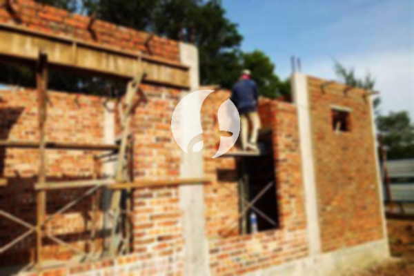

**Biaya Bangun Rumah Per Meter Di Sukamaju Depok** - Hai Mitra Sumber Material! Gimana kabarnya? Seiring perkembangan zaman, layanan borongan bangun rumah semakin banyak dicari di Sukamaju Depok. Kita lihat, bisnis konstruksi makin berkembang, termasuk jasa desain rumah. Hal ini mendorong banyak orang untuk lebih selektif memilih jasa bangun rumah yang tepat. Pertumbuhan populasi yang pesat juga meningkatkan kebutuhan akan tempat tinggal. Tak heran jika banyak pengembang properti berlomba-lomba membangun rumah, apartemen, atau tempat tinggal susun, dari standar hingga mewah. Kepercayaan pelanggan adalah kunci, dan jasa bangun rumah yang baik akan berusaha keras mempertahankan amanah tersebut. Dengan begitu, mereka akan fokus memberikan hasil terbaik sesuai harapan Anda. Nah, sebagai penyedia jasa yang terpercaya, Kami menawarkan beberapa layanan untuk mewujudkan rumah impian Anda. Berikut adalah beberapa jenis layanan bangun rumah yang bisa Anda pilih:



## Layanan Desain Gambar Arsitek Profesional Di Sukamaju Depok

Sebagai penyedia jasa arsitek, Kami sangat memperhatikan desain bangunan yang akan dibuat. Desain yang baik akan mempercantik tampilan rumah Anda. Kami berusaha menciptakan komposisi desain yang indah dan selaras dengan berbagai faktor penting. Desain memang hal utama, karena akan menentukan estetika rumah Anda. Jangan khawatir, Kami menciptakan desain yang sesuai dengan budget yang Anda miliki. Dengan desain yang jelas, Anda bisa memperkirakan biaya yang dibutuhkan untuk mewujudkan rumah impian Anda. Selain itu, desain juga mempertimbangkan material bangunan yang akan digunakan. Semua aspek ini cukup kompleks, itulah mengapa Anda membutuhkan jasa arsitek profesional. Jasa arsitek akan memahami semua harapan Anda, sehingga Anda akan merasa puas dengan hasilnya.

Namun, biaya jasa desain dari Kami bervariasi. Harga tergantung pada luas bangunan dan kerumitan desain yang Anda inginkan. Untuk saat ini, harga jasa desain rumah minimalis satu lantai adalah Rp 54.000,- per meter persegi, sudah termasuk desain, kalkulasi RAB, dan 2 kali revisi. Untuk rumah dua lantai atau lebih, harganya hanya dikalikan 2 atau 3 sesuai jumlah lantai.

## Estimasi Biaya Borong Bangun Rumah Di Sukamaju Depok

Kita tahu, dengan semakin banyaknya populasi, memiliki rumah menjadi kebutuhan mendasar. Banyak layanan bangun rumah bermunculan dan menawarkan layanan terbaik kepada konsumen. Disinilah peran penting jasa bangun rumah dalam menangani persoalan pembangunan rumah Anda. Dengan Kami, Anda akan mendapatkan layanan yang sesuai harapan Anda. Memiliki rumah yang cantik adalah impian semua orang. Dengan memanfaatkan jasa bangun rumah, Kami akan membantu mewujudkan impian Anda. Anda tidak perlu repot mendesain rumah sendiri, karena Kami selalu berusaha memahami keinginan Anda dan mewujudkannya dalam bentuk rumah impian Anda. Kepuasan Anda adalah prioritas Kami, dan itu menjadi penyemangat Kami untuk terus memberikan yang terbaik. Dengan hasil karya desain dan proyek yang Kami kerjakan, Anda dapat melihat portofolio Kami yang membuktikan bahwa Kami adalah pilihan terbaik dan terpercaya.

Untuk harga layanan borong bangunan, Kami menawarkan beberapa tingkatan harga. Harga menyesuaikan dengan material bangunan yang digunakan dan lokasi pembangunan. Dengan asumsi kondisi tanah rata, stabil, dan tidak memerlukan pengurukan, harga per meter persegi dengan material dinding hebel adalah Rp 1.950.000,-, dan dengan material bata merah adalah Rp 2.200.000,-. Harga ini sudah termasuk pondasi batu kali, kolom dan tiang beton, lantai keramik standar, dan atap dengan rangka baja ringan plus genteng spandek. Untuk genteng dan keramik, Anda bisa menyesuaikan tipe, model, kualitas, dan harga sesuai keinginan Anda.

## Harga Jasa Perbaikan & Renovasi Bangunan Di Sukamaju Depok

Selain jasa arsitek dan bangun rumah, Kami juga menyediakan jasa renovasi. Renovasi rumah adalah cara yang efektif untuk memberikan tampilan baru pada rumah Anda. Dengan jasa renovasi, Anda tidak perlu bingung menentukan bagaimana caranya merenovasi rumah Anda. Renovasi yang Kami lakukan bisa berupa perubahan model bangunan, atau renovasi menyeluruh total. Renovasi memang menjadi alternatif yang baik untuk mempercantik rumah dengan anggaran yang terjangkau. Namun, seringkali orang kesulitan melakukannya sendiri. Dengan adanya jasa renovasi, semua masalah tersebut dapat diatasi. Kami hadir sebagai jasa renovasi yang akan memudahkan Anda merenovasi rumah agar lebih bagus dan indah dari sebelumnya, sesuai dengan impian Anda.

Untuk biaya borongan renovasi, Kami memberikan harga yang bervariasi. Karena kondisi kerusakan rumah yang akan direnovasi juga bervariasi. Biaya disesuaikan dengan tipe kerusakan yang akan diperbaiki. Namun, untuk harga jasa renovasi dengan tenaga tukang harian, tarifnya adalah Rp 150.000,- per hari untuk tukang dan Rp 100.000,- per hari untuk kenek.

## Dukungan Tenaga Kerja & Arsitek Berpengalaman Di Sukamaju Depok

Baik layanan arsitek, bangun rumah, maupun renovasi, semuanya memiliki peran penting. Dengan dukungan arsitek profesional dan tenaga kerja yang handal, Kami akan membantu mewujudkan impian Anda. Membangun rumah idaman bersama Kami akan memberikan Anda tempat tinggal yang menarik dan berkualitas. Anda tidak perlu khawatir, karena Kami memberikan pelayanan terbaik, menjaga mutu dan kualitas untuk memberikan kepuasan maksimal. Sebagai penyedia jasa, kepuasan konsumen adalah motivasi Kami untuk terus berkarya dan menghasilkan karya yang lebih baik. Anda dapat melihat katalog proyek-proyek Kami sebelumnya untuk melihat kualitas pekerjaan Kami. Hal ini membuktikan bahwa Kami adalah pilihan terbaik dan terpercaya.

Perlu diingat, rumah adalah kebutuhan primer manusia setelah sandang dan pangan. Rumah menjadi tempat berlindung dari cuaca panas dan dingin, serta melindungi kita dari berbagai bahaya. Ini menjadi peluang bagi penyedia jasa bangun rumah untuk menawarkan jasanya. Sebagai penyedia jasa, Kami berpartisipasi dalam memajukan dunia arsitektur dengan mempresentasikan layanan Kami melalui berbagai media. Mulai dari media cetak hingga online, semua dimanfaatkan untuk mempromosikan jasa bangun rumah Kami. Hal ini membantu banyak orang yang ingin membangun rumah. Dengan menjaga mutu dan kualitas terbaik, Kami telah terbukti memiliki pengalaman yang cukup lama dalam dunia arsitektur. Inilah alasan mengapa jasa bangun rumah Kami semakin banyak dipercaya.

Didukung oleh arsitek profesional dan tenaga kerja yang handal, tentu akan mewujudkan jasa bangun rumah yang semakin dikenal dan terpercaya. Hal ini terlihat dari perkembangan yang Kami berikan. Kami selalu berkarya dengan menciptakan karya-karya baru yang inovatif dan kreatif. Banyak bangunan yang dibangun dengan desain apik dan menarik berkat bantuan Kami. Dengan proses pengerjaan yang cepat, Anda akan segera mendapatkan rumah impian Anda. Baik bangunan kecil maupun besar, Kami mampu mengatasinya. Anda tidak perlu ragu atau khawatir. Desain bangunan, material bahan, ukuran rumah, dan SDM adalah hal-hal yang dapat Kami atasi. Sehingga, Kami dapat mendukung terwujudnya rumah yang cantik dan menarik. Disitulah peran penting dari jasa bangun rumah. Kami akan mewujudkan perencanaan Anda, sekaligus menjadi pengawas selama proses pembangunan. [bangun rumah di Beji](/bangunan/biaya-bangun-rumah-per-meter-di-beji-depok/) Untuk wilayah lain, Kami juga melayani jasa bangun rumah di Beji Depok.

Yuk, segera wujudkan rumah impian Anda bersama Sumber Material! Jangan tunda lagi, [Hubungi Kami Sekarang](https://api.whatsapp.com/send?phone=6285776786091&text=*Halo%20sumbermaterial.com*%20%3A) untuk mendapatkan penawaran terbaik dan konsultasi gratis! Kami siap membantu Anda mewujudkan hunian idaman di Sukamaju Depok.
