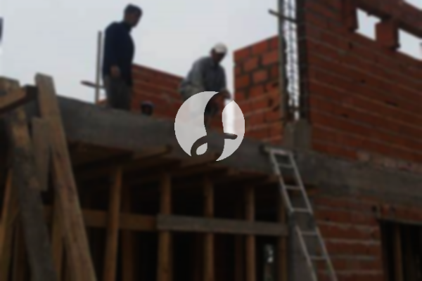

**Biaya Bangun Rumah Per Meter Di Sukamulya Tangerang** - Hai Mitra Sumber Material! Bagaimana kabar Anda? Kami dari penyedia jasa konstruksi di Sukamulya Tangerang ingin memberikan informasi penting terkait biaya bangun rumah per meter. Seiring perkembangan zaman, layanan membangun rumah semakin diminati, bahkan merambah ke desain bangunan. Hal ini membuat banyak orang lebih selektif dalam memilih jasa bangun rumah. Semakin meningkatnya jumlah penduduk, kebutuhan akan tempat tinggal pun terus bertambah. Oleh karena itu, para pengembang properti berlomba-lomba membangun rumah dan perumahan dengan beragam kelas. Kami sebagai penyedia jasa bangun rumah yang terpercaya, berkomitmen untuk memberikan layanan terbaik dan menjaga kepercayaan yang telah diberikan. Kami akan menjalankan pekerjaan sesuai dengan amanah dan harapan Anda. Nah, yuk kita bahas lebih lanjut mengenai layanan yang kami tawarkan untuk membangun rumah impian Anda di Sukamulya Tangerang!



## Jasa Desain Gambar Arsitek Di Sukamulya Tangerang

Sebagai penyedia jasa arsitek profesional, kami akan mengamati dan merancang desain bangunan yang akan Anda wujudkan. Kami berupaya menciptakan keindahan pada rumah Anda melalui desain yang menarik dan sesuai dengan kebutuhan Anda. Kami mempertimbangkan berbagai faktor penting untuk menghasilkan komposisi desain yang baik dan harmonis. Anda tahu sendiri, desain rumah sangat penting karena akan menentukan tampilan visual hunian Anda. Dengan desain yang tepat, rumah Anda akan terlihat cantik dan nyaman. Anda tidak perlu khawatir, karena kami akan menyesuaikan desain dengan budget yang Anda miliki. Dari desain tersebut, Anda dapat memperkirakan biaya yang dibutuhkan untuk membangun rumah impian Anda. Selain itu, kami juga memperhatikan pemilihan material bangunan yang akan digunakan.

Dan harga jasa untuk mendesign bangunan dari kami bervariasi, tergantung luas rumah dan tingkat kesulitan desain yang diinginkan. Saat ini, kami menetapkan harga jasa desain rumah minimalis satu lantai sebesar Rp 54.000,- per meter persegi, sudah termasuk desain, hitungan RAB, dan dua kali revisi. Untuk rumah dua lantai atau lebih, harganya bisa dikalikan dua atau tiga sesuai dengan jumlah lantai.

## Harga Jasa Borong Renovasi Tempat Tinggal Di Sukamulya Tangerang

Banyak orang yang membutuhkan tempat tinggal yang nyaman dan aman. Hal ini menciptakan peluang bagi penyedia jasa bangun rumah untuk menawarkan solusi terbaik bagi para pelanggan. Kami hadir sebagai mitra yang dapat diandalkan dalam mewujudkan rumah impian Anda di Sukamulya Tangerang. Memiliki rumah yang indah adalah dambaan setiap orang. Dengan menggunakan jasa bangun rumah, Anda akan terbantu dalam mewujudkan impian tersebut. Anda tidak perlu repot mendesain rumah sendiri, karena kami siap mewujudkan keinginan Anda menjadi karya nyata. Kepuasan Anda adalah prioritas utama kami, dan kami akan berusaha memberikan pelayanan terbaik sesuai harapan Anda.

Untuk ongkos borong renovasi rumah, kami menawarkan beberapa pilihan harga. Biaya ini disesuaikan dengan bahan bangunan yang digunakan dan lokasi renovasi. Dengan syarat area tanah dalam kondisi rata, stabil, dan tidak memerlukan pengurugan. Harga per meter persegi dengan material dinding hebel adalah Rp 1.950.000,-, sementara dengan material bata merah adalah Rp 2.200.000,-. Harga tersebut sudah termasuk pondasi batu sungai, kolom dan tiang beton, lantai keramik standar, serta atap dengan rangka baja ringan dan genteng spandek. Untuk genteng dan keramik, Anda bisa memilih variasi lain dengan model dan kualitas yang berbeda sesuai budget Anda.

## Harga Layanan Rombak Bangunan Di Sukamulya Tangerang

Selain layanan desain dan pembangunan rumah baru, kami juga menyediakan jasa renovasi bangunan. Renovasi adalah cara yang efektif untuk mengubah tampilan rumah agar terlihat baru dan segar. Dengan jasa renovasi kami, Anda tidak perlu khawatir dalam memastikan renovasi rumah Anda berjalan lancar. Renovasi yang kami lakukan dapat berupa perubahan model rumah secara keseluruhan atau hanya sebagian. Renovasi memang menjadi pilihan untuk meningkatkan estetika rumah, tetapi seringkali terhambat oleh keterbatasan anggaran. Namun, dengan adanya jasa renovasi bangunan, semua masalah tersebut dapat teratasi. Kami hadir sebagai solusi renovasi rumah yang mudah dan terjangkau, siap mengubah rumah Anda menjadi lebih modern dan menarik.

Untuk harga borongan jasa renovasi bangunan, kami memberikan harga yang bervariasi, tergantung pada kondisi kerusakan rumah yang akan diperbaiki. Biaya akan disesuaikan dengan tingkat kerusakan yang ada. Namun, untuk biaya jasa renovasi dengan tenaga tukang harian, harganya adalah Rp 150.000,- per hari untuk tukang dan Rp 100.000,- per hari untuk kenek.

## Didukung Tukang Dan Arsitek Berpengalaman Di Sukamulya Tangerang

Baik jasa desain arsitek, pembangunan rumah baru, maupun renovasi, semuanya memiliki peran penting dalam mewujudkan rumah impian Anda. Kami didukung oleh arsitek profesional dan tenaga kerja yang handal, siap membantu mewujudkan impian Anda. Dengan membangun rumah bersama kami, Anda akan memiliki rumah yang menarik dan berkualitas tinggi. Anda tidak perlu khawatir, karena kami memberikan pelayanan terbaik, menjaga mutu dan kualitas untuk memberikan kepuasan Anda. Sebagai penyedia jasa bangun rumah, kepuasan pelanggan adalah motivasi utama kami untuk terus berkarya dan menghasilkan karya yang lebih baik. Anda bisa melihat portofolio proyek-proyek kami untuk membuktikan bahwa kami adalah pilihan terbaik dan terpercaya untuk membangun rumah di Sukamulya Tangerang.

Perlu diketahui, rumah adalah kebutuhan primer manusia yang sangat penting, selain sandang dan pangan. Rumah menjadi tempat berlindung dari cuaca panas dan dingin, serta memberikan rasa aman dan nyaman. Hal ini menjadi peluang bagi penyedia jasa bangun rumah untuk menawarkan jasanya. Sebagai penyedia jasa khususnya dalam bidang pembangunan rumah, kami berpartisipasi aktif dalam meramaikan dunia arsitektur dengan mempresentasikan jasa kami melalui berbagai media. Mulai dari media cetak hingga online, kami memanfaatkan berbagai platform untuk menjangkau lebih banyak calon pelanggan. Hal ini tentu membantu banyak orang dalam mewujudkan rumah impian mereka. Dengan menjaga mutu dan kualitas terbaik, kami telah terbukti memiliki pengalaman yang cukup lama dalam dunia arsitektur. Itulah sebabnya, kami semakin dipercaya oleh banyak orang.

Didukung oleh arsitek profesional dan tenaga kerja yang handal, tentu akan menjadikan layanan bangun rumah kami semakin dikenal dan terpercaya. Kami terus berinovasi dan kreatif dalam menghasilkan karya-karya baru yang menarik. Banyak bangunan-bangunan yang telah kami bangun dengan desain yang apik dan modern. Dengan proses pengerjaan yang efisien, Anda akan cepat mendapatkan rumah impian Anda. Baik rumah berskala kecil maupun besar, kami mampu mengatasinya dengan baik. Anda tidak perlu ragu atau khawatir. Mulai dari desain bangunan, pemilihan material, ukuran rumah, hingga sumber daya manusia, semuanya dapat kami atasi dengan optimal. Hal ini akan mendukung terwujudnya rumah yang cantik dan menarik. Di sinilah peran penting jasa bangun rumah. Kami akan menciptakan rancangan yang sesuai dengan harapan Anda dan menjadi pengawas dalam proses pembangunan. [Hubungi Kami Sekarang](https://api.whatsapp.com/send?phone=6285776786091&text=*Halo%20sumbermaterial.com*%20%3A) untuk konsultasi gratis!
