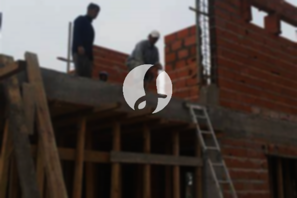

**Biaya Bangun Rumah Per Meter Di Sukaraja Sukabumi** - Hai Mitra Sumber Material! Gimana kabarnya? Kami dari tim Sumber Material ingin berbagi informasi penting bagi Anda yang berencana membangun rumah di Sukaraja Sukabumi. Seiring dengan perkembangan zaman, banyak orang lebih memilih jasa bangun rumah yang terpercaya. Semakin banyak permintaan, otomatis kebutuhan akan tempat tinggal pun meningkat.  Para pelaku properti berlomba-lomba menghadirkan solusi terbaik, mulai dari rumah sederhana hingga mewah. Kepercayaan konsumen adalah kunci utama, dan sebagai penyedia jasa, Kami selalu berupaya menjaga kepercayaan tersebut dengan memberikan hasil kerja yang amanah. Nah, Kami akan menjabarkan beberapa layanan yang bisa Anda pilih untuk mewujudkan rumah impian Anda di Sukaraja Sukabumi.



## Harga Design Gambar Arsitek Di Sukaraja Sukabumi

Untuk mewujudkan rumah impian, design yang menarik adalah hal pertama yang perlu dipikirkan. Sebagai penyedia jasa arsitek, Kami akan membantu Anda menciptakan design rumah yang indah dan fungsional. Kami akan mempertimbangkan berbagai faktor penting untuk menghasilkan komposisi design yang selaras dan sesuai dengan keinginan Anda.  Desain yang baik akan membuat rumah Anda terlihat lebih menarik dan nyaman. Anda tak perlu khawatir soal budget, karena Kami bisa menyesuaikan design dengan anggaran yang Anda miliki.  Dari design ini, Anda bisa memperkirakan biaya yang dibutuhkan untuk mewujudkan rumah impian di Sukaraja Sukabumi. Selain itu, Kami juga akan mencocokkan desain dengan material bangunan yang akan digunakan. Memang proses ini nggak mudah, lho.  Itulah mengapa, memilih jasa arsitek yang berpengalaman sangatlah penting. Kami akan memahami harapan Anda dan mewujudkannya menjadi kenyataan.

Saat ini, harga jasa desain bangunan dari Kami bervariasi tergantung luas bangunan dan tingkat kesulitan desain. Untuk rumah minimalis satu lantai, harga jasa desain per meter persegi mulai dari Rp 54.000,-. Harga ini sudah termasuk desain, kalkulasi RAB, dan dua kali revisi. Sedangkan untuk rumah dua lantai atau lebih, harganya tinggal dikalikan 2 atau 3 sesuai jumlah lantai.

## Jasa Borong Bangun Rumah Di Sukaraja Sukabumi

Miliki rumah idaman Anda di Sukaraja Sukabumi tanpa repot! Kami hadir sebagai solusi borongan bangun rumah yang terpercaya. Dengan banyaknya pilihan layanan bangun rumah, Kami menawarkan produk dan pelayanan terbaik untuk konsumen. Layanan borongan bangun rumah berperan penting dalam mengatasi tantangan pembangunan rumah. Anda akan mendapatkan rumah yang sesuai dengan harapan dan impian Anda. Memiliki rumah yang cantik adalah keinginan semua orang. Dengan menggunakan jasa Kami, Anda akan terbantu mewujudkannya.  Anda tidak perlu pusing memikirkan desain rumah sendiri, karena Kami akan berusaha memahami keinginan Anda dan mewujudkannya dalam sebuah karya nyata. Kepuasan Anda adalah prioritas Kami, yang akan Kami wujudkan melalui pekerjaan yang terpercaya.

Untuk harga layanan borong bangun rumah Kami, tersedia beberapa pilihan sesuai dengan bahan bangunan yang digunakan dan lokasi pembangunan. Dengan asumsi lokasi tanah rata dan stabil (tidak memerlukan pengurugan), harga per meter persegi dengan material dinding hebel adalah Rp 1.950.000,-, sedangkan dengan material bata merah adalah Rp 2.200.000,-. Harga ini sudah termasuk pondasi batu kali, kolom dan tiang beton, lantai keramik standar, serta atap rangka baja ringan plus genteng spandek. Anda bisa menyesuaikan jenis genteng dan keramik sesuai keinginan, dengan biaya tambahan yang akan Kami informasikan.

## Harga Rombak Tempat Tinggal Di Sukaraja Sukabumi

Selain layanan desain dan bangun rumah, Kami juga menyediakan jasa renovasi rumah di Sukaraja Sukabumi. Renovasi adalah cara terbaik untuk memberikan tampilan baru pada rumah Anda. Dengan layanan renovasi Kami, Anda tidak perlu bingung mencari solusi untuk merombak rumah Anda. Kami melakukan renovasi dengan teknik mengubah tampilan rumah secara keseluruhan atau sebagian. Renovasi bisa menjadi pilihan tepat untuk meningkatkan keindahan rumah Anda dengan budget yang lebih terjangkau. Namun, seringkali orang kesulitan melakukannya sendiri.  Dengan adanya jasa renovasi bangunan, semua itu bisa diatasi. Kami hadir sebagai solusi renovasi rumah yang akan membantu Anda menciptakan hunian yang lebih segar dan menarik. Kami siap mengubah bangunan Anda menjadi lebih indah sesuai impian Anda.

Untuk biaya borongan jasa renovasi rumah, Kami memberikan harga yang berbeda-beda tergantung kondisi kerusakan bangunan. Jadi, harga borongan renovasi kami disesuaikan dengan variasi kerusakan yang akan diperbaiki. Namun, untuk biaya tenaga tukang harian, harganya adalah Rp 150.000,- per hari untuk tukang dan Rp 100.000,- per hari untuk kenek.

## Didukung Tenaga Kerja Dan Arsitek Terbaik Di Sukaraja Sukabumi

Baik itu layanan desain arsitek, borongan bangun rumah, ataupun renovasi, semuanya memiliki peran yang penting. Didukung oleh arsitek profesional dan tenaga kerja yang handal, Kami siap membantu Anda mewujudkan impian memiliki rumah impian. Dengan membangun rumah bersama Kami, Anda akan memiliki hunian yang menarik dan indah. Kami menjamin kualitas terbaik, menjaga mutu, dan memberikan kepuasan maksimal kepada Anda. Sebagai penyedia jasa, kepuasan pengguna adalah motivasi Kami untuk terus berkarya dan menghasilkan karya yang lebih baik. Anda bisa melihat katalog proyek Kami untuk melihat hasil karya-karya sebelumnya. Ini membuktikan bahwa Kami adalah pilihan terbaik dan terpercaya untuk membangun rumah di Sukaraja Sukabumi.

Perlu diingat, memiliki rumah adalah kebutuhan pokok manusia selain sandang dan pangan. Rumah adalah tempat berlindung dari cuaca dan bahaya. Inilah yang menjadi peluang bagi penyedia jasa bangun rumah untuk menawarkan jasanya. Sebagai penyedia jasa, Kami aktif berpartisipasi dalam memajukan dunia arsitektur dengan menampilkan layanan Kami melalui berbagai media, baik cetak maupun online. Hal ini tentu membantu banyak orang yang ingin membangun rumah. Dengan menjaga mutu dan kualitas terbaik, Kami telah memiliki pengalaman yang cukup lama di dunia arsitektur. Itulah mengapa, semakin banyak orang mempercayakan pembangunan rumah mereka kepada Kami.

Didukung oleh arsitek profesional dan tenaga kerja yang handal, Kami siap memberikan yang terbaik. Kami selalu berinovasi dan kreatif dalam setiap proyek. Banyak rumah dan bangunan yang telah Kami bangun dengan desain yang apik dan menarik. Proses pengerjaan yang cepat dan efisien akan membantu Anda segera mewujudkan rumah impian Anda. Baik rumah berskala kecil maupun besar, Kami mampu mengatasinya dengan baik. Jadi, Anda tidak perlu khawatir atau cemas. Mulai dari desain, material, ukuran, hingga sumber daya manusia, semua bisa Kami atasi. Itulah peran penting Kami sebagai penyedia jasa bangun rumah yang terpercaya. Kami akan membantu Anda menata desain, serta mengawasi pembangunan sehingga hasilnya sesuai harapan Anda. [bangun rumah di Bojongmanik](/bangunan/biaya-bangun-rumah-per-meter-di-bojongmanik-rangkasbitung/) Kalau Anda sedang mempertimbangkan membangun di luar Sukaraja Sukabumi, Kami juga melayani [bangun rumah di Bantargadung](/bangunan/biaya-bangun-rumah-per-meter-di-bantargadung-sukabumi/). [Hubungi Kami Sekarang!](https://api.whatsapp.com/send?phone=6285776786091&text=*Halo%20sumbermaterial.com*%20%3A)
