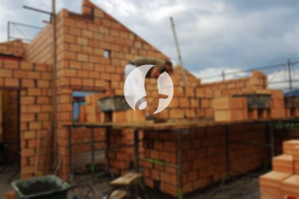

**Biaya Bangun Rumah Per Meter Di Sukaresmi Bogor** - Hai Mitra Sumber Material! Gimana kabarnya? Kami dari Sumber Material hadir sebagai mitra terpercaya dalam mewujudkan rumah impian Anda di Sukaresmi Bogor. Seiring dengan meningkatnya kebutuhan tempat tinggal, layanan konstruksi pun berkembang pesat, tak hanya fokus pada pembangunan, tapi juga desain interior dan eksterior. Ini menghadirkan banyak pilihan bagi Anda, namun juga menuntut kehati-hatian dalam memilih penyedia jasa yang tepat. Semakin banyak orang yang mencari hunian, maka permintaan akan jasa konstruksi juga meningkat. Para kontraktor pun berlomba-lomba menawarkan layanan terbaik, mulai dari standar hingga mewah. Kredibilitas adalah kunci utama – jasa konstruksi yang baik akan selalu mengutamakan kepercayaan pelanggan dan berkomitmen untuk memberikan hasil terbaik. Nah, untuk itu, kami hadir dengan beragam layanan yang bisa Anda pilih. Berikut beberapa jenis layanan yang kami tawarkan:



## Jasa Desain Gambar Arsitektur Di Sukaresmi Bogor

Sebagai penyedia jasa desain arsitektur terpercaya di Sukaresmi Bogor, kami mengutamakan pemahaman mendalam tentang visi dan kebutuhan Anda. Desain yang baik adalah fondasi dari rumah impian, dan kami berupaya mewujudkan keindahan serta fungsionalitas dalam setiap rancangan. Proses desain kami mempertimbangkan berbagai faktor penting untuk menciptakan komposisi yang harmonis dan aesthetically pleasing. Kami memahami betul bahwa desain adalah elemen krusial dalam pembangunan rumah. Desain yang menarik akan menciptakan hunian yang indah dan nyaman dihuni. Anda tidak perlu khawatir, karena kami menyesuaikan desain dengan anggaran yang Anda miliki. Dari desain inilah, Anda dapat memperkirakan biaya yang dibutuhkan untuk mewujudkan rumah impian Anda. Selain itu, kami juga mempertimbangkan pemilihan material yang sesuai dengan budget dan gaya desain. Proses ini memang membutuhkan keahlian khusus. Itulah mengapa, Anda membutuhkan jasa arsitek profesional. Arsitek akan memahami keinginan Anda dengan baik, sehingga Anda akan merasa puas dengan hasilnya.

Harga jasa desain rumah kami bervariasi, tergantung pada luas bangunan dan tingkat kesulitan desain. Saat ini, harga jasa desain rumah minimalis satu lantai adalah Rp 54.000,- per meter persegi, sudah termasuk desain, perhitungan RAB (Rencana Anggaran Biaya), dan dua kali revisi. Untuk rumah dua lantai atau lebih, harga hanya dikalikan dua atau tiga, sesuai dengan jumlah lantai.

## Jasa Borong Renovasi Tempat Tinggal Di Sukaresmi Bogor

Memiliki rumah adalah kebutuhan mendasar setiap orang. Seiring waktu, rumah mungkin membutuhkan renovasi untuk meningkatkan kenyamanan dan estetika. Kami menyediakan jasa borong renovasi tempat tinggal di Sukaresmi Bogor untuk membantu Anda menyegarkan tampilan rumah Anda. Bermacam-macam layanan bangun rumah hadir menawarkan produk dan pelayanan terbaik. Di sinilah peran penting jasa bangun rumah dalam mengatasi tantangan pembangunan rumah. Dengan layanan kami, Anda akan mendapatkan solusi yang sesuai dengan keinginan Anda. Memiliki rumah yang indah adalah impian setiap orang. Dengan memanfaatkan jasa bangun rumah, Anda akan dibantu untuk mewujudkan impian tersebut. Anda tidak perlu repot mendesain rumah sendiri, karena kami selalu berusaha memahami kebutuhan Anda, dan mewujudkannya dalam bangunan impian Anda. Kepuasan Anda adalah prioritas kami, dan itu mendorong kami untuk terus memberikan karya yang lebih baik.

Untuk harga borong renovasi tempat tinggal, kami menawarkan beberapa tingkatan harga yang disesuaikan dengan material bangunan dan lokasi pembangunan. Dengan syarat tanah dalam kondisi rata, stabil, dan tidak memerlukan pengurugan. Harga per meter persegi dengan material dinding hebel adalah Rp 1.950.000,-, sedangkan dengan material bata merah adalah Rp 2.200.000,-. Harga tersebut sudah termasuk pondasi batu sungai, kolom dan tiang beton, lantai keramik standar, serta atap rangka baja ringan dengan genteng spandek. Untuk jenis genteng dan keramik, Anda dapat memilih variasi lain sesuai dengan preferensi anggaran Anda.

## Harga Jasa Rombak Bangunan Di Sukaresmi Bogor

Selain jasa arsitek dan pembangunan rumah baru, kami juga menawarkan jasa renovasi bangunan di Sukaresmi Bogor. Renovasi adalah cara yang efektif untuk mengubah tampilan rumah agar terlihat baru dan lebih segar. Dengan adanya jasa renovasi, Anda tidak perlu khawatir menentukan langkah renovasi yang tepat. Kami menawarkan renovasi yang bervariasi, mulai dari perubahan tampilan hingga perombakan total. Renovasi memang menjadi solusi ideal untuk memperbarui bangunan dengan budget yang terjangkau. Namun, seringkali seseorang kesulitan melakukannya sendiri. Dengan jasa renovasi profesional, semua masalah tersebut dapat teratasi. Kami hadir sebagai solusi renovasi rumah yang akan membantu Anda menciptakan hunian yang lebih modern dan menarik.

Biaya borong jasa renovasi bangunan kami bervariasi, tergantung pada kondisi kerusakan bangunan. Kami akan melakukan survei terlebih dahulu untuk menentukan perkiraan biaya yang sesuai. Untuk tenaga tukang harian, harga yang kami tawarkan adalah Rp 150.000,- per hari untuk tukang dan Rp 100.000,- per hari untuk kenek.

## Didukung Tukang Dan Arsitek Berpengalaman Di Sukaresmi Bogor

Baik jasa arsitek, konstruksi rumah baru, maupun renovasi, semuanya memiliki peran penting dalam mewujudkan rumah impian Anda. Dengan dukungan arsitek profesional dan tenaga kerja yang terampil, kami akan membantu Anda mewujudkan impian tersebut. Membangun rumah idaman bersama kami akan memberikan Anda hunian yang menarik dan nyaman. Anda tidak perlu khawatir, karena kami selalu mengutamakan kualitas dan memberikan pelayanan terbaik untuk memastikan kepuasan Anda. Sebagai penyedia jasa konstruksi yang terpercaya, kepuasan pelanggan adalah motivasi utama kami untuk terus berinovasi dan menghasilkan karya yang lebih baik. Anda dapat melihat portofolio proyek-proyek kami sebelumnya untuk membuktikan kualitas kerja kami. Untuk wilayah lain, Kami juga melayani [bangun rumah di Babakan Pasar](/bangunan/biaya-bangun-rumah-per-meter-di-babakan-pasar-bogor/).

Perlu diingat, rumah adalah kebutuhan pokok manusia, sama pentingnya dengan sandang dan pangan. Rumah berfungsi sebagai tempat berlindung dari cuaca ekstrem dan berbagai bahaya. Hal inilah yang menjadi peluang bagi penyedia jasa konstruksi untuk menawarkan layanan mereka. Sebagai penyedia jasa khusus dalam konstruksi rumah, kami berpartisipasi dalam memajukan dunia arsitektur dengan menampilkan jasa kami melalui berbagai media, mulai dari media cetak hingga online. Hal ini tentu memudahkan banyak orang untuk mewujudkan rumah impian mereka. Dengan menjaga kualitas dan mutu terbaik, Kami telah terbukti memiliki pengalaman yang cukup lama dalam dunia arsitektur. Itulah mengapa, Kami semakin dipercaya oleh banyak orang.

Didukung oleh arsitek profesional dan tenaga kerja yang handal, jasa konstruksi Kami semakin dikenal dan terpercaya. Hal ini terlihat dari perkembangan pesat yang Kami alami. Kami terus berinovasi dan menciptakan karya-karya baru yang lebih kreatif dan berkualitas. Banyak bangunan dengan desain yang apik dan menarik telah Kami bangun. Dengan proses pengerjaan yang cepat dan efisien, Anda akan segera mendapatkan rumah impian Anda. Baik bangunan berskala kecil maupun besar, semua dapat Kami tangani dengan baik. Anda tidak perlu khawatir atau ragu. Mulai dari desain bangunan, pemilihan material, ukuran bangunan, hingga tenaga kerja, semuanya dapat Kami atasi dengan layanan konstruksi Kami. Dengan begitu, Kami dapat mendukung terwujudnya bangunan yang indah dan menarik. Disitulah peran penting jasa konstruksi Kami. Karena, Kami akan membuat perencanaan yang matang, serta melakukan pengawasan selama proses pembangunan. Jangan ragu untuk [hubungi Kami](https://api.whatsapp.com/send?phone=6285776786091&text=*Halo%20sumbermaterial.com*%20%3A) sekarang juga untuk konsultasi gratis!
