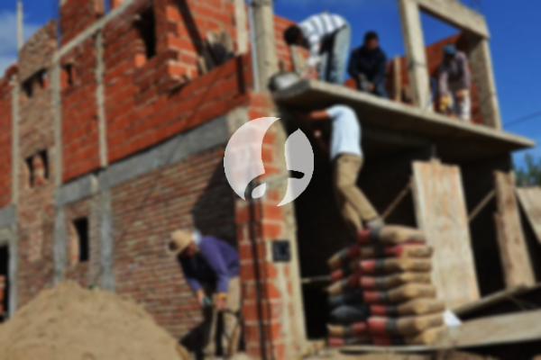

**Biaya Bangun Rumah Per Meter Di Sukatani Bekasi** - Hai Mitra Sumber Material! Gimana kabarnya? Kami dari Sumber Material hadir sebagai mitra terpercaya Anda dalam mewujudkan impian memiliki rumah idaman di Sukatani Bekasi. Seiring perkembangan zaman, minat terhadap jasa pembuatan bangunan semakin meningkat. Borongan bangun rumah semakin populer, menawarkan kemudahan termasuk layanan desain interior. Peningkatan jumlah penduduk juga mendorong kebutuhan akan tempat tinggal, dan para kontraktor berlomba-lomba menyediakan solusi mulai dari rumah ekonomis hingga mewah. Kami memahami betul pentingnya kepercayaan konsumen, dan berkomitmen untuk memberikan layanan terbaik serta menjaga kualitas pekerjaan yang telah dipercayakan kepada kami. Sebagai penyedia layanan konstruksi yang terpercaya, Kami menawarkan berbagai pilihan layanan untuk membangun rumah impian Anda. Berikut beberapa jenis layanan yang bisa Anda pilih:



## Jasa Desain Gambar Arsitek Di Sukatani Bekasi

Sebagai penyedia jasa desain, Kami mengutamakan estetika bangunan yang akan Anda wujudkan. Dengan desain yang tepat, Kami akan berusaha menciptakan rumah yang indah dan sesuai dengan harapan Anda. Kami mempertimbangkan berbagai faktor penting untuk menghasilkan komposisi desain yang harmonis dan menarik. Desain yang baik adalah kunci utama untuk menciptakan rumah yang menawan. Anda tidak perlu khawatir, karena Kami akan menciptakan desain yang selaras dengan anggaran yang Anda miliki. Dengan desain yang jelas, Anda dapat memperkirakan biaya yang dibutuhkan untuk mewujudkan rumah impian Anda. Selain itu, Kami juga akan mempertimbangkan material bangunan yang akan digunakan. Proses ini memang cukup kompleks, dan inilah mengapa Anda membutuhkan jasa arsitek profesional. Kami akan memahami kebutuhan dan keinginan Anda, sehingga Anda akan merasa puas dengan hasil desain yang Kami berikan.

Namun, biaya jasa desain dari Kami bervariasi tergantung luas rumah dan kompleksitas desain yang diminta. Saat ini, Kami menawarkan harga jasa desain rumah minimalis satu lantai mulai dari Rp 54.000,- per meter persegi, termasuk desain, RAB, dan 2 kali revisi. Untuk rumah dua lantai atau lebih, biayanya bisa dikali 2 atau 3 sesuai jumlah lantai.

## Harga Layanan Borong Renovasi Tempat Tinggal Di Sukatani Bekasi

Seperti yang Kita ketahui, kebutuhan akan tempat tinggal adalah hal mendasar bagi setiap manusia. Oleh karena itu, banyak orang yang mencari layanan borongan bangun rumah untuk mewujudkan impian mereka. Layanan ini menawarkan kemudahan dan solusi terbaik bagi konsumen. Di sinilah peran penting Kami dalam menangani permasalahan pembangunan rumah Anda. Dengan memilih layanan borongan bangun rumah, Anda akan mendapatkan rumah yang sesuai dengan keinginan Anda. Memiliki rumah yang indah adalah impian setiap orang, dan Kami akan membantu Anda mewujudkannya. Dengan borongan bangun rumah, Anda tidak perlu repot mendesain rumah sendiri, karena tim desain Kami akan memahami dan menerjemahkan harapan Anda ke dalam karya nyata. Kepuasan Anda adalah prioritas utama Kami, dan Kami akan terus berusaha memberikan layanan terbaik dan menjaga kualitas pekerjaan.

Untuk jasa borong renovasi rumah, Kami menawarkan beberapa tingkatan harga yang disesuaikan dengan bahan bangunan dan lokasi pembangunan. Dengan syarat lokasi tanah dalam keadaan rata, stabil, dan tidak memerlukan pengurukan. Harga per meter persegi dengan material dinding hebel adalah Rp 1.950.000,-, sedangkan untuk material bata merah adalah Rp 2.200.000,-. Harga ini sudah termasuk pondasi batu kali, kolom dan tiang beton, lantai keramik standar, serta atap rangka baja ringan dengan genteng spandek. Untuk jenis genteng dan keramik, Anda dapat memilih sesuai preferensi, mutu, dan harga yang sesuai.

## Ongkos Renovasi Tempat Tinggal Di Sukatani Bekasi

Selain layanan desain dan bangun rumah, Kami juga menyediakan jasa renovasi rumah. Renovasi rumah adalah cara efektif untuk memberikan tampilan baru pada hunian Anda. Dengan adanya jasa renovasi rumah, Anda tidak perlu khawatir dalam menentukan langkah-langkah perbaikan. Renovasi yang Kami lakukan dapat berupa perubahan model rumah, perombakan total, maupun perbaikan kerusakan. Renovasi memang menjadi alternatif yang menarik untuk mempercantik rumah Anda, terutama dengan biaya yang lebih terjangkau. Namun, seringkali orang kesulitan untuk melakukannya sendiri. Dengan adanya jasa renovasi bangunan, masalah ini dapat teratasi. Kami hadir sebagai solusi renovasi rumah yang akan memudahkan Anda untuk menciptakan rumah yang lebih baik dan indah dari sebelumnya. Kami siap mewujudkan impian Anda dalam menciptakan hunian yang nyaman dan menarik.

Harga borongan dari jasa renovasi bangunan Kami bervariasi, tergantung pada kondisi kerusakan rumah yang akan diperbaiki. Namun, untuk biaya jasa renovasi dengan tenaga tukang harian, tarifnya adalah Rp 150.000,- per hari untuk tukang dan Rp 100.000,- per hari untuk kenek.

## Didukung Tenaga Kerja Dan Arsitek Terbaik Di Sukatani Bekasi

Baik jasa desain, bangun rumah, maupun renovasi, semuanya memiliki peran penting dalam mewujudkan hunian impian Anda. Dengan dukungan arsitek profesional dan tenaga kerja yang handal, Kami siap membantu Anda mewujudkan impian tersebut. Membangun rumah idaman bersama Kami akan memberikan Anda rumah yang menarik dan berkualitas. Jangan khawatir, Kami akan memberikan pelayanan terbaik, menjaga mutu dan kualitas, serta memberikan kepuasan maksimal kepada Anda. Sebagai penyedia jasa bangun rumah, kepuasan pelanggan adalah semangat Kami untuk terus berkarya dan menghasilkan karya yang lebih baik. Anda dapat melihat katalog proyek-proyek Kami untuk membuktikan kualitas dan pengalaman Kami. Katalog tersebut akan menunjukkan bahwa Kami adalah pilihan terbaik dan terpercaya.

Sebagai informasi, rumah adalah kebutuhan pokok manusia selain sandang pangan, sebagai tempat berlindung dari cuaca dan bahaya. Inilah yang menjadi peluang bagi penyedia jasa bangun rumah untuk menawarkan layanan mereka. Sebagai penyedia jasa, khususnya dalam layanan bangun rumah, Kami turut berkontribusi dalam meramaikan dunia arsitektur yang terus berkembang dengan mempromosikan layanan Kami melalui berbagai media, baik cetak maupun online. Hal ini tentu akan membantu banyak orang yang ingin membangun rumah. Dengan menjaga mutu dan kualitas terbaik, Kami telah terbukti memiliki pengalaman yang cukup lama dalam dunia arsitektur. Itulah mengapa layanan bangun rumah Kami semakin dipercaya oleh banyak orang. [bangun rumah di Cabangbungin](/bangunan/biaya-bangun-rumah-per-meter-di-cabangbungin-bekasi/)

Didukung oleh arsitek profesional dan tenaga kerja terampil, Kami dapat mewujudkan jasa bangun rumah yang semakin dikenal dan dipercaya. Hal ini terlihat dari perkembangan yang terus Kami lakukan, menciptakan karya-karya baru yang inovatif dan kreatif. Banyak rumah dan bangunan indah yang telah Kami bangun dengan desain yang apik dan menarik. Dengan proses pengerjaan yang efisien, Anda akan segera mendapatkan rumah impian Anda. Baik rumah skala kecil maupun besar, Kami dapat mengatasinya dengan baik. Jadi, Anda tidak perlu khawatir atau cemas. Mulai dari desain rumah, pemilihan material, ukuran rumah, hingga sumber daya manusia, semuanya dapat Kami atasi. Dengan demikian, Kami dapat mendukung terwujudnya rumah yang cantik dan menarik. Disitulah peran penting dari layanan bangun rumah Sumber Material. Karena Kami akan mewujudkan tata desain yang Anda inginkan, sekaligus mengawasi seluruh proses pembangunan. [Hubungi Kami Sekarang](https://api.whatsapp.com/send?phone=6285776786091&text=*Halo%20sumbermaterial.com*%20%3A)
