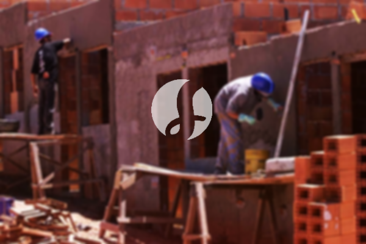

**Biaya Bangun Rumah Per Meter Di Sukatani Purwakarta** - Hai Mitra Sumber Material! Bagaimana kabar Anda semua? Kami dari penyedia jasa bangun rumah di Sukatani Purwakarta ingin memberikan solusi terbaik untuk mewujudkan rumah impian Anda. Seiring dengan perkembangan zaman, layanan konstruksi kini semakin diminati. Banyak orang yang memilih jasa bangun rumah karena kemudahan dan efisiensinya. Semakin padatnya populasi di Sukatani Purwakarta, kebutuhan akan hunian pun meningkat pesat. Hal ini mendorong para pelaku properti untuk berlomba-lomba membangun rumah, mulai dari yang sederhana hingga mewah. Dengan kepercayaan yang diberikan oleh pelanggan, Kami berkomitmen memberikan layanan terbaik dan menjaga kualitas bangunan Anda. Nah, dengan pengalaman Kami, Kami menawarkan beberapa layanan yang bisa Anda pilih untuk membangun rumah idaman di Sukatani Purwakarta:



## Jasa Desain Gambar Arsitektur Di Sukatani Purwakarta

Sebagai mitra terpercaya dalam bidang desain, Kami akan mengamati secara detail desain rumah yang Anda inginkan. Dengan desain yang tepat, Kami akan berupaya semaksimal mungkin untuk menciptakan rumah yang indah dan fungsional. Komposisi desain yang harmonis adalah kunci utama. Seperti yang Anda ketahui, desain merupakan aspek terpenting dalam pembangunan rumah. Desain yang baik akan membuat rumah Anda terlihat menarik dan nyaman dihuni. Anda tidak perlu khawatir soal budget, karena Kami akan menciptakan desain yang sesuai dengan kemampuan finansial Anda. Dari desain tersebut, Anda dapat memperkirakan biaya yang dibutuhkan untuk mewujudkan rumah impian Anda. Selain itu, Kami juga mempertimbangkan material bangunan yang akan digunakan. Semua aspek ini cukup kompleks. Itulah mengapa Anda membutuhkan jasa arsitek profesional. Kami memahami keinginan Anda dan memastikan Anda puas dengan hasilnya.

Biaya jasa desain rumah Kami bervariasi, tergantung pada luas rumah dan tingkat kerumitan desain yang diinginkan. Saat ini, Kami menawarkan harga per meter persegi. Untuk desain rumah minimalis satu lantai, biayanya adalah Rp 54.000,- per meter persegi. Harga tersebut sudah termasuk desain, perhitungan RAB (Rencana Anggaran Biaya), dan 2 kali revisi. Untuk rumah dua lantai atau lebih, biayanya hanya dikalikan 2 atau 3 sesuai jumlah lantainya.

## Jasa Borong Renovasi Bangunan Di Sukatani Purwakarta

Dengan semakin banyaknya orang yang mencari tempat tinggal, layanan bangun rumah semakin kompetitif. Kami hadir untuk memberikan penawaran terbaik dan solusi tepat bagi kebutuhan pembangunan Anda di Sukatani Purwakarta. Kami memahami tantangan dalam membangun rumah, dan Kami siap membantu Anda mewujudkan impian Anda. Memiliki rumah yang cantik adalah impian semua orang. Dengan menggunakan jasa borong bangun rumah, Anda akan mendapatkan bantuan penuh dalam membangun rumah impian Anda. Dengan bantuan Kami, Anda tidak perlu repot memikirkan desain rumah sendiri. Kami selalu berusaha memahami keinginan Anda dan mewujudkannya menjadi karya nyata. Kepuasan Anda adalah prioritas Kami.

Untuk harga borong renovasi bangunan, Kami memiliki beberapa tingkat harga yang disesuaikan dengan material bangunan dan lokasi proyek. Dengan syarat tanah yang akan dibangun dalam keadaan rata, stabil, dan tidak memerlukan pengurugan. Harga per meter persegi dengan material dinding hebel adalah Rp 1.950.000,- dan dengan material bata merah adalah Rp 2.200.000,-. Harga tersebut mencakup pondasi batu gunung, kolom dan tiang beton, lantai keramik standar, serta atap rangka baja ringan dengan genteng spandek. Untuk genteng dan keramik, Anda dapat memilih variasi lain sesuai model, kualitas, dan harga yang Anda inginkan.

## Jasa Perbaikan Bangunan Di Sukatani Purwakarta

Selain jasa arsitek dan bangun rumah, Kami juga menyediakan jasa renovasi bangunan di Sukatani Purwakarta. Renovasi adalah cara yang efektif untuk memberikan tampilan baru pada rumah Anda. Dengan adanya jasa renovasi rumah, Anda tidak perlu khawatir tentang proses renovasi. Kami akan melakukan renovasi dengan teknik mengubah tampilan rumah secara keseluruhan atau sebagian. Renovasi bisa menjadi alternatif yang terjangkau untuk mempercantik rumah Anda. Namun, seringkali orang kesulitan dalam melakukan renovasi karena anggaran terbatas. Dengan adanya jasa renovasi rumah, masalah tersebut dapat teratasi. Kami adalah borongan renovasi bangunan yang siap membantu Anda merenovasi rumah Anda menjadi lebih segar dan menarik. Kami akan mewujudkan bangunan impian Anda.

Harga borong jasa renovasi rumah Kami bervariasi, tergantung pada kondisi kerusakan bangunan. Setiap bangunan memiliki tingkat kerusakan yang berbeda-beda. Oleh karena itu, biaya borongan renovasi bangunan Kami disesuaikan dengan jenis kerusakan yang akan diperbaiki. Namun, untuk biaya jasa renovasi dengan tenaga tukang harian, harganya adalah Rp 150.000,- per hari untuk tukang dan Rp 100.000,- per hari untuk kenek.

## Didukung Tenaga Kerja Dan Arsitek Berpengalaman Di Sukatani Purwakarta

Baik jasa arsitek, bangun rumah, maupun renovasi, semuanya memiliki peran penting dalam mewujudkan impian Anda. Dengan dukungan arsitek profesional dan tenaga kerja yang handal, Kami dapat membantu Anda mewujudkan rumah idaman Anda. Anda akan memiliki rumah yang menarik, indah, dan tentunya nyaman. Jangan khawatir! Kami akan memberikan pelayanan terbaik, menjaga kualitas, dan memenuhi harapan Anda. Sebagai penyedia jasa bangun rumah, kepuasan pelanggan adalah motivasi Kami untuk terus berkarya dan menciptakan karya yang lebih baik. Anda bisa melihat katalog proyek-proyek Kami untuk melihat hasil karya Kami. Ini bisa menjadi bukti bahwa Kami adalah pilihan terbaik dan terpercaya untuk membangun rumah Anda. [bangun rumah di Bojong](/bangunan/biaya-bangun-rumah-per-meter-di-bojong-purwakarta/)

Perlu diingat, rumah adalah kebutuhan primer manusia yang sangat penting, selain sandang dan pangan. Rumah menjadi tempat berlindung dari cuaca panas dan dingin, serta melindungi dari berbagai bahaya. Hal ini menjadi peluang bagi penyedia jasa bangun rumah untuk memberikan yang terbaik. Sebagai penyedia jasa, Kami berpartisipasi dalam memeriahkan dunia arsitektur yang terus berkembang dengan menawarkan layanan Kami melalui berbagai media. Mulai dari media cetak hingga online, Kami berusaha menjangkau lebih banyak calon pelanggan. Ini membantu banyak orang mewujudkan rumah impian mereka. Dengan menjaga kualitas dan mutu terbaik, Kami telah memiliki pengalaman yang cukup lama dalam dunia arsitektur. Itulah sebabnya, Kami semakin banyak dipercaya oleh masyarakat.

Dengan dukungan arsitek profesional dan tenaga kerja yang handal, Kami yakin dapat memberikan layanan terbaik. Perkembangan yang Kami berikan menunjukkan kemampuan Kami yang tidak diragukan lagi. Kami terus berkarya mewujudkan inovasi dan kreativitas dalam setiap proyek. Banyak rumah dan bangunan yang Kami bangun dengan desain yang apik dan menarik. Proses pengerjaan yang cepat dan efisien memungkinkan Anda segera menikmati rumah impian Anda. Baik bangunan skala kecil maupun besar, Kami siap menghadapinya. Anda tidak perlu ragu atau khawatir. Mulai dari desain bangunan, material bahan, ukuran bangunan, hingga sumber daya manusia, semuanya dapat Kami atasi dengan layanan bangun rumah yang komprehensif. Disitulah peran penting dari jasa bangun rumah. Kami akan membuat perencanaan yang matang dan melakukan pengawasan selama proses pembangunan. [Hubungi Kami Sekarang](https://api.whatsapp.com/send?phone=6285776786091&text=*Halo%20sumbermaterial.com*%20%3A) Untuk mengetahui lebih lanjut mengenai biaya bangun rumah di Sukatani Purwakarta, silakan lihat tabel harga di atas  atau konsultasikan langsung dengan tim Kami.
