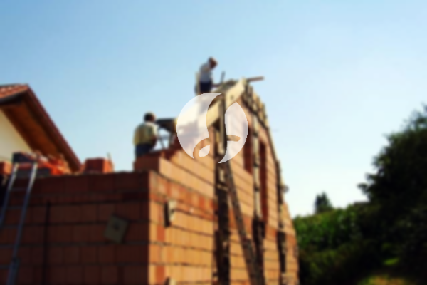

**Biaya Bangun Rumah Per Meter Di Sukawangi Bekasi** - Hai Mitra Sumber Material! Gimana kabarnya? Kami dari penyedia jasa konstruksi di Sukawangi Bekasi ingin berbagi informasi penting untuk Anda yang berencana membangun rumah impian. Seiring dengan perkembangan zaman, layanan borongan pembangunan rumah semakin diminati. Layanan bangun tempat tinggal ini benar-benar berkembang dan merambah ke jasa desain bangunan. Hal ini memicu banyak orang lebih memilih jasa bangun rumah untuk mewujudkan hunian ideal mereka. Pertumbuhan populasi yang pesat otomatis meningkatkan kebutuhan akan rumah, sehingga para pelaku properti berlomba-lomba menawarkan solusi terbaik. Dengan kepercayaan yang diberikan oleh pembeli, jasa bangun rumah berkomitmen untuk memberikan layanan yang andal dan berkualitas.



## Jasa Desain Gambar Arsitek Di Sukawangi Bekasi

Sebagai penyedia jasa arsitek, Kami sangat memperhatikan desain sebuah bangunan yang akan diwujudkan. Melalui desain yang matang, Kami berusaha menciptakan keindahan dan fungsionalitas dalam setiap rumah. Komposisi desain yang indah dan selaras merupakan prioritas Kami. Seperti yang kita ketahui, desain adalah elemen krusial dalam pembangunan. Desain yang baik akan membuat rumah terlihat menarik dan nyaman. Anda tidak perlu khawatir, karena Kami akan menciptakan desain yang sesuai dengan anggaran Anda. Dari desain tersebut, Anda dapat memperkirakan biaya yang dibutuhkan untuk mewujudkan rumah impian Anda. Selain itu, desain juga harus mempertimbangkan pemilihan material yang tepat. Semua aspek ini membutuhkan keahlian khusus, itulah mengapa Anda perlu memilih jasa arsitek profesional. Kami akan memahami keinginan Anda dan mewujudkannya menjadi kenyataan.

Namun, harga jasa desain bangunan dari Kami bervariasi. Harganya tergantung pada luas rumah dan tingkat kesulitan desain yang diinginkan. Saat ini, Kami menetapkan harga jasa desain rumah minimalis satu lantai sebesar Rp 54.000,- per meter persegi. Biaya ini sudah termasuk desain, perhitungan RAB (Rencana Anggaran Biaya), dan dua kali revisi. Untuk bangunan dua lantai atau lebih, biayanya dikalikan 2 atau 3 sesuai dengan jumlah lantai.

## Harga Borong Bangun Tempat Tinggal Di Sukawangi Bekasi

Seiring dengan pertumbuhan populasi, kebutuhan akan tempat tinggal semakin meningkat pula. Banyak layanan bangun rumah yang menawarkan produk dan layanan terbaik untuk konsumen. Disinilah peran penting jasa bangun rumah dalam menangani permasalahan pembangunan hunian. Dengan menggunakan jasa bangun rumah, Anda akan mendapatkan layanan yang sesuai dengan harapan Anda. Memiliki rumah yang cantik adalah impian setiap orang. Dengan menggunakan layanan bangun rumah, Anda akan dibantu mewujudkan impian tersebut. Anda tidak perlu repot mendesain rumah sendiri, karena Kami akan memahami keinginan Anda dan mewujudkannya menjadi karya nyata. Kepuasan Anda adalah prioritas Kami dan menjadi motivasi untuk terus berkarya lebih baik.

Untuk harga jasa borong bangunannya sendiri, Kami memiliki beberapa level harga. Harga disesuaikan dengan material bangunan yang digunakan dan lokasi pembangunan di Sukawangi Bekasi. Dengan asumsi kondisi tanah yang rata, stabil, dan tidak memerlukan pengurugan, harga per meter persegi dengan material dinding hebel adalah Rp 1.950.000,- dan dengan material bata merah adalah Rp 2.200.000,-. Harga tersebut sudah termasuk pondasi batu sungai, kolom dan tiang beton, lantai keramik standar, serta atap rangka baja ringan dengan genteng spandek. Pilihan genteng dan keramik dapat disesuaikan dengan preferensi Anda, serta anggaran yang tersedia.

## Jasa Perbaikan Rumah Di Sukawangi Bekasi

Selain layanan desain dan bangun rumah, Kami juga menyediakan jasa renovasi rumah di Sukawangi Bekasi. Jasa renovasi bangunan adalah solusi untuk mengubah tampilan rumah Anda menjadi lebih segar dan modern. Dengan kehadiran jasa renovasi rumah, Anda tidak perlu khawatir menentukan langkah-langkah perbaikan yang tepat. Kami dapat melakukan renovasi dengan mengubah tampilan bangunan secara keseluruhan atau hanya sebagian. Renovasi seringkali menjadi pilihan untuk meningkatkan keindahan rumah, terutama dengan anggaran yang terbatas. Namun, proses renovasi bisa menjadi rumit jika tidak ditangani oleh profesional. Kami hadir sebagai solusi renovasi rumah yang akan memudahkan Anda. Kami siap mengubah bangunan Anda menjadi lebih cantik dan sesuai dengan impian Anda.

Biaya borongan jasa renovasi rumah Kami bervariasi, tergantung pada kondisi kerusakan bangunan. Setiap rumah memiliki tingkat kerusakan yang berbeda-beda, sehingga harga disesuaikan dengan jenis perbaikan yang dibutuhkan. Namun, untuk jasa renovasi dengan tenaga tukang harian, tarifnya adalah Rp 150.000,- per hari untuk tukang dan Rp 100.000,- per hari untuk kenek.

## Didukung Tukang Dan Arsitek Berpengalaman Di Sukawangi Bekasi

Baik jasa desain arsitek, bangun rumah, maupun renovasi rumah, semuanya memiliki peran penting. Dengan dukungan arsitek profesional dan tenaga kerja yang handal, Kami akan membantu mewujudkan impian Anda. Membangun rumah idaman bersama Kami akan menghasilkan hunian yang menarik dan berkualitas. Anda tidak perlu khawatir, karena Kami akan memberikan pelayanan terbaik, menjaga mutu dan kualitas, serta memberikan kepuasan maksimal. Sebagai penyedia jasa bangun rumah yang terpercaya, kepuasan pelanggan adalah prioritas utama Kami.

Perlu diketahui bahwa rumah merupakan kebutuhan pokok manusia yang sangat penting. Rumah berfungsi sebagai tempat berlindung dari cuaca ekstrem dan berbagai macam bahaya. Hal ini menjadi peluang bagi penyedia jasa bangun rumah untuk menawarkan layanan terbaik. Sebagai penyedia jasa, Kami berpartisipasi dalam memajukan dunia arsitektur dengan mempromosikan layanan Kami melalui berbagai media, baik cetak maupun online. Hal ini tentu membantu banyak orang yang ingin membangun rumah impian mereka. Dengan mempertahankan mutu dan kualitas terbaik, Kami telah terbukti memiliki pengalaman yang cukup lama dalam dunia arsitektur. Itulah sebabnya, Kami semakin dipercaya oleh banyak orang.

Didukung oleh arsitek profesional dan tenaga kerja yang handal, Kami akan memberikan layanan terbaik yang tidak diragukan lagi kemampuannya. Hal ini terlihat dari perkembangan yang terus Kami lakukan, dengan menciptakan karya-karya baru yang inovatif dan kreatif. Banyak rumah dan bangunan yang telah Kami bangun dengan desain yang apik dan menarik. Dengan proses pengerjaan yang efisien, Anda akan segera menikmati rumah impian Anda. Kami mampu menangani proyek pembangunan berskala kecil maupun besar. Jadi, Anda tidak perlu ragu atau khawatir. Mulai dari desain bangunan, material bahan, ukuran bangunan, hingga pengelolaan SDM, semua dapat Kami atasi dengan baik. Dengan begitu, Kami dapat mendukung terwujudnya rumah yang cantik dan menarik. Di sinilah peran penting jasa bangun rumah. Karena Kami akan membuat perencanaan yang matang, sekaligus melakukan pengawasan selama proses pembangunan. [Hubungi Kami Sekarang!](https://api.whatsapp.com/send?phone=6285776786091&text=*Halo%20sumbermaterial.com*%20%3A)

Untuk wilayah lain, Kami juga melayani [bangun rumah di Bekasi Barat](/bangunan/biaya-bangun-rumah-per-meter-di-bekasi-barat/). Selain itu, bagi Mitra Sumber Material yang berencana membangun properti di daerah lain, Kami juga menyediakan layanan di [bangun rumah di Bekasi Timur](/bangunan/biaya-bangun-rumah-per-meter-di-bekasi-timur/), , , , dan .
