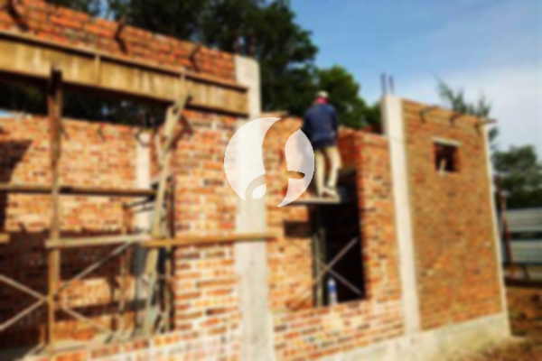

**Biaya Bangun Rumah Per Meter Di Sumur Batu Jakarta** - Hai Mitra Sumber Material! Gimana kabarnya? Seiring perkembangan zaman, jasa pembangunan bangunan kini semakin diminati. Banyak orang memilih layanan bangun rumah yang menawarkan kemudahan dan solusi komprehensif. Pertumbuhan populasi yang pesat memicu peningkatan kebutuhan akan tempat tinggal, dan para pengembang properti berlomba-lomba menghadirkan berbagai pilihan, mulai dari rumah sederhana hingga mewah. Kami, sebagai penyedia jasa bangun rumah terpercaya di Sumur Batu Jakarta, memahami pentingnya kepercayaan konsumen dan berkomitmen untuk memberikan hasil terbaik. Kepercayaan itu kami jaga dengan menjalankan pekerjaan sesuai harapan dan memberikan penawaran layanan yang beragam. Berikut adalah beberapa jenis layanan yang bisa Anda pilih:



## Desain Gambar Arsitektur Profesional di Sumur Batu Jakarta

Sebagai bagian dari layanan kami, kami menawarkan jasa desain gambar arsitektur yang akan membantu mewujudkan rumah impian Anda. Kami memahami bahwa desain adalah fondasi utama sebuah bangunan yang indah dan fungsional. Tim arsitek kami akan bekerja keras menciptakan komposisi desain yang cantik dan selaras dengan keinginan Anda, dengan mempertimbangkan faktor-faktor penting seperti estetika, fungsi, dan anggaran. Jangan khawatir, kami akan menyesuaikan desain dengan budget yang tersedia, sehingga Anda dapat memiliki gambaran jelas mengenai biaya yang dibutuhkan untuk mewujudkan desain rumah idaman Anda. Selain itu, kami juga akan mempertimbangkan pemilihan material bangunan yang tepat. Proses desain ini memang membutuhkan ketelitian dan keahlian khusus, itulah mengapa memilih jasa arsitek profesional adalah langkah yang tepat. Kami akan memahami visi Anda dan membantu mewujudkannya menjadi kenyataan.

Harga jasa desain rumah dari Kami beragam, tergantung pada luas bangunan dan tingkat kerumitan desain yang diinginkan. Saat ini, kami menawarkan harga jasa desain rumah minimalis satu lantai mulai dari Rp 54.000,- per meter persegi, sudah termasuk desain, perhitungan RAB (Rencana Anggaran Biaya), dan 2 kali revisi. Untuk rumah dua lantai atau lebih, harga hanya dikalikan 2 atau 3 sesuai dengan jumlah lantai.

## Harga Jasa Borong Renovasi Rumah di Sumur Batu Jakarta

Kebutuhan akan tempat tinggal yang nyaman mendorong banyak orang untuk mencari jasa bangun rumah. Dengan banyaknya pilihan yang tersedia, pastikan Anda memilih penyedia layanan yang tepat dan terpercaya. Kami hadir sebagai solusi untuk mewujudkan rumah impian Anda di Sumur Batu Jakarta. Memiliki rumah yang indah adalah impian setiap orang, dan kami siap membantu Anda mewujudkannya dengan layanan borong bangun rumah yang profesional. Dengan memanfaatkan jasa kami, Anda tidak perlu repot mendesain rumah sendiri. Kami akan memahami keinginan Anda dan menerjemahkannya menjadi karya nyata berupa rumah impian Anda. Kepuasan Anda adalah prioritas utama kami, dan kami akan selalu berusaha memberikan pelayanan terbaik.

Untuk layanan borong bangun, Kami menawarkan beberapa tingkatan harga yang disesuaikan dengan material bangunan yang digunakan dan lokasi pembangunan. Dengan asumsi kondisi tanah rata, stabil, dan tidak memerlukan pengurugan, harga per meter persegi untuk material dinding hebel adalah Rp 1.950.000,-, sedangkan untuk material bata merah adalah Rp 2.200.000,-. Harga tersebut sudah termasuk pondasi batu sungai, kolom dan tiang beton, lantai keramik standar, serta rangka baja ringan dan genteng spandek untuk atap. Pilihan genteng dan keramik dapat disesuaikan dengan preferensi Anda, dengan penyesuaian biaya sesuai dengan tipe, model, dan kualitas yang dipilih.

## Jasa Renovasi Rumah Terpercaya di Sumur Batu Jakarta

Selain jasa arsitek dan borong bangun rumah, Kami juga menyediakan jasa renovasi rumah. Renovasi adalah cara yang efektif untuk memberikan tampilan baru pada rumah Anda. Dengan layanan renovasi rumah dari Kami, Anda tidak perlu khawatir tentang prosesnya. Kami menawarkan renovasi dengan teknik perubahan model rumah secara parsial maupun total. Renovasi merupakan alternatif yang tepat untuk memperbarui tampilan rumah tanpa harus membangun dari awal. Namun, biaya renovasi seringkali menjadi kendala bagi banyak orang. Dengan adanya jasa renovasi rumah, Anda dapat mengatasi masalah tersebut. Kami siap membantu Anda merenovasi rumah Anda menjadi lebih indah dan menarik sesuai dengan impian Anda.

Untuk biaya borongan renovasi, Kami memberikan harga yang bervariasi bergantung pada kondisi kerusakan rumah Anda. Setiap rumah memiliki tingkat kerusakan yang berbeda-beda, sehingga Kami akan menyesuaikan harga borongan sesuai dengan jenis kerusakan yang akan diperbaiki. Namun, untuk biaya jasa renovasi dengan tenaga tukang harian, harga yang Kami tawarkan adalah Rp 150.000,- per hari untuk tukang dan Rp 100.000,- per hari untuk kenek.

## Didukung Tim Profesional dan Berpengalaman di Sumur Batu Jakarta

Baik jasa arsitek, borong bangun rumah, maupun jasa renovasi, semuanya memiliki peran penting dalam mewujudkan impian Anda memiliki rumah yang nyaman dan indah. Kami didukung oleh tim arsitek profesional dan tenaga kerja yang handal, sehingga dapat membantu Anda mewujudkan rumah impian Anda. Dengan membangun rumah bersama Kami, Anda akan mendapatkan rumah yang menarik dan indah. Kami berkomitmen untuk memberikan pelayanan terbaik, menjaga kualitas dan mutu pekerjaan, serta memberikan kepuasan kepada Anda. Kepuasan Anda adalah motivasi Kami untuk terus berkarya dan menghasilkan karya-karya yang lebih baik. Anda dapat melihat katalog proyek-proyek Kami sebelumnya untuk melihat hasil karya Kami. Katalog tersebut akan membuktikan bahwa Kami adalah pilihan terbaik dan terpercaya.

Rumah adalah kebutuhan dasar manusia, sama pentingnya dengan sandang dan pangan. Rumah menjadi tempat berlindung dari cuaca ekstrem dan berbagai bahaya. Hal ini menjadi peluang bagi penyedia jasa bangun rumah untuk menawarkan layanan terbaik mereka. Sebagai penyedia jasa, Kami berpartisipasi dalam memajukan dunia arsitektur dengan menawarkan layanan melalui berbagai media, baik cetak maupun online. Hal ini memudahkan banyak orang untuk mewujudkan rumah impian mereka. Dengan mempertahankan kualitas dan mutu terbaik, Kami telah terbukti memiliki pengalaman yang cukup lama dalam dunia arsitektur. Itulah mengapa, Kami semakin dipercaya oleh banyak orang.

Dengan dukungan tim arsitek profesional dan tenaga kerja yang handal, Kami semakin dikenal sebagai penyedia jasa bangun rumah yang handal dan terpercaya. Perkembangan yang terus Kami berikan menghasilkan karya-karya baru yang inovatif dan kreatif. Banyak bangunan indah telah Kami bangun dengan desain yang apik dan menarik. Proses pengerjaan yang cepat dan efisien memungkinkan Anda untuk segera menikmati rumah impian Anda. Baik bangunan skala kecil maupun besar, Kami mampu mengendalikannya dengan baik. Anda tidak perlu ragu atau khawatir. Mulai dari desain bangunan, pemilihan material, ukuran rumah, hingga sumber daya manusia, semuanya dapat Kami atasi. Dengan layanan yang lengkap dan terpercaya, Kami siap mendukung terwujudnya rumah yang cantik dan menarik. Disitulah peran penting dari Kami sebagai penyedia jasa bangun rumah. Kami akan menciptakan rancangan yang sesuai dengan harapan Anda dan sekaligus mengawasi proses pembangunan agar sesuai dengan rencana. [Hubungi Kami Sekarang](https://api.whatsapp.com/send?phone=6285776786091&text=*Halo%20sumbermaterial.com*%20%3A) untuk konsultasi GRATIS!
