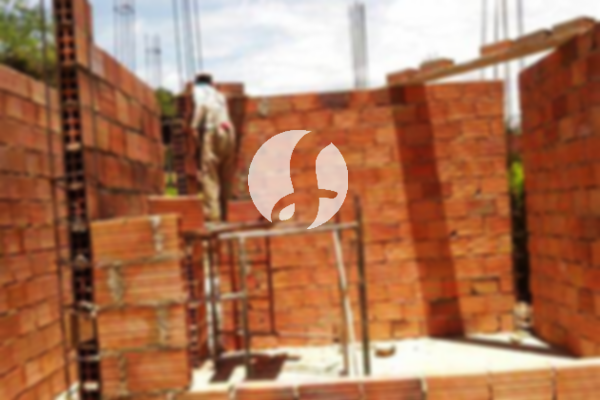

**Biaya Bangun Rumah Per Meter Di Tambun Selatan Bekasi** - Hai Mitra Sumber Material! Gimana kabarnya? Kami dari Sumber Material, penyedia solusi konstruksi terpercaya di Tambun Selatan Bekasi, ingin berbagi informasi penting bagi Anda yang sedang merencanakan pembangunan rumah impian. Di era modern ini, penggunaan jasa bangun rumah semakin populer. Layanan ini berkembang pesat, bahkan merambah ke desain bangunan yang inovatif. Hal ini wajar, karena membangun rumah sendiri membutuhkan perencanaan matang dan tenaga ahli. Kami hadir untuk mempermudah proses tersebut, dengan menawarkan berbagai layanan yang dapat disesuaikan dengan kebutuhan dan budget Anda. Semakin meningkatnya kebutuhan akan tempat tinggal, otomatis memicu persaingan antar kontraktor properti untuk memberikan penawaran terbaik. Dengan kepercayaan yang diberikan konsumen, jasa bangun rumah yang terpercaya akan selalu berusaha memberikan hasil yang memuaskan.



## Jasa Desain Gambar Arsitektur di Tambun Selatan Bekasi

Sebagai mitra terpercaya dalam bidang arsitektur, Kami sangat memperhatikan desain sebuah rumah yang akan dibangun. Desain yang baik akan mempercantik tampilan rumah dan meningkatkan nilai estetika. Kami menggunakan berbagai faktor penting dalam merancang komposisi desain yang cantik dan selaras. Desain adalah elemen krusial dalam pembangunan rumah. Dengan desain yang tepat, rumah Anda akan terlihat indah dan nyaman ditinggali. Anda tidak perlu khawatir tentang anggaran, karena Kami dapat menyesuaikan desain dengan budget yang Anda miliki. Dari desain yang Kami buat, Anda dapat memperkirakan biaya yang dibutuhkan untuk mewujudkan rumah impian Anda. Selain itu, Kami juga mempertimbangkan pemilihan bahan bangunan yang sesuai. Semua proses ini membutuhkan keahlian khusus. Itulah mengapa penting untuk memilih jasa arsitek profesional. Kami akan memahami harapan Anda dan mewujudkannya menjadi kenyataan.

Untuk informasi harga, biaya jasa desain rumah minimalis satu lantai Kami mulai dari Rp 54.000,- per meter persegi. Harga tersebut sudah termasuk desain, perhitungan RAB (Rencana Anggaran Biaya), dan dua kali revisi. Untuk rumah dua lantai atau lebih, harga Kami berlipat ganda atau bahkan tiga kali lipat, tergantung jumlah lantai.

## Estimasi Biaya Borong Renovasi Bangunan di Tambun Selatan Bekasi

Seperti yang Kita ketahui, memiliki rumah adalah kebutuhan dasar setiap manusia. Hal ini memicu pertumbuhan pesat industri jasa bangun rumah. Para penyedia layanan ini berlomba-lomba menawarkan produk dan layanan terbaik untuk memenuhi kebutuhan konsumen. Di sinilah peran penting jasa bangun rumah dalam mengatasi berbagai permasalahan pembangunan rumah. Dengan memanfaatkan layanan ini, Anda akan mendapatkan solusi yang sesuai dengan harapan Anda. Memiliki rumah yang bagus adalah impian semua orang. Dengan menggunakan jasa bangun rumah, Anda akan mendapatkan bantuan untuk mewujudkan impian tersebut. Kami akan membantu mendesain rumah Anda sesuai dengan keinginan Anda, sehingga Anda tidak perlu merasa khawatir. Kami selalu berusaha memahami harapan Anda dan mewujudkannya dalam bentuk bangunan yang nyata. Hal ini akan membuat Anda merasa puas dan semakin percaya pada layanan Kami.

Untuk harga jasa borong renovasi, Kami menawarkan beberapa tingkatan harga yang sesuai dengan kualitas bahan bangunan dan lokasi pembangunan. Dengan asumsi area tanah dalam keadaan rata dan tidak memerlukan pengurukan, harga per meter persegi dengan material dinding hebel adalah Rp 1.950.000,-, sedangkan dengan material bata merah adalah Rp 2.200.000,-. Harga ini sudah termasuk pondasi batu gunung, kolom dan tiang beton, lantai keramik standar, serta atap dengan rangka baja ringan dan genteng spandek. Anda juga dapat menyesuaikan pilihan genteng dan keramik sesuai dengan model dan kualitas yang Anda inginkan.

## Kisaran Harga Layanan Rombak Bangunan di Tambun Selatan Bekasi

Selain layanan desain dan pembangunan rumah baru, Kami juga menyediakan jasa renovasi bangunan. Renovasi rumah adalah cara yang efektif untuk memberikan tampilan baru pada rumah Anda. Dengan hadirnya jasa renovasi rumah profesional seperti Kami, Anda tidak perlu khawatir tentang proses renovasi yang rumit. Kami menawarkan renovasi total, yaitu perubahan bentuk model rumah secara menyeluruh. Renovasi memang menjadi alternatif yang menarik untuk mempercantik bangunan dengan budget yang lebih terjangkau. Namun, seringkali seseorang kesulitan melakukan renovasi karena keterbatasan anggaran atau pengetahuan. Kami hadir untuk mengatasi permasalahan tersebut. Dengan layanan renovasi bangunan Kami, Anda akan mendapatkan bantuan untuk merenovasi bangunan Anda menjadi lebih indah dan menarik dari sebelumnya. Kami siap mewujudkan desain impian Anda.

Harga jasa renovasi bangunan Kami bervariasi, tergantung pada kondisi kerusakan bangunan yang akan diperbaiki. Untuk tenaga tukang harian, Kami mengenakan biaya Rp 150.000,- per hari untuk tukang dan Rp 100.000,- per hari untuk kenek.

## Dukungan Tim Tukang dan Arsitek Terbaik di Tambun Selatan Bekasi

Baik itu jasa arsitek, konstruksi bangunan baru, maupun renovasi, semuanya memiliki peran penting dalam mewujudkan rumah impian Anda. Kami didukung oleh tim arsitek profesional dan tenaga kerja yang handal, untuk memastikan setiap proyek berjalan lancar. Dengan pengalaman bertahun-tahun, Kami mampu mewujudkan rumah impian Anda dengan kualitas terbaik. Kami selalu berusaha memberikan pelayanan terbaik, menjaga mutu dan kualitas pekerjaan, serta memberikan kepuasan kepada setiap pelanggan. Kepuasan pelanggan adalah prioritas utama Kami dan menjadi motivasi untuk terus berkarya dan menghasilkan karya-karya yang lebih baik. Anda dapat melihat portofolio proyek-proyek Kami untuk membuktikan bahwa Kami adalah pilihan yang tepat dan terpercaya.

Rumah adalah kebutuhan pokok manusia setelah sandang dan pangan. Rumah menjadi tempat berlindung dari cuaca ekstrem dan berbagai bahaya. Hal ini menjadi peluang bagi penyedia jasa bangun rumah untuk menawarkan solusi terbaik. Sebagai penyedia jasa terkemuka di Tambun Selatan Bekasi, Kami berpartisipasi aktif dalam memajukan dunia arsitektur dengan menampilkan layanan Kami melalui berbagai media, baik cetak maupun online. Hal ini memudahkan Anda dalam menemukan informasi dan memilih layanan yang sesuai dengan kebutuhan Anda. Dengan mempertahankan mutu dan kualitas terbaik, Kami telah terbukti memiliki pengalaman yang cukup lama dalam bidang arsitektur.

[bangun rumah di Bekasi Timur](/bangunan/biaya-bangun-rumah-per-meter-di-bekasi-timur/) Ditemukan banyak penyedia jasa [bangun rumah di Bojongmangu](/bangunan/biaya-bangun-rumah-per-meter-di-bojongmangu-bekasi/) di Tambun Selatan Bekasi, dan Kami sangat yakin dengan keunggulan Kami. Dengan tim arsitek dan tenaga kerja yang solid, Kami mampu menangani proyek pembangunan rumah skala kecil maupun besar. Dimulai dari desain, pemilihan material, hingga pengawasan pembangunan, semuanya Kami lakukan dengan profesional dan teliti. Maka dari itu, Anda tidak perlu khawatir dengan hasil akhirnya. Dengan layanan bangun rumah seperti Kami, Anda dapat memiliki rumah yang cantik, nyaman, dan sesuai dengan impian Anda. [Hubungi Kami Sekarang!](https://api.whatsapp.com/send?phone=6285776786091&text=*Halo%20sumbermaterial.com*%20%3A) untuk konsultasi gratis dan penawaran terbaik.
