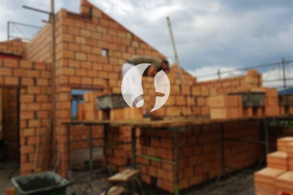

**Biaya Bangun Rumah Per Meter Di Tanah Abang Jakarta** - Hai Mitra Sumber Material! Gimana kabarnya? Kami memahami betul kebutuhan Anda akan informasi biaya bangun rumah yang akurat. Sebagai penyedia material konstruksi dan jasa bangunan terpercaya di Tanah Abang Jakarta, Kami hadir untuk memberikan solusi lengkap bagi proyek Anda. Seiring perkembangan zaman, borongan pembangunan tempat tinggal semakin diminati. Banyak orang kini memilih jasa bangun rumah karena praktis dan efisien. Semakin banyak populasi, kebutuhan akan tempat tinggal pun meningkat. Ini mendorong para pengembang properti berlomba-lomba membangun rumah, apartemen, dan tempat tinggal susun dari berbagai kelas. Kami percaya, dengan reputasi yang baik, jasa bangun rumah dapat memenuhi dan melampaui ekspektasi konsumen. Berikut adalah beberapa layanan yang Kami tawarkan:



## Jasa Desain Gambar Arsitektur Di Tanah Abang Jakarta

Sebagai penyedia jasa arsitek, Kami sangat memperhatikan desain sebuah rumah yang akan dibangun. Dengan desain yang tepat, rumah akan terlihat indah dan sesuai dengan keinginan Anda. Kami berusaha menciptakan komposisi desain yang bagus dan selaras dengan kebutuhan serta anggaran Anda. Desain adalah elemen penting dalam membangun rumah impian. Dengan desain yang baik, Anda bisa membayangkan bagaimana rumah Anda akan terlihat dan berfungsi. Anda tidak perlu khawatir, karena Kami akan menciptakan desain yang serasi dengan budget yang Anda miliki. Dari desain itulah, Anda dapat memperkirakan anggaran biaya yang dibutuhkan untuk mewujudkan rumah impian Anda. Selain itu, desain yang Kami buat juga mempertimbangkan bahan bangunan yang akan digunakan. Proses ini memang cukup kompleks, itulah mengapa Anda membutuhkan jasa arsitek profesional. Kami akan memahami keinginan Anda dan mewujudkannya dalam sebuah desain yang memuaskan.

Harga jasa desain bangunan Kami bervariasi, tergantung pada luas bangunan dan tingkat kerumitan desain. Saat ini, Kami menawarkan harga jasa desain rumah minimalis satu lantai mulai dari Rp 54.000,- per meter persegi. Harga ini sudah termasuk desain, data RAB (Rencana Anggaran Biaya), dan dua kali revisi. Untuk bangunan dua lantai atau lebih, harganya hanya dikalikan 2 atau 3 sesuai dengan jumlah lantai.

## Ongkos Borong Bangun Tempat Tinggal Di Tanah Abang Jakarta

Seiring bertambahnya populasi dunia, kebutuhan akan tempat tinggal semakin meningkat. Banyak orang membutuhkan tempat tinggal yang nyaman dan aman. Hal ini menjadi peluang bagi penyedia jasa bangun rumah untuk menawarkan layanan terbaik kepada konsumen. Di sinilah peran penting jasa bangun rumah dalam menangani permasalahan pembangunan sebuah tempat tinggal. Kami hadir untuk membantu Anda mewujudkan impian memiliki rumah. Memiliki tempat tinggal yang bagus adalah impian semua orang. Dengan menggunakan layanan bangun rumah Kami, Anda akan mendapatkan bantuan dalam mewujudkan impian tersebut. Dengan mempercayakannya pada Kami, Anda tidak perlu repot mendesain rumah sendiri. Kami akan berusaha memahami keinginan Anda dan mewujudkannya dalam bentuk nyata. Hal ini akan membuat Anda merasa puas dan mempercayai Kami sebagai mitra pembangunan Anda.

Untuk harga borong renovasi bangunan, Kami menawarkan beberapa tingkatan harga. Harga tersebut menyesuaikan dengan material bangunan yang digunakan dan lokasi pembangunan. Dengan syarat lokasi tanah dalam kondisi rata, stabil, dan tidak memerlukan pengurukan. Harga per meter persegi dengan material dinding hebel adalah Rp 1.950.000,-, sedangkan dengan material bata merah adalah Rp 2.200.000,-. Harga ini sudah termasuk pondasi batu kali, kolom dan tiang beton, lantai keramik standar, dan atap dengan rangka baja ringan plus genteng spandek. Anda juga dapat memilih tipe, model, dan kualitas genteng dan keramik sesuai anggaran Anda.

## Harga Layanan Perbaikan Bangunan Di Tanah Abang Jakarta

Selain jasa arsitek dan layanan bangun rumah, Kami juga menyediakan jasa renovasi rumah di Tanah Abang Jakarta. Renovasi adalah cara yang efektif untuk mengubah tampilan rumah Anda agar terlihat lebih segar dan modern. Dengan adanya jasa renovasi bangunan, Anda tidak perlu khawatir tentang proses renovasi rumah Anda. Karena, renovasi yang Kami lakukan meliputi perubahan bentuk model rumah, atau bahkan perubahan menyeluruh atau total. Renovasi memang menjadi pilihan menarik untuk meningkatkan keindahan rumah Anda. Namun, biaya renovasi seringkali menjadi kendala. Dengan adanya jasa renovasi bangunan, masalah ini dapat diatasi. Kami hadir sebagai jasa renovasi bangunan yang akan memudahkan Anda dalam merenovasi bangunan Anda menjadi lebih segar dan menawan. Dengan begitu, Kami siap mewujudkan rumah impian Anda.

Untuk harga borongan jasa renovasi rumah, Kami memberikan harga yang variatif. Hal ini disebabkan karena kondisi kerusakan rumah yang akan direnovasi berbeda-beda. Biaya borongan renovasi bangunan disesuaikan dengan jenis kerusakan yang akan diperbaiki. Namun, untuk harga jasa renovasi dengan tenaga tukang harian, harganya adalah Rp 150.000,- per hari untuk tukang dan Rp 100.000,- per hari untuk kenek.

## Didukung Tukang Dan Arsitek Berpengalaman Di Tanah Abang Jakarta

Baik layanan arsitek, borongan bangun rumah, maupun jasa renovasi bangunan, semuanya memiliki peran yang sangat penting. Didukung oleh arsitek profesional serta tenaga kerja yang handal, layanan-layanan ini akan membantu mewujudkan impian Anda. Dengan membangun rumah idaman bersama Kami, Anda akan memiliki rumah yang menarik dan tentunya cantik. Jangan khawatir, karena Kami akan memberikan pelayanan terbaik, menjaga mutu dan kualitas untuk memberikan kepuasan kepada Anda. Sebagai penyedia jasa bangun rumah, kepuasan pelanggan menjadi penyemangat Kami untuk terus berkarya dan menciptakan karya-karya yang lebih baik lagi. Anda dapat melihat katalog hasil proyek Kami sebagai bukti kualitas dan kemampuan Kami.

Perlu diketahui, rumah adalah kebutuhan primer manusia yang sangat penting, selain sandang dan pangan. Rumah menjadi tempat berlindung dari cuaca dan bahaya. Hal ini memotivasi penyedia jasa bangun rumah untuk menawarkan jasanya. Sebagai penyedia jasa terkhusus pada jasa bangun rumah, Kami berpartisipasi aktif dalam meramaikan dunia arsitektur yang sedang berkembang pesat. Kami menawarkan jasa Kami melalui berbagai media, mulai dari media cetak hingga media online. Hal ini tentu membantu banyak orang yang ingin membangun rumah. Dengan mempertahankan mutu dan kualitas terbaik, Kami telah terbukti memiliki pengalaman yang cukup lama dalam menggeluti dunia arsitektur. Inilah mengapa Kami semakin dipercaya oleh banyak orang.

Didukung oleh arsitek profesional serta tenaga kerja yang handal, Kami akan semakin dikenal dan diakui kemampuannya. Kami terus mengembangkan diri dan menciptakan karya-karya baru yang inovatif dan kreatif. Banyak bangunan yang dibangun dengan desain apik dan menarik berkat Kami. Dengan cara pengerjaan yang efisien, Anda akan segera memiliki rumah impian Anda. Baik bangunan berskala kecil maupun besar, Kami mampu mengatasinya. Anda tidak perlu ragu atau khawatir tentang hal tersebut. Mulai dari desain rumah, material bahan, ukuran rumah, dan SDM, semuanya dapat Kami atasi. Dengan demikian, [Kami] dapat mendukung terwujudnya bangunan yang cantik dan menarik. Disitulah peran penting Kami sebagai penyedia jasa bangun rumah. Kami akan mewujudkan rancangan Anda dan sekaligus mengawasi proses pembangunan. [bangun rumah di Cakung](/bangunan/biaya-bangun-rumah-per-meter-di-cakung-jakarta/) Jika Anda berencana bangun rumah di Cakung Jakarta, Kami juga siap membantu Anda. [Hubungi Kami Sekarang](https://api.whatsapp.com/send?phone=6285776786091&text=*Halo%20sumbermaterial.com*%20%3A) untuk konsultasi gratis.
