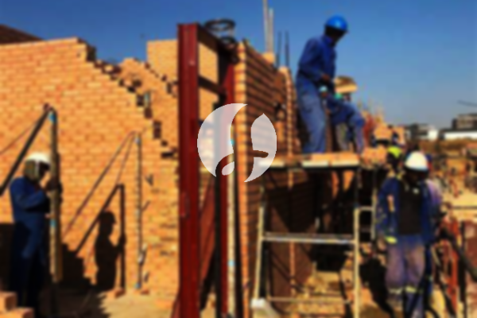

**Biaya Bangun Rumah Per Meter Di Tanah Baru Depok** - Hai Mitra Sumber Material! Bagaimana kabarnya? Kami dari penyedia layanan konstruksi di Tanah Baru Depok ingin berbagi informasi penting bagi Anda yang sedang merencanakan pembangunan rumah impian. Di era modern ini, banyak orang lebih memilih menggunakan jasa bangun rumah karena praktis dan efisien. Meningkatnya populasi secara signifikan juga memicu permintaan akan tempat tinggal yang terus bertambah. Oleh karena itu, pelaku properti berlomba-lomba menawarkan solusi perumahan dari berbagai kelas. Kepercayaan pelanggan adalah prioritas utama kami sebagai penyedia jasa, dan kami berkomitmen untuk menjalankan setiap amanah dengan sebaik mungkin. Kami hadir sebagai mitra terpercaya yang menawarkan beragam layanan untuk mendukung proyek pembangunan Anda. Berikut beberapa jenis layanan yang bisa Anda pilih:



## Desain Rumah Impian dengan Layanan Arsitek di Tanah Baru Depok

Sebagai penyedia jasa arsitek, kami akan mendalami visi Anda untuk menciptakan desain rumah yang sesuai dengan harapan. Melalui proses desain yang cermat, kami berupaya mewujudkan keindahan dan fungsionalitas dalam setiap detail. Kami memperhatikan berbagai faktor penting untuk menghasilkan komposisi desain yang harmonis dan berkesan. Desain merupakan elemen vital dalam pembangunan rumah karena menentukan estetika dan kenyamanan hunian Anda. Kami memahami bahwa setiap anggaran berbeda-beda, sehingga kami akan menciptakan desain yang sesuai dengan *budget* yang Anda miliki. Dengan desain yang jelas, Anda dapat memperkirakan biaya yang akan dikeluarkan untuk mewujudkan rumah idaman. Selain itu, kami juga mempertimbangkan pemilihan material yang tepat untuk memastikan kualitas dan efisiensi biaya. Itulah mengapa, memilih jasa arsitek profesional adalah keputusan yang bijak. Kami akan memahami keinginan Anda dan menerjemahkannya menjadi desain yang memuaskan.

Harga jasa desain rumah kami bervariasi, tergantung pada luas rumah dan tingkat kompleksitas desain yang diinginkan. Saat ini, kami menetapkan harga mulai dari Rp 54.000,- per meter persegi untuk desain rumah minimalis satu lantai, termasuk desain, perhitungan RAB, dan dua kali revisi. Untuk rumah dua lantai atau lebih, harga hanya dikalikan 2 atau 3 sesuai jumlah lantai.

## Estimasi Biaya Borong Renovasi Rumah di Tanah Baru Depok

Kebutuhan akan tempat tinggal merupakan hal mendasar bagi setiap manusia. Hal ini memicu perkembangan pesat dalam industri jasa konstruksi, di mana banyak penyedia layanan menawarkan solusi terbaik bagi konsumen. Kami hadir sebagai mitra yang andal dalam menangani berbagai permasalahan terkait pembangunan rumah. Dengan memilih jasa bangun rumah yang tepat, Anda akan mendapatkan solusi yang sesuai dengan kebutuhan dan keinginan Anda. Memiliki rumah yang indah adalah impian setiap orang. Dengan menggunakan jasa bangun rumah, Anda dapat mewujudkan impian tersebut tanpa perlu repot mendesain sendiri. Kami selalu berusaha memahami keinginan Anda dan menerjemahkannya ke dalam karya nyata yang memuaskan. Kepuasan Anda adalah prioritas utama kami, sehingga kami terus berupaya memberikan pelayanan terbaik dan menjaga kualitas pekerjaan.

Untuk layanan borong renovasi rumah, kami menawarkan beberapa pilihan harga yang disesuaikan dengan material bangunan dan lokasi pembangunan. Dengan asumsi area tanah dalam kondisi rata dan stabil, tanpa perlu pengurukan, harga per meter persegi dengan material dinding hebel adalah Rp 1.950.000,-, sementara dengan material bata merah adalah Rp 2.200.000,-. Harga tersebut sudah termasuk pondasi batu sungai, kolom dan tiang beton, lantai keramik standar, serta atap rangka baja ringan dengan genteng spandek. Anda juga dapat memilih variasi genteng dan keramik sesuai preferensi Anda.

## Jasa Renovasi Rumah Terpercaya di Tanah Baru Depok

Selain layanan desain dan bangun rumah, kami juga menyediakan jasa renovasi rumah. Renovasi adalah cara efektif untuk memberikan tampilan baru pada hunian Anda. Dengan bantuan jasa renovasi rumah profesional, Anda tidak perlu khawatir tentang prosesnya. Kami menawarkan renovasi yang bervariasi, mulai dari perubahan tampilan hingga renovasi total. Renovasi bisa menjadi solusi ideal jika anggaran terbatas, namun Anda ingin memperbarui tampilan rumah Anda. Namun, renovasi seringkali terasa sulit karena melibatkan banyak aspek teknis. Di sinilah peran kami sebagai penyedia jasa renovasi rumah yang terpercaya. Kami akan membantu Anda mengatasi semua tantangan tersebut dan memastikan renovasi berjalan lancar. Kami siap mewujudkan rumah impian Anda dengan desain yang segar dan menarik.

Harga borongan untuk jasa renovasi rumah kami bervariasi, tergantung pada kondisi kerusakan dan tingkat kompleksitas renovasi. Untuk tenaga tukang harian, kami mengenakan biaya Rp 150.000,- per hari untuk tukang dan Rp 100.000,- per hari untuk kenek.

## Dukungan Tenaga Ahli dan Arsitek Berpengalaman di Tanah Baru Depok

Layanan arsitek, bangun rumah, dan renovasi rumah semuanya memainkan peran penting dalam mewujudkan hunian impian Anda. Didukung oleh arsitek profesional dan tenaga kerja yang handal, kami akan membantu Anda mencapai tujuan tersebut. Dengan membangun rumah bersama kami, Anda akan memiliki hunian yang menarik dan nyaman. Kami berkomitmen untuk memberikan pelayanan terbaik, menjaga kualitas, dan memastikan kepuasan Anda. Kepuasan pelanggan adalah motivasi utama kami untuk terus berinovasi dan menghasilkan karya yang lebih baik. Anda dapat melihat portofolio proyek kami untuk membuktikan kualitas dan pengalaman kami.

Perlu diingat bahwa rumah adalah kebutuhan pokok manusia, sama pentingnya dengan sandang dan pangan. Rumah memberikan perlindungan dari cuaca ekstrem dan berbagai bahaya. Hal ini menjadi peluang bagi penyedia jasa bangun rumah untuk menawarkan solusi terbaik bagi masyarakat. Sebagai penyedia jasa khusus dalam bidang pembangunan rumah di Tanah Baru Depok, kami turut berkontribusi dalam memajukan dunia arsitektur dengan menampilkan layanan kami melalui berbagai media, baik cetak maupun *online*. Kami selalu berupaya mempertahankan kualitas dan memberikan yang terbaik bagi setiap klien.

Dengan dukungan arsitek profesional dan tenaga kerja yang handal, kami yakin dapat memberikan layanan yang tak tertandingi. Perkembangan yang kami tunjukkan adalah bukti komitmen kami terhadap inovasi dan kreativitas. Banyak rumah dan bangunan indah telah kami bangun dengan desain yang apik dan menarik. Proses pengerjaan yang efisien memungkinkan Anda untuk segera menikmati rumah impian Anda. Baik rumah kecil maupun besar, kami mampu menangani berbagai proyek pembangunan dengan baik. Kami akan membantu Anda dalam segala aspek, mulai dari desain, material, ukuran bangunan, hingga tenaga kerja. Kami adalah solusi tepat untuk mewujudkan rumah idaman Anda. [Hubungi Kami Sekarang!](https://api.whatsapp.com/send?phone=6285776786091&text=*Halo%20sumbermaterial.com*%20%3A) — untuk konsultasi gratis dan penawaran khusus. Anda juga bisa melihat layanan [bangun rumah di Beji](/bangunan/biaya-bangun-rumah-per-meter-di-beji-depok/) kami untuk wilayah Beji Depok. Kami juga menyediakan layanan [bangun rumah di Abadijaya](/bangunan/biaya-bangun-rumah-per-meter-di-abadijaya-depok/) di Abadijaya Depok jika Anda mencari solusi konstruksi terjangkau.
