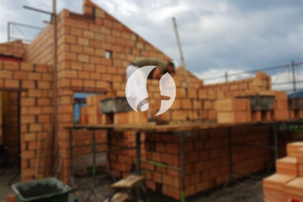

**Biaya Bangun Rumah Per Meter Di Tanjung Barat Jakarta** - Halo Mitra Sumber Material! Bagaimana kabarnya? Kami dari Sumber Material hadir untuk memberikan solusi lengkap kebutuhan konstruksi Anda di Tanjung Barat Jakarta. Sejalan dengan perkembangan zaman, jasa bangun rumah semakin diminati. Perkembangan ini turut memacu layanan desain rumah yang semakin berkembang pesat. Banyak orang kini lebih memilih jasa bangun rumah demi mewujudkan hunian impian mereka. Dengan pertumbuhan populasi yang pesat, kebutuhan akan rumah pun terus meningkat. Tak heran jika banyak kontraktor properti berlomba-lomba membangun rumah, apartemen, atau perumahan dengan berbagai pilihan kelas. Kepercayaan pelanggan menjadi kunci utama bagi jasa bangun rumah dalam memberikan pelayanan terbaik dan mempertahankan reputasi yang baik. Dengan begitu, layanan bangun rumah akan berkomitmen untuk melaksanakan pekerjaan sesuai dengan amanah dan harapan pelanggan. Nah, sebagai penyedia jasa bangun rumah yang terpercaya, Kami menawarkan berbagai layanan yang dapat Anda pilih.



## Estimasi Biaya Desain Gambar Arsitek Di Tanjung Barat Jakarta

Sebagai penyedia jasa arsitek, Kami akan mengamati dan merancang desain bangunan yang akan Anda wujudkan. Desain yang baik akan memunculkan keindahan dan kenyamanan rumah Anda. Oleh karena itu, Kami akan mempertimbangkan beberapa faktor penting untuk menciptakan komposisi desain yang cantik dan selaras. Seperti yang Anda ketahui, desain seringkali menjadi aspek paling penting dalam membangun rumah. Karena dengan desain yang menarik, rumah Anda akan terlihat lebih indah dan memukau. Anda tidak perlu khawatir, karena Kami akan mewujudkan desain yang sesuai dengan budget yang Anda miliki. Dengan desain yang jelas, Anda dapat memahami perkiraan biaya yang akan dikeluarkan untuk mewujudkan hunian impian Anda. Selain itu, Kami juga akan mempertimbangkan jenis bahan material yang akan digunakan. Semua hal tersebut tentu saja memerlukan keahlian dan pengalaman yang mumpuni. Itulah mengapa, Anda perlu memilih jasa arsitek yang profesional dan terpercaya. Dengan begitu, Kami akan memahami keinginan Anda dan mewujudkannya menjadi desain yang memuaskan.

Biaya jasa desain dari Kami bervariasi, tergantung pada luas bangunan dan tingkat kesulitan desain yang Anda inginkan. Saat ini, Kami menawarkan harga jasa desain rumah minimalis satu lantai mulai dari Rp 54.000,- per meter persegi. Harga tersebut sudah termasuk desain, data RAB (Rencana Anggaran Biaya), dan dua kali revisi. Namun, untuk rumah dua lantai atau lebih, biayanya hanya dikalikan dua atau tiga, sesuai dengan jumlah lantai.

## Jasa Borong Bangun Rumah Di Tanjung Barat Jakarta

Mengingat semakin banyaknya orang yang membutuhkan tempat tinggal, Kami hadir sebagai solusi untuk mewujudkan impian Anda memiliki rumah idaman di Tanjung Barat Jakarta. Banyak penyedia jasa bangun rumah yang menawarkan produk dan layanan terbaik untuk menarik perhatian pelanggan. Di sinilah peran penting jasa bangun rumah dalam menangani permasalahan pembangunan rumah Anda. Dengan memilih Kami, Anda akan mendapatkan layanan yang sesuai dengan harapan Anda. Memiliki rumah yang indah merupakan impian setiap orang. Dengan mempercayakan pembangunan rumah Anda kepada Kami, Anda tidak perlu repot mendesain rumah sendiri. Kami akan berusaha memahami keinginan Anda dan mewujudkannya dalam bentuk bangunan yang nyata. Hal ini akan memberikan Anda kepuasan dan menjadikan Kami sebagai penyedia jasa bangun rumah yang terpercaya.

Untuk perkiraan biaya borong renovasi rumah, Kami memiliki beberapa tingkatan harga. Biaya tersebut disesuaikan dengan jenis bahan bangunan yang digunakan dan lokasi pembangunan. Dengan asumsi area tanah dalam kondisi rata, stabil, dan tidak memerlukan pengurukan, harga per meter persegi dengan material dinding hebel adalah Rp 1.950.000,-, sementara dengan material bata merah adalah Rp 2.200.000,-. Harga tersebut sudah termasuk pondasi batu gunung, kolom dan tiang beton, lantai keramik standar, serta atap dengan rangka baja ringan dan genteng spandek. Untuk pilihan genteng dan keramik lainnya, Anda dapat menyesuaikan tipe, model, mutu, serta anggaran yang Anda miliki.

## Harga Jasa Perbaikan Rumah Di Tanjung Barat Jakarta

Selain layanan desain dan bangun rumah, Kami juga menyediakan jasa renovasi rumah. Jasa renovasi rumah merupakan solusi tepat untuk mengubah tampilan rumah Anda agar terlihat baru kembali. Dengan bantuan Kami, Anda tidak perlu khawatir memastikan renovasi bangunan Anda berjalan lancar. Renovasi yang Kami lakukan dapat berupa perubahan bentuk model rumah atau renovasi total. Renovasi menjadi alternatif yang menarik untuk mempercantik rumah Anda dengan anggaran yang lebih terjangkau. Namun, terkadang seseorang mengalami kesulitan dalam melakukan renovasi rumah karena keterbatasan anggaran. Dengan adanya jasa renovasi rumah, semua kesulitan tersebut dapat diatasi. Kami hadir sebagai penyedia jasa renovasi rumah yang siap membantu Anda merenovasi rumah menjadi lebih segar dan menarik dari sebelumnya. Kami akan mewujudkan impian Anda memiliki rumah yang indah dan nyaman.

Biaya jasa renovasi rumah dari Kami bervariasi, tergantung pada kondisi kerusakan bangunan. Setiap rumah memiliki tingkat kerusakan yang berbeda-beda, sehingga harga disesuaikan dengan jenis kerusakan yang akan diperbaiki. Namun, untuk biaya tenaga tukang harian, Kami mengenakan biaya Rp 150.000,- per hari untuk tukang dan Rp 100.000,- per hari untuk kenek.

## Dukungan Tukang dan Arsitek Berpengalaman Di Tanjung Barat Jakarta

Baik jasa arsitek, jasa bangun rumah, maupun jasa renovasi bangunan, semuanya memiliki peran penting dalam mewujudkan hunian impian Anda. Dengan dukungan arsitek profesional dan tenaga kerja yang handal, Kami akan membantu mewujudkan impian Anda dengan hasil yang maksimal. Dengan membangun rumah bersama Kami, Anda akan memiliki rumah yang menarik dan berkualitas. Anda tidak perlu khawatir, karena Kami akan memberikan pelayanan terbaik, menjaga mutu dan kualitas pekerjaan, serta memberikan kepuasan yang tak terlupakan. Kepuasan pelanggan adalah motivasi utama Kami untuk terus berkarya dan memberikan yang terbaik. Melalui hasil karya desain dan proyek pembangunan rumah, Anda dapat melihat katalog portofolio Kami yang membuktikan bahwa Kami adalah pilihan terbaik dan terpercaya.

Perlu Anda ketahui, rumah adalah kebutuhan pokok manusia yang sangat penting selain sandang dan pangan. Rumah menjadi tempat berlindung dari cuaca ekstrem dan berbagai bahaya. Hal ini menjadi peluang bagi penyedia jasa bangun rumah untuk menawarkan jasanya. Sebagai penyedia jasa khususnya di Tanjung Barat Jakarta, Kami berpartisipasi dalam memajukan dunia arsitektur dengan menawarkan layanan melalui berbagai media. Mulai dari media cetak hingga media online, Kami memanfaatkan berbagai platform untuk mempromosikan jasa bangun rumah. Hal ini tentu saja membantu orang-orang yang ingin membangun rumah untuk menemukan solusi yang tepat. Dengan menjaga mutu dan kualitas terbaik, Kami telah terbukti memiliki pengalaman yang cukup lama dalam menggeluti dunia arsitektur. Inilah alasan mengapa Kami semakin dipercaya oleh banyak orang.

Didukung oleh arsitek profesional dan tenaga kerja yang handal, Kami akan terus mengembangkan dan meningkatkan kualitas layanan Kami. Hal ini terlihat dari perkembangan yang terus Kami berikan. Kami selalu berkarya menciptakan karya-karya baru yang inovatif dan kreatif. Banyak bangunan-bangunan yang Kami bangun dengan desain yang apik dan menarik. Dengan proses pengerjaan yang efisien, Kami dapat menyelesaikan proyek pembangunan rumah Anda dengan cepat dan tepat waktu. Baik rumah berskala kecil maupun besar, banyak proyek yang berhasil Kami selesaikan dengan baik. Sehingga, Anda tidak perlu ragu atau khawatir dengan kemampuan Kami. Mulai dari desain bangunan, pemilihan material, ukuran rumah, hingga sumber daya manusia, semuanya dapat Kami atasi dengan baik. Hal ini menjadikan Kami sebagai solusi yang tepat untuk mewujudkan rumah impian Anda. Sebab, Kami akan membuat rancangan yang matang dan menjadi pengawas selama proses pembangunan. [Hubungi Kami sekarang!](https://api.whatsapp.com/send?phone=6285776786091&text=*Halo%20sumbermaterial.com*%20%3A)
