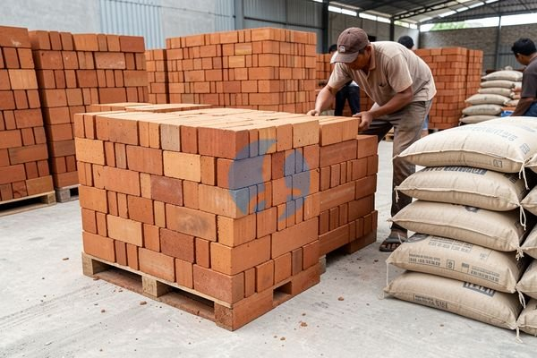

**1 Batu Bata Berapa Rupiah? Jawaban Singkat dan Contoh Hitungannya** - Mitra Sumber Material yang berbahagia, pernahkah Anda merasa bingung saat menghitung biaya pembangunan rumah? Salah satu komponen yang paling krusial adalah harga batu bata. Nah, di artikel ini, Kami akan membahas tuntas berapa harga satu buah batu bata, jenis-jenisnya, dan bagaimana Anda bisa mendapatkan penawaran terbaik untuk proyek Anda. Bayangkan, Anda punya rencana membangun rumah impian, tapi anggaran terasa membengkak karena harga material yang tidak terduga. Kami di Sumber Material siap membantu Anda mendapatkan material berkualitas dengan harga yang jelas dan transparan.



## Pilihan Batu Bata: Merah, Hebel, atau Batako?

Sebelum membahas harga, penting untuk memahami ada beberapa jenis batu bata yang umum digunakan. Masing-masing punya kelebihan dan kekurangan, serta harga yang berbeda-beda. Mitra Sumber Material, pilihan jenis batu bata ini akan sangat memengaruhi total biaya pembangunan Anda. Batu bata merah adalah yang paling tradisional dan banyak digunakan. Harganya relatif terjangkau, tapi perlu diingat bahwa pemasangannya membutuhkan lebih banyak waktu dan material plester karena ukurannya yang tidak seragam. Sementara itu, batu bata hebel (AAC) menawarkan kemudahan pemasangan karena ukurannya presisi dan ringan, sehingga bisa menghemat biaya tenaga kerja. Namun, harganya biasanya lebih mahal dari batu bata merah. Ada juga batako, yang sering digunakan untuk dinding pembatas atau pagar karena harganya yang paling ekonomis.

Untuk proyek Anda, Kami sarankan untuk mempertimbangkan kebutuhan dan anggaran secara matang. Apakah Anda mengutamakan harga yang murah, atau kemudahan pemasangan yang bisa menghemat waktu dan tenaga kerja? Jika Anda masih ragu, jangan sungkan untuk [tanyakan harga lewat WhatsApp](https://api.whatsapp.com/send?phone=6285776786091&text=*Halo%20sumbermaterial.com*%20%3A) kepada Kami. Kami akan bantu Anda memilih jenis batu bata yang paling sesuai dengan kebutuhan proyek Anda.

## Material Sumber Material: Pilihan Batu Bata Berkualitas dengan Harga Jelas

Sumber Material menyediakan berbagai jenis batu bata dengan kualitas terjamin. Kami punya batu bata merah dengan berbagai ukuran dan mutu, sesuai dengan standar SNI. Untuk batu bata hebel, Kami menyediakan berbagai merek dan ketebalan, mulai dari 7,5 cm hingga 12,5 cm. Selain itu, Kami juga menyediakan batako dengan berbagai ukuran dan kualitas.

Berikut contoh estimasi harga batu bata per buah (harga dapat berubah sewaktu-waktu — hubungi Kami untuk penawaran terbaru dan paling akurat sesuai kebutuhan proyek Mitra):

<table class="table">
  <caption>Estimasi Harga Batu Bata Per Buah (2026)</caption>
  <thead>
    <tr><th>Jenis Batu Bata</th><th>Ukuran</th><th>Harga Per Buah (Estimasi)</th><th>Catatan</th></tr>
  </thead>
  <tbody>
    <tr><td>Batu Bata Merah</td><td>Standar (22 x 10 x 5 cm)</td><td>Rp 800 - Rp 1.200</td><td>Harga bervariasi tergantung kualitas tanah dan proses pembakaran</td></tr>
    <tr><td>Batu Bata Hebel</td><td>7,5 cm</td><td>Rp 12.000 - Rp 15.000</td><td>Harga per buah (ukuran 30x20x7.5 cm)</td></tr>
    <tr><td>Batu Bata Hebel</td><td>10 cm</td><td>Rp 15.000 - Rp 18.000</td><td>Harga per buah (ukuran 30x20x10 cm)</td></tr>
    <tr><td>Batako</td><td>Standar (39 x 19 x 10 cm)</td><td>Rp 3.000 - Rp 5.000</td><td>Harga bervariasi tergantung kualitas semen dan pasir</td></tr>
  </tbody>
</table>

Selain menyediakan material, Kami juga menyediakan jasa pengiriman ke seluruh wilayah Jabodetabek dan sekitarnya. Kami memahami betul pentingnya ketepatan waktu dalam proyek pembangunan Anda.

## Keuntungan Memesan Material Bangunan di Sumber Material

Mitra Sumber Material, kenapa Anda harus memilih Sumber Material sebagai pemasok material bangunan Anda? Pertama, Kami menjamin kualitas produk yang Kami jual. Semua material yang Kami sediakan telah melalui proses pengecekan kualitas yang ketat. Kedua, Kami menawarkan harga yang kompetitif dan transparan. Anda bisa langsung tanyakan harga lewat WhatsApp untuk mendapatkan penawaran terbaik sesuai kebutuhan proyek Anda. Ketiga, Kami menyediakan layanan pengiriman yang cepat dan tepat waktu. Kami mengerti bahwa keterlambatan pengiriman material bisa menghambat proses pembangunan Anda. Keempat, Kami berlokasi di berbagai area strategis seperti Bogor, Jakarta, Bekasi, Karawang, Tangerang, dan Cikarang, sehingga memudahkan Anda untuk mendapatkan material bangunan yang Anda butuhkan.

Sebagai tambahan, Kami juga menyediakan sewa alat berat seperti molen, stamper, dan excavator. Jika Anda membutuhkan jasa urug atau jasa cor, Kami juga siap membantu.

## Pesan Batu Bata & Material Bangunan Lainnya dengan Mudah

Memesan material bangunan di Sumber Material sangat mudah. Anda bisa menghubungi Kami melalui tombol **Telepon** atau **WhatsApp** yang tersedia di halaman ini. Sampaikan kebutuhan Anda secara detail, termasuk jenis material, jumlah, dan lokasi proyek Anda. Tim Kami akan segera memberikan penawaran harga terbaik untuk Anda. Anda juga bisa datang langsung ke salah satu lokasi Kami di Bogor, Jakarta, Bekasi, Karawang, Tangerang, atau Cikarang.

## Menghitung Kebutuhan Batu Bata: Contoh Kasus & Rumus Praktis

Mitra Sumber Material, seringkali menghitung kebutuhan batu bata menjadi tantangan tersendiri. Terlalu sedikit, proyek jadi tertunda karena harus memesan lagi. Terlalu banyak, berarti ada biaya terbuang percuma. Nah, Kami akan bantu Anda dengan contoh perhitungan sederhana.

Anggap saja Anda ingin membangun dinding dengan ukuran panjang 6 meter, tinggi 3 meter, dan tebal 15 cm (setengah bata). Untuk batu bata merah standar (22 x 10 x 5 cm), kita perlu menghitung luas dinding terlebih dahulu: 6 m x 3 m = 18 m². Kemudian, kita hitung volume dinding: 18 m² x 0,15 m = 2,7 m³.

Terakhir, bagi volume dinding total dengan volume efektif satu batu bata: 2,7 m³ / 0,00121 m³ = sekitar 2.231 buah batu bata. Jadi, Anda membutuhkan sekitar 2.231 buah batu bata merah untuk dinding tersebut. Penting diingat, angka ini adalah estimasi dan bisa bervariasi tergantung ketelitian pemasangan dan jenis mortar yang digunakan.

## Pertanyaan Umum Seputar Batu Bata: Panduan Singkat

Mitra Sumber Material, seringkali Kami menerima pertanyaan serupa dari pelanggan. Berikut beberapa pertanyaan umum dan jawabannya:

### Berapa Daya Tahan Batu Bata Merah?

Daya tahan batu bata merah sangat bervariasi, tergantung kualitas tanah liat, proses pembakaran, dan perawatan. Batu bata merah berkualitas baik bisa bertahan hingga puluhan tahun, bahkan ratusan tahun jika dirawat dengan baik.

### Apakah Batu Bata Hebel Mudah Pecah?

Batu bata hebel memang lebih rapuh daripada batu bata merah, terutama saat penanganan. Namun, jika dipasang dengan benar dan tidak terkena benturan keras, batu bata hebel cukup kuat dan tahan lama.

### Apa Bedanya Batako Padat dan Batako Lubang?

Batako padat memiliki berat yang lebih tinggi dan lebih kuat dibandingkan batako lubang. Batako lubang lebih ringan dan lebih ekonomis, tetapi kurang kuat. Pilihan tergantung kebutuhan dan anggaran Anda.

### Bagaimana Cara Menyimpan Batu Bata Agar Tidak Rusak?

Simpan batu bata di tempat yang kering dan rata. Tutup dengan terpal atau plastik jika disimpan di luar ruangan untuk melindunginya dari hujan dan panas matahari langsung.

## Tips Memilih dan Memesan Batu Bata yang Tepat

Mitra Sumber Material, memilih dan memesan batu bata yang tepat memerlukan perhatian khusus. Pertama, perhatikan ukuran dan bentuk batu bata. Pastikan ukurannya seragam dan tidak ada yang pecah atau retak. Kedua, perhatikan warna batu bata. Warna yang konsisten menandakan kualitas yang baik. Ketiga, pastikan batu bata kering dan tidak berlumut. Kelembapan bisa mengurangi kekuatan batu bata.

## Meminimalkan Pemborosan: Tips Menghitung Kebutuhan Semen untuk Pemasangan Batu Bata

Mitra Sumber Material, perhitungan kebutuhan batu bata saja tidak cukup. Anda juga perlu memperhitungkan kebutuhan semen untuk pemasangan agar tidak terjadi kekurangan atau kelebihan yang akhirnya memboroskan biaya. Nah, untuk batu bata merah standar ukuran 22x10x5 cm, biasanya dibutuhkan sekitar 0,08 – 0,12 meter kubik semen per meter kubik dinding. Angka ini bisa bervariasi tergantung jenis semen, proporsi campuran, dan keterampilan tukang. Untuk batu bata hebel, kebutuhan semennya lebih sedikit karena permukaannya lebih halus dan tidak membutuhkan plester setebal batu bata merah.

## Pertanyaan Lain yang Sering Diajukan Tentang Batu Bata

Mitra Sumber Material, selain pertanyaan di atas, Kami sering menerima beberapa pertanyaan lain. Berikut jawabannya:

### Apakah Batu Bata Merah Bisa Digunakan untuk Lantai?

Tidak disarankan. Batu bata merah tidak dirancang untuk menahan beban berat secara langsung. Gunakan keramik atau material lantai lainnya yang lebih kuat dan tahan lama.

### Bagaimana Cara Membedakan Batu Bata Merah Berkualitas Baik?

Perhatikan warna dan teksturnya. Batu bata merah berkualitas baik biasanya berwarna merah bata yang seragam dan memiliki tekstur yang padat. Ketuk batu bata, jika terdengar bunyi nyaring, itu menandakan kualitasnya baik.

### Apakah Batu Bata Hebel Perlu Diplester?

Sebaiknya diplester untuk melindungi dari cuaca dan memberikan tampilan yang lebih rapi. Namun, karena permukaannya sudah cukup halus, ketebalan plester yang dibutuhkan lebih tipis dibandingkan batu bata merah.

### Bisakah Batu Bata Merah Digunakan untuk Membuat Dinding Partisi?

Bisa, tapi sebaiknya gunakan batu bata merah dengan kualitas yang lebih rendah atau batako untuk menghemat biaya. Dinding partisi tidak membutuhkan kekuatan setinggi dinding penahan beban.

Mau tahu harga terbaru untuk kebutuhan proyek Mitra Sumber Material? Klik tombol **WhatsApp** atau **Telepon** di bawah, kirim kebutuhan dan lokasi proyek, Kami bantu hitungkan.
