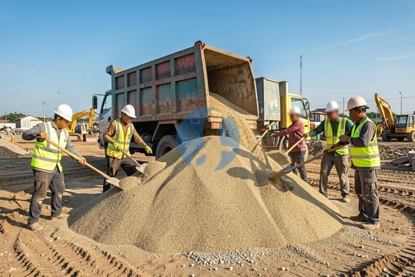

**Agen Pasir Terdekat untuk Renovasi dan Bangunan Baru** - Mitra Sumber Material dimana saja berada, mencari agen pasir terdekat untuk proyek Anda? Kami siap membantu menyediakan pasir berkualitas dengan pengiriman cepat ke lokasi proyek Anda di Jabodetabek dan sekitarnya. Jangan khawatir kehabisan material atau kesulitan mencari pemasok terpercaya – Kami hadir untuk memastikan kelancaran proyek Anda.



## Butuh Pasir Sekarang? Pilih Jenis yang Tepat untuk Hasil Optimal

Mitra Sumber Material, sebelum memutuskan membeli, penting untuk mengetahui jenis-jenis pasir yang tersedia. Ada pasir urug, pasir beton, pasir cor, dan lain-lain. Setiap jenis punya karakteristik berbeda yang cocok untuk aplikasi berbeda. Nah, agar tidak salah pilih, Kami bantu ringkas informasinya. Pasir urug biasanya digunakan untuk pengurugan lahan atau pondasi. Pasir beton, seperti namanya, penting untuk campuran beton yang kuat. Sementara pasir cor, dengan teksturnya yang halus, ideal untuk pekerjaan cor. Bingung memilih yang paling pas? Jangan ragu, Kami siap konsultasi dan merekomendasikan jenis pasir yang paling sesuai dengan kebutuhan proyek Anda.

## Pilihan Pasir Berkualitas dari Sumber Material

Kami menyediakan berbagai jenis pasir bangunan yang siap memenuhi kebutuhan proyek Anda:

- **Pasir Urug:** Cocok untuk pengurugan, pembuatan pondasi, atau lapisan dasar. Tersedia dalam berbagai ukuran butiran sesuai permintaan.
- **Pasir Beton:** Pasir pilihan untuk campuran beton berkualitas tinggi. Kami menjamin mutu pasir beton yang Kami jual sesuai standar SNI.
- **Pasir Cor:** Pasir halus yang ideal untuk pekerjaan cor, plester, dan acian. Menghasilkan permukaan yang lebih rata dan halus.
- **Pasir Putih:** Digunakan untuk estetika, seperti membuat taman atau dekorasi. Tersedia dalam berbagai grade keputihan.

Untuk proyek yang membutuhkan volume besar, Kami juga menyediakan layanan sewa alat berat seperti truk engkel, dump truk, dan excavator untuk mempercepat proses pengiriman dan penataan material di lokasi proyek Anda.

## Mengapa Memilih Sumber Material sebagai Agen Pasir Terdekat Anda?

Mitra Sumber Material, banyak keuntungan yang bisa Anda dapatkan dengan memesan pasir dari Kami. Pertama, Kami memastikan kualitas pasir yang Kami jual sesuai standar. Artinya, Anda tidak perlu khawatir mendapatkan material yang kotor atau bercampur sampah. Kedua, Kami menawarkan harga yang kompetitif dan transparan. Kami bantu hitungkan kebutuhan pasir proyek Anda secara akurat, sehingga Anda bisa memperkirakan anggaran dengan lebih baik. Ketiga, Kami melayani pengiriman ke seluruh wilayah Jabodetabek dan sekitarnya. Dengan armada yang lengkap, Kami bisa memastikan pasir sampai tepat waktu di lokasi proyek Anda. Keempat, Kami berlokasi strategis di Bogor, Jakarta, Bekasi, Karawang, Tangerang, dan Cikarang – memudahkan pengiriman dan konsultasi langsung. Dengan pengalaman bertahun-tahun di bidang material bangunan, Kami siap menjadi mitra terpercaya Anda.

## Pesan Pasir Mudah & Cepat – Proyek Lancar Tanpa Ribet!

Yuk, segera dapatkan pasir berkualitas untuk proyek Anda! Proses pemesanan di Sumber Material sangat mudah. Anda bisa menghubungi Kami melalui tombol **WhatsApp** atau **Telepon** yang tersedia di bawah halaman ini. Tim Kami akan dengan senang hati membantu Anda memilih jenis pasir yang tepat, menghitung kebutuhan material, dan memberikan penawaran harga terbaik. Kami juga bisa menyesuaikan jadwal pengiriman sesuai kebutuhan Anda. Jangan tunda lagi, segera hubungi Kami dan buktikan sendiri kemudahan memesan material bangunan dari Sumber Material.

## Pasir Lokal vs. Pasir Import: Mana yang Lebih Cocok untuk Proyek Anda?

Mitra Sumber Material, ada beberapa pilihan sumber pasir yang tersedia di pasaran. Secara umum, ada pasir lokal dan pasir import. Pasir lokal biasanya lebih ekonomis dan mudah didapatkan, tapi kualitasnya bisa bervariasi tergantung sumbernya. Sementara pasir import, seperti pasir dari Sungai Musi atau dari negara tetangga, seringkali memiliki kualitas yang lebih konsisten dan bersih. Namun, harganya tentu lebih mahal. Nah, untuk proyek-proyek yang membutuhkan kekuatan dan daya tahan tinggi, seperti konstruksi bangunan bertingkat atau jembatan, pasir import bisa menjadi pilihan yang lebih baik. Tapi, untuk proyek-proyek kecil seperti renovasi rumah atau pembuatan jalan setapak, pasir lokal berkualitas baik juga sudah cukup memadai. Kami sarankan untuk selalu mempertimbangkan anggaran dan kebutuhan proyek sebelum memutuskan jenis pasir yang akan digunakan.

## Pertanyaan Umum tentang Pasir Bangunan – Kami Jawab!

Seringkali, Mitra Sumber Material punya pertanyaan seputar pasir bangunan. Berikut ini beberapa pertanyaan yang paling umum Kami terima:

### Berapa lama waktu pengiriman pasir ke lokasi proyek?

Waktu pengiriman tergantung jarak dan ketersediaan armada. Untuk wilayah Jabodetabek, biasanya pengiriman bisa dilakukan dalam 1-2 hari kerja setelah pesanan Kami terima.

### Apakah pasir yang Kami jual sudah termasuk biaya pengiriman?

Biaya pengiriman akan Kami informasikan secara terpisah setelah Kami mengetahui lokasi proyek Anda dan volume pasir yang dipesan.

### Bagaimana jika pasir yang Kami terima tidak sesuai dengan spesifikasi?

Kami menjamin kualitas pasir yang Kami jual. Jika Anda menemukan ketidaksesuaian, segera hubungi Kami, dan Kami akan segera menggantinya dengan material yang sesuai.

### Apakah Kami bisa memesan pasir dalam jumlah kecil?

Tentu saja! Kami melayani pemesanan dalam berbagai volume, mulai dari jumlah kecil untuk renovasi rumah hingga jumlah besar untuk proyek konstruksi.

## Hindari Kesalahan Umum Saat Membeli Pasir

Mitra Sumber Material, ada beberapa kesalahan umum yang sering terjadi saat membeli pasir. Pertama, tidak memperhatikan kualitas pasir. Pasir yang berkualitas buruk bisa mengandung lumpur atau kotoran lain yang dapat mengurangi kekuatan beton. Kedua, memesan pasir terlalu sedikit atau terlalu banyak. Ketidakakuratan dalam perhitungan bisa menyebabkan keterlambatan proyek atau pemborosan biaya. Ketiga, tidak memperhatikan biaya pengiriman. Biaya pengiriman yang tinggi bisa membuat harga pasir menjadi lebih mahal dari yang diharapkan. Keempat, tidak meminta rekomendasi dari ahli konstruksi. Ahli konstruksi dapat membantu Anda memilih jenis pasir yang tepat untuk proyek Anda. Nah, untuk menghindari masalah ini, selalu pastikan Anda membeli pasir dari agen terpercaya seperti Kami, konsultasikan kebutuhan Anda dengan ahli, dan perhatikan biaya pengiriman sebelum memutuskan untuk memesan.

## Masih Punya Pertanyaan? Ini Beberapa yang Sering Kami Terima

### Apakah pasir bisa disimpan di lokasi proyek dalam waktu lama?

Sebaiknya tidak. Pasir yang disimpan terlalu lama di lokasi proyek rentan tercampur dengan kotoran atau sampah, terutama saat musim hujan. Kami sarankan untuk memesan pasir sesuai kebutuhan dan segera menggunakannya.

### Bagaimana cara memastikan pasir yang Kami terima benar-benar kering?

Kami selalu berusaha mengirimkan pasir dalam kondisi kering. Namun, jika Anda khawatir, Anda bisa meminta Kami untuk mengirimkan sampel pasir terlebih dahulu sebelum melakukan pemesanan dalam jumlah besar.

### Apakah Kami menyediakan layanan pengiriman pasir ke lokasi yang sulit dijangkau?

Kami akan berusaha sebaik mungkin untuk mengirimkan pasir ke lokasi yang sulit dijangkau. Namun, untuk beberapa lokasi tertentu, mungkin diperlukan biaya tambahan atau penggunaan kendaraan khusus. Diskusikan saja dengan tim Kami, Kami akan cari solusinya.

### Bagaimana cara mengetahui apakah pasir yang Kami terima sudah sesuai dengan standar SNI?

Kami menjamin semua pasir yang Kami jual memenuhi standar SNI. Anda bisa meminta sertifikat kualitas dari Kami untuk memastikan keasliannya.

## Hitung Kebutuhan Pasir untuk Pekerjaan Plester: Contoh Praktis

Mitra Sumber Material, seringkali sulit memperkirakan berapa banyak pasir yang dibutuhkan untuk pekerjaan plester. Nah, untuk membantu Anda, Kami berikan contoh perhitungan sederhana. Misalkan Anda akan memplester dinding seluas 50 meter persegi dengan tebal plester 1,5 cm (0,015 meter). Perbandingan campuran plester umumnya adalah 1:3 (1 bagian semen : 3 bagian pasir). Volume plester yang dibutuhkan adalah 50 m² x 0,015 m = 0,75 m³. Karena perbandingan pasir 3:1, maka volume pasir yang dibutuhkan adalah (3/4) x 0,75 m³ = 0,5625 m³. Artinya, Anda membutuhkan sekitar 0,5625 meter kubik pasir untuk pekerjaan plester tersebut. Jangan ragu untuk konsultasi dengan Kami, Kami bantu hitungkan kebutuhan material secara lebih akurat sesuai proyek Anda.

## Sering Ditanyakan: Tentang Biaya Tambahan dan Opsi Pembayaran

### Apakah ada biaya tambahan untuk pengiriman ke area yang sulit dijangkau?

Ya, Mitra Sumber Material, untuk pengiriman ke area yang sulit dijangkau atau memerlukan penanganan khusus, mungkin ada biaya tambahan yang akan Kami informasikan sebelumnya.

### Apakah Kami menerima pembayaran tunai di lokasi?

Untuk kenyamanan Anda, Kami menerima pembayaran tunai di lokasi, transfer bank, atau melalui metode pembayaran digital lainnya.

### Bagaimana jika jumlah pasir yang Kami terima kurang dari yang dipesan?

Kami akan segera mengirimkan kekurangan pasir tersebut tanpa biaya tambahan. Kualitas dan kuantitas material adalah prioritas Kami.

### Apakah Kami bisa meminta faktur pajak?

Tentu saja! Kami dapat menyediakan faktur pajak untuk setiap transaksi.

Siap pesan atau masih mau konsultasi dulu? Tombol **WhatsApp** dan **Telepon** di bawah halaman ini langsung terhubung dengan tim Kami.
