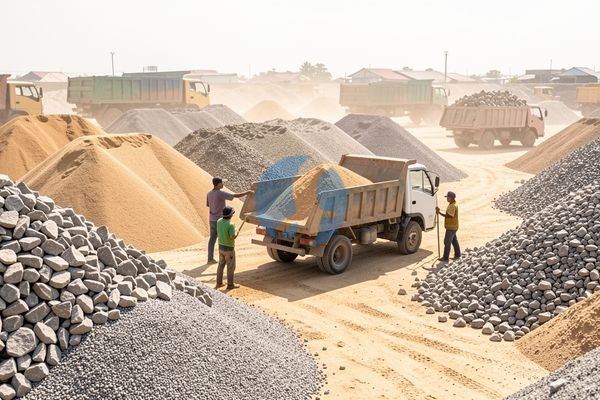

**Apakah Bisa Beli Pasir Kiloan di Toko Bangunan? Simak Jawabannya** - Mitra, pernahkah Anda mengalami kesulitan saat menghitung kebutuhan pasir untuk proyek kecil? Atau mungkin Anda hanya butuh sedikit pasir untuk pekerjaan DIY di rumah? Pertanyaan “apakah bisa beli pasir kiloan di toko bangunan?” sering muncul karena pembelian per truk atau kubik terasa terlalu banyak dan boros. Nah, Kami dari Sumber Material siap membantu Anda menemukan solusi terbaik untuk kebutuhan pasir, bahkan dalam jumlah kecil sekalipun.



## Membeli Pasir Kiloan: Pilihan dan Pertimbangan

Membeli pasir kiloan memang mungkin dilakukan, tapi tidak semua toko bangunan menyediakannya. Biasanya, toko bangunan lebih fokus pada penjualan pasir dalam jumlah besar seperti per truk atau kubik. Kalaupun ada yang menyediakan, seringkali pasir kiloan dijual dalam kemasan yang sudah ditentukan (misalnya 25 kg atau 50 kg) dan harganya tentu saja lebih tinggi dibandingkan membeli secara grosir.

Mitra, penting untuk mempertimbangkan jenis pasir yang Anda butuhkan. Ada berbagai jenis pasir dengan fungsi yang berbeda-beda, seperti pasir urug, pasir pasang, pasir beton, dan pasir cor. Memilih jenis pasir yang tepat akan sangat berpengaruh pada kualitas hasil pekerjaan Anda. Nah, Kami di Sumber Material menyediakan berbagai jenis pasir sesuai kebutuhan proyek Anda, mulai dari pasir halus hingga pasir kasar, dengan mutu terjamin.

### Jenis Pasir yang Tersedia di Sumber Material

Kami, Sumber Material, menyediakan berbagai pilihan pasir dengan kualitas terbaik:

- **Pasir Urug:** Cocok untuk pengurugan lahan, menimbun, atau membuat pondasi. Teksturnya kasar dan kuat.
- **Pasir Pasang:** Ideal untuk campuran semen dalam pemasangan keramik, batu bata, atau genteng. Teksturnya lebih halus dari pasir urug.
- **Pasir Beton:** Digunakan untuk campuran beton dengan mutu tinggi. Memiliki kandungan lumpur yang rendah untuk hasil beton yang lebih kuat dan tahan lama.
- **Pasir Cor:** Umumnya digunakan untuk campuran semen dalam pekerjaan cor. Memastikan kekuatan dan ketahanan struktur cor-an Anda.

Kami juga menyediakan pasir dengan ukuran dan mutu yang berbeda-beda, sesuai dengan standar SNI. Anda bisa memilih pasir dengan ukuran butir yang sesuai dengan kebutuhan proyek Anda. Misalnya, untuk pekerjaan plester, pasir yang lebih halus akan lebih mudah diaplikasikan. Untuk pekerjaan struktur, pasir yang lebih kasar akan memberikan kekuatan yang lebih baik.

### Kenapa Pesan Pasir ke Sumber Material Lebih Untung?

Mungkin Anda bertanya-tanya, kenapa harus pesan pasir ke Kami? Jawabannya sederhana: Kami memberikan solusi yang praktis, terpercaya, dan hemat waktu untuk Anda. Kami melayani pengiriman pasir ke seluruh wilayah Jabodetabek dan sekitarnya, baik dalam jumlah kecil maupun besar. Anda tidak perlu repot-repot mengangkut pasir sendiri, yang bisa memakan waktu dan biaya tambahan.

Selain itu, Kami juga menawarkan beberapa keuntungan lainnya:

- **Harga Kompetitif:** Harga pasir Kami bersaing dan transparan. Anda bisa menanyakan harga terbaru dan mendapatkan penawaran yang disesuaikan dengan volume dan lokasi pengiriman proyek Anda.
- **Kualitas Terjamin:** Kami hanya menyediakan pasir dengan mutu terbaik, sesuai dengan standar SNI.
- **Pengiriman Tepat Waktu:** Kami memahami pentingnya ketepatan waktu dalam proyek Anda. Kami akan memastikan pasir sampai di lokasi proyek Anda sesuai jadwal yang telah disepakati.
- **Layanan Konsultasi:** Tim Kami siap membantu Anda memilih jenis pasir yang tepat untuk proyek Anda.

Nah, untuk proyek yang membutuhkan material lain seperti batu, baja ringan, atau batako, Kami juga menyediakannya! Anda bisa mendapatkan semua material bangunan yang Anda butuhkan dalam satu tempat.

### Cara Mudah Pesan Pasir di Sumber Material

Memesan pasir di Sumber Material sangat mudah dan cepat. Anda bisa menghubungi Kami melalui tombol **Telepon** atau **WhatsApp** yang ada di halaman ini. Cukup informasikan jenis pasir, volume yang Anda butuhkan, dan lokasi proyek Anda. Tim Kami akan segera memproses pesanan Anda dan memberikan penawaran terbaik. Kami juga menyediakan jasa sewa alat berat seperti truk dan ekskavator jika Anda membutuhkannya.

Dengan Sumber Material, Anda tidak perlu lagi khawatir tentang pengadaan pasir untuk proyek Anda. Kami siap membantu Anda mewujudkan proyek impian Anda dengan material bangunan berkualitas dan layanan yang prima.

Tinggal satu langkah lagi: hubungi Kami lewat tombol **Telepon** atau **WhatsApp** di bawah untuk menanyakan harga dan jadwal pengiriman proyek Mitra Sumber Material.

ARTIKEL_SELESAI

## Menghitung Kebutuhan Pasir: Contoh Kasus Nyata

Mitra, seringkali kesulitan terbesar saat proyek kecil bukan soal mencari material, tapi menghitung berapa banyak material yang dibutuhkan. Terutama untuk pasir, salah hitung sedikit bisa berakibat boros atau malah kekurangan. Nah, yuk kita lihat contoh perhitungan kebutuhan pasir untuk pekerjaan plester dinding.

Anggap saja Anda ingin melakukan plester dinding dengan luas 10 meter persegi dan tebal plester 1,5 cm (0,015 meter). Untuk menghitung volume pasir yang dibutuhkan, kita perlu tahu campuran plester yang umum digunakan. Rasio campuran plester standar adalah 1:3 (semen:pasir). Artinya, untuk setiap 1 bagian semen, dibutuhkan 3 bagian pasir.

Pertama, hitung volume total plester: 10 m² x 0,015 m = 0,15 m³. Selanjutnya, kita perlu mengetahui volume semen yang dibutuhkan. Asumsi kita menggunakan semen dengan berat jenis 1400 kg/m³, maka berat semen yang diperlukan adalah 0,15 m³ x 1400 kg/m³ = 210 kg. Dengan rasio 1:3, maka berat pasir yang dibutuhkan adalah 210 kg x 3 = 630 kg.

### Pilihan Pembelian: Kiloan vs. Kubik – Mana yang Lebih Efisien?

Perbedaan harga ini disebabkan oleh biaya operasional dan logistik yang lebih rendah saat pengiriman dalam jumlah besar. Selain itu, membeli dalam jumlah besar juga lebih praktis karena Anda tidak perlu bolak-balik ke toko bangunan untuk membeli pasir sedikit demi sedikit.

Untuk proyek kecil, membeli dalam kemasan 25 kg atau 50 kg mungkin masih masuk akal. Tapi untuk proyek yang lebih besar, Kami sarankan untuk mempertimbangkan pembelian per kubik. Kami di Sumber Material siap melayani pembelian pasir dalam berbagai volume, sesuai dengan kebutuhan Anda.

### Pertanyaan yang Sering Diajukan (FAQ) Tentang Pembelian Pasir

Mitra, seringkali ada beberapa pertanyaan yang muncul saat akan membeli pasir. Berikut adalah beberapa pertanyaan yang paling sering Kami terima:

**### Apakah pasir yang dijual sudah bersih?**

Tidak semua pasir yang dijual di toko bangunan sudah bersih. Beberapa jenis pasir mungkin masih mengandung kotoran seperti tanah, kerikil, atau sampah. Kami di Sumber Material memastikan pasir yang Kami jual sudah melalui proses penyaringan yang ketat, sehingga lebih bersih dan siap digunakan.

**### Bagaimana cara mengetahui kualitas pasir?**

Kualitas pasir dapat dilihat dari tekstur, warna, dan kandungan lumpurnya. Pasir yang berkualitas baik memiliki tekstur yang kasar, berwarna cerah, dan kandungan lumpur yang rendah. Kami selalu memberikan informasi yang jelas mengenai kualitas pasir yang Kami jual.

**### Apakah bisa minta sampel pasir sebelum membeli?**

Tentu saja bisa! Kami dengan senang hati akan memberikan sampel pasir kepada Anda agar Anda bisa melihat dan merasakan kualitasnya secara langsung. Ini penting agar Anda yakin pasir tersebut sesuai dengan kebutuhan proyek Anda.

**### Bagaimana jika pasir yang sampai di lokasi proyek kurang dari yang dipesan?**

## Hindari Kesalahan Umum Saat Membeli Pasir

Mitra, seringkali ada beberapa kesalahan kecil yang bisa terjadi saat membeli pasir, padahal bisa dihindari. Salah satu yang paling umum adalah tidak memperhatikan jenis pasir yang dibutuhkan. Misalnya, menggunakan pasir pasang untuk pekerjaan beton bisa mengurangi kekuatan struktur. Pastikan Anda tahu persis jenis pasir yang sesuai dengan proyek Anda.

Kesalahan lainnya adalah tidak menghitung kebutuhan pasir dengan akurat. Akibatnya, Anda bisa kekurangan atau kelebihan pasir. Kekurangan pasir akan menghambat pekerjaan, sementara kelebihan pasir akan membuang-buang anggaran. Kami sarankan untuk melakukan perhitungan yang cermat atau meminta bantuan Kami untuk menghitung kebutuhan pasir Anda.

## Pertanyaan Lain yang Sering Kami Terima

### Apakah pasir bisa disimpan lama?

Pasir bisa disimpan lama asalkan disimpan di tempat yang kering dan terlindungi dari hujan. Jika pasir terkena hujan, kandungan lumpurnya bisa bertambah dan mempengaruhi kualitasnya.

### Bagaimana cara membedakan pasir alam dan pasir buatan?

Pasir alam biasanya memiliki butiran yang tidak seragam dan mengandung sedikit mineral. Sementara pasir buatan memiliki butiran yang lebih seragam dan bersih. Untuk proyek konstruksi, Kami sarankan menggunakan pasir alam karena lebih kuat dan tahan lama.

### Apakah bisa memesan pasir dengan jadwal pengiriman tertentu?

Tentu saja bisa! Kami selalu berusaha memenuhi permintaan jadwal pengiriman dari pelanggan Kami. Cukup informasikan jadwal yang Anda inginkan saat melakukan pemesanan.

Kami berkomitmen untuk memberikan pelayanan yang terbaik kepada pelanggan Kami. Jika terjadi kekurangan volume pasir saat pengiriman, segera hubungi Kami dan Kami akan segera menyelesaikan masalah tersebut. Kami akan mengirimkan sisa pasir yang kurang secepatnya.
