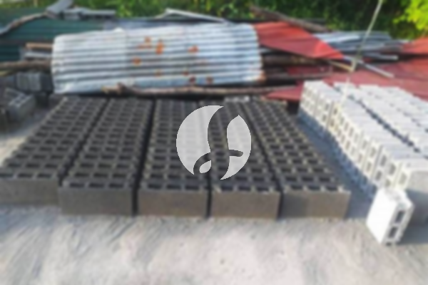

**Cara Memilih Batu Bata Hitam yang Sesuai Kebutuhan** - Mitra Sumber Material yang budiman, apakah Anda sedang mencari material bangunan yang unik dan memberikan kesan mewah pada proyek Anda? Batu bata hitam bisa jadi solusi tepat! Kami di Sumber Material siap membantu menyiapkan kebutuhan batu bata hitam untuk berbagai proyek konstruksi Anda.



## Mencari Tampilan Unik: Keunggulan Batu Bata Hitam Dibanding Pilihan Lain

Batu bata hitam semakin populer dalam desain modern karena memberikan karakter tersendiri pada bangunan. Banyak yang memilihnya untuk tampilan industrial, minimalis, atau bahkan rustic yang elegan. Tapi, apakah batu bata hitam ini pilihan yang tepat untuk proyek Anda? Nah, sebelum memutuskan, ada baiknya kita pertimbangkan beberapa hal. Batu bata hitam memberikan kesan kuat dan berbeda dibanding batu bata merah konvensional. Selain itu, batu bata hitam juga bisa menjadi solusi untuk proyek yang menginginkan tampilan yang lebih *bold* dan dramatis.

Bagi Mitra yang ingin tampilan yang lebih modern, batu bata hitam sering dikombinasikan dengan material lain seperti beton ekspos, kayu, atau kaca. Efek kontras yang dihasilkan akan menciptakan desain yang menarik dan berkarakter. Jika Anda tertarik dengan tampilan ini, Kami siap membantu menyediakan batu bata hitam berkualitas dengan harga yang kompetitif. Jangan ragu untuk [tanyakan harga lewat WhatsApp](https://api.whatsapp.com/send?phone=6285776786091&text=*Halo%20sumbermaterial.com*%20%3A) untuk mendapatkan penawaran khusus!

## Jenis Batu Bata Hitam dan Penggunaannya dalam Proyek Anda

Ada beberapa jenis batu bata hitam yang tersedia di pasaran. Yang paling umum adalah batu bata merah yang diwarnai dengan pigmen khusus. Proses pewarnaan ini memberikan warna hitam yang merata dan tahan lama. Selain itu, ada juga batu bata hitam yang dibuat dari tanah liat khusus yang memang berwarna gelap secara alami. Jenis ini cenderung lebih mahal, tetapi memiliki keunggulan dalam hal ketahanan dan estetika.

Kami di Sumber Material menyediakan berbagai jenis batu bata hitam dengan ukuran standar maupun custom sesuai kebutuhan proyek Anda. Misalnya, untuk dinding eksterior, Kami merekomendasikan batu bata hitam dengan ketebalan minimal 11,5 cm untuk memastikan kekuatan dan ketahanan terhadap cuaca. Sementara untuk interior, Anda bisa memilih batu bata hitam dengan ketebalan yang lebih tipis. Berikut contoh penggunaan batu bata hitam:

- **Fasad bangunan:** Menciptakan tampilan modern dan industrial.
- **Dinding interior:** Menambahkan aksen unik pada ruangan.
- **Pilar dan pagar:** Memberikan kesan kokoh dan mewah.
- **Perapian:** Menciptakan fokus visual yang menarik.

## Mengapa Memilih Sumber Material untuk Kebutuhan Batu Bata Hitam Anda?

Sebagai supplier material bangunan terpercaya di Jabodetabek dan sekitarnya, Kami menawarkan beberapa keuntungan bagi Mitra Sumber Material:

- **Harga Kompetitif:** Kami menjamin harga batu bata hitam yang kompetitif tanpa mengorbankan kualitas. Harga ini bersifat estimasi dan dapat berubah sewaktu-waktu — hubungi Kami untuk penawaran terbaru dan paling akurat sesuai kebutuhan proyek Mitra.
- **Kualitas Terjamin:** Kami hanya menyediakan batu bata hitam berkualitas tinggi yang memenuhi standar SNI.
- **Pengiriman Tepat Waktu:** Kami memahami pentingnya ketepatan waktu dalam proyek konstruksi. Kami berkomitmen untuk mengirimkan pesanan Anda tepat waktu ke lokasi proyek.
- **Layanan Konsultasi:** Tim Kami siap membantu Anda dalam memilih jenis batu bata hitam yang tepat sesuai dengan kebutuhan dan anggaran proyek Anda.
- **Jangkauan Luas:** Kami melayani pengiriman ke seluruh wilayah Jabodetabek, termasuk Bogor, Jakarta, Bekasi, Karawang, Tangerang, dan Cikarang.

Kami bangga menjadi bagian dari kesuksesan proyek-proyek Mitra Sumber Material. Dengan pengalaman bertahun-tahun di industri ini, Kami yakin dapat memberikan solusi material bangunan yang terbaik untuk Anda.

## Pesan Batu Bata Hitam dengan Mudah dari Sumber Material

Memesan batu bata hitam dari Kami sangat mudah. Anda bisa menghubungi Kami melalui tombol **WhatsApp** atau **Telepon** yang tersedia di bawah halaman ini. Sampaikan kebutuhan Anda, termasuk jenis batu bata hitam, jumlah, dan lokasi pengiriman. Tim Kami akan segera merespon dan memberikan penawaran terbaik.

Jangan tunda kebutuhan proyek Mitra Sumber Material — tanyakan harga dan ketersediaannya sekarang lewat tombol **WhatsApp** atau **Telepon** di bawah halaman ini.

ARTIKEL_SELESAI

## Perhitungan Kebutuhan Batu Bata Hitam: Jangan Sampai Salah Pesan!

Mitra Sumber Material, seringkali kita melihat proyek konstruksi terhambat karena salah perhitungan kebutuhan material. Ini sangat umum terjadi, dan batu bata hitam tidak terkecuali. Nah, supaya proyek Anda lancar, yuk kita bahas cara menghitung kebutuhan batu bata hitam dengan akurat.

Pertama, tentukan luas dinding yang akan menggunakan batu bata hitam. Misalnya, Anda ingin membuat dinding dengan panjang 5 meter dan tinggi 3 meter. Maka, luas dindingnya adalah 5 m x 3 m = 15 m². Selanjutnya, kita perlu memperhitungkan ukuran batu bata hitam itu sendiri. Ukuran standar batu bata hitam adalah 24 cm x 11,5 cm x 5,5 cm. Perlu diingat, ada ruang nat (mortar) antar bata, biasanya sekitar 1 cm. Jadi, ukuran efektifnya menjadi 25 cm x 12,5 cm.

Untuk menghitung jumlah bata per meter persegi, kita bagi luas efektif bata dengan 1 m²: (0,25 m x 0,125 m) = 0,03125 m². Ini adalah luas satu bata efektif. Maka, jumlah bata per meter persegi adalah 1 m² / 0,03125 m² = 32 bata. Sekarang, kita kalikan jumlah bata per meter persegi dengan luas dinding: 32 bata/m² x 15 m² = 480 bata. Ini adalah kebutuhan minimum batu bata hitam untuk dinding tersebut.

## Batu Bata Hitam: Pertanyaan Umum yang Sering Diajukan

Mitra Sumber Material, seringkali ada beberapa pertanyaan yang muncul sebelum memutuskan untuk menggunakan batu bata hitam. Berikut adalah beberapa pertanyaan umum beserta jawabannya:

### Apakah Batu Bata Hitam Mudah Pudar Warnanya?

Warna batu bata hitam bisa sedikit memudar seiring waktu, terutama jika terpapar langsung sinar matahari dan cuaca ekstrem. Namun, dengan perawatan yang tepat dan penggunaan bahan pelapis yang berkualitas, Anda bisa menjaga warna batu bata hitam tetap awet dan tahan lama.

### Bagaimana Cara Membersihkan Batu Bata Hitam?

Membersihkan batu bata hitam relatif mudah. Anda bisa menggunakan air bersih dan sikat lembut untuk menghilangkan debu dan kotoran. Hindari penggunaan bahan kimia keras yang dapat merusak permukaan batu bata.

### Apakah Batu Bata Hitam Cocok untuk Iklim Tropis?

Ya, batu bata hitam cocok untuk iklim tropis. Material ini tahan terhadap panas dan kelembaban, serta tidak mudah berjamur atau lapuk. Namun, pastikan Anda menggunakan mortar yang berkualitas untuk mencegah rembesan air.

### Apakah Batu Bata Hitam Lebih Mahal dari Batu Bata Merah?

Secara umum, batu bata hitam memang sedikit lebih mahal dari batu bata merah. Hal ini karena proses pewarnaan atau penggunaan tanah liat khusus yang membutuhkan biaya tambahan. Namun, nilai estetika yang ditawarkan batu bata hitam sepadan dengan harganya.

## Memastikan Kualitas Batu Bata Hitam: Hal yang Perlu Diperhatikan

Mitra, sebelum memesan batu bata hitam dalam jumlah besar, ada beberapa hal yang perlu diperhatikan untuk memastikan kualitasnya:

- **Periksa Kekuatan:** Pastikan batu bata hitam memiliki kekuatan yang cukup untuk menahan beban dan tekanan. Bahan yang berkualitas akan terasa padat dan tidak mudah pecah saat ditekan.
- **Perhatikan Warna:** Pastikan warna batu bata hitam merata dan konsisten. Hindari memilih batu bata dengan perbedaan warna yang signifikan.
- **Cek Ukuran:** Pastikan ukuran batu bata hitam seragam dan sesuai dengan standar. Ini akan memudahkan proses pemasangan dan menghasilkan tampilan yang rapi.
- **Periksa Keretakan:** Hindari memilih batu bata yang memiliki retak atau cacat lainnya. Keretakan dapat mengurangi kekuatan dan estetika batu bata.

Kami di Sumber Material selalu memastikan kualitas batu bata hitam yang Kami jual memenuhi standar yang berlaku. Kami hanya bekerja sama dengan produsen terpercaya yang menggunakan bahan baku berkualitas tinggi. Dengan begitu, Mitra Sumber Material bisa mendapatkan material bangunan yang terbaik untuk proyeknya.
