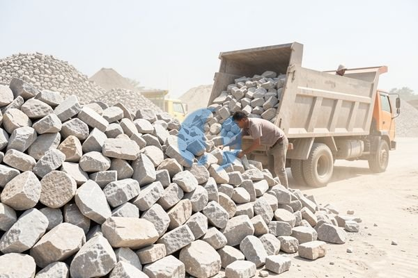

**Memahami Batu Belah per m3 sebelum Memesan** - Mitra Sumber Material di mana pun berada, mencari batu belah per m3 untuk proyek konstruksi Anda? Kami siap membantu menyiapkan kebutuhan material Anda dengan cepat dan efisien!



Batu belah adalah material konstruksi yang serbaguna dan banyak digunakan di berbagai proyek, mulai dari pondasi bangunan, drainase, hingga pembuatan jalan. Memilih jenis dan ukuran yang tepat akan sangat mempengaruhi kekuatan dan durabilitas hasil akhir. Nah, di artikel ini, Kami akan membahas tuntas tentang batu belah per m3, termasuk perkiraan harga, ukuran yang umum digunakan, dan kenapa memilih Kami sebagai supplier terpercaya untuk kebutuhan proyek Anda.

## Memilih Batu Belah yang Tepat: Pertimbangkan Kebutuhan Proyek Anda

Sebelum memutuskan membeli batu belah per m3, penting untuk mempertimbangkan jenis proyek yang akan dikerjakan. Apakah untuk pondasi, urugan, atau drainase? Setiap aplikasi membutuhkan ukuran dan kualitas batu belah yang berbeda. Batu belah untuk pondasi biasanya membutuhkan ukuran yang lebih besar dan kuat, sementara untuk drainase ukuran yang lebih kecil dan berpori lebih disarankan.

Mitra Sumber Material, jangan ragu untuk berkonsultasi dengan Kami mengenai kebutuhan spesifik proyek Anda. Kami akan memberikan rekomendasi jenis dan ukuran batu belah yang paling sesuai, serta membantu menghitung volume yang dibutuhkan agar tidak ada pemborosan. Dengan begitu, Anda bisa lebih fokus pada pelaksanaan proyek tanpa perlu khawatir kekurangan material.

## Ragam Batu Belah Per M3: Jenis, Ukuran, dan Aplikasi

Kami menyediakan berbagai jenis batu belah per m3 untuk memenuhi kebutuhan proyek Anda. Beberapa jenis yang paling umum meliputi:

- **Batu Belah Gunung:** Jenis ini dikenal dengan kekuatannya yang tinggi dan cocok digunakan untuk pondasi bangunan, retaining wall, dan pekerjaan berat lainnya. Ukuran yang tersedia bervariasi, mulai dari 10-20 cm, 20-30 cm, hingga lebih besar.
- **Batu Belah Kali:** Jenis ini biasanya memiliki bentuk yang lebih bulat dan halus serta cocok untuk drainase, urugan, dan pembuatan jalan. Ukuran yang umum digunakan adalah 5-10 cm dan 10-15 cm.
- **Batu Belah Celah:** Jenis ini memiliki bentuk tidak beraturan dengan celah-celah yang cocok untuk pekerjaan drainase yang membutuhkan daya serap air yang tinggi.

Selain jenis-jenis tersebut, Kami juga menyediakan batu belah dengan ukuran khusus sesuai permintaan. Misalnya, untuk proyek yang membutuhkan batu belah dengan ukuran tertentu, Kami dapat menyesuaikannya agar sesuai dengan kebutuhan Anda.

## Kenapa Memesan Batu Belah Per M3 di Sumber Material?

Mitra Sumber Material, ada banyak alasan kenapa Anda sebaiknya mempercayakan kebutuhan batu belah per m3 kepada Kami. Pertama, Kami menyediakan berbagai jenis dan ukuran batu belah untuk memenuhi semua kebutuhan proyek Anda. Kedua, Kami menjamin kualitas material yang Kami jual, karena Kami hanya bekerja sama dengan supplier terpercaya.

Selain itu, Kami juga menawarkan layanan pengiriman cepat dan tepat waktu ke seluruh wilayah Jabodetabek dan sekitarnya. Anda tidak perlu repot mencari jasa pengiriman sendiri, karena Kami akan mengurus semuanya untuk Anda. Kami memahami betul bahwa ketepatan waktu pengiriman sangat penting dalam kelancaran proyek Anda, sehingga Kami selalu berusaha memberikan pelayanan terbaik.

Ditambah lagi, lokasi strategis Kami di Bogor, Jakarta, Bekasi, Karawang, Tangerang, dan Cikarang memungkinkan Kami memberikan harga yang kompetitif tanpa mengorbankan kualitas. Anda akan mendapatkan material berkualitas dengan harga yang sesuai dengan anggaran proyek Anda.

## Pesan Batu Belah Per M3 dengan Mudah dan Praktis

Memesan batu belah per m3 di Sumber Material sangat mudah dan praktis. Cukup hubungi Kami melalui tombol **WhatsApp** atau **Telepon** yang tersedia di halaman ini. Kirimkan informasi mengenai jenis batu belah yang Anda butuhkan, ukuran, volume, dan lokasi proyek Anda. Kami akan segera memberikan penawaran harga terbaik dan mengatur jadwal pengiriman.

Jangan tunda lagi! Segera hubungi Kami dan dapatkan solusi terbaik untuk kebutuhan batu belah per m3 Anda. Kami siap membantu mewujudkan proyek impian Anda dengan material berkualitas dan layanan yang profesional.

Mau tahu harga terbaru untuk kebutuhan proyek Mitra Sumber Material? Klik tombol **WhatsApp** atau **Telepon** di bawah, kirim kebutuhan dan lokasi proyek, Kami bantu hitungkan.

ARTIKEL_SELESAI

## Menghitung Kebutuhan Batu Belah Per M3 untuk Proyek Anda

Mitra Sumber Material, menghitung kebutuhan batu belah per m3 dengan tepat sangat penting untuk menghindari pemborosan atau kekurangan material. Perhitungan ini juga akan membantu Anda dalam membuat anggaran biaya proyek yang lebih akurat. Nah, Kami akan memberikan contoh perhitungan sederhana untuk membantu Anda memperkirakan volume batu belah yang dibutuhkan.

Misalkan Anda akan membuat pondasi untuk bangunan seluas 100 m2 dengan kedalaman pondasi 80 cm (0.8 meter) dan lebar 60 cm (0.6 meter). Pertama, hitung volume pondasi: 100 m2 x 0.8 m x 0.6 m = 48 m3.  Selanjutnya, perhatikan bahwa batu belah tidak mengisi ruang secara sempurna karena bentuknya yang tidak beraturan. Biasanya, dibutuhkan faktor pengisi sekitar 1.3 hingga 1.5. Artinya, Anda perlu mengalikan volume pondasi dengan faktor pengisi tersebut.

## Pertanyaan Umum Seputar Batu Belah Per M3

Banyak Mitra Sumber Material yang memiliki pertanyaan seputar batu belah. Berikut beberapa pertanyaan yang sering Kami terima beserta jawabannya:

### Berapa Daya Tahan Batu Belah?

Daya tahan batu belah sangat bervariasi tergantung jenis batu dan kualitasnya. Batu belah gunung umumnya memiliki daya tahan paling tinggi karena kepadatan dan kekuatannya. Namun, dengan perawatan yang tepat, semua jenis batu belah dapat bertahan lama dan memberikan kinerja yang optimal.

### Apakah Batu Belah Perlu Diayak Sebelum Digunakan?

Untuk beberapa aplikasi, seperti drainase, Anda mungkin perlu mengayak batu belah untuk memisahkan material yang terlalu besar atau terlalu kecil. Namun, untuk pondasi atau urugan, biasanya tidak perlu diayak karena ukuran yang bervariasi justru dapat meningkatkan stabilitas struktur.

### Bagaimana Cara Merawat Batu Belah Agar Awet?

Perawatan batu belah cukup sederhana. Pastikan batu belah tidak terpapar bahan kimia keras yang dapat merusak permukaannya. Bersihkan secara berkala dari kotoran dan debu untuk menjaga penampilannya.  Jika digunakan di area yang sering terkena air, pastikan drainase berfungsi dengan baik untuk mencegah penumpukan air yang dapat menyebabkan lumut atau jamur.

### Bagaimana Cara Memastikan Kualitas Batu Belah yang Kami Terima?

Periksa secara visual kondisi batu belah. Pastikan tidak ada retakan besar atau kerusakan signifikan lainnya. Ukur beberapa sampel untuk memastikan ukurannya sesuai dengan pesanan Anda. Jika Anda ragu, jangan sungkan untuk meminta bantuan Kami. Kami selalu siap memeriksa kualitas material sebelum dikirimkan ke lokasi proyek Anda.

## Memilih Ukuran Batu Belah yang Sesuai: Panduan Praktis

Mitra Sumber Material, memilih ukuran batu belah yang tepat akan sangat mempengaruhi efisiensi dan efektivitas proyek Anda. Ukuran batu belah biasanya dinyatakan dalam rentang, misalnya 10-20 cm atau 20-30 cm. Semakin besar ukuran batu belah, semakin sedikit celah di antara batu-batu tersebut, sehingga meningkatkan stabilitas struktur.

Untuk pondasi bangunan, Kami sarankan menggunakan batu belah dengan ukuran 20-30 cm atau lebih besar, terutama jika bangunan memiliki beban yang berat. Untuk drainase, ukuran 5-10 cm atau 10-15 cm sudah cukup memadai. Pertimbangkan juga jenis tanah di lokasi proyek Anda. Jika tanahnya lunak, Anda mungkin perlu menggunakan batu belah dengan ukuran yang lebih besar untuk memberikan dukungan yang lebih kuat. Jangan ragu untuk berkonsultasi dengan Kami agar Kami bisa memberikan rekomendasi yang paling tepat untuk kondisi proyek Anda.

## Mengenali Ciri-Ciri Batu Belah Berkualitas

Mitra Sumber Material, kualitas batu belah sangat berpengaruh pada kekuatan dan umur bangunan Anda. Perhatikan beberapa ciri penting saat memilih batu belah. Pertama, perhatikan kekerasan batu. Batu yang keras akan lebih tahan terhadap benturan dan abrasi. Kedua, perhatikan porositasnya. Batu dengan porositas yang terlalu tinggi akan mudah menyerap air dan rentan terhadap kerusakan akibat pembekuan-pencairan. Ketiga, pastikan batu memiliki struktur yang padat dan tidak mudah pecah atau lapuk.

## Hindari Kesalahan Umum Saat Memesan Batu Belah

Banyak Mitra Sumber Material yang melakukan kesalahan saat memesan batu belah. Salah satunya adalah tidak memperhitungkan faktor pengisi dengan tepat. Seperti yang sudah Kami bahas, batu belah tidak mengisi ruang secara sempurna, jadi Anda perlu memesan lebih banyak dari volume yang dibutuhkan. Kesalahan lainnya adalah memilih ukuran yang tidak sesuai dengan kebutuhan proyek. Ingat, ukuran yang lebih besar cocok untuk pondasi, sementara ukuran yang lebih kecil cocok untuk drainase. Terakhir, jangan ragu untuk berkonsultasi dengan Kami sebelum memesan agar Kami bisa membantu Anda memilih jenis dan ukuran yang paling tepat.
