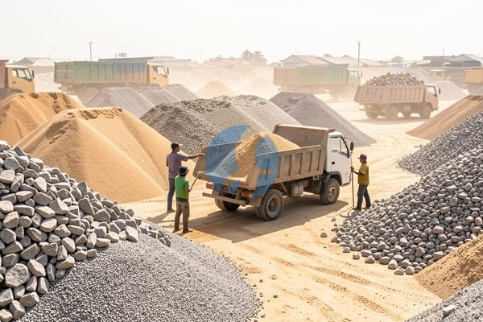

**Beli Pasir di Toko Bangunan Minimal Berapa? Jawaban untuk Pemula** - Mitra Sumber Material di mana pun berada, pernahkah Mitra menghadapi kebingungan saat menentukan berapa banyak pasir yang dibutuhkan untuk proyek bangunan? Seringkali, perkiraan yang kurang tepat bisa berujung pada pemborosan biaya karena kelebihan pembelian, atau malah menghambat kelancaran pekerjaan karena kekurangan material. Nah, Kami di Sumber Material siap membantu memastikan pesanan pasir Mitra tepat sasaran, sesuai kebutuhan proyek, dan bebas ribet.



## Pikirkan Dulu: Jenis Pasir & Volume yang Dibutuhkan

Sebelum membahas minimal pembelian, penting untuk memahami jenis pasir yang dibutuhkan. Pasir tidak hanya satu jenis, lho! Ada pasir urug, pasir pasang, pasir beton, dan lain-lain. Pemilihan jenis pasir yang tepat akan sangat memengaruhi kualitas hasil akhir proyek. Misalnya, untuk urug timbun, pasir urug adalah pilihan terbaik karena harganya lebih ekonomis. Sedangkan untuk campuran beton, pasir pasang dengan gradasi yang baik sangat diperlukan agar beton kuat dan tahan lama.

Kalau Mitra masih bingung memilih jenis pasir yang pas, jangan ragu untuk konsultasi dengan Kami. Kami akan bantu mengarahkan agar Mitra tidak salah beli. Selain jenis pasir, volume juga krusial. Volume yang dibutuhkan tergantung pada skala proyek. Untuk proyek kecil seperti renovasi kamar mandi, mungkin hanya perlu beberapa rit (satuan pengiriman pasir). Tapi untuk proyek besar seperti pembangunan rumah, kebutuhan pasir bisa mencapai puluhan bahkan ratusan meter kubik. Jangan tanyakan harga satuan dulu sebelum memperkirakan volumenya, ya!

## Material Pasir Terbaik dari Sumber Material: Pilihan Lengkap untuk Proyek Anda

Mitra Sumber Material bisa mendapatkan berbagai jenis pasir berkualitas di sini. Kami menyediakan:

- **Pasir Urug:** Cocok untuk mengisi lahan, membuat pondasi, atau meratakan permukaan tanah. Tersedia dalam berbagai ukuran dan mutu.
- **Pasir Pasang:** Ideal untuk campuran semen, plester, atau acian. Memiliki tekstur halus dan bersih.
- **Pasir Beton:** Dirancang khusus untuk campuran beton berkualitas tinggi. Memenuhi standar SNI.
- **Pasir Cor:** Untuk kebutuhan cor semen, dengan kekuatan dan daya tahan yang terjamin.

Kami juga menyediakan jasa pengiriman pasir langsung ke lokasi proyek Mitra di wilayah Jabodetabek dan sekitarnya. Mau pesan satu rit atau ratusan rit? Kami siap melayani! Untuk informasi lebih lanjut mengenai jenis pasir yang tersedia dan harga terbaru, silakan langsung hubungi Kami.

## Kenapa Pesan Pasir di Sumber Material? Bebas Salah Beli, Pengiriman Tepat Waktu

Nah, ini yang penting nih. Kenapa Mitra harus pesan pasir di Sumber Material? Pertama, Kami bantu memastikan Mitra tidak salah beli. Tim Kami akan memberikan rekomendasi jenis pasir yang paling sesuai dengan kebutuhan proyek Mitra. Kedua, Kami menjamin kualitas pasir yang Kami jual. Semua pasir yang Kami sediakan telah melalui proses seleksi yang ketat. Ketiga, Kami memberikan layanan pengiriman yang cepat dan tepat waktu. Kami mengerti betapa pentingnya ketepatan waktu dalam sebuah proyek konstruksi. Keempat, Kami berlokasi strategis di Bogor, Jakarta, Bekasi, Karawang, Tangerang, dan Cikarang, memudahkan pengiriman ke berbagai wilayah.

Dengan memesan melalui Kami, Mitra bisa fokus mengerjakan proyek tanpa perlu repot memikirkan urusan pasir. Kami akan handle semuanya!

## Cara Mudah Pesan Pasir di Sumber Material

Pesan pasir di Sumber Material itu gampang banget! Cukup hubungi Kami lewat tombol **WhatsApp** atau **Telepon** yang ada di bawah halaman ini. Beritahu Kami jenis pasir yang dibutuhkan, volume, dan lokasi proyek. Tim Kami akan segera memberikan penawaran harga terbaik dan mengatur jadwal pengiriman. Atau, kirim kebutuhan dan lokasi proyek Mitra lewat WhatsApp, Kami bantu hitungkan berapa banyak yang dibutuhkan!

## Hitung Kebutuhan Pasir: Contoh Kasus Proyek Rumah Minimalis

Seringkali Mitra bertanya-tanya, “Berapa banyak pasir yang saya butuhkan untuk bangunan rumah?” Nah, supaya lebih jelas, yuk kita lihat contoh perhitungan kebutuhan pasir untuk proyek rumah minimalis tipe 45. Anggap saja Mitra akan membuat pondasi batu kali dengan volume 8 meter kubik. Untuk campuran semen pondasi, kita membutuhkan perbandingan 1:3 (semen:pasir). Artinya, untuk setiap 1 bagian semen, dibutuhkan 3 bagian pasir.

Jadi, volume pasir yang dibutuhkan untuk pondasi adalah 3 x 8 meter kubik = 24 meter kubik. Kemudian, untuk plester dinding dengan luas 100 meter persegi dan ketebalan 1,5 cm (0,015 meter), kita membutuhkan volume plester 100 m² x 0,015 m = 1,5 meter kubik. Asumsikan campuran plester 1:2 (semen:pasir), maka volume pasir untuk plester adalah 2 x 1,5 meter kubik = 3 meter kubik.

## Pasir Pasang vs. Pasir Beton: Mana yang Tepat untuk Kebutuhan Anda?

Banyak Mitra yang bertanya, “Apa bedanya pasir pasang dan pasir beton?” Nah, perbedaannya terletak pada ukuran butiran dan kandungan lumpur. Pasir pasang memiliki butiran yang lebih halus dan kandungan lumpur lebih tinggi. Pasir beton memiliki butiran yang lebih kasar dan kandungan lumpur lebih rendah.

### Pasir Pasang: Ideal untuk Plester, Acian, dan Bata

Pasir pasang sangat cocok digunakan untuk pekerjaan plester, acian, dan pemasangan bata. Kandungan lumpurnya membantu semen menempel lebih kuat pada dinding. Namun, pasir pasang kurang ideal untuk pekerjaan beton karena kandungan lumpurnya dapat mengurangi kekuatan beton.

### Pasir Beton: Kuat untuk Fondasi, Kolom, dan Balok

Pasir beton lebih cocok digunakan untuk pekerjaan beton seperti fondasi, kolom, balok, dan lantai. Ukuran butiran yang lebih kasar memberikan kekuatan yang lebih tinggi pada beton. Pastikan pasir beton yang Anda gunakan memenuhi standar SNI agar kualitas beton terjamin.

### Kesalahan Umum Saat Memilih Pasir

Kesalahan umum yang sering terjadi adalah menggunakan pasir yang tidak sesuai dengan jenis pekerjaannya. Misalnya, menggunakan pasir beton untuk plester atau pasir pasang untuk beton. Hal ini dapat menyebabkan hasil akhir yang kurang memuaskan dan bahkan membahayakan keamanan bangunan. Jangan ragu tanya Kami, ya!

## Pertanyaan Umum Seputar Pembelian Pasir

Biar makin jelas, ini beberapa pertanyaan yang sering Kami terima:

### Berapa Minimal Pembelian Pasir di Sumber Material?

Minimal pembelian pasir di Sumber Material tergantung jenis pasir dan lokasi pengiriman. Untuk pengiriman ke wilayah Jabodetabek, minimal 1 rit (sekitar 6-8 meter kubik). Tapi Kami fleksibel, kok! Untuk pembelian dalam jumlah kecil, bisa kita usahakan.

### Apakah Sumber Material Melayani Pengiriman Pasir ke Luar Jabodetabek?

Untuk pengiriman ke luar Jabodetabek, Kami sarankan Mitra menghubungi Kami terlebih dahulu untuk menanyakan ketersediaan dan biaya pengiriman. Jangkauan pengiriman Kami terus berkembang, jadi jangan sungkan untuk bertanya!

### Bagaimana Cara Memastikan Kualitas Pasir yang Saya Terima?

Kami menjamin kualitas pasir yang Kami jual. Semua pasir telah melalui proses seleksi yang ketat dan memenuhi standar SNI. Jika Mitra ragu, Kami sarankan untuk memeriksa sampel pasir sebelum melakukan pemesanan dalam jumlah besar.

### Apa Saja yang Perlu Diperhatikan Saat Menerima Pengiriman Pasir?

Pastikan volume pasir yang diterima sesuai dengan pesanan. Periksa juga kondisi pasir, apakah bersih dari kotoran dan sampah. Jika ada ketidaksesuaian, segera hubungi Kami.

## Masalah Umum & Solusi: Jangan Sampai Salah Hitung Kebutuhan Pasir

Seringkali, Mitra Sumber Material mengalami kesulitan saat memperkirakan kebutuhan pasir untuk proyek. Kesalahan umum adalah terlalu optimis dengan volume yang dibutuhkan, sehingga akhirnya kekurangan di tengah pekerjaan. Atau, justru terlalu berlebihan, yang mengakibatkan pemborosan biaya dan lahan penyimpanan. Nah, untuk menghindari hal ini, sebaiknya selalu bulatkan ke atas saat menghitung kebutuhan. Lebih baik lebih sedikit daripada kurang, kan? Kami juga siap bantu hitungkan secara gratis, kok!

## Tanya Jawab Seputar Pembelian Pasir di Sumber Material

### Berapa Lama Waktu Pengiriman Pasir?

Waktu pengiriman pasir tergantung jarak dan kondisi lalu lintas. Biasanya, pengiriman di wilayah Jabodetabek membutuhkan waktu 1-3 hari kerja. Kami akan informasikan estimasi waktu pengiriman yang lebih akurat saat Mitra melakukan pemesanan.

### Apakah Pasir yang Dijual Sumber Material Sudah Diayak?

Sebagian besar pasir yang Kami jual sudah diayak untuk menghilangkan kotoran dan kerikil besar. Namun, untuk jenis pasir tertentu, mungkin masih terdapat sedikit kotoran. Kami sarankan untuk memeriksa kembali pasir sebelum digunakan.

### Bagaimana Jika Pasir yang Diterima Tidak Sesuai Pesanan?

Jangan khawatir! Jika Mitra menerima pasir yang tidak sesuai dengan pesanan (misalnya jenisnya salah atau volumenya kurang), segera hubungi Kami. Kami akan segera melakukan penggantian atau memberikan solusi terbaik.

### Apakah Bisa Request Jadwal Pengiriman?

Tentu saja! Kami akan usahakan untuk menyesuaikan jadwal pengiriman dengan kebutuhan Mitra. Silakan informasikan tanggal dan jam pengiriman yang diinginkan saat melakukan pemesanan.

Siap pesan atau masih mau konsultasi dulu? Tombol **WhatsApp** dan **Telepon** di bawah halaman ini langsung terhubung dengan tim Kami.
