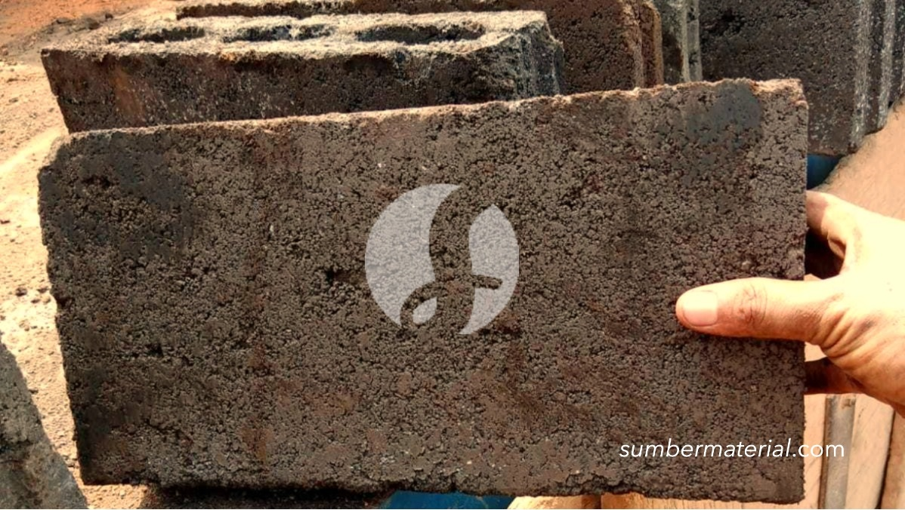

**Berapa Harga Batako per Biji? Penjelasan dan Contohnya** - Mitra Sumber Material di mana pun berada, seringkali pertanyaan ini muncul di awal perencanaan pembangunan. Kami siap membantu Anda menyiapkan material batako berkualitas untuk proyek Anda, mulai dari renovasi kecil hingga pembangunan besar.



Banyak yang bertanya-tanya, berapa sih harga batako per biji? Jawabannya tidak sesederhana angka tunggal. Harga batako sangat bervariasi tergantung ukuran, jenis, kualitas, dan tentu saja, lokasi Anda. Nah, artikel ini akan membahas tuntas mengenai harga batako, faktor-faktor yang mempengaruhinya, serta bagaimana Kami di Sumber Material bisa membantu Anda mendapatkan penawaran terbaik.

## Pilihan Batako: Ukuran dan Jenis yang Perlu Anda Pertimbangkan

Sebelum membahas harga, penting untuk memahami pilihan batako yang tersedia. Ada beberapa jenis batako yang umum digunakan, masing-masing dengan kelebihan dan kekurangannya. Ukuran batako juga bervariasi, mempengaruhi harga per biji dan kebutuhan proyek Anda. Mitra Sumber Material, kami menyediakan berbagai pilihan batako untuk memenuhi kebutuhan spesifik Anda.

Ada batako standar, batako hollow (berongga), batako press, dan batako ringan. Batako hollow sering dipilih karena lebih ringan dan hemat material, namun batako press cenderung lebih kuat dan tahan lama. Ukuran standar batako biasanya 40x20x10 cm, namun ada juga ukuran lain yang tersedia. Pemilihan jenis dan ukuran batako akan berdampak langsung pada harga yang Anda dapatkan. Untuk proyek besar, batako hollow bisa jadi pilihan hemat, sementara untuk struktur yang membutuhkan kekuatan ekstra, batako press mungkin lebih sesuai. Jangan ragu untuk [tanyakan harga lewat WhatsApp](https://api.whatsapp.com/send?phone=6285776786091&text=*Halo%20sumbermaterial.com*%20%3A) untuk konsultasi gratis!

## Batako Berkualitas dari Sumber Material: Solusi untuk Setiap Proyek

Kami di Sumber Material menyediakan berbagai jenis batako dengan kualitas terjamin. Berikut beberapa pilihan yang bisa Anda pertimbangkan:

- **Batako Standar:** Cocok untuk dinding pembatas, garasi, atau bangunan non-struktural. Harga per biji mulai dari Rp 3.000 – Rp 5.000 (harga ini bersifat estimasi dan dapat berubah sewaktu-waktu — hubungi Kami untuk penawaran terbaru dan paling akurat sesuai kebutuhan proyek Mitra).
- **Batako Hollow:** Pilihan ekonomis untuk dinding luar atau dalam yang tidak memerlukan kekuatan struktural tinggi. Harga per biji mulai dari Rp 4.000 – Rp 6.000 (harga ini bersifat estimasi dan dapat berubah sewaktu-waktu — hubungi Kami untuk penawaran terbaru dan paling akurat sesuai kebutuhan proyek Mitra).
- **Batako Press:** Lebih kuat dan tahan lama, ideal untuk dinding struktural atau bangunan bertingkat. Harga per biji mulai dari Rp 6.000 – Rp 8.000 (harga ini bersifat estimasi dan dapat berubah sewaktu-waktu — hubungi Kami untuk penawaran terbaru dan paling akurat sesuai kebutuhan proyek Mitra).
- **Batako Ringan (Hebel):** Ringan, mudah dipasang, dan memiliki insulasi termal yang baik. Harga per biji mulai dari Rp 8.000 – Rp 12.000 (harga ini bersifat estimasi dan dapat berubah sewaktu-waktu — hubungi Kami untuk penawaran terbaru dan paling akurat sesuai kebutuhan proyek Mitra).

Kami juga menyediakan batako dengan ukuran khusus sesuai permintaan. Butuh batako untuk proyek renovasi kecil di rumah? Atau mungkin untuk pembangunan ruko komersial? Kami siap melayani kebutuhan Anda, apapun skalanya.

## Keuntungan Memesan Batako di Sumber Material: Hemat Waktu dan Biaya

Mengapa memilih Sumber Material untuk kebutuhan batako Anda? Pertama, Kami menawarkan harga yang kompetitif dan transparan. Kedua, Kami menyediakan berbagai pilihan batako dengan kualitas terjamin. Ketiga, Kami melayani pengiriman ke seluruh wilayah Jabodetabek dan sekitarnya. Keempat, Kami berlokasi strategis di Bogor, Jakarta, Bekasi, Karawang, Tangerang, dan Cikarang, memudahkan proses pengiriman dan pengambilan material.

Mitra Sumber Material, dengan memesan batako dari Kami, Anda tidak perlu repot mencari supplier lain atau khawatir dengan kualitas produk. Kami memastikan batako yang Anda terima sesuai dengan standar SNI dan siap digunakan untuk proyek Anda. Kami juga menyediakan jasa konsultasi gratis untuk membantu Anda memilih jenis batako yang paling tepat sesuai dengan kebutuhan dan anggaran Anda. Jangan buang waktu Anda untuk membandingkan harga di berbagai toko bangunan — serahkan semuanya kepada Kami!

## Pesan Batako Sekarang: Mudah, Cepat, dan Terpercaya

Memesan batako di Sumber Material sangat mudah. Anda bisa langsung menghubungi Kami melalui tombol **WhatsApp** atau **Telepon** yang tersedia di halaman ini. Kirimkan kebutuhan batako Anda (jenis, ukuran, jumlah) serta lokasi proyek Anda, dan Kami akan segera memberikan penawaran harga terbaik. Proses pemesanan cepat dan terpercaya.

Kami berkomitmen untuk memberikan pelayanan terbaik kepada setiap Mitra Sumber Material. Kami akan membantu Anda menghitung kebutuhan batako secara akurat, memastikan pengiriman tepat waktu, dan memberikan dukungan teknis jika diperlukan. Jadi, tunggu apa lagi? Segera hubungi Kami sekarang juga dan mulai proyek Anda dengan batako berkualitas dari Sumber Material.

## Menghitung Kebutuhan Batako: Contoh Kasus dan Tips Akurat

Mitra Sumber Material, seringkali kesalahan dalam menghitung kebutuhan batako menyebabkan pemborosan material dan biaya yang membengkak. Nah, mari kita lihat contoh perhitungan sederhana untuk proyek dinding rumah dengan dimensi 4 meter panjang, 3 meter tinggi, dan ketebalan dinding 15 cm.

Perhitungan ini belum memperhitungkan kebutuhan semen dan pasir untuk perekat. Penting untuk berkonsultasi dengan tukang bangunan atau Kami di Sumber Material untuk mendapatkan perhitungan yang lebih akurat sesuai dengan desain dan kondisi proyek Anda.

## Pertanyaan Umum Tentang Batako: Panduan Singkat

Banyak Mitra Sumber Material yang memiliki pertanyaan seputar batako. Berikut beberapa pertanyaan yang sering muncul, beserta jawabannya:

### Berapa Daya Tahan Batako Terhadap Cuaca?

Batako cukup tahan terhadap cuaca, terutama jika dilapisi dengan plester atau semen. Namun, batako yang terpapar langsung ke hujan dan panas matahari dalam jangka waktu lama dapat mengalami kerusakan seperti retak atau lumut.

### Apakah Batako Mudah Pecah?

Batako cukup kuat, tetapi tetap bisa pecah jika terkena benturan keras. Penanganan yang hati-hati saat pengiriman dan pemasangan sangat penting. Kami di Sumber Material selalu mengemas batako dengan aman untuk meminimalkan risiko kerusakan.

### Bagaimana Cara Membedakan Batako Berkualitas Baik?

Perhatikan tekstur batako. Batako berkualitas baik memiliki tekstur yang padat dan seragam, tanpa retak atau lubang yang berlebihan. Dengarkan juga suara batako saat diketuk — suara yang nyaring menandakan kualitas yang baik.

### Apakah Batako Bisa Digunakan untuk Lantai?

Secara umum, batako tidak direkomendasikan untuk lantai karena kurang kuat menahan beban. Batako lebih cocok digunakan untuk dinding dan struktur bangunan lainnya.

## Tips Memilih Batako yang Tepat untuk Proyek Anda

Mitra Sumber Material, memilih batako yang tepat sangat penting untuk keberhasilan proyek Anda. Pertimbangkan beberapa faktor berikut:

- **Jenis bangunan:** Untuk bangunan permanen yang membutuhkan kekuatan struktural, batako press atau hebel adalah pilihan terbaik. Untuk bangunan sementara atau dinding pembatas, batako standar atau hollow bisa menjadi solusi ekonomis.
- **Kondisi tanah:** Jika tanah di lokasi proyek Anda kurang stabil, sebaiknya gunakan batako yang lebih berat dan kuat untuk menahan beban bangunan.
- **Iklim:** Di daerah dengan curah hujan tinggi, pilih batako yang tahan air dan tidak mudah lapuk.
- **Anggaran:** Sesuaikan pilihan batako dengan anggaran yang Anda miliki. Batako hollow biasanya lebih murah daripada batako press atau hebel.

## Perbandingan Batako Press vs. Batako Hollow: Mana yang Lebih Ekonomis?

Mitra Sumber Material, seringkali muncul pertanyaan: batako press atau batako hollow, mana yang lebih hemat biaya? Secara umum, batako hollow lebih murah per biji. Namun, perlu diingat bahwa batako press lebih kuat dan membutuhkan lebih sedikit material perekat (semen dan pasir) karena ukurannya lebih besar dan lebih padat. Dalam jangka panjang, penghematan material perekat ini bisa menutupi selisih harga awal. Untuk proyek yang membutuhkan kekuatan struktural tinggi, batako press justru bisa menjadi pilihan yang lebih ekonomis karena mengurangi kebutuhan tulangan besi dan biaya tenaga kerja.

## Pertanyaan Lain Seputar Batako yang Sering Kami Terima

### Apakah Batako Perlu Direndam Sebelum Dipasang?

Sebaiknya rendam batako dalam air selama beberapa menit sebelum dipasang. Hal ini membantu mengurangi daya serap air batako, sehingga perekat dapat menempel lebih kuat dan mencegah retak-retak pada dinding.

### Bagaimana Cara Menyimpan Batako Agar Tidak Rusak?

Simpan batako di tempat yang kering dan rata. Tutupi dengan terpal atau plastik untuk melindungi dari hujan dan panas matahari langsung. Hindari menumpuk batako terlalu tinggi agar tidak mudah roboh.

### Apakah Batako Bisa Dipotong?

Ya, batako bisa dipotong menggunakan gergaji mesin khusus batako. Namun, proses pemotongan batako membutuhkan keahlian dan alat yang tepat. Kami sarankan untuk menggunakan jasa tukang profesional untuk pekerjaan ini.

### Bagaimana Cara Menghitung Jumlah Semen yang Dibutuhkan?

Jumlah semen yang dibutuhkan tergantung pada jenis batako, ukuran dinding, dan rasio campuran. Secara umum, rasio campuran semen dan pasir yang umum digunakan adalah 1:4 atau 1:5. Konsultasikan dengan tukang bangunan atau Kami untuk mendapatkan perhitungan yang lebih akurat.

Mau tahu harga terbaru untuk kebutuhan proyek Mitra Sumber Material? Klik tombol **WhatsApp** atau **Telepon** di bawah, kirim kebutuhan dan lokasi proyek, Kami bantu hitungkan.
