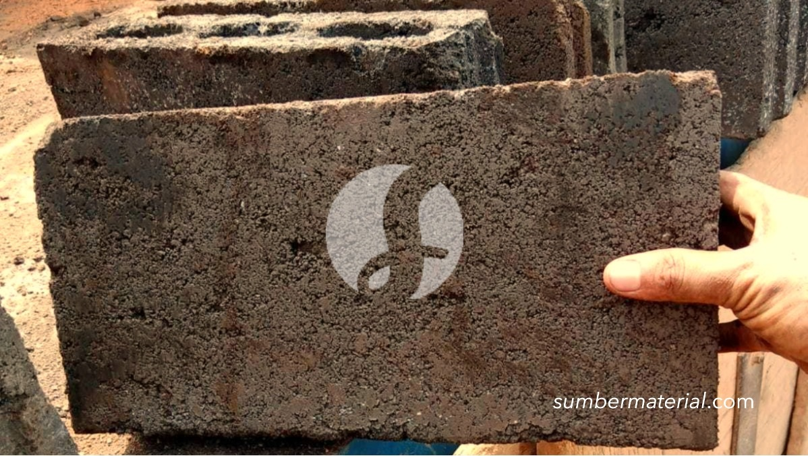

**Cara Memilih Berat Batako per Biji yang Sesuai Kebutuhan** - Mitra Sumber Material, seringkali kita melihat kesalahan dalam memperkirakan kebutuhan batako untuk sebuah proyek bangunan. Banyak yang belum memahami betul bagaimana cara menghitung kebutuhan batako yang akurat, termasuk mengetahui berat per bijinya. Nah, daripada buang waktu dan biaya karena salah beli, Kami bantu Anda memahami lebih dalam tentang berat batako per biji dan bagaimana memilih jenis yang paling pas untuk proyek Anda.



## Kenapa Berat Batako Per Biji Penting?

Mitra, mengetahui berat batako per biji bukan sekadar informasi teknis. Ini krusial karena berpengaruh langsung pada perhitungan biaya transportasi, biaya tenaga kerja pemasangan, dan tentu saja, kekuatan struktur bangunan Anda. Bayangkan jika Anda salah memperkirakan berat total batako yang dibutuhkan – bisa jadi biaya angkut membengkak atau fondasi bangunan kurang kuat menahan beban. Kami memahami betul tantangan ini, dan siap membantu Anda menyiapkan material batako yang tepat dengan perhitungan akurat.

### Memahami Variasi Berat Batako dan Ukurannya

Berat batako per biji sangat bervariasi, tergantung pada ukuran dan jenis batako. Secara umum, ada beberapa ukuran batako yang umum digunakan di Indonesia:

<table class="table">
  <caption>Ukuran Batako Umum</caption>
  <thead>
    <tr><th>Ukuran (P x L x T) cm</th><th>Berat Per Biji (kg)</th><th>Kegunaan Umum</th></tr>
  </thead>
  <tbody>
    <tr><td>39 x 19 x 10</td><td>14-16</td><td>Dinding, pagar rumah</td></tr>
    <tr><td>39 x 19 x 20</td><td>28-32</td><td>Dinding rumah 2 lantai</td></tr>
    <tr><td>39 x 19 x 30</td><td>42-48</td><td>Dinding rumah bertingkat</td></tr>
  </tbody>
</table>

Perhatikan bahwa angka berat di atas adalah estimasi. Berat sebenarnya bisa sedikit berbeda tergantung pada komposisi campuran semen dan pasir yang digunakan oleh produsen. Nah, untuk mendapatkan angka yang lebih presisi sesuai kebutuhan proyek Anda, jangan ragu untuk [tanyakan harga lewat WhatsApp](https://api.whatsapp.com/send?phone=6285776786091&text=*Halo%20sumbermaterial.com*%20%3A) kepada tim Kami.

### Material Batako Berkualitas dari Sumber Material

Kami di Sumber Material menyediakan berbagai jenis batako dengan ukuran dan mutu yang sesuai standar SNI. Selain ukuran standar di atas, Kami juga menyediakan batako custom sesuai permintaan. Material batako Kami terbuat dari campuran semen dan pasir berkualitas tinggi, serta diproses dengan teknologi modern untuk menghasilkan produk yang kuat, tahan lama, dan presisi.

Berikut beberapa pilihan batako yang tersedia di Sumber Material:

- **Batako Standar:** Cocok untuk dinding rumah sederhana, pagar, atau bangunan non-struktural.
- **Batako Hollow:** Ringan dan memiliki lubang-lubang yang membantu mengurangi beban bangunan. Ideal untuk dinding rumah 1-2 lantai.
- **Batako Jumbo:** Ukurannya lebih besar dari batako standar, sehingga mempercepat proses pemasangan. Cocok untuk proyek-proyek besar seperti gudang atau pabrik.
- **Batako Press:** Dibuat dengan mesin press, menghasilkan batako yang lebih padat dan kuat. Ideal untuk dinding rumah bertingkat atau bangunan yang membutuhkan kekuatan ekstra.

Untuk mengetahui lebih lanjut tentang spesifikasi dan ketersediaan stok batako, Anda bisa tanyakan harga lewat WhatsApp.

### Mengapa Memesan Batako di Sumber Material?

Mitra Sumber Material, kenapa Anda harus memilih Kami sebagai supplier batako Anda? Pertama, Kami memberikan konsultasi GRATIS untuk membantu Anda memilih jenis dan ukuran batako yang paling tepat sesuai kebutuhan proyek. Kedua, Kami menjamin kualitas produk yang sesuai standar SNI. Ketiga, Kami melayani pengiriman ke seluruh wilayah Jabodetabek dan sekitarnya dengan cepat dan aman. Keempat, Kami berlokasi strategis di Bogor, Jakarta, Bekasi, Karawang, Tangerang, dan Cikarang, sehingga memudahkan proses pengiriman.

Kami memahami betul bahwa waktu adalah uang. Itulah mengapa Kami berkomitmen untuk memberikan pelayanan yang cepat, efisien, dan profesional. Dengan Kami, Anda tidak perlu khawatir lagi tentang kualitas material, proses pengiriman, atau perhitungan kebutuhan batako. Kami akan membantu Anda mewujudkan proyek impian Anda dengan lancar dan sukses.

### Pesan Batako Sekarang, Bangun Impian Anda!

Jangan tunda lagi! Bangun impian Anda dengan batako berkualitas dari Sumber Material. Proses pemesanan sangat mudah: cukup hubungi tim Kami melalui tombol **WhatsApp** atau **Telepon** di bawah, dan sampaikan kebutuhan dan lokasi proyek Anda. Tim Kami akan segera menyiapkan penawaran terbaik untuk Anda.

## Hitung Kebutuhan Batako: Contoh Praktis dan Tips Akurat

Mitra, setelah memahami variasi berat batako per biji, langkah selanjutnya adalah menghitung kebutuhan batako secara akurat untuk proyek Anda. Ini penting untuk menghindari sisa material yang terbuang percuma atau kekurangan material di tengah jalan. Kami akan berikan contoh perhitungan sederhana untuk membantu Anda.

Misalkan Anda akan membangun dinding dengan ukuran panjang 10 meter dan tinggi 3 meter. Dinding tersebut akan menggunakan batako ukuran 39 x 19 x 10 cm. Pertama, hitung luas dinding: 10 m x 3 m = 30 m². Kemudian, hitung luas satu buah batako: 0,39 m x 0,19 m = 0,0741 m². Selanjutnya, bagi luas dinding dengan luas satu batako: 30 m² / 0,0741 m² = 405,4 buah. Bulatkan ke atas menjadi 406 buah batako.

## Pertanyaan Umum Tentang Berat dan Pemilihan Batako

Seringkali, Mitra Sumber Material memiliki pertanyaan seputar berat dan pemilihan batako. Berikut beberapa pertanyaan umum dan jawabannya:

### Berapa Berat Maksimal Batako yang Bisa Diangkut Satu Orang?

Berat maksimal batako yang bisa diangkut satu orang tergantung pada kondisi fisik dan jarak tempuh. Namun, sebagai pedoman umum, satu orang sebaiknya tidak mengangkat batako lebih dari 20-25 kg per sekali angkut. Hal ini untuk menghindari cedera punggung atau kelelahan berlebihan.

### Apakah Batako yang Lebih Berat Selalu Lebih Baik?

Tidak selalu. Berat batako bukan satu-satunya faktor penentu kualitas. Kualitas batako juga dipengaruhi oleh komposisi campuran semen dan pasir, proses pembuatan, serta tingkat kekeringan. Batako yang lebih berat bisa jadi hanya karena kandungan airnya lebih tinggi, bukan karena kualitas materialnya lebih baik.

### Bagaimana Cara Memastikan Batako yang Saya Beli Berkualitas?

Periksa visual batako sebelum membeli. Pastikan batako tidak retak, pecah, atau memiliki cacat lainnya. Ketuk batako dengan palu – suara yang dihasilkan harus nyaring dan tidak berongga. Jika memungkinkan, lakukan uji kekuatan dengan menekan batako secara perlahan. Batako berkualitas baik akan sulit pecah atau hancur.

### Apa Perbedaan Batako Press dan Batako Cetak?

Batako press dibuat dengan mesin press yang menghasilkan batako lebih padat dan kuat. Batako cetak dibuat dengan cara dicetak dalam cetakan, sehingga memiliki pori-pori lebih banyak dan lebih ringan. Secara umum, batako press lebih cocok untuk bangunan bertingkat, sedangkan batako cetak cocok untuk bangunan satu atau dua lantai.

## Tips Memilih Batako yang Tepat untuk Proyek Anda

Mitra, pemilihan batako yang tepat sangat penting untuk memastikan kekuatan dan keberlanjutan bangunan Anda. Berikut beberapa tips yang bisa Anda ikuti:

- **Perhatikan Jenis Tanah:** Jika tanah di lokasi proyek Anda kurang stabil, sebaiknya gunakan batako yang lebih berat dan kuat untuk menahan beban bangunan.
- **Pertimbangkan Iklim:** Di daerah dengan iklim lembap, pilih batako yang memiliki daya serap air rendah untuk mencegah kerusakan akibat jamur atau lumut.
- **Sesuaikan dengan Desain Bangunan:** Pilih batako dengan ukuran dan bentuk yang sesuai dengan desain bangunan Anda. Batako hollow bisa menjadi pilihan yang baik untuk menghemat material dan mengurangi beban bangunan.
- **Konsultasikan dengan Ahli:** Jika Anda ragu dalam memilih batako, jangan ragu untuk berkonsultasi dengan ahli konstruksi atau tim Kami di Sumber Material. Kami siap membantu Anda menemukan solusi terbaik untuk proyek Anda.

## Kesalahan Umum Saat Memilih Berat Batako Per Biji

Mitra, seringkali Kami temui kesalahan dalam memilih berat batako per biji yang sesuai kebutuhan. Salah satu yang paling umum adalah hanya fokus pada harga tanpa mempertimbangkan kekuatan dan daya tahan material. Padahal, batako yang terlalu ringan atau kurang padat bisa mengurangi kekuatan struktur bangunan Anda. Kesalahan lainnya adalah tidak memperhitungkan biaya transportasi. Batako yang lebih berat tentu akan membutuhkan biaya angkut yang lebih besar. Nah, untuk menghindari hal ini, sebaiknya konsultasikan kebutuhan Anda dengan Kami sebelum membuat keputusan.

## Tanya Jawab Seputar Berat dan Pemilihan Batako

### Apakah Batako Perlu Direndam Sebelum Dipasang?

Mitra, sebagian tukang bangunan menyarankan merendam batako sebelum dipasang untuk meningkatkan kekuatannya. Namun, ini tidak selalu diperlukan. Jika batako sudah berkualitas baik dan diproses dengan benar, Anda bisa langsung memasangnya. Merendam batako justru bisa mengurangi kekuatannya jika dilakukan terlalu lama.

### Bagaimana Jika Berat Batako Bervariasi dalam Satu Palet?

Jika Anda menemukan berat batako bervariasi dalam satu palet, segera hubungi supplier. Perbedaan berat yang signifikan bisa mengindikasikan kualitas batako yang tidak konsisten. Kami di Sumber Material selalu memastikan kualitas batako Kami seragam sebelum dikirim.

### Apakah Batako Cocok untuk Area Lembap?

Batako bisa digunakan di area lembap, namun pilih jenis yang memiliki daya serap air rendah. Batako press umumnya lebih tahan terhadap kelembapan dibandingkan batako cetak. Pastikan juga dinding dilapisi dengan pelapis anti air untuk mencegah kerusakan akibat jamur atau lumut.

Kirim kebutuhan dan lokasi proyek Mitra Sumber Material lewat tombol **WhatsApp** atau **Telepon** di bawah, tim Kami bantu siapkan penawarannya.
