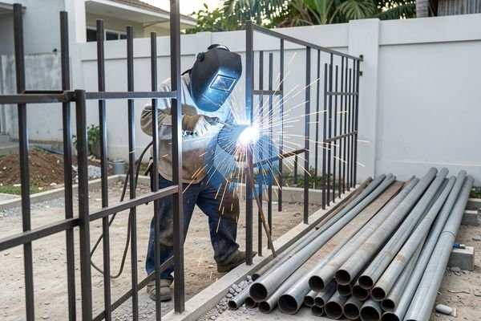

**Biaya Las Pagar Patah dan Cara Menghitung Kebutuhan Material** - Mitra Sumber Material di mana pun berada, pernahkah Anda mengalami pagar besi patah atau rusak? Kondisi ini bukan hanya mengganggu estetika rumah atau bangunan, tapi juga bisa membahayakan keamanan. Banyak pemilik properti langsung panik memikirkan biaya perbaikan, terutama biaya las pagar patah. Nah, Kami di Sumber Material siap membantu Anda mengatasi masalah ini tanpa perlu khawatir soal biaya membengkak.



Seringkali, Mitra Sumber Material mencoba memperbaikinya sendiri, tapi hasilnya malah memperburuk kerusakan. Atau, malah tergiur harga murah dari tukang las yang kurang profesional, ujung-ujungnya kualitas las tidak terjamin dan pagarnya cepat rusak lagi. Itu sebabnya, penting untuk mempercayakan perbaikan pagar pada ahlinya.

## Mempertimbangkan Kerusakan dan Material Pagar Sebelum Menghitung Biaya

Sebelum membahas angka, memahami jenis kerusakan dan material pagar sangat penting. Apakah pagarnya patah total, hanya bengkok, atau ada bagian yang berkarat parah? Material besi tempa tentu membutuhkan penanganan yang berbeda dibandingkan besi hollow. Pagar aluminium juga punya metode perbaikan sendiri. Semakin kompleks kerusakannya dan semakin mahal material pagarnya, tentu biayanya akan lebih tinggi.

Mitra Sumber Material, Kami memahami bahwa setiap proyek punya kebutuhan unik. Karena itu, Kami menawarkan solusi yang disesuaikan dengan kondisi pagar Anda. Jangan khawatir, Kami akan memberikan estimasi biaya yang transparan dan jelas sebelum pekerjaan dimulai. Untuk material pengganti (jika diperlukan), Kami menyediakan berbagai pilihan besi, baja ringan, dan material konstruksi lainnya dengan kualitas terjamin.

## Jasa Las Pagar Patah Profesional dari Sumber Material: Bebas Repot, Hasil Kuat

Sumber Material tidak hanya menyediakan material bangunan, tapi juga jasa las pagar patah yang profesional. Kami menggunakan tenaga ahli las bersertifikasi yang berpengalaman menangani berbagai jenis pagar, mulai dari pagar rumah minimalis, pagar industrial, hingga pagar mewah dengan desain rumit. Kami menggunakan teknik pengelasan yang tepat untuk memastikan pagar Anda kembali kokoh dan tahan lama.

Untuk material, Kami menyediakan:

- **Besi Hollow:** Pilihan ekonomis untuk pagar rumah sederhana. Tersedia berbagai ukuran (20x40, 40x60, dll.) dan ketebalan (0.9mm, 1.2mm, dst.).
- **Besi Tempa:** Ideal untuk pagar dengan desain artistik dan kuat. Kami menyediakan besi tempa berkualitas tinggi dengan berbagai motif.
- **Baja Ringan:** Solusi ringan dan tahan karat, cocok untuk pagar di lingkungan berair. Tersedia berbagai profil (C, R, dll.) dengan lapisan galvanis.
- **Wiremesh:** Pilihan praktis untuk pagar perimeter atau pengaman tambahan. Kami menyediakan wiremesh dengan berbagai ukuran lubang dan ketebalan kawat.

## Mengapa Memilih Sumber Material untuk Jasa Las Pagar Patah? Pengiriman Langsung ke Lokasi Proyek!

Banyak penyedia jasa las pagar di Jabodetabek, tapi Kami punya keunggulan yang membedakan Kami dari yang lain. Pertama, Kami menawarkan kenyamanan pengiriman langsung ke lokasi proyek Anda di wilayah Jabodetabek dan sekitarnya. Anda tidak perlu repot mencari tukang las atau mengangkut material sendiri. Kedua, Kami memberikan garansi untuk setiap pekerjaan las yang Kami lakukan. Ketiga, Kami selalu mengutamakan kualitas dan kepuasan pelanggan.

Kami berlokasi di Bogor, Jakarta, Bekasi, Karawang, Tangerang, dan Cikarang, sehingga Kami bisa memberikan respon cepat dan pelayanan yang prima. Kami juga menyediakan layanan konsultasi gratis untuk membantu Anda menentukan solusi perbaikan yang paling tepat dan hemat biaya. Jangan ragu untuk bertanya, Kami siap membantu!

## Mudah dan Cepat: Cara Memesan Jasa Las Pagar Patah dari Sumber Material

Memesan jasa las pagar patah dari Kami sangat mudah. Cukup kirimkan foto atau deskripsi kerusakan pagar Anda melalui tombol **WhatsApp** atau **Telepon** di bawah halaman ini. Tim Kami akan segera menghubungi Anda untuk memberikan estimasi biaya dan menjadwalkan survei (jika diperlukan). Setelah deal, Kami akan mengirimkan tenaga ahli las dan material yang dibutuhkan langsung ke lokasi proyek Anda.

## Memahami Jenis-Jenis Las Pagar dan Pengaruhnya Terhadap Biaya

Mitra Sumber Material, biaya las pagar patah tidak hanya ditentukan oleh tingkat kerusakan. Jenis las yang digunakan juga punya pengaruh signifikan. Ada beberapa metode las yang umum dipakai, masing-masing dengan kelebihan dan kekurangannya. Misalnya, las SMAW (Shielded Metal Arc Welding) atau las batang adalah yang paling umum karena harganya terjangkau dan cocok untuk berbagai jenis besi. Namun, untuk besi yang lebih tebal atau membutuhkan kekuatan ekstra, las MIG/MAG (Metal Inert Gas/Metal Active Gas) bisa jadi pilihan yang lebih baik, meskipun biayanya sedikit lebih tinggi.

Nah, Kami di Sumber Material akan membantu Anda memilih jenis las yang paling sesuai dengan kebutuhan dan anggaran Anda. Kami akan mempertimbangkan jenis material pagar, tingkat kerusakannya, serta beban yang akan ditanggung pagar tersebut. Jangan ragu untuk bertanya kepada Kami tentang perbedaan masing-masing metode las dan dampaknya terhadap ketahanan pagar Anda.

### Perbandingan Kekuatan Las SMAW vs. MIG/MAG untuk Pagar

Untuk memberikan gambaran yang lebih jelas, berikut perbandingan singkat antara las SMAW dan MIG/MAG:

| Fitur | Las SMAW (Las Batang) | Las MIG/MAG |
|---|---|---|
| **Kekuatan Sambungan** | Cukup kuat, cocok untuk pagar standar | Lebih kuat, ideal untuk pagar yang membutuhkan daya tahan tinggi |
| **Kecepatan Pengerjaan** | Lebih lambat | Lebih cepat |
| **Biaya** | Lebih ekonomis | Lebih mahal |
| **Jenis Material** | Cocok untuk berbagai jenis besi | Lebih optimal untuk besi tipis dan aluminium |
| **Keahlian Tukang Las** | Membutuhkan keahlian khusus | Lebih mudah dipelajari |

Dengan memahami perbedaan ini, Mitra Sumber Material bisa membuat keputusan yang lebih tepat. Kami selalu merekomendasikan metode las yang paling sesuai dengan kebutuhan Anda, bukan hanya yang paling murah.

## Pertanyaan Umum Seputar Perbaikan Pagar Besi

Kami sering menerima pertanyaan serupa dari Mitra Sumber Material terkait perbaikan pagar besi. Berikut beberapa pertanyaan yang paling umum dan jawabannya:

### Berapa Lama Waktu yang Dibutuhkan untuk Memperbaiki Pagar Patah?

Waktu pengerjaan tergantung pada tingkat kerusakan. Untuk patah ringan, biasanya bisa selesai dalam 1–2 hari. Namun, jika patahnya parah dan membutuhkan penggantian material, mungkin memerlukan waktu 3–5 hari.

### Apakah Pagar Bisa Diperbaiki di Tempat atau Harus Dibawa ke Bengkel?

Sebagian besar perbaikan bisa dilakukan di tempat, terutama untuk patah ringan atau bengkok. Namun, untuk kerusakan yang parah atau membutuhkan peralatan khusus, mungkin perlu dibawa ke bengkel Kami.

### Bagaimana Jika Pagar Berkarat Parah? Apakah Harus Diganti?

Karat ringan bisa diatasi dengan pengamplasan dan pengecatan ulang. Namun, jika karatnya sudah terlalu parah dan merusak struktur besi, penggantian mungkin menjadi pilihan terbaik untuk memastikan keamanan dan ketahanan pagar.

### Apakah Sumber Material Melayani Perbaikan Pagar Aluminium?

Ya, Kami melayani perbaikan pagar aluminium. Kami memiliki tenaga ahli las yang berpengalaman dalam menangani berbagai jenis material, termasuk aluminium.

## Menghindari Kesalahan Umum Saat Memesan Jasa Las Pagar

Mitra Sumber Material, penting untuk menghindari kesalahan umum saat memesan jasa las pagar agar tidak rugi waktu dan uang. Salah satunya adalah tidak meminta penawaran harga dari beberapa penyedia jasa. Dengan membandingkan harga, Anda bisa mendapatkan penawaran terbaik. Kesalahan lainnya adalah tidak menanyakan pengalaman dan kualifikasi tukang las. Pastikan tukang las yang Anda pilih memiliki pengalaman yang cukup dan mampu memberikan hasil yang berkualitas.

Selain itu, jangan tergiur dengan harga yang terlalu murah. Harga yang terlalu rendah biasanya mengindikasikan kualitas pekerjaan yang kurang baik atau penggunaan material yang tidak standar. Selalu prioritaskan kualitas dan keamanan pagar Anda. Kami di Sumber Material berkomitmen untuk memberikan pelayanan yang profesional dan berkualitas dengan harga yang wajar.

Jangan tunda kebutuhan proyek Mitra Sumber Material — tanyakan harga dan ketersediaannya sekarang lewat tombol **WhatsApp** atau **Telepon** di bawah halaman ini.
