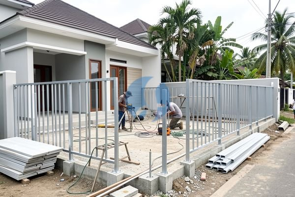

**Buat Pagar Terdekat untuk Renovasi dan Bangunan Baru** - Mitra, ## Pagar Impian, Lokasi Terdekat: Apa yang Anda Butuhkan?



Mitra, apa yang terlintas di pikiran Anda ketika membayangkan pagar ideal? Keamanan? Privasi? Atau mungkin tampilan yang estetis yang meningkatkan nilai properti? Apapun prioritas Anda, Sumber Material siap membantu mewujudkannya. Kami menyediakan berbagai material berkualitas untuk membangun pagar sesuai kebutuhan dan anggaran Anda, ditambah lagi dengan layanan pemasangan profesional. Nah, sebelum melangkah lebih jauh, mari kita bahas beberapa opsi yang bisa Anda pertimbangkan.

## Memilih Material Pagar: Bata, Batako, Hebel, atau Besi?

Pilihan material pagar sangat beragam, dan masing-masing memiliki kelebihan dan kekurangannya. Bata merah, misalnya, menawarkan kekuatan dan ketahanan yang baik, namun membutuhkan waktu pemasangan yang lebih lama. Batako adalah alternatif yang lebih ekonomis, dengan proses pemasangan yang relatif lebih cepat. Hebel, dengan bobotnya yang ringan, juga menjadi pilihan populer, terutama jika Anda menginginkan pagar yang tidak terlalu membebani struktur bangunan. Sementara itu, besi menawarkan tampilan yang modern dan minimalis, serta tingkat keamanan yang tinggi.

Untuk Mitra yang masih bingung, Kami sarankan untuk membahas kebutuhan spesifik proyek Anda dengan tim Kami. Dengan begitu, Anda akan mendapatkan rekomendasi material yang paling sesuai. [tanyakan harga terbaru](https://api.whatsapp.com/send?phone=6285776786091&text=*Halo%20sumbermaterial.com*%20%3A)

## Material Pagar Berkualitas dari Sumber Material

Kami menyediakan berbagai material untuk membangun pagar impian Anda:

- **Bata Merah:** Tersedia dalam berbagai ukuran standar (22x10x5 cm, 22x10x7 cm) dan kualitas yang terjamin. Ideal untuk pagar yang kokoh dan tahan lama.
- **Batako:** Pilihan ekonomis dengan berbagai motif dan ukuran (39x19x10 cm, 39x19x15 cm). Cocok untuk pagar rumah minimalis atau pagar pembatas lahan.
- **Hebel:** Ringan, mudah dipasang, dan memiliki insulasi termal yang baik. Tersedia dalam berbagai ketebalan (7.5 cm, 10 cm, 12.5 cm). Sangat cocok untuk wilayah dengan iklim panas.
- **Besi:** Tersedia berbagai ukuran profil (besi hollow, besi beton) dan finishing (galvanis, cat anti karat). Pilihan tepat untuk pagar yang kuat, aman, dan modern.
- **Wiremesh:** Untuk pagar yang ekonomis dan cepat pemasangan, wiremesh bisa menjadi pilihan. Kami menyediakan berbagai ukuran dan ketebalan.

Selain material, Kami juga menyediakan jasa sewa alat berat seperti molen, stamper, dan excavator untuk mempercepat proses pembangunan pagar Anda.

## Mengapa Memilih Sumber Material untuk Pagar Anda?

Mitra Sumber Material, Kami memahami bahwa membangun pagar bukan hanya tentang membeli material. Ini tentang mendapatkan solusi lengkap yang terpercaya. Inilah yang membuat Kami berbeda:

- **Konsultasi Gratis:** Kami siap membantu Anda memilih material yang tepat dan menghitung kebutuhan material secara akurat. Anda bisa bertanya tanpa harus langsung membeli.
- **Kualitas Terjamin:** Kami hanya menyediakan material dari produsen terpercaya dengan standar SNI.
- **Pengiriman Tepat Waktu:** Kami melayani pengiriman ke seluruh wilayah Jabodetabek dan sekitarnya.
- **Pengalaman dan Keahlian:** Kami telah berpengalaman dalam menyediakan material dan jasa konstruksi selama bertahun-tahun.
- **Layanan Lengkap:** Dari material hingga jasa pemasangan, Kami siap memenuhi semua kebutuhan Anda.

Kami berlokasi di Bogor, Jakarta, Bekasi, Karawang, Tangerang, dan Cikarang, sehingga memudahkan Kami untuk menjangkau lokasi proyek Anda.

## Pesan Pagar Impian Anda Sekarang!

Jangan tunda lagi! Bangun pagar impian Anda dengan Sumber Material. Proses pemesanan sangat mudah:

1.  **Hubungi Kami:** Sampaikan kebutuhan material dan lokasi proyek Anda melalui tombol **WhatsApp** atau **Telepon** di bawah.
2.  **Dapatkan Penawaran:** Tim Kami akan segera menghubungi Anda untuk memberikan penawaran harga terbaik.
3.  **Konfirmasi Pesanan:** Setelah Anda menyetujui penawaran, Kami akan segera memproses pesanan Anda.
4.  **Pengiriman & Pemasangan:** Kami akan mengirimkan material ke lokasi proyek Anda dan, jika Anda memilih jasa pemasangan, tim Kami akan segera memasangnya.

## Perhitungan Kebutuhan Material Pagar: Contoh Nyata

Mitra, seringkali yang membuat proyek pagar terasa rumit adalah menghitung kebutuhan material dengan tepat. Jangan khawatir, Kami akan berikan contoh perhitungan sederhana untuk membantu Anda memperkirakan jumlah material yang dibutuhkan. Misalkan Anda ingin membuat pagar bata merah dengan tinggi 1,5 meter dan panjang 20 meter. Asumsikan setiap bata merah berukuran 22x10x5 cm.

Tentu saja, perhitungan ini belum termasuk kebutuhan semen, pasir, dan material lainnya. Untuk perkiraan yang lebih akurat, Kami sarankan untuk berkonsultasi dengan tim Kami. Kami akan membantu Anda menghitung kebutuhan material secara detail sesuai dengan desain pagar yang Anda inginkan.

## Pagar Minimalis vs. Klasik: Perbandingan Material dan Biaya

Mitra, memilih gaya pagar juga memengaruhi jenis material dan perkiraan biayanya. Pagar minimalis cenderung menggunakan material yang lebih modern seperti besi hollow atau hebel, sementara pagar klasik biasanya menggunakan bata merah atau batako dengan desain yang lebih rumit.

Mari kita bandingkan secara sederhana:

- **Pagar Minimalis (Besi Hollow):** Pemasangan relatif cepat, tampilan modern, biaya material mungkin lebih rendah dari bata merah, tetapi membutuhkan perawatan rutin untuk mencegah karat.
- **Pagar Klasik (Bata Merah):** Lebih kokoh dan tahan lama, tampilan klasik yang elegan, biaya material dan pemasangan cenderung lebih tinggi, perawatan relatif mudah.
- **Pagar Minimalis (Hebel):** Ringan, mudah dipasang, insulasi termal baik, biaya material menengah, tampilan minimalis modern.

Penting untuk diingat bahwa biaya total akan bervariasi tergantung pada desain, tinggi pagar, panjang pagar, dan lokasi proyek Anda. Kami siap membantu Anda membandingkan opsi dan memilih yang paling sesuai dengan anggaran Anda.

## Pertanyaan Umum Seputar Pembangunan Pagar

Banyak Mitra Sumber Material yang memiliki pertanyaan serupa sebelum memulai proyek pagar. Berikut beberapa pertanyaan yang sering Kami terima:

### Berapa Tinggi Pagar yang Ideal?

Tinggi pagar ideal tergantung pada kebutuhan privasi dan keamanan Anda. Umumnya, tinggi 1,5-2 meter sudah cukup untuk memberikan privasi yang memadai dan mencegah akses yang tidak diinginkan.

### Apakah Perlu Izin untuk Membangun Pagar?

Di beberapa wilayah, mungkin diperlukan izin membangun pagar, terutama jika pagar tersebut berada di batas tanah atau melebihi ketinggian tertentu. Sebaiknya periksa peraturan bangunan setempat sebelum memulai proyek.

### Bagaimana Cara Merawat Pagar Agar Awet?

Perawatan pagar tergantung pada jenis materialnya. Pagar besi perlu dicat ulang secara berkala untuk mencegah karat, sementara pagar bata atau batako perlu dibersihkan secara rutin.

### Bisakah Saya Membangun Pagar Sendiri?

Tentu saja bisa, Mitra! Namun, jika Anda tidak memiliki pengalaman dalam konstruksi, Kami sarankan untuk menggunakan jasa profesional untuk memastikan hasil yang rapi dan kokoh. Kami menyediakan jasa pemasangan pagar profesional yang dapat membantu Anda.

## Menghindari Kesalahan Umum Saat Membangun Pagar

Mitra, membangun pagar memang terlihat sederhana, tapi ada beberapa kesalahan umum yang sering terjadi dan bisa berakibat pada hasil yang kurang memuaskan. Salah satunya adalah kurang teliti dalam mengukur keliling lahan. Pengukuran yang tidak akurat akan menyebabkan kekurangan atau kelebihan material, yang tentu saja akan menambah biaya. Kesalahan lain yang sering terjadi adalah memilih material yang tidak sesuai dengan kondisi tanah dan iklim. Misalnya, menggunakan material yang rentan terhadap retak jika tanah di sekitar pagar berpotensi bergerak.

Kami sarankan untuk selalu meminta bantuan profesional dalam pengukuran dan pemilihan material. Tim Kami siap membantu Anda memastikan bahwa pagar yang Anda bangun akan kokoh, tahan lama, dan sesuai dengan harapan Anda.

## Pertanyaan Lebih Lanjut Seputar Pembangunan Pagar

Banyak Mitra Sumber Material yang menanyakan hal-hal spesifik terkait pembangunan pagar. Kami rangkum beberapa pertanyaan yang sering muncul:

### Berapa Jarak Ideal Antar Tiang Pagar?

Jarak ideal antar tiang pagar tergantung pada jenis material dan tinggi pagar. Umumnya, jarak 2–3 meter sudah cukup untuk memberikan kekuatan yang memadai.

### Apakah Pagar Harus Menyambung dengan Tembok Rumah?

Tidak selalu, Mitra. Pagar bisa dibangun terpisah dari tembok rumah atau menyambung dengan tembok rumah, tergantung pada desain dan kebutuhan Anda. Jika menyambung dengan tembok rumah, pastikan ada struktur yang kuat untuk menghubungkan keduanya.

### Bagaimana Cara Memastikan Pagar Tahan Terhadap Angin Kencang?

Pastikan pondasi tiang pagar cukup dalam dan kuat. Gunakan material yang berkualitas dan pasang dengan benar. Untuk pagar yang tinggi, Kami sarankan untuk menggunakan tiang yang lebih tebal dan jarak antar tiang yang lebih rapat.

### Bisakah Pagar Dibuat dengan Desain Custom?

Tentu saja bisa! Kami menyediakan layanan desain custom untuk pagar sesuai dengan keinginan Anda. Silakan berdiskusi dengan tim Kami untuk mewujudkan desain pagar impian Anda.

Siap pesan atau masih mau konsultasi dulu? Tombol **WhatsApp** dan **Telepon** di bawah halaman ini langsung terhubung dengan tim Kami.
