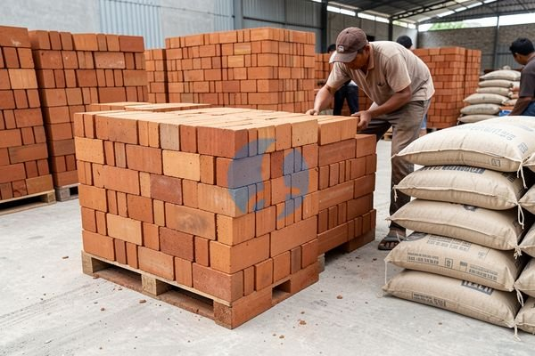

**Cara Menghitung Tanah dari Meter ke Bata? Begini Cara Memahaminya** - Mitra Sumber Material yang berbahagia, pernahkah Anda mengalami kesulitan saat menghitung berapa banyak tanah yang dibutuhkan untuk proyek pembangunan, lalu mengonversikannya ke jumlah bata yang diperlukan? Perhitungan yang kurang tepat bisa berakibat material kurang atau berlebihan, yang tentu saja akan mengganggu kelancaran dan efisiensi anggaran proyek Anda. Nah, Kami dari Sumber Material siap membantu Anda memastikan perhitungan yang akurat dan pengiriman material tepat waktu ke lokasi proyek Anda!



Banyak faktor yang perlu diperhatikan saat menghitung kebutuhan tanah dan bata. Ukuran bata yang berbeda, jenis tanah yang digunakan, serta luas area yang akan dibangun, semuanya memengaruhi hasil akhir perhitungan. Untungnya, dengan panduan yang tepat, proses ini bisa jadi lebih sederhana dan terhindar dari kesalahan. Kami akan bantu memecah proses ini langkah demi langkah, sekaligus menawarkan solusi lengkap untuk kebutuhan material proyek Anda.

## Menentukan Volume Tanah yang Dibutuhkan: Pertimbangan Penting

Sebelum menghitung konversi ke jumlah bata, langkah pertama adalah menentukan volume tanah yang Anda butuhkan. Ini bergantung pada luas area dan tinggi timbunan yang direncanakan. Pertimbangkan juga adanya faktor pemadatan tanah. Tanah yang dipadatkan akan memiliki volume yang lebih kecil dibandingkan sebelum dipadatkan.

Misalnya, jika Anda ingin menimbun area seluas 100 meter persegi dengan tinggi 30 cm, maka volume tanah yang dibutuhkan adalah 100 m² x 0,3 m = 30 m³.  Tetapi, jangan lupa bahwa angka ini masih berupa estimasi kasar. Untuk hasil yang lebih akurat, Kami sarankan untuk mengukur volume tanah yang dibutuhkan secara presisi. Atau, lebih mudahnya, serahkan perhitungan ini kepada Kami! Kami siap membantu menghitung kebutuhan material secara akurat dan memberikan penawaran harga terbaik.

## Material Tanah dan Bata dari Sumber Material: Pilihan Terbaik untuk Proyek Anda

Sumber Material menyediakan berbagai jenis tanah urug berkualitas, seperti tanah pasir, tanah liat, dan campuran tanah sesuai kebutuhan proyek Anda. Kami juga menyediakan berbagai jenis bata, mulai dari bata merah biasa, bata ringan (hebel), hingga batako dengan berbagai ukuran dan kekuatan. Untuk kebutuhan bata, kami memiliki:

- **Bata Merah:** Tersedia dalam ukuran standar (22x10x7 cm) dan ukuran jumbo. Cocok untuk struktur bangunan yang membutuhkan kekuatan dan ketahanan tinggi.
- **Bata Ringan (Hebel):** Pilihan ideal untuk bangunan yang ingin mengurangi beban struktur dan mempercepat waktu pengerjaan. Ukuran yang presisi meminimalkan pemborosan material.
- **Batako:** Alternatif ekonomis untuk dinding pembatas atau bangunan non-struktural. Tersedia dalam berbagai ketebalan dan ukuran.

Selain itu, Kami juga menyediakan material konstruksi lainnya seperti pasir, batu split, besi beton, wiremesh, dan baja ringan untuk melengkapi kebutuhan proyek Anda secara komprehensif. Dengan satu sumber material, Anda bisa menghemat waktu dan biaya logistik.

## Kenapa Memilih Sumber Material untuk Kebutuhan Tanah dan Bata Anda?

Selain menyediakan material berkualitas, Kami juga menawarkan kemudahan dan kepastian dalam proses pemesanan dan pengiriman. Kami memahami betul betapa pentingnya ketepatan waktu dalam proyek konstruksi. Oleh karena itu, Kami berkomitmen untuk mengirimkan material tepat waktu ke lokasi proyek Anda di wilayah Jabodetabek dan sekitarnya.

Berikut beberapa alasan mengapa Mitra Sumber Material harus memilih Kami:

- **Ketersediaan Stok:** Kami selalu menjaga ketersediaan stok material yang cukup untuk memenuhi kebutuhan proyek Anda, bahkan yang mendesak sekalipun.
- **Harga Kompetitif:** Kami menawarkan harga yang bersaing dengan kualitas yang terjamin.
- **Pengiriman Tepat Waktu:** Kami memiliki armada transportasi yang handal untuk memastikan material sampai di lokasi proyek Anda tepat waktu.
- **Layanan Konsultasi:** Tim Kami siap membantu Anda dalam memilih material yang tepat sesuai kebutuhan proyek Anda.
- **Jangkauan Luas:** Kami melayani pengiriman material ke seluruh wilayah Jabodetabek, termasuk Bogor, Jakarta, Bekasi, Karawang, Tangerang, dan Cikarang.

## Pesan Tanah dan Bata Sekarang: Mudah dan Cepat!

Jangan tunda lagi! Segera hubungi Kami untuk mendapatkan penawaran harga terbaik dan memastikan ketersediaan stok material yang Anda butuhkan. Proses pemesanan sangat mudah: cukup hubungi Kami melalui tombol **Telepon** atau **WhatsApp** di bawah, informasikan jenis material, jumlah, dan lokasi proyek Anda. Tim Kami akan segera merespons dan memberikan solusi terbaik untuk kebutuhan Anda.

Tinggal satu langkah lagi: hubungi Kami lewat tombol **Telepon** atau **WhatsApp** di bawah untuk menanyakan harga dan jadwal pengiriman proyek Mitra Sumber Material.

ARTIKEL_SELESAI

## Mengonversi Volume Tanah ke Jumlah Bata: Contoh Perhitungan Nyata

Setelah mengetahui volume tanah yang dibutuhkan, langkah selanjutnya adalah menghitung berapa banyak bata yang diperlukan untuk proyek Anda. Proses ini melibatkan beberapa faktor, termasuk ukuran bata, ketebalan dinding, dan persentase kehilangan material akibat pemotongan atau kerusakan. Mari kita lihat contoh perhitungan konkret.

## Pertanyaan Umum Seputar Perhitungan Kebutuhan Tanah dan Bata

Mitra Sumber Material seringkali memiliki pertanyaan serupa terkait perhitungan kebutuhan material. Berikut beberapa pertanyaan yang paling umum beserta jawabannya:

### Berapa Persentase Kehilangan Material yang Wajar?

### Apakah Jenis Tanah Memengaruhi Jumlah Bata yang Dibutuhkan?

Ya, jenis tanah dapat memengaruhi jumlah bata yang dibutuhkan, terutama jika Anda menggunakan bata yang menyerap air. Tanah yang lembap dapat menyebabkan bata menyerap air, sehingga mengurangi kekuatannya. Dalam kasus ini, Anda mungkin perlu menggunakan lebih banyak bata untuk memastikan kekuatan struktural yang optimal.

### Bagaimana Cara Menghitung Kebutuhan Bata untuk Dinding dengan Bentuk Tidak Beraturan?

Untuk dinding dengan bentuk tidak beraturan, bagi dinding menjadi beberapa bagian yang lebih sederhana (misalnya, persegi panjang atau segitiga). Hitung volume setiap bagian secara terpisah, lalu jumlahkan untuk mendapatkan total volume dinding. Selanjutnya, lakukan perhitungan seperti contoh di atas.

### Bisakah Saya Memesan Material Langsung ke Lokasi Proyek?

Tentu saja! Kami menyediakan layanan pengiriman langsung ke lokasi proyek Anda di wilayah Jabodetabek dan sekitarnya. Cukup informasikan alamat proyek Anda saat melakukan pemesanan, dan Kami akan mengatur pengiriman sesuai jadwal yang Anda tentukan.

## Meminimalkan Kesalahan Pemesanan Material: Tips dari Sumber Material

Kesalahan dalam pemesanan material bisa menyebabkan keterlambatan proyek dan pembengkakan biaya. Berikut beberapa tips untuk meminimalkan kesalahan:

- **Buat Daftar Kebutuhan yang Detail:** Catat semua material yang dibutuhkan, termasuk ukuran, jenis, dan jumlahnya.
- **Gunakan Kalkulator Online:** Ada banyak kalkulator online yang dapat membantu Anda menghitung kebutuhan material secara akurat.
- **Konsultasikan dengan Ahli:** Jika Anda ragu, jangan sungkan untuk berkonsultasi dengan ahli konstruksi atau tim Kami di Sumber Material.
- **Periksa Kembali Pesanan Anda:** Sebelum melakukan pemesanan, periksa kembali daftar pesanan Anda untuk memastikan semuanya sudah benar.
- **Pesan Lebih Awal:** Pesan material lebih awal untuk menghindari keterlambatan akibat stok yang habis atau masalah logistik. Kami di Sumber Material selalu siap membantu Anda merencanakan kebutuhan material proyek Anda dengan cermat.

## Memahami Hubungan Rasio Campuran Tanah dan Kebutuhan Bata

Memahami rasio campuran tanah yang tepat sangat penting, terutama jika Anda menggunakan tanah urug untuk pondasi atau lantai kerja sebelum pemasangan bata. Rasio yang ideal akan memastikan stabilitas dan daya dukung yang memadai. Misalnya, untuk lantai kerja dengan ketebalan 10 cm, rasio campuran tanah pasir dan semen yang umum digunakan adalah 8:1 atau 10:1. Semakin tinggi kandungan semen, semakin kuat campuran tanahnya, namun juga akan meningkatkan biaya. Perlu diingat bahwa perhitungan kebutuhan bata tetap harus mempertimbangkan volume tanah yang sudah dipadatkan setelah penimbunan.

## Pertanyaan Lain Seputar Kebutuhan Material: Tanya Jawab Singkat

### Berapa Jumlah Bata yang Dibutuhkan untuk Satu Meter Kubik Tembok?

Jumlah bata yang dibutuhkan untuk satu meter kubik tembok sangat bervariasi tergantung ukuran bata yang digunakan. Secara umum, untuk bata merah standar (22x10x7 cm), dibutuhkan sekitar 400-500 buah bata per meter kubik, sudah termasuk spesi.

### Apakah Perlu Memesan Bata Lebih dari Kebutuhan Perhitungan?

### Bagaimana Jika Saya Ingin Menggunakan Bata dengan Ukuran yang Berbeda?

Jika Anda menggunakan bata dengan ukuran yang berbeda, Anda perlu menyesuaikan perhitungan volume dan jumlah bata yang dibutuhkan. Pastikan Anda mengetahui dimensi bata yang tepat dan menggunakan rumus yang sesuai untuk menghitung kebutuhan materialnya. Kami di Sumber Material siap membantu Anda menghitung kebutuhan material dengan tepat, tanpa perlu khawatir salah hitung.
