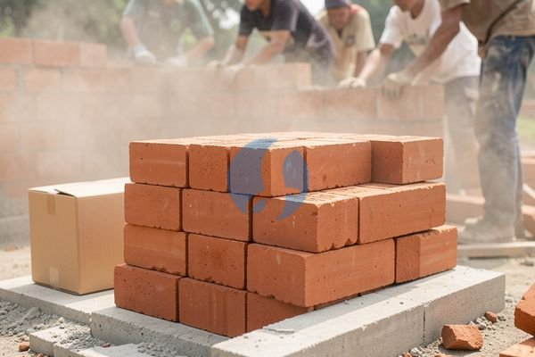

**Harga 1 Bata Tanah, Apa yang Sudah dan Belum Termasuk?** - Mitra Sumber Material di mana pun berada, apakah Anda sedang merencanakan pembangunan rumah, renovasi, atau proyek komersial di Jabodetabek? Salah satu material yang pasti dibutuhkan adalah bata. Tapi, tahu nggak sih, harga bata tanah bisa bervariasi tergantung banyak faktor? Nah, Kami di Sumber Material siap membantu Anda mendapatkan bata tanah berkualitas dengan harga yang pas, sekaligus menyediakan solusi lengkap untuk kebutuhan proyek Anda—mulai dari material lain hingga jasa urug dan sewa alat berat.



## Memilih Bata Tanah yang Tepat: Ukuran & Jenisnya

Sebelum membahas harga, penting untuk memahami jenis dan ukuran bata tanah yang tersedia. Ada beberapa pilihan yang umum di pasaran, seperti bata merah biasa, bata ringan (hebel), dan bata tempel. Nah, untuk bata tanah sendiri, biasanya ukuran standarnya adalah 22 cm x 10,5 cm x 5 cm. Tapi, ada juga variasi ukuran lain tergantung produsen dan kebutuhan proyek Anda.

Pertimbangkan juga jenis tanah yang digunakan dalam pembuatannya. Tanah liat yang berkualitas akan menghasilkan bata yang lebih kuat dan tahan lama. Kalau Anda masih bingung memilih, jangan ragu untuk konsultasi dengan Kami. Kami bisa bantu merekomendasikan jenis bata tanah yang paling sesuai dengan anggaran dan kebutuhan konstruksi Anda. Ingat, memilih yang tepat dari awal bisa menghemat biaya perbaikan di kemudian hari, lho!

### Bata Tanah vs. Pilihan Material Dinding Lainnya

Mungkin Anda bertanya-tanya, kenapa harus memilih bata tanah? Dibandingkan dengan material dinding lain seperti batako atau batako ringan (hebel), bata tanah punya keunggulan tersendiri. Bata tanah lebih kuat dan tahan terhadap cuaca ekstrem. Selain itu, bata tanah juga memiliki nilai estetika yang klasik dan sering digunakan untuk tampilan bangunan yang lebih tradisional.

Kami di Sumber Material menyediakan berbagai jenis material dinding, termasuk bata tanah, batako, dan hebel. Jadi, Anda bisa mendapatkan semua kebutuhan Anda dalam satu tempat. Untuk proyek yang membutuhkan kekuatan ekstra, bata tanah bisa jadi pilihan yang tepat. Sementara, untuk proyek yang mengutamakan kemudahan pemasangan dan biaya yang lebih rendah, batako ringan bisa jadi solusi yang menarik.

### Kenapa Pesan Bata Tanah di Sumber Material?

Nah, sekarang pertanyaannya: kenapa Anda harus memesan bata tanah di Sumber Material? Pertama, Kami menyediakan berbagai ukuran dan jenis bata tanah sesuai kebutuhan Anda. Kedua, Kami melayani pengiriman ke seluruh wilayah Jabodetabek dan sekitarnya. Ketiga, Kami juga menyediakan jasa urug dan sewa alat berat untuk melengkapi proyek Anda.

Bayangkan, Anda bisa mendapatkan semua kebutuhan proyek Anda—bata tanah, pasir, batu split, besi beton, jasa urug, dan sewa excavator—dalam satu tempat. Hemat waktu, hemat tenaga, dan pastinya hemat biaya! Kami berada di lokasi strategis di Bogor, Jakarta, Bekasi, Karawang, Tangerang, dan Cikarang, sehingga pengiriman bisa dilakukan dengan cepat dan efisien. Harga ini bersifat estimasi dan dapat berubah sewaktu-waktu — hubungi Kami untuk penawaran terbaru dan paling akurat sesuai kebutuhan proyek Mitra.

### Cara Mudah Pesan Bata Tanah & Material Lainnya

Pesan bata tanah di Sumber Material sangat mudah. Cukup hubungi Kami lewat tombol **Telepon** atau **WhatsApp** di bawah. Tim Kami akan siap membantu Anda menghitung kebutuhan material, memberikan penawaran harga terbaik, dan mengatur jadwal pengiriman sesuai dengan lokasi proyek Anda. Jangan sungkan untuk bertanya — Kami selalu siap memberikan konsultasi gratis untuk membantu proyek Anda berjalan lancar. Kami bantu hitungkan kebutuhan material Anda secara akurat agar tidak ada sisa atau kekurangan.

## Menghitung Kebutuhan Bata Tanah untuk Proyek Anda: Contoh Kasus

Nah, sekarang kita masuk ke bagian yang paling praktis: menghitung berapa banyak bata tanah yang Anda butuhkan untuk proyek Anda. Ini penting banget, lho, supaya nggak ada sisa bata yang mubazir atau malah kekurangan di tengah jalan. Anggaplah Anda mau membangun dinding dengan ukuran panjang 8 meter, tinggi 3 meter, dan tebal 15 cm (atau setengah bata).

Pertama, kita hitung volume dindingnya: 8 m x 3 m x 0,15 m = 3,6 m³. Lalu, kita perlu tahu berapa volume satu buah bata tanah. Dengan ukuran standar 22 cm x 10,5 cm x 5 cm, volumenya adalah 0,001155 m³ (22/100 x 10,5/100 x 5/100).

### Pertanyaan Umum Tentang Bata Tanah: FAQ

Mitra Sumber Material, seringkali ada beberapa pertanyaan yang muncul sebelum memutuskan untuk membeli bata tanah. Yuk, kita bahas beberapa pertanyaan yang paling umum:

**### Berapa lama bata tanah bisa tahan terhadap cuaca?**

Bata tanah yang berkualitas, terutama yang dibakar dengan sempurna, bisa tahan terhadap cuaca ekstrem selama bertahun-tahun. Kuncinya adalah memilih bata yang padat dan tidak mudah retak.

**### Apakah bata tanah bisa digunakan untuk bangunan bertingkat?**

Tentu saja bisa! Bata tanah memiliki kekuatan tekan yang cukup tinggi untuk menopang beban bangunan bertingkat. Namun, pastikan Anda menggunakan jenis bata tanah yang sesuai dengan standar SNI dan berkonsultasi dengan ahli struktur bangunan.

**### Bagaimana cara merawat bata tanah agar tidak rusak?**

Setelah dinding bata selesai dibangun, sebaiknya dilapisi dengan plester atau acian untuk melindungi bata dari air hujan dan paparan sinar matahari langsung. Perawatan rutin juga penting untuk menjaga keawetan bangunan Anda.

**### Apa yang harus diperhatikan saat menerima pengiriman bata tanah?**

Periksa apakah bata tanah yang Anda terima dalam kondisi baik, tidak ada yang pecah atau retak. Pastikan juga jumlah bata sesuai dengan pesanan Anda. Kalau ada kerusakan atau kekurangan, segera laporkan ke Kami, ya.

## Hindari Kesalahan Umum Saat Membeli Bata Tanah

Banyak Mitra Sumber Material yang mengalami masalah karena kesalahan kecil saat membeli bata tanah. Salah satunya adalah tidak memperhatikan kualitas tanah liat yang digunakan. Tanah liat yang berkualitas buruk akan menghasilkan bata yang rapuh dan mudah pecah.

Kesalahan lainnya adalah tidak menghitung kebutuhan bata dengan tepat. Akibatnya, Anda bisa kekurangan bata di tengah jalan atau malah punya sisa bata yang nggak terpakai. Selain itu, jangan lupa untuk memilih supplier yang terpercaya dan bisa memberikan jaminan kualitas. Kami di Sumber Material selalu memastikan kualitas bata tanah yang Kami jual sesuai dengan standar SNI.

Dengan memperhitungkan semua faktor di atas, Anda bisa mendapatkan bata tanah yang berkualitas dan sesuai dengan kebutuhan proyek Anda. Dan jangan lupa, Kami siap membantu Anda dalam setiap langkahnya!

## Perhatikan Kualitas Bata: Ciri-Ciri Bata Tanah yang Baik

Mitra Sumber Material, kualitas bata tanah itu penting banget, lho! Jangan sampai Anda sudah beli banyak, ternyata banyak yang rusak atau tidak sesuai harapan. Nah, ada beberapa ciri-ciri bata tanah yang baik yang perlu Anda perhatikan. Pertama, perhatikan warnanya. Bata yang bagus biasanya berwarna merah merata, tidak belang-belang atau kehitaman. Kedua, coba ketuk batanya. Kalau suaranya nyaring dan berbunyi “ting”, itu tandanya bata tersebut padat dan kuat. Ketiga, perhatikan teksturnya. Bata yang berkualitas biasanya memiliki tekstur yang halus dan tidak mudah terkelupas.

### Membedakan Bata Tanah Bakar & Bata Tanah Kering

Nah, ada juga perbedaan antara bata tanah bakar dan bata tanah kering. Bata bakar diproses dengan cara dibakar dalam tungku dengan suhu tinggi, sehingga lebih kuat dan tahan lama. Sementara, bata kering hanya dikeringkan dengan sinar matahari, sehingga kekuatannya tidak sekuat bata bakar. Untuk proyek yang membutuhkan kekuatan ekstra, seperti bangunan bertingkat atau dinding penahan tanah, Kami sarankan untuk menggunakan bata bakar.

## Contoh Perhitungan Kebutuhan Bata: Dinding 1 Meter Persegi

Supaya lebih jelas, mari kita hitung kebutuhan bata tanah untuk dinding seluas 1 meter persegi. Dengan ukuran bata standar 22 cm x 10,5 cm x 5 cm, dan menggunakan pemasangan setengah bata (15 cm), maka dalam 1 meter persegi dibutuhkan sekitar 58 – 60 buah bata tanah. Angka ini sudah termasuk ruang untuk adukan semen. Jadi, kalau Anda mau membangun dinding seluas 10 meter persegi, Anda membutuhkan sekitar 580 – 600 buah bata tanah. Tentu saja, angka ini bisa sedikit berbeda tergantung ketebalan adukan dan jenis pemasangan yang Anda gunakan. Kami bantu hitungkan lebih akurat sesuai proyek Anda, ya!

Tinggal satu langkah lagi: hubungi Kami lewat tombol **Telepon** atau **WhatsApp** di bawah untuk menanyakan harga dan jadwal pengiriman proyek Mitra Sumber Material.
