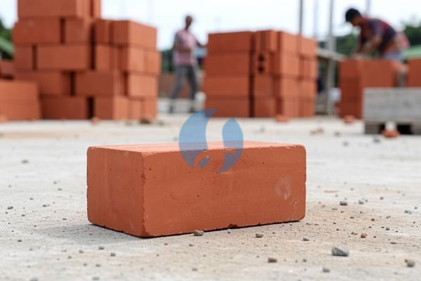

**Cara Membandingkan Harga 1 Bata dari Beberapa Penjual** - Mitra Sumber Material yang budiman, sedang mencari tahu harga bata untuk proyek Anda? Mencari yang berkualitas tapi tetap ramah di kantong memang bikin pusing. Nah, Kami dari Sumber Material siap membantu Anda menemukan bata yang tepat, dengan harga terbaik, dan pengiriman langsung ke lokasi proyek Anda di Jabodetabek dan sekitarnya.



Bata adalah material dasar yang penting dalam konstruksi. Memilih yang tepat tidak hanya soal harga, tapi juga kualitas, ukuran, dan jenisnya. Mitra Sumber Material, jangan sampai salah pilih karena bisa berpengaruh pada kekuatan dan estetika bangunan Anda.

## Pilihan Bata: Mana yang Paling Cocok untuk Kebutuhan Anda?

Sebelum membahas lebih jauh tentang harga 1 bata, penting untuk memahami berbagai jenis yang tersedia. Ada bata merah, bata ringan (hebel), dan batako. Masing-masing punya kelebihan dan kekurangan. Bata merah misalnya, dikenal kuat dan tahan lama, cocok untuk struktur bangunan utama. Batako lebih ekonomis dan ringan, sering digunakan untuk dinding pembatas atau pagar. Sementara bata ringan (hebel) unggul dalam hal insulasi termal dan akustik, serta lebih mudah dipasang.

Kalau Anda masih bingung, jangan ragu untuk berkonsultasi dengan tim Kami. Kami akan bantu mencarikan solusi terbaik sesuai anggaran dan kebutuhan proyek Anda. Atau, kalau Mitra sudah punya gambaran, langsung saja kirim kebutuhan dan lokasi proyek lewat WhatsApp — Kami bantu hitungkan jumlah bata yang dibutuhkan!

## Ragam Ukuran dan Jenis Bata yang Tersedia di Sumber Material

Di Sumber Material, Kami menyediakan berbagai jenis bata dengan ukuran dan mutu yang beragam. Untuk bata merah, tersedia ukuran standar 22x10x5 cm, 22x10x6 cm, dan juga ukuran jumbo. Mutunya pun bervariasi, mulai dari kualitas standar hingga kualitas super, tergantung kebutuhan anggaran dan kekuatan yang diinginkan. Untuk batako, Kami punya ukuran 39x19x10 cm dan 39x19x15 cm.

Bata ringan (hebel) tersedia dalam berbagai ketebalan, mulai dari 7.5 cm, 10 cm, hingga 12.5 cm. Material ini sangat populer untuk dinding partisi karena ringan dan mudah dipotong. Kami juga menyediakan jasa pemotongan bata ringan sesuai kebutuhan Anda. Nah, untuk proyek skala besar seperti pembangunan rumah di Karawang, Kami seringkali menyediakan pengiriman langsung ke lokasi.

## Mengapa Memilih Sumber Material untuk Kebutuhan Bata Anda?

Mitra, kenapa harus repot mencari ke sana kemari kalau semua kebutuhan bata Anda bisa dipenuhi di Sumber Material? Kami tidak hanya menyediakan berbagai jenis bata berkualitas, tapi juga menawarkan kemudahan dalam pemesanan dan pengiriman. Kami melayani wilayah Jabodetabek dan sekitarnya, termasuk Bogor, Jakarta, Bekasi, Karawang, Tangerang, dan Cikarang. Dengan jaringan distribusi yang luas, Kami memastikan bata sampai di lokasi proyek Anda tepat waktu.

Selain itu, Kami juga punya tim yang siap membantu menghitung kebutuhan bata secara akurat. Anda cukup informasikan luas area yang akan dibangun, dan Kami akan hitungkan jumlah bata yang dibutuhkan, sehingga Anda tidak perlu khawatir kelebihan atau kekurangan material. Keuntungan lainnya? Anda bisa fokus dengan pekerjaan inti proyek Anda, sementara pengadaan material Kami yang urus.

## Pesan Bata Sekarang, Bangun Impian Anda Lebih Cepat!

Memesan bata di Sumber Material sangat mudah. Cukup hubungi Kami melalui tombol **WhatsApp** atau **Telepon** yang ada di bawah halaman ini. Tim Kami akan segera merespons dan membantu Anda memilih bata yang tepat, menghitung kebutuhan, dan memberikan penawaran harga terbaik. Estimasi harga 1 bata merah ukuran standar saat ini mulai dari Rp 400 – Rp 700 per buah (harga ini bersifat estimasi dan dapat berubah sewaktu-waktu — hubungi Kami untuk penawaran terbaru dan paling akurat sesuai kebutuhan proyek Mitra). Jangan tunda lagi, segera wujudkan proyek impian Anda dengan bata berkualitas dari Sumber Material!

## Hitung Kebutuhan Bata: Jangan Sampai Kurang atau Kelebihan!

Mitra Sumber Material, sudah menentukan jenis bata yang akan digunakan? Langkah selanjutnya adalah menghitung kebutuhan bata secara akurat. Ini penting banget lho, supaya tidak ada sisa bata yang menumpuk atau kekurangan di tengah proyek. Bayangkan kerepotannya kalau tiba-tiba kehabisan bata saat pemasangan sedang berjalan! Nah, Kami akan bantu jelaskan cara menghitungnya dengan contoh nyata.

## Perbandingan Bata Merah dan Bata Ringan: Mana yang Lebih Ekonomis?

Mitra, seringkali bingung memilih antara bata merah dan bata ringan (hebel). Selain mempertimbangkan kekuatan dan insulasi, aspek ekonomis juga perlu diperhatikan. Bata merah memang harganya per buah lebih murah, tapi perlu diingat bahwa pemasangannya lebih lama dan membutuhkan lebih banyak semen. Bata ringan (hebel) justru sebaliknya — harganya per buah sedikit lebih mahal, tapi pemasangannya lebih cepat dan hemat semen.

## Pertanyaan Seputar Bata: FAQ dari Mitra Sumber Material

Kami sering menerima pertanyaan seputar bata dari Mitra Sumber Material seperti Anda. Berikut beberapa pertanyaan yang paling umum:

### Berapa Daya Tahan Bata Merah?

Bata merah yang berkualitas baik bisa bertahan hingga ratusan tahun, lho! Kuncinya adalah memilih bata yang dibakar dengan sempurna dan tidak retak.

### Apakah Bata Ringan Mudah Pecah?

Bata ringan memang lebih rapuh dibandingkan bata merah, tapi jika dipasang dengan hati-hati dan menggunakan alat yang tepat, tidak akan mudah pecah.

### Bagaimana Cara Merawat Bata Agar Awet?

Pastikan bata terlindungi dari air hujan dan sinar matahari langsung. Simpan bata di tempat yang kering dan bersih sebelum digunakan.

### Apakah Bata Bekas Bisa Digunakan?

Bata bekas masih bisa digunakan, tapi pastikan kualitasnya masih baik dan tidak ada retakan yang signifikan. Biasanya, bata bekas cocok untuk pekerjaan yang tidak terlalu membutuhkan kekuatan struktural tinggi, seperti membuat pagar atau dinding pembatas.

Nah, itu tadi beberapa pertanyaan yang sering Kami terima. Kalau Mitra punya pertanyaan lain, jangan ragu untuk menghubungi Kami — Kami siap membantu!

## Kesalahan Umum Saat Membeli Bata: Hindari Kerugian Tak Terduga!

Mitra Sumber Material, seringkali ada kesalahan kecil saat membeli bata yang bisa berakibat fatal pada anggaran dan kualitas bangunan Anda. Salah satunya adalah tidak memperhatikan konsistensi ukuran. Bata yang ukurannya tidak seragam akan menyulitkan proses pemasangan dan membutuhkan lebih banyak semen untuk mengisi celah. Selain itu, jangan tergiur dengan harga murah tanpa memeriksa kualitasnya. Bata yang retak atau pecah akan mengurangi kekuatan bangunan dan memperpendek umur pakainya. Nah, satu lagi yang sering terjadi: kurangnya perencanaan yang matang. Pastikan Anda sudah menghitung kebutuhan bata secara akurat sebelum memesan, supaya tidak ada sisa material yang terbuang percuma.

## Tanya Jawab Seputar Bata: Pertanyaan yang Sering Diajukan Mitra

### Berapa Ketebalan Dinding yang Ideal dengan Bata Merah?

Ketebalan dinding yang ideal dengan bata merah biasanya 15-20 cm (setengah bata atau satu bata). Ini sudah cukup kuat untuk menopang beban bangunan.

### Apakah Bata Merah Cukup Kuat untuk Bangunan Dua Lantai?

Bata merah yang berkualitas baik dan dipasang dengan semen yang tepat, sangat kuat untuk bangunan dua lantai. Pastikan Anda menggunakan bata merah yang sudah memenuhi standar SNI.

### Bagaimana Cara Memastikan Bata yang Kami Beli Berkualitas?

Periksa visualnya: pastikan tidak ada retak, pecah, atau kerusakan lainnya. Ketuk bata: suara yang nyaring menandakan bata berkualitas baik. Bandingkan ukurannya: pastikan semua bata ukurannya seragam.

### Apakah Bata Merah Membutuhkan Perawatan Khusus Setelah Pemasangan?

Sebaiknya tunggu beberapa hari setelah pemasangan sebelum mengaplikasikan plester atau cat. Ini akan memberikan waktu bagi semen untuk mengering dan mengeras dengan sempurna. Pastikan juga dinding terlindungi dari air hujan selama proses pengeringan.

Siap pesan atau masih mau konsultasi dulu? Tombol **WhatsApp** dan **Telepon** di bawah halaman ini langsung terhubung dengan tim Kami.
