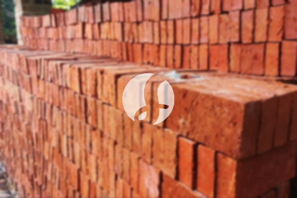

**Harga Bata Merah per Kubik dan Perhitungan Kebutuhan Proyek** - Mitra Sumber Material dimana saja berada, pernahkah Anda bertanya-tanya berapa biaya yang perlu dialokasikan untuk bata merah dalam proyek konstruksi Anda? Kami siap membantu! Di Sumber Material, Anda bisa mendapatkan penawaran harga bata merah per kubik yang kompetitif, lengkap dengan konsultasi gratis untuk memperkirakan kebutuhan proyek Anda secara akurat.



## Memilih Bata Merah yang Tepat: Pertimbangan Utama

Sebelum membahas harga, penting untuk memahami ada beberapa jenis bata merah yang beredar di pasaran. Setiap jenis memiliki karakteristik dan harga yang berbeda. Secara umum, Anda akan menemukan bata merah standar, bata merah press, dan bata merah hollow. Pemilihan jenis bata merah akan sangat memengaruhi keseluruhan biaya proyek Anda. Nah, kalau masih bingung memilih, jangan ragu untuk konsultasi dengan tim Kami. Kami akan bantu mencocokkan jenis bata merah yang paling sesuai dengan spesifikasi proyek Anda.

### Bata Merah: Jenis, Ukuran, dan Aplikasi yang Sesuai Kebutuhan

Bata merah hadir dalam berbagai ukuran dan kualitas. Ukuran standar bata merah biasanya 22,5 x 10,5 x 5 cm, namun ada juga variasi lain. Kualitas bata merah dipengaruhi oleh proses pembuatan dan bahan baku yang digunakan. Bata merah press, misalnya, dikenal lebih kuat dan tahan lama dibandingkan bata merah standar karena proses penekanannya yang lebih tinggi.

Bata merah sangat serbaguna. Untuk dinding rumah tinggal, bata merah standar sudah cukup memadai. Namun, untuk bangunan yang membutuhkan kekuatan ekstra, seperti dinding penahan tanah atau fondasi, bata merah press adalah pilihan yang lebih tepat. Kami menyediakan berbagai jenis bata merah dengan kualitas terjamin, siap memenuhi kebutuhan proyek Anda. Kami juga melayani pengiriman ke seluruh wilayah Jabodetabek dan sekitarnya.

### Mengapa Memesan Bata Merah di Sumber Material?

Mitra Sumber Material, memesan material bangunan tidak perlu ribet! Di Sumber Material, Kami menawarkan beberapa keuntungan yang akan mempermudah dan menghemat waktu Anda. Pertama, Kami menyediakan konsultasi gratis. Tim ahli Kami akan membantu Anda menghitung kebutuhan bata merah secara akurat berdasarkan desain proyek Anda. Ini akan mencegah Anda membeli terlalu banyak atau terlalu sedikit bata merah, sehingga menghemat anggaran.

Kedua, Kami hanya menyediakan material berkualitas. Semua bata merah yang Kami jual telah melalui proses seleksi ketat untuk memastikan kualitasnya sesuai standar SNI. Ketiga, Kami melayani pengiriman langsung ke lokasi proyek Anda di wilayah Jabodetabek dan sekitarnya. Dengan demikian, Anda tidak perlu repot mengurus transportasi sendiri. Kami berlokasi di Bogor, Jakarta, Bekasi, Karawang, Tangerang, dan Cikarang, sehingga pengiriman lebih cepat dan efisien.

Kami juga menjual material bangunan lainnya seperti pasir, batu, hebel, besi, wiremesh, baja ringan, dan readymix. Jadi, Anda bisa mendapatkan semua kebutuhan proyek Anda dalam satu tempat. Harga bata merah per kubik yang Kami tawarkan pun kompetitif, dan Kami selalu berusaha memberikan penawaran terbaik untuk Mitra.

### Pesan Bata Merah Sekarang: Mudah, Cepat, dan Terpercaya

Proses pemesanan bata merah di Sumber Material sangat mudah. Anda bisa langsung menghubungi Kami melalui tombol **WhatsApp** atau **Telepon** yang ada di bawah halaman ini. Tim Kami akan segera merespons dan membantu Anda mendapatkan penawaran harga terbaik. Anda juga bisa mengirimkan detail proyek Anda (lokasi, jenis bata merah yang dibutuhkan, jumlah perkiraan) melalui WhatsApp untuk mendapatkan estimasi biaya yang lebih akurat.

Jangan tunda lagi! Segera lengkapi kebutuhan material bangunan Anda dengan bata merah berkualitas dari Sumber Material. Kami menjamin kepuasan Anda.

## Kalkulasi Kebutuhan Bata Merah: Contoh Nyata untuk Proyek Anda

Mitra Sumber Material, seringkali perhitungan kebutuhan bata merah menjadi tantangan tersendiri. Salah perhitungan bisa berakibat pemborosan material atau malah kekurangan di tengah proyek. Nah, supaya Anda lebih yakin, yuk kita lihat contoh perhitungannya.

Anggaplah Anda akan membangun dinding dengan ukuran panjang 10 meter, tinggi 3 meter, dan tebal 15 cm (atau 0,15 meter). Pertama, hitung luas dinding: 10 m x 3 m = 30 m². Selanjutnya, hitung volume dinding: 30 m² x 0,15 m = 4,5 m³.

Sekarang, kita perlu tahu berapa volume bata merah yang dibutuhkan per meter kubik. Bata merah standar dengan ukuran 22,5 x 10,5 x 5 cm memiliki volume 0,00118125 m³ per buah. Untuk 1 m³ bata merah, dibutuhkan sekitar 845 buah bata (1 / 0,00118125 = 846,48, dibulatkan menjadi 845).

## Hindari Kesalahan Umum Saat Membeli Bata Merah

Mitra, ada beberapa kesalahan umum yang sering terjadi saat membeli bata merah. Kesalahan ini bisa berdampak pada kualitas bangunan dan biaya proyek Anda. Salah satunya adalah tidak memeriksa kualitas bata merah secara seksama. Pastikan bata merah yang Anda beli tidak retak, pecah, atau berlubang besar.

Kesalahan lainnya adalah salah memperkirakan jumlah bata merah yang dibutuhkan. Seperti yang sudah Kami bahas sebelumnya, perhitungan yang akurat sangat penting. Jangan ragu untuk meminta bantuan Kami menghitung kebutuhan bata merah Anda. Kesalahan terakhir, seringkali pembeli hanya fokus pada harga tanpa memperhatikan kualitas. Bata merah yang murah belum tentu berkualitas baik. Ingat, kualitas bangunan jauh lebih penting daripada sekadar menghemat biaya.

### Pertanyaan Umum Seputar Bata Merah

Biar lebih jelas, berikut beberapa pertanyaan yang sering Kami terima dari Mitra Sumber Material:

**### Berapa lama bata merah perlu disimpan sebelum digunakan?**

Idealnya, bata merah disimpan di tempat kering dan terlindung dari hujan selama minimal 3 hari sebelum digunakan. Ini akan membantu bata merah mengering dan meningkatkan kekuatannya.

**### Apakah bata merah bisa digunakan untuk dinding luar?**

Tentu saja. Bata merah sangat cocok untuk dinding luar karena kuat, tahan lama, dan memiliki insulasi termal yang baik. Namun, pastikan Anda menggunakan bata merah yang berkualitas dan memasangnya dengan benar.

**### Bagaimana cara membedakan bata merah yang berkualitas baik?**

Bata merah berkualitas baik memiliki warna merah merata, tidak ada retak atau pecah, dan bunyi nyaring saat diketuk. Selain itu, pastikan bata merah tersebut memiliki permukaan yang kasar dan tidak licin.

### Jasa Urug & Pasang Bata Merah: Solusi Praktis untuk Proyek Anda

Selain menyediakan material, Kami juga menyediakan jasa urug dan pemasangan bata merah. Jasa ini sangat cocok bagi Anda yang ingin menghemat waktu dan tenaga. Tim Kami yang berpengalaman akan memastikan pemasangan bata merah dilakukan dengan rapi dan sesuai standar. Kami juga menangani berbagai jenis proyek, mulai dari pembangunan rumah tinggal hingga gedung komersial. Dengan menggunakan jasa Kami, Anda bisa fokus pada aspek lain dari proyek Anda, sementara Kami yang akan mengurus pemasangan bata merahnya.

## Memahami Kekuatan Tekan Bata Merah: Mengapa Ini Penting?

Mitra Sumber Material, kekuatan tekan bata merah adalah salah satu faktor penting yang perlu Anda perhatikan. Kekuatan tekan menunjukkan kemampuan bata merah menahan beban. Semakin tinggi kekuatan tekannya, semakin kuat bata merah tersebut. Bata merah yang berkualitas baik umumnya memiliki kekuatan tekan minimal 75 kg/cm². Untuk bangunan yang membutuhkan kekuatan ekstra, seperti dinding penahan tanah, disarankan menggunakan bata merah dengan kekuatan tekan lebih tinggi, misalnya 100 kg/cm² atau lebih. Kami menyediakan berbagai pilihan bata merah dengan spesifikasi yang berbeda, sesuai dengan kebutuhan proyek Anda.

## Perbedaan Bata Merah Bakar dan Bata Merah Cetak: Mana yang Lebih Unggul?

Bata merah bakar dan bata merah cetak adalah dua jenis yang paling umum ditemui. Perbedaan utama terletak pada proses pembuatannya. Bata merah bakar dibuat dengan cara dibakar dalam tungku, sedangkan bata merah cetak dibuat dengan cara ditekan menggunakan mesin cetak. Secara umum, bata merah bakar memiliki pori-pori lebih banyak, sehingga lebih ringan dan memiliki insulasi termal yang lebih baik. Namun, bata merah cetak cenderung lebih kuat dan lebih presisi ukurannya. Pilihan terbaik tergantung pada kebutuhan proyek Anda. Jika Anda membutuhkan insulasi termal yang baik, bata merah bakar adalah pilihan yang tepat. Jika Anda membutuhkan kekuatan dan presisi, bata merah cetak adalah pilihan yang lebih baik.

### Apa yang Harus Diperhatikan Saat Menerima Pengiriman Bata Merah?

Mitra, setelah memesan bata merah, ada beberapa hal yang perlu diperhatikan saat menerima pengiriman. Pertama, pastikan jumlah bata merah yang diterima sesuai dengan pesanan Anda. Kedua, periksa kondisi bata merah secara visual. Pastikan tidak ada bata merah yang retak, pecah, atau rusak. Ketiga, periksa apakah bata merah tersebut bersih dari kotoran atau debu. Jika Anda menemukan ada kerusakan atau kekurangan, segera laporkan kepada Kami. Kami akan segera mengganti bata merah yang rusak atau kurang.

Siap pesan atau masih mau konsultasi dulu? Tombol **WhatsApp** dan **Telepon** di bawah halaman ini langsung terhubung dengan tim Kami.
