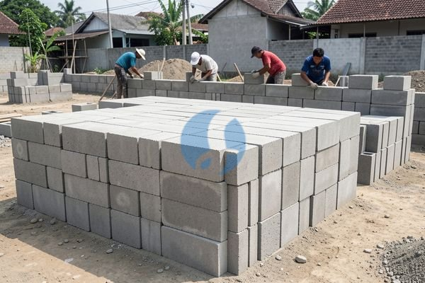

**Apa Saja yang Menentukan Harga Batako 100 Biji?** - Mitra Sumber Material yang kami hormati, mencari tahu harga batako 100 biji terkini memang penting sekali untuk perencanaan anggaran proyek Anda. Kami siap membantu menyiapkan kebutuhan batako, mulai dari perhitungan volume, pemesanan, hingga pengiriman langsung ke lokasi proyek Anda di Jabodetabek dan sekitarnya.



Berapa sebenarnya biaya yang perlu Anda siapkan? Harga batako bervariasi tergantung beberapa faktor, seperti kualitas, ukuran, dan lokasi pembelian. Nah, daripada bingung sendiri, yuk kita bahas lebih detail supaya Anda bisa memperkirakan anggaran dengan lebih akurat!

## Pilihan Batako: Ukuran, Kualitas, dan Pengaruhnya ke Harga

Mitra, sebelum membahas angka, penting untuk memahami pilihan yang ada. Batako hadir dalam berbagai ukuran, mulai dari standar 40x20x10 cm hingga yang lebih besar atau khusus. Ukuran ini memengaruhi jumlah batako yang dibutuhkan untuk proyek Anda. Selain itu, kualitas batako juga berperan penting. Batako dengan mutu yang baik, dibuat dari campuran semen dan pasir yang tepat, biasanya lebih tahan lama dan kokoh.

Pilihan batako yang tepat akan berpengaruh pada kekuatan struktur bangunan. Kami di Sumber Material menyediakan berbagai pilihan batako dengan kualitas terjamin. Untuk kebutuhan proyek Mitra Sumber Material yang membutuhkan ketahanan tinggi, Kami sarankan untuk memilih batako dengan mutu yang sudah teruji. Jangan ragu untuk [tanyakan harga lewat WhatsApp](https://api.whatsapp.com/send?phone=6285776786091&text=*Halo%20sumbermaterial.com*%20%3A) untuk konsultasi lebih lanjut mengenai pilihan batako yang paling sesuai dengan kebutuhan Anda.

## Material Batako dari Sumber Material: Jenis, Ukuran, dan Aplikasi

Kami menyediakan berbagai jenis batako untuk memenuhi kebutuhan proyek Anda. Beberapa pilihan yang tersedia antara lain:

- **Batako Standar:** Ukuran 40x20x10 cm, cocok untuk dinding luar maupun dalam.
- **Batako Ringan:** Memiliki berat lebih ringan, memudahkan proses pemasangan dan mengurangi beban struktur bangunan.
- **Batako Jumbo:** Ukuran lebih besar, mempercepat proses pembangunan karena lebih sedikit sambungan.
- **Batako Press:** Dibuat dengan mesin press, menghasilkan permukaan yang lebih rata dan presisi.

Sebagai contoh, untuk membangun dinding seluas 10 meter persegi dengan tinggi 3 meter (total luas 30 meter persegi), Anda membutuhkan sekitar 150 – 200 batako standar (tergantung ketebalan dinding). Kami siap membantu Anda menghitung kebutuhan secara akurat. Untuk proyek renovasi rumah tinggal, mungkin batako standar sudah cukup. Namun, untuk proyek komersial atau bangunan bertingkat, batako jumbo atau batako press bisa menjadi pilihan yang lebih efisien.

## Kenapa Pesan Batako di Sumber Material? Keuntungan untuk Proyek Anda

Mitra Sumber Material, Kami memahami bahwa mencari supplier material bangunan yang terpercaya itu tidak mudah. Berikut beberapa alasan kenapa Anda sebaiknya memilih Sumber Material:

- **Jangkauan Luas:** Kami melayani pengiriman ke seluruh wilayah Jabodetabek dan sekitarnya.
- **Kualitas Terjamin:** Kami hanya menyediakan batako dari produsen terpercaya dengan mutu yang terjamin.
- **Harga Kompetitif:** Kami menawarkan harga yang bersaing dengan kualitas yang tidak perlu diragukan. Harga ini bersifat estimasi dan dapat berubah sewaktu-waktu — hubungi Kami untuk penawaran terbaru dan paling akurat sesuai kebutuhan proyek Mitra.
- **Layanan Konsultasi:** Tim Kami siap membantu Anda memilih jenis batako yang paling sesuai dengan kebutuhan proyek Anda.
- **Penyewaan Alat Berat:** Kami juga menyediakan jasa sewa alat berat seperti ekskavator dan truk molen untuk mendukung kelancaran proyek Anda.
- **Solusi Lengkap:** Kami bukan hanya menyediakan batako, tapi juga material bangunan lain seperti pasir, batu, semen, dan baja ringan.

Kami berlokasi di Bogor, Jakarta, Bekasi, Karawang, Tangerang, dan Cikarang, sehingga pengiriman bisa dilakukan dengan cepat dan efisien.

## Cara Mudah Memesan Batako dari Kami

Untuk memesan batako atau menanyakan harga terbaru, caranya sangat mudah:

1.  **Hubungi Kami:** Klik tombol **WhatsApp** atau **Telepon** di bawah halaman ini.
2.  **Sampaikan Kebutuhan:** Informasikan jenis batako, jumlah yang dibutuhkan, dan lokasi proyek Anda.
3.  **Dapatkan Penawaran:** Tim Kami akan segera memberikan penawaran harga terbaik.
4.  **Konfirmasi & Pengiriman:** Setelah Anda menyetujui penawaran, Kami akan segera proses pengiriman ke lokasi proyek Anda.

Atau, Anda bisa langsung [berapa harga penjelasan](/blog/berapa-harga-batako-per-biji/) untuk tahu berapa harga penjelasan lebih detail, atau [hal yang biji di Lapangan](/blog/harga-batako-per-biji/) untuk mengetahui hal yang biji di Lapangan.

## Perhitungan Kebutuhan Batako: Contoh Praktis untuk Proyek Anda

Mitra, seringkali kita kesulitan memperkirakan jumlah batako yang dibutuhkan secara akurat. Nah, supaya tidak ada sisa atau kekurangan, mari kita lihat contoh perhitungan sederhana. Misalkan Anda akan membangun dinding dengan dimensi panjang 5 meter, tinggi 2,5 meter, dan tebal 15 cm (atau 0,15 meter).

Pertama, hitung luas dinding: 5 meter x 2,5 meter = 12,5 meter persegi. Kemudian, hitung volume dinding: 12,5 meter persegi x 0,15 meter = 1,875 meter kubik.

Selanjutnya, kita perlu tahu volume satu buah batako standar (40x20x10 cm = 0,04 m³ x 0,02 m x 0,1 m = 0,0008 m³). Untuk menghitung jumlah batako yang dibutuhkan, bagi volume dinding dengan volume satu batako: 1,875 m³ / 0,0008 m³/batako = 2343,75 batako.

## Pertanyaan Umum Seputar Batako: Apa yang Sering Ditanyakan Pelanggan

Mitra Sumber Material, seringkali ada beberapa pertanyaan yang muncul sebelum Anda memutuskan untuk membeli batako. Berikut beberapa pertanyaan yang paling umum dan jawabannya:

### Apakah Batako Mudah Pecah?

Batako memang rentan pecah jika terkena benturan keras. Namun, dengan penanganan yang hati-hati selama pengiriman dan pemasangan, risiko kerusakan bisa diminimalkan. Kami memastikan pengemasan yang aman dan berhati-hati dalam proses pengiriman.

### Bagaimana Cara Membedakan Batako Berkualitas Baik?

Perhatikan beberapa hal: tekstur batako harus padat dan rata, tidak ada retakan atau cacat, serta warna harus seragam. Ketuk batako, suara yang dihasilkan harus nyaring dan tidak berongga. Kami hanya menyediakan batako dengan kualitas terjamin dari produsen terpercaya.

### Batako Lebih Baik atau Bata Merah?

Pilihan antara batako dan bata merah tergantung kebutuhan proyek Anda. Batako lebih ringan dan lebih cepat dipasang, sedangkan bata merah lebih kuat dan tahan lama. Untuk dinding non-struktural, batako bisa menjadi pilihan yang lebih ekonomis. Untuk dinding penahan beban, bata merah mungkin lebih disarankan. Kami dapat membantu Anda menentukan pilihan yang paling tepat.

### Apakah Batako Perlu Diplester?

Ya, batako umumnya perlu diplaster untuk melindungi dari cuaca dan memberikan tampilan yang lebih rapi. Plester juga membantu memperkuat dinding. Kami menyediakan berbagai jenis semen dan pasir untuk keperluan plester Anda.

## Kesalahan Umum Saat Membeli Batako: Hindari Kerugian Tidak Perlu

Mitra Sumber Material, seringkali ada beberapa kesalahan yang tanpa sengaja dilakukan saat membeli batako. Kesalahan ini bisa berakibat pada pemborosan biaya atau kualitas bangunan yang kurang optimal. Salah satu yang paling umum adalah kurang memperhitungkan jumlah batako yang dibutuhkan. Banyak yang hanya mengandalkan perkiraan mata, tanpa perhitungan yang cermat. Akibatnya, bisa terjadi kekurangan batako di tengah proyek, yang tentu akan mengganggu kelancaran pekerjaan.

## Tanya Jawab Seputar Batako: Pertanyaan yang Sering Kami Terima

Kami seringkali menerima pertanyaan serupa dari Mitra Sumber Material. Berikut beberapa pertanyaan yang paling sering diajukan beserta jawabannya:

### Berapa Lama Batako Harus Disiram Sebelum Dipasang?

Penyiraman batako sebelum dipasang bertujuan untuk mengurangi penyerapan air dari semen saat proses pemasangan. Idealnya, siram batako selama 30 menit hingga 1 jam sebelum digunakan.

### Apakah Batako Bisa Digunakan untuk Membuat Septic Tank?

Batako bisa digunakan untuk membuat septic tank, namun pastikan memilih batako yang memiliki kepadatan tinggi dan tidak mudah rembes. Kami sarankan untuk berkonsultasi dengan ahli konstruksi untuk memastikan desain dan pemasangan septic tank yang tepat.

### Bagaimana Cara Menyimpan Batako Agar Tidak Rusak?

Simpan batako di tempat yang kering, rata, dan terlindung dari hujan dan sinar matahari langsung. Tumpuk batako secara rapi dan jangan terlalu tinggi agar tidak mudah roboh.

### Apakah Batako Bisa Dipotong?

Batako bisa dipotong menggunakan mesin pemotong khusus atau gergaji beton. Namun, proses pemotongan harus dilakukan dengan hati-hati agar tidak merusak struktur batako.

Mau tahu harga terbaru untuk kebutuhan proyek Mitra Sumber Material? Klik tombol **WhatsApp** atau **Telepon** di bawah, kirim kebutuhan dan lokasi proyek, Kami bantu hitungkan.
